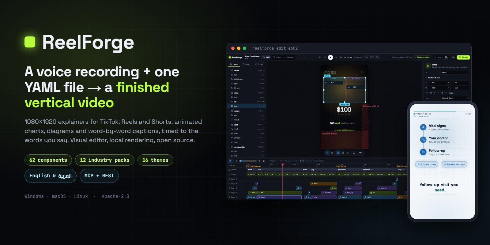
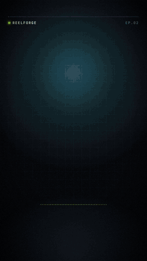
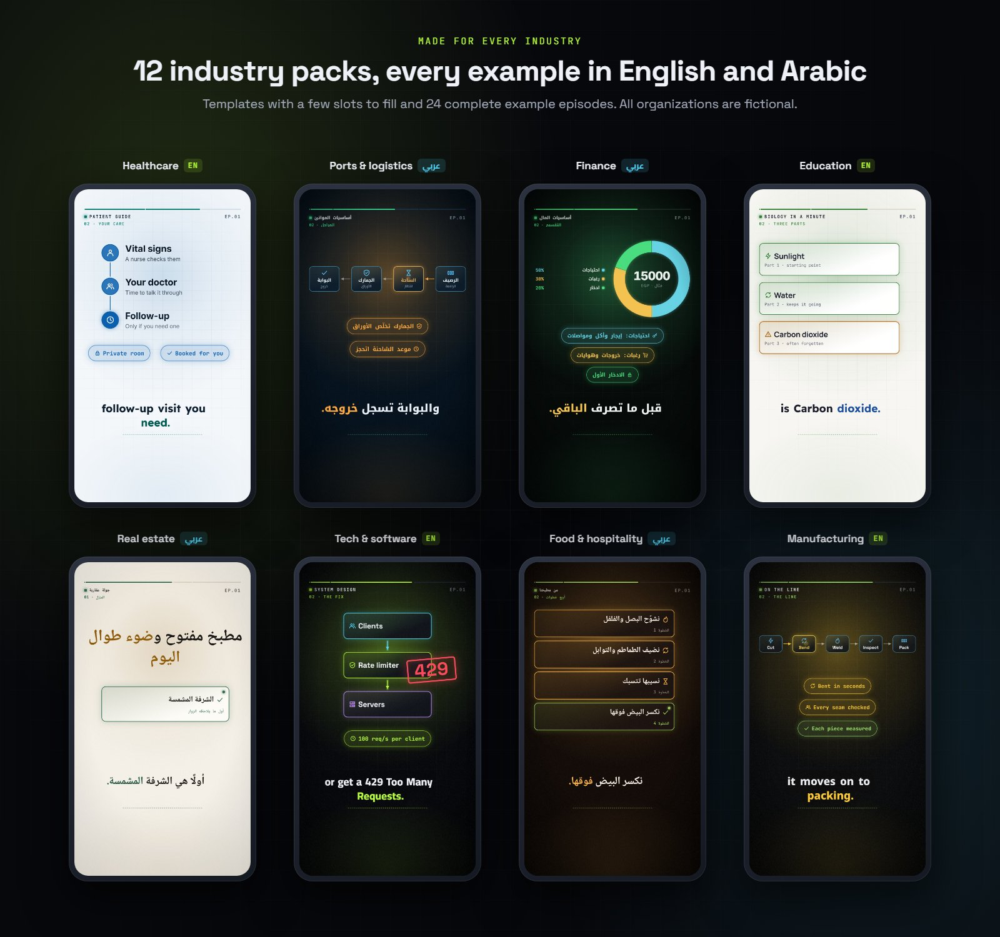
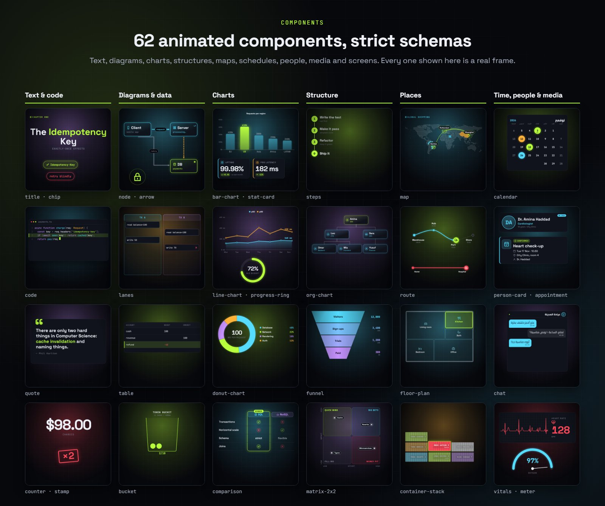
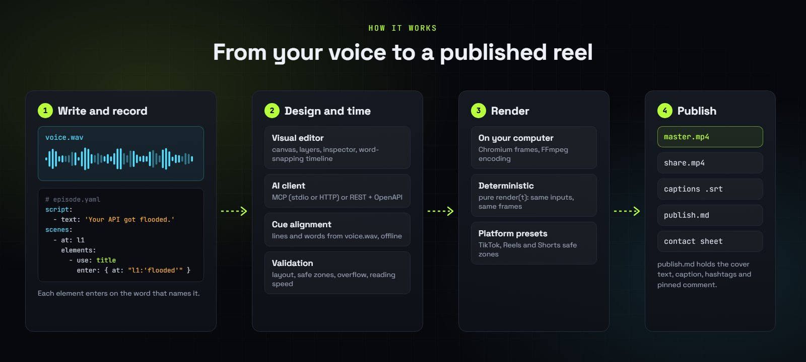
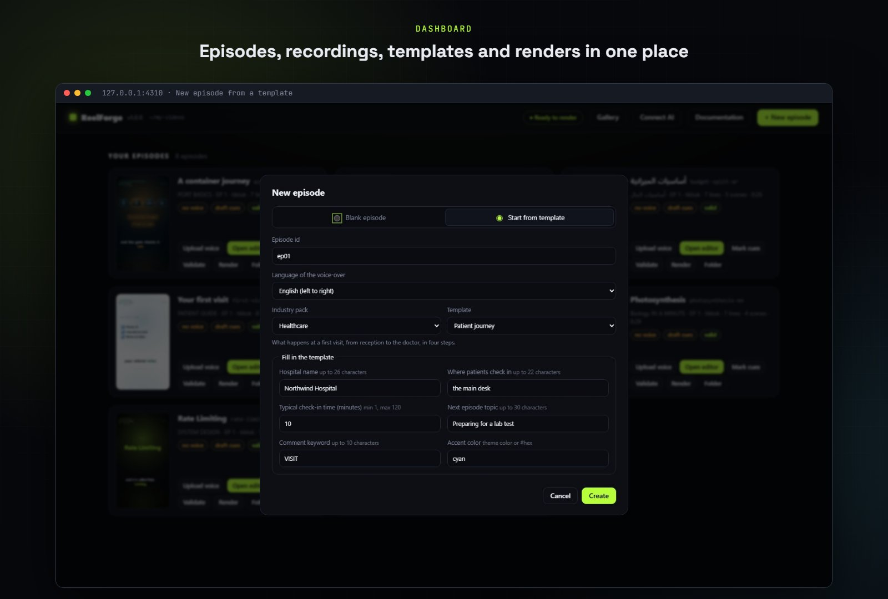
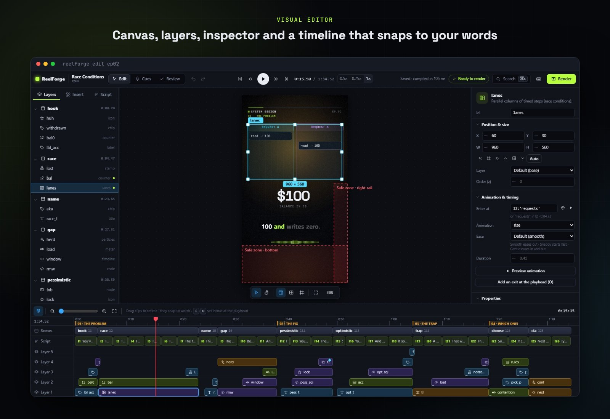
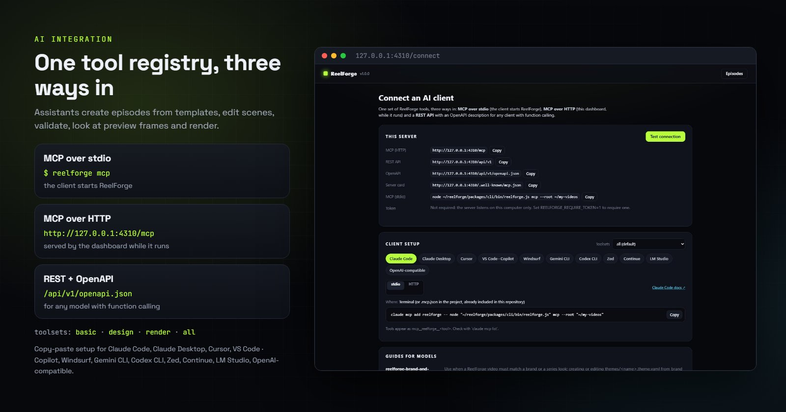
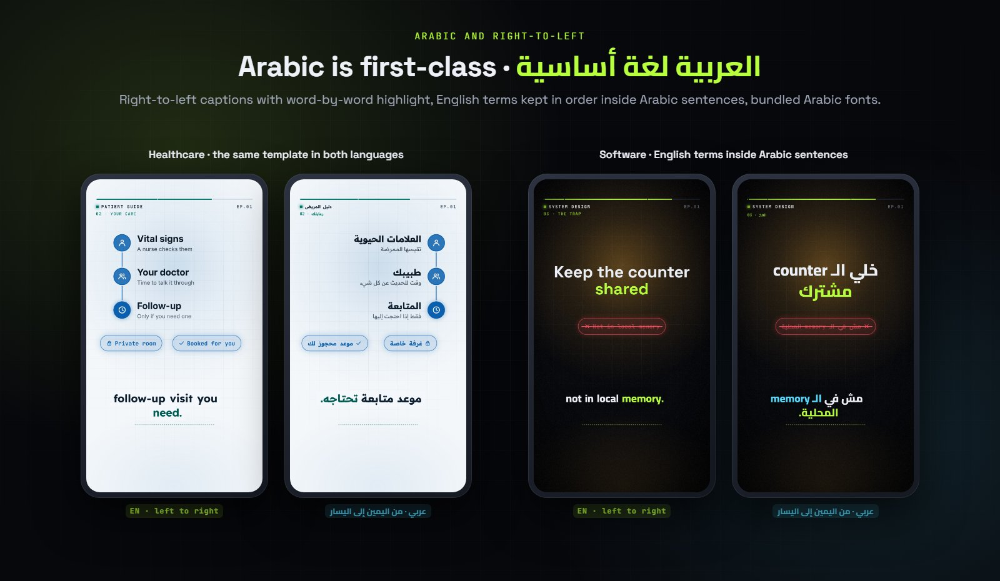

<div dir="rtl">

<p align="center">
  
</p>

<h1 align="center">ReelForge</h1>

<p align="center"><b>حوّل تسجيلاً صوتياً وملف YAML واحداً إلى فيديو شرح عمودي جاهز للنشر.</b></p>

<p align="center">
  <a href="https://github.com/TerminalDZ/vidcreat/actions/workflows/ci.yml"></a>
  <a href="LICENSE"></a>
  <a href="https://nodejs.org"></a>
  <a href="https://terminaldz.github.io/vidcreat/ar/"></a>
</p>

<p align="center">
  <a href="README.md">English</a> · <b>العربية</b> · <a href="https://terminaldz.github.io/vidcreat/ar/">التوثيق</a> · <a href="AGENTS.md">AGENTS.md</a>
</p>

<p align="center">
  
</p>

يُنتج ReelForge فيديوهات بمقاس 1080×1920 لمنصات TikTok وReels وShorts: رسوماً بيانية متحركة، وخطوات
ومقارنات ومخططات وكوداً، وترجمة نصية تظهر كلمة بكلمة بالعربية والإنجليزية، وكلها متزامنة مع الكلمات التي
تنطقها. تصمّم الفيديو في محرر مرئي، أو في YAML مباشرة، أو عبر مساعد ذكاء اصطناعي، ويصدّره ReelForge على
جهازك باستخدام Chromium وFFmpeg.

<p align="center">
  
</p>

## لماذا ReelForge

- **متزامن مع كلماتك.** يظهر كل عنصر عند نطق الكلمة التي تسمّيه (`enter: { at: "l3:'bucket'" }`). وتبقى الإشارات إلى الكلمات صالحة عند إعادة التسجيل، فنادراً ما تحتاج إلى كتابة الثواني يدوياً.
- **محرر مرئي ولوحة تحكم.** مساحة عمل بأدلة محاذاة ذكية، وطبقات، ولوحة خصائص مبنية على الـ schema، وخط
  زمني يلتصق بالكلمات المنطوقة، مع التراجع والإعادة، ولوحة تحكم للحلقات والتسجيلات والتصدير.
- **62 مكوّناً.** عناوين ومخططات، ورسوم بيانية بالأعمدة والخطوط والحلقات، وبطاقات مؤشرات، وخطوات ومسارات
  عمل، وهياكل تنظيمية، وقمعات، وخرائط، ومخططات طوابق، وجداول مواعيد، ومحادثات، وكود، ونماذج هواتف
  وغيرها، ولكل مكوّن schema صارمة.
- **12 حزمة قطاعية و16 ثيماً.** ‏36 قالباً تملأ فيها بضعة حقول، و24 حلقة نموذجية كاملة: مثال بالإنجليزية
  وآخر بالعربية لكل حزمة.
- **العربية والإنجليزية.** ترجمة نصية من اليمين إلى اليسار ومن اليسار إلى اليمين، وتحافظ الجمل العربية على
  ترتيب المصطلحات الإنجليزية داخلها (`الـ client`)، مع خطوط مضمّنة بترخيص OFL للغتين.
- **حتمي ومحلي.** تُرسم الإطارات بدالة `render(t)` نقية، فالمدخلات نفسها تعطي الإطارات نفسها دائماً. لا
  ذكاء اصطناعي في محرك الرسم، ولا تحويل للنص إلى كلام، ولا صور مولّدة، ولا خدمة سحابية.
- **فحوص قبل التصدير.** يتحقق ReelForge من الـ schema والـ cues والتخطيط والمناطق الآمنة للمنصات وتجاوز
  النص وسرعة القراءة، مع أرقام الأسطر وتلميحات للإصلاح.
- **مخرجات جاهزة للمنصات.** ملف MP4 رئيسي، وملف MP4 للمشاركة بحجم محدود، وترجمة (`.srt`)، وورقة
  لقطات، وملف `publish.md` فيه نص الغلاف والوصف والوسوم والتعليق المثبّت.
- **مساعدات محلية اختيارية.** تحدد محاذاة الكلام بداية كل سطر وكل كلمة من تسجيلك، ويقترح مساعد المشاهد
  مكوّنات لكل سطر. ينزّل الأمر `reelforge align --setup` نماذج الكلام مرة واحدة، وبعدها يعمل كل شيء دون
  اتصال بالإنترنت.

## لكل القطاعات

<p align="center">
  
</p>

لكل [حزمة قطاعية](packs/) ثيم خاص وقوالب ومثالان كاملان. كل الجهات الواردة في الأمثلة خيالية. ابدأ من
قالب في لوحة التحكم أو من سطر الأوامر:

</div>

```bash
./reelforge packs                                                    # list packs, templates and slots
./reelforge new clinic --pack healthcare --template patient-journey --lang ar
```

<div dir="rtl">

## المكوّنات

<p align="center">
  
</p>

لكل مكوّن schema صارمة وحركة دخول. راجع [مرجع المكوّنات](docs/components.md) لكل الخصائص، أو افتح
**Gallery** في لوحة التحكم لتصفّح المكوّنات والثيمات والحزم.

## كيف يعمل

<p align="center">
  
</p>

الحلقة ملف `episode.yaml` واحد: النص المنطوق (جملة واحدة في كل سطر)، والمشاهد، والعناصر داخل كل مشهد
موضوعة على مساحة 1080 × 1000.

</div>

```yaml
meta: { id: ep10, series: 'SYSTEM DESIGN', title: 'Rate Limiting', preset: tiktok, lang: en-US }
audio: { voice: voice.wav }
script:
  - text: 'Your API just got flooded with requests.'
scenes:
  - id: hook
    at: l1
    elements:
      - use: title
        props: { text: 'Flooded **API**' }
        place: { x: 60, y: 160, w: 960, h: 240 }
        enter: { at: "l1:'flooded'", anim: pop }
```

<div dir="rtl">

سجّل `voice.wav`، ثم حدّد الـ cues (تلقائياً بالأمر `reelforge align`، أو بالاستماع في المحرر)، وتحقق من
الحلقة، ثم صدّرها. يشرح [دليل الكتابة](docs/authoring.md) تعبيرات الوقت والتخطيط والحركة.

## بداية سريعة

المتطلبات: Node.js 22 أو أحدث، وFFmpeg 6 أو أحدث (يعرض المثبّت تثبيت FFmpeg).

</div>

```bash
git clone https://github.com/TerminalDZ/vidcreat.git && cd vidcreat
./install.sh            # Windows: install.bat
./start.sh              # Windows: start.bat · macOS: ReelForge.command → http://127.0.0.1:4310
```

<div dir="rtl">

تنشئ لوحة التحكم الحلقات (فارغة أو من قالب)، وتستقبل تسجيلك، وتحدد الـ cues، وتتحقق من الحلقة، وتصدّر
الفيديو. والخطوات نفسها من سطر الأوامر (`reelforge.cmd` على Windows):

</div>

```bash
./reelforge new clinic --pack healthcare --template patient-journey   # or: ./reelforge new ep10 --lang ar
./reelforge edit clinic                  # visual editor
./reelforge align clinic                 # cues for every line and word from voice.wav
./reelforge validate clinic              # checks with fix hints
./reelforge render clinic --silent       # render without a voice to preview
```

<p align="center">
  
</p>

<p align="center">
  
</p>

<div dir="rtl">

## الربط مع الذكاء الاصطناعي

<p align="center">
  
</p>

سجل أدوات واحد وثلاث طرق للوصول إليه. ينشئ المساعد الحلقات من القوالب، ويعدّل المشاهد، ويتحقق منها،
ويطّلع على إطارات المعاينة، ثم يصدّر الفيديو.

</div>

```bash
./reelforge mcp                                  # MCP over stdio (the client starts ReelForge)
./reelforge studio                               # MCP over HTTP at http://127.0.0.1:4310/mcp
curl http://127.0.0.1:4310/api/v1/openapi.json   # REST + OpenAPI for any function-calling model
./reelforge mcp --toolsets basic                 # fewer tools for small models (basic, design, render, all)
open http://127.0.0.1:4310/connect               # copy-paste setup for each client
```

<div dir="rtl">

يتضمن المشروع إعدادات MCP جاهزة لعدة عملاء (`.mcp.json` و`.cursor/mcp.json` و`.vscode/mcp.json`
و`.gemini/settings.json`). يبدأ الوكلاء بقراءة [AGENTS.md](AGENTS.md) وأدلة المهام في [skills/](skills/).
تستمع لوحة التحكم افتراضياً على `127.0.0.1`، وراجع [SECURITY.md](SECURITY.md) لمعرفة الـ token المطلوب عند
تشغيلها على عنوان آخر.

## العربية والكتابة من اليمين إلى اليسار

<p align="center">
  
</p>

اضبط `lang: ar-EG` فتُعرض الترجمة النصية من اليمين إلى اليسار مع التمييز نفسه كلمة بكلمة. تبقى المصطلحات
التقنية الإنجليزية في ترتيبها الصحيح داخل الجمل العربية، وكل قوالب الحزم وأمثلتها متوفرة باللغتين. والتوثيق
متاح أيضاً [بالعربية](https://terminaldz.github.io/vidcreat/ar/).

## التوثيق

- [الدليل بالعربية](https://terminaldz.github.io/vidcreat/ar/) · [English guide](https://terminaldz.github.io/vidcreat)
- نسخة تعمل دون اتصال: يبني الأمر `pnpm docs` الملف `documentation/index.html`
- [دليل الكتابة](docs/authoring.md) · [مرجع المكوّنات](docs/components.md)
- المعمارية: [بالعربية](docs/architecture-ar.md) · [بالإنجليزية](docs/architecture.md) ·
  [سجلات القرارات المعمارية (ADRs)](docs/adr/)
- لوكلاء الذكاء الاصطناعي: [AGENTS.md](AGENTS.md) · [skills/](skills/)

## حالة المشروع وخطة التطوير

ReelForge 1.0 هو الإصدار العام الأول، وراجع [سجل التغييرات](CHANGELOG.md). تتبع أسماء الأدوات ومعاملاتها
الإصدار الدلالي (semver) وفق [ADR-014](docs/adr/014-one-tool-registry-three-transports.md). الخطوات التالية:

- **مقاسات أخرى.** يصدّر الإصدار 1.0 بنسبة 9:16 فقط. تأتي المقاسات المربعة و4:5 و16:9 بعد نموذج تخطيط نسبي
  ([ADR-016](docs/adr/016-vertical-only-formats.md)).
- **عيّنة محاذاة عربية.** تسجيل لكلام عربي حقيقي مع توقيتات كلمات مراجَعة يدوياً، لقياس دقة الـ cues
  التلقائية بالعربية ([fixtures/align/ar-real](fixtures/align/ar-real/README.md)). نرحب بالمساهمة فيها.

## المساهمة

نرحب بالمكوّنات والثيمات والحزم القطاعية وأدلة المهام (skills). يشرح [CONTRIBUTING.md](CONTRIBUTING.md)
الإعداد على Windows وmacOS وLinux، والمعمارية، وبوابة الجودة
(`pnpm build && pnpm typecheck && pnpm lint && pnpm test:unit && pnpm test:browser`). للأسئلة:
[Discussions](https://github.com/TerminalDZ/vidcreat/discussions)، وللأخطاء:
[Issues](https://github.com/TerminalDZ/vidcreat/issues)، وراجع أيضاً [قواعد السلوك](CODE_OF_CONDUCT.md)
و[الدعم](SUPPORT.md).

## الأمان

تستمع الخوادم المحلية على `127.0.0.1`، وتتحقق من ترويسات Host وOrigin، ولا تقبل عمليات الكتابة إلا بصيغة
JSON. يُرجى الإبلاغ عن الثغرات بشكل خاص كما يشرح [SECURITY.md](SECURITY.md).

## الترخيص

الكود مرخّص بـ [Apache License 2.0](LICENSE) ([NOTICE](NOTICE))، والتوثيق ونصوص الأمثلة والنصوص النموذجية
في الثيمات مرخّصة بـ [CC BY 4.0](docs/LICENSE-CONTENT.md). الفيديوهات التي تصنعها ملكك. تحتفظ المكوّنات
الخارجية بتراخيصها ([THIRD-PARTY-NOTICES.md](THIRD-PARTY-NOTICES.md))، أما FFmpeg وChromium ونماذج الكلام
الاختيارية فتُثبَّت بشكل منفصل ولا تُوزَّع مع ReelForge.

</div>
