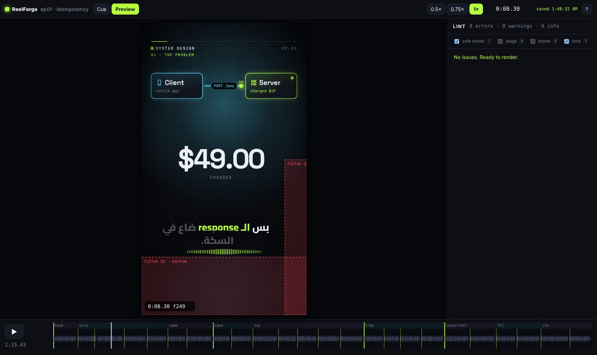

# ReelForge

**Voice recording + one YAML file → a finished vertical explainer video** (1080×1920, 30 fps) for TikTok,
Instagram Reels and YouTube Shorts. Animated diagrams, code that types itself, race-condition lanes,
stamps, word-by-word Arabic captions with correctly mixed English terms, procedural sound effects and
platform-ready encoding.

- **Offline, no running costs.** No network after install, no subscription, no per-video fees.
- **No AI.** No speech recognition, no TTS, no generative models. Timing comes from cues you mark.
- **Deterministic.** The same inputs always give the same frames (`render(t)` is a pure function).
- **Arabic first.** RTL captions with English terms, `الـ client` kept together, punctuation on the right side.

| Command                                    | What it does                                                                                                    |
| ------------------------------------------ | --------------------------------------------------------------------------------------------------------------- |
| `reelforge studio`                         | the project dashboard: create, upload voice, mark cues, preview, validate, render, play outputs                 |
| `reelforge new <id>`                       | create `episodes/<id>/episode.yaml` from a commented template                                                   |
| `reelforge cue <id>`                       | studio: mark the start of each script line while listening (writes `cues.json`)                                 |
| `reelforge dev <id>`                       | studio: live preview synced to the audio, safe-zone overlay, lint panel, hot reload                             |
| `reelforge validate <id>`                  | schema, cues, timing, overlap, safe zones, text overflow (V-1…V-13)                                             |
| `reelforge render <id>`                    | `out/<id>.master.mp4`, `out/<id>.share.mp4`, `.srt`, `.sheet.jpg`, `publish.md` (`--all` renders every episode) |
| `reelforge snap <id> <t…>`                 | PNG frames at times (or `l7`, `l7:'word'`) plus a contact sheet; `--cover` writes `out/<id>.cover.png`          |
| `reelforge theme new <name> --accent #hex` | generate a series theme from one accent color                                                                   |
| `reelforge doctor [--fix]`                 | check Node, ffmpeg, Chromium and fonts                                                                          |
| `reelforge schema`                         | write the JSON Schema for editor autocompletion                                                                 |

## Screenshots



More in [docs/screenshots](docs/screenshots/README.md): cue marker, word mode, lint panel, error overlay,
every Season 1 episode, the component gallery and the CLI.

## Install

Requirements: **Node.js 22 LTS** and **ffmpeg 6+** (the installers offer to install ffmpeg for you).
Full instructions with screenshots: `documentation/index.html`.

| System        | Install                    | Open the dashboard               |
| ------------- | -------------------------- | -------------------------------- |
| Windows 10/11 | double-click `install.bat` | double-click `start.bat`         |
| macOS         | `./install.sh` in Terminal | double-click `ReelForge.command` |
| Linux         | `./install.sh`             | `./start.sh`                     |

The installer checks Node.js, installs ffmpeg (with your confirmation), installs the dependencies,
downloads the pinned Chromium used for rendering and runs `reelforge doctor`. The command line is
`reelforge.cmd` (Windows) or `./reelforge` (macOS/Linux).

**From source (developers):** `corepack enable && pnpm install && pnpm build && pnpm reelforge doctor --fix`.

## Tutorial: a 30-second episode

```bash
./reelforge new ep10 --series "SYSTEM DESIGN"
```

1. **Write the script.** Open `episodes/ep10/episode.yaml`. Put one spoken sentence per `script` line.
2. **Record** `episodes/ep10/voice.wav` with any recorder (no recording yet? `./reelforge cue ep10 --draft`
   writes estimated cues so you can preview anyway).
3. **Mark cues.** `./reelforge cue ep10` opens the studio. Press **Space** at the start of each line
   (1 / 2 / 3 switch to 0.5× / 0.75× / 1×). **Backspace** undoes, **←/→** nudge the selected cue,
   click a line to re-mark it, **W** marks individual words. Every change is saved to `cues.json`.
4. **Describe scenes** with components (see [docs/components.md](docs/components.md)) and make
   elements enter on the words that name them: `enter: { at: "l3:'Idempotency'" }`.
5. **Preview** with `./reelforge dev ep10`. Save the YAML and the preview reloads in place.
   **Z** shows the platform safe zones, **E** element boxes, **?** all shortcuts.
6. **Validate** with `./reelforge validate ep10`. Each issue has `file:line:col` and a fix hint.
7. **Render** with `./reelforge render ep10`, then upload `out/ep10.share.mp4` with the caption from
   `out/publish.md`.

Try it on the bundled examples: `./reelforge dev examples/season1/ep01` (they ship with draft cues;
record a `voice.wav` and re-mark to render them, or `./reelforge render examples/season1/ep01 --silent`).

## Render options

```
reelforge render <id> [--preset tiktok|reels|shorts] [--workers N] [--from 12 --to 20]
                      [--share-size 28] [--no-sfx] [--no-share] [--lossless] [--fast]
                      [--silent] [--keep-tmp] [--no-measure] [--json] [--verbose]
```

Configuration follows 12-Factor: flags, or environment variables
`REELFORGE_ROOT`, `REELFORGE_PRESET`, `REELFORGE_WORKERS`, `REELFORGE_SHARE_SIZE`, `REELFORGE_JPEG_QUALITY`,
`REELFORGE_PORT`, `REELFORGE_NO_OPEN`, `REELFORGE_FFMPEG`, `REELFORGE_FFPROBE`, `REELFORGE_CHROMIUM`.
`NO_COLOR` disables colors. `--json` prints machine-readable output (progress events while rendering).
Ctrl+C aborts cleanly and removes partial files.

Outputs (verified with ffprobe): H.264 High, yuv420p, 30/1 fps CFR, AAC 48 kHz, `moov` atom first.
The master uses CRF 18; the share file is two-pass encoded to fit `--share-size` MB.
The voice is mastered to −14 LUFS (two-pass loudnorm), SFX are ducked under it, and a limiter keeps peaks below −0.45 dBFS.

## Repository layout

```
packages/
  audio/     WAV io, envelopes, onset detection, procedural SFX
  core/      schema, time expressions, captions, themes, presets, compiler, lint
  runtime/   browser page: pure render(t), series chrome, 21 components
  renderer/  Chromium workers, ffmpeg pipeline, measuring pass, doctor
  studio/    localhost server + cue marker / preview client (Vite)
  cli/       the `reelforge` command
themes/      default, season1, workshop
presets/     tiktok, reels, shorts (editable)
examples/season1/ep01…ep09
fixtures/    mini (integration), golden frames, seeded lint bugs
docs/        PRD, SRS, authoring guide, component reference, ADRs
```

Architecture decisions are in [docs/adr](docs/adr). The compiled timeline (`Timeline` in
`packages/core/src/types.ts`) is the only contract between the compiler and the runtime.

## Development

```bash
pnpm build             # all packages
pnpm test              # unit + browser/integration suites
pnpm test:unit         # fast, no browser
pnpm coverage          # unit coverage (≥ 85% lines on core/runtime/audio)
pnpm typecheck && pnpm lint
pnpm check:licenses    # dependency license allow-list check
UPDATE_GOLDEN=1 pnpm test:browser   # refresh golden frames after an intended visual change
node scripts/gen-components-doc.mjs # regenerate docs/components.md from the schemas
```

Adding a component: add its prop schema and defaults in `packages/core/src/components/`, its DOM
implementation in `packages/runtime/src/components/`, an entry in the gallery fixture
(`fixtures/golden/components/episode.yaml`), then refresh the golden frames.

## License

Commercial software sold on Envato Market (CodeCanyon) under the Regular / Extended License — see
[LICENSE.md](LICENSE.md). The videos you make are yours. Open-source components (bundled fonts under the
SIL OFL 1.1, npm packages under MIT / ISC / Apache-2.0) keep their own licenses — see
[THIRD-PARTY-NOTICES.md](THIRD-PARTY-NOTICES.md). FFmpeg and Chromium are installed separately.
