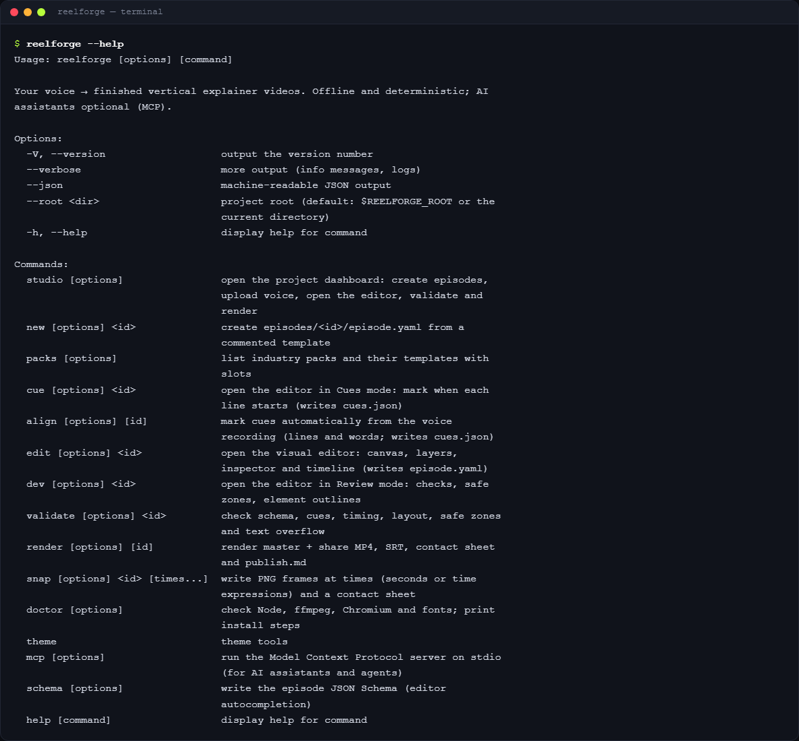
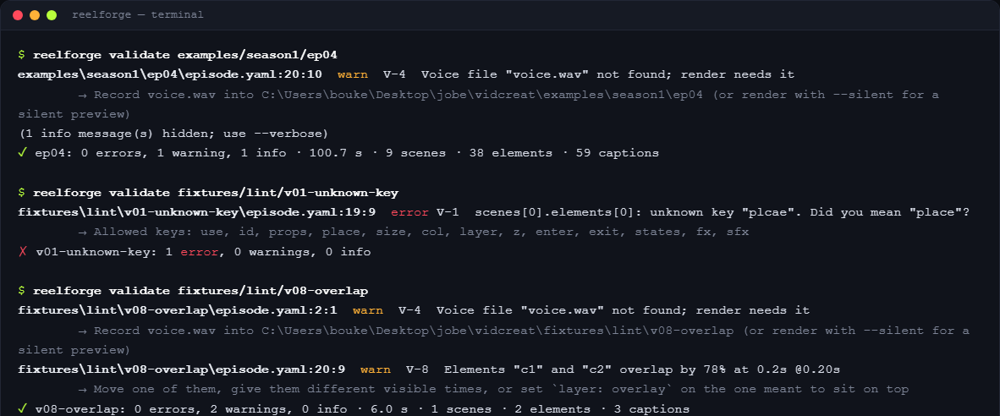

# سطر الأوامر

على Windows استخدم `reelforge.cmd`، وعلى macOS وLinux استخدم `./reelforge` (أو أضف المجلد إلى PATH). ومن نسخة
المصدر يعمل `pnpm reelforge` على كل الأنظمة. تجد كل أمر وكل خيار في [مرجع CLI](../reference/cli.md) المولّد
من تعريف الأوامر نفسه.

## الأوامر الأساسية

| الأمر                                                                          | الوصف                                                                               |
| ------------------------------------------------------------------------------ | ----------------------------------------------------------------------------------- |
| `reelforge studio [--port <n>] [--host <address>] [--no-open]`                 | فتح لوحة التحكم (الافتراضي `http://127.0.0.1:4310`)                                 |
| `reelforge new <id> [--series <name>] [--episode <n>] [--lang en\|ar]`         | إنشاء `episodes/<id>/episode.yaml` من القالب الفارغ المشروح                         |
| `reelforge new <id> --pack <pack> [--template <t>] [--lang ar] [--slot k=v …]` | إنشاؤها من قالب قطاعي مع cues تقديرية (راجع [القوالب](templates-and-packs.md))      |
| `reelforge packs [--lang en\|ar]`                                              | عرض الحزم القطاعية وقوالبها وحقولها (`--json` للتفاصيل الكاملة)                     |
| `reelforge edit <id>`                                                          | فتح المحرر المرئي                                                                   |
| `reelforge cue <id> [--draft]`                                                 | فتح المحرر في وضع Cues (يكتب `--draft` cues تقديرية بدلاً من ذلك)                   |
| `reelforge align <id> [--engine dsp\|whisper] [--force] [--dry-run]`           | تحديد الـ cues لكل سطر وكل كلمة من التسجيل (راجع [التوقيت](timing.md))              |
| `reelforge align --setup [--model tiny\|base\|small]` / `--status`             | تثبيت نماذج الكلام الاختيارية أو عرض حالتها (مرة واحدة، ~180 MB)                    |
| `reelforge dev <id>`                                                           | فتح المحرر في وضع Review                                                            |
| `reelforge mcp [--toolsets basic,design,render]`                               | تشغيل خادم MCP لمساعدي الذكاء الاصطناعي (راجع [التكامل مع الذكاء الاصطناعي](ai.md)) |
| `reelforge validate <id> [--strict] [--no-measure]`                            | فحص كل شيء؛ رمز الخروج 1 عند الأخطاء (أو التحذيرات مع `--strict`)                   |
| `reelforge render <id> [options]` / `--all`                                    | التصدير (راجع [التصدير والنشر](rendering.md))                                       |
| `reelforge snap <id> <times…> [--every 5] [--cover]`                           | صور PNG وورقة لقطات؛ الأزمنة مثل `12.5` و`l7` و`"l7:'word'"`                        |
| `reelforge doctor [--fix]`                                                     | فحص البيئة؛ ومع `--fix` يُنزّل Chromium                                             |
| `reelforge theme new <name> --accent <#hex> [--mode light\|dark] [--font <f>]` | توليد ثيم كامل (بتباين مفحوص) من لون تمييز واحد                                     |
| `reelforge schema [--out <file>]`                                              | كتابة JSON Schema للإكمال التلقائي في المحررات                                      |

الخيارات العامة: `--json` (مخرجات قابلة للقراءة الآلية، وأحداث تقدم أثناء التصدير)، و`--verbose`، و`--root <folder>`
(مجلد المشروع؛ الافتراضي هو المجلد الحالي).

خيارات الأمر `reelforge align`: ‏`--engine auto|dsp|whisper` (القيمة auto تستخدم Whisper إن كان مثبّتاً، وإلا
فكشف الوقفات)، و`--model tiny|base|small`، و`--no-vad`، و`--no-words` (cues الأسطر فقط)، و`--force` (استبدال
الـ cues التي حددتها يدوياً)، و`--dry-run` (طباعة النتيجة دون كتابتها). ويتجاوز الخياران `reelforge render --denoise`
و`--no-denoise` قيمة `audio.denoise`.

## متغيرات البيئة

| المتغير                                 | المعنى                                                         |
| --------------------------------------- | -------------------------------------------------------------- |
| `REELFORGE_ROOT`                        | مجلد المشروع                                                   |
| `REELFORGE_PRESET`                      | الـ preset الافتراضي                                           |
| `REELFORGE_WORKERS`                     | عدد عمليات التصدير                                             |
| `REELFORGE_SHARE_SIZE`                  | حجم ملف النشر بالميغابايت                                      |
| `REELFORGE_JPEG_QUALITY`                | جودة التقاط الإطارات (الافتراضي 95)                            |
| `REELFORGE_PORT`                        | منفذ لوحة التحكم أو المحرر                                     |
| `REELFORGE_HOST`                        | عنوان ربط لوحة التحكم (الافتراضي 127.0.0.1)                    |
| `REELFORGE_ALLOWED_HOSTS`               | أسماء Host إضافية تقبلها لوحة التحكم (مفصولة بفواصل)           |
| `REELFORGE_REQUIRE_TOKEN`               | القيمة `1` تشترط الـ token على `/mcp` و`/api/v1` في كل الحالات |
| `REELFORGE_NO_OPEN`                     | عدم فتح المتصفح تلقائياً                                       |
| `REELFORGE_FFMPEG` و`REELFORGE_FFPROBE` | مسارا ffmpeg وffprobe                                          |
| `REELFORGE_CHROMIUM`                    | مسار ملف Chromium التنفيذي                                     |
| `REELFORGE_CACHE`                       | مجلد نماذج الكلام الاختيارية                                   |
| `REELFORGE_CONFIG_DIR`                  | مجلد الإعدادات (`llm.json` والـ token)                         |
| `REELFORGE_LLM_*`                       | النموذج اللغوي لاقتراح المشاهد (راجع [النماذج](ai.md#models))  |
| `NO_COLOR`                              | إيقاف الألوان                                                  |
