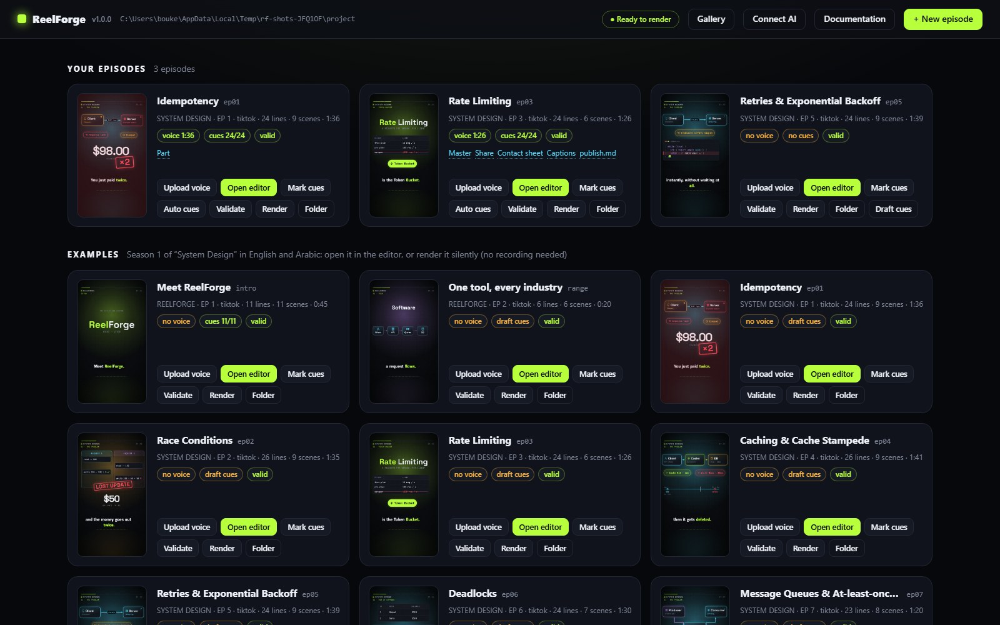
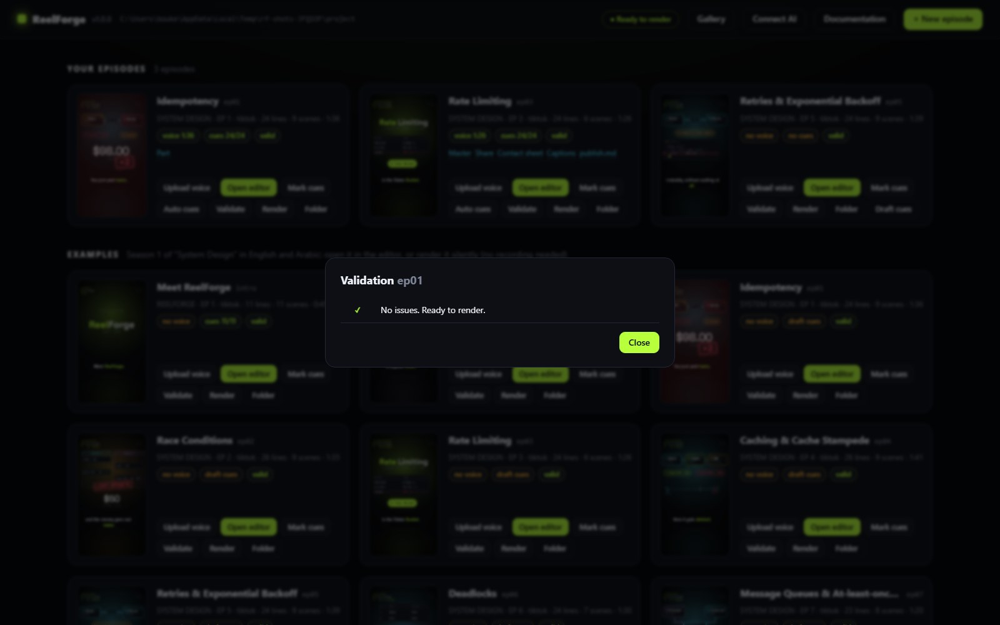
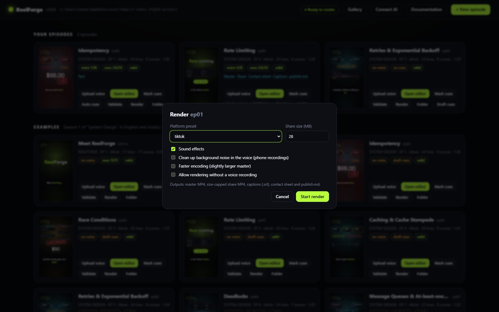
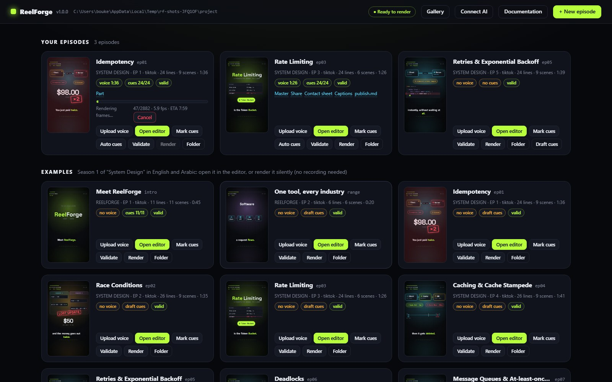
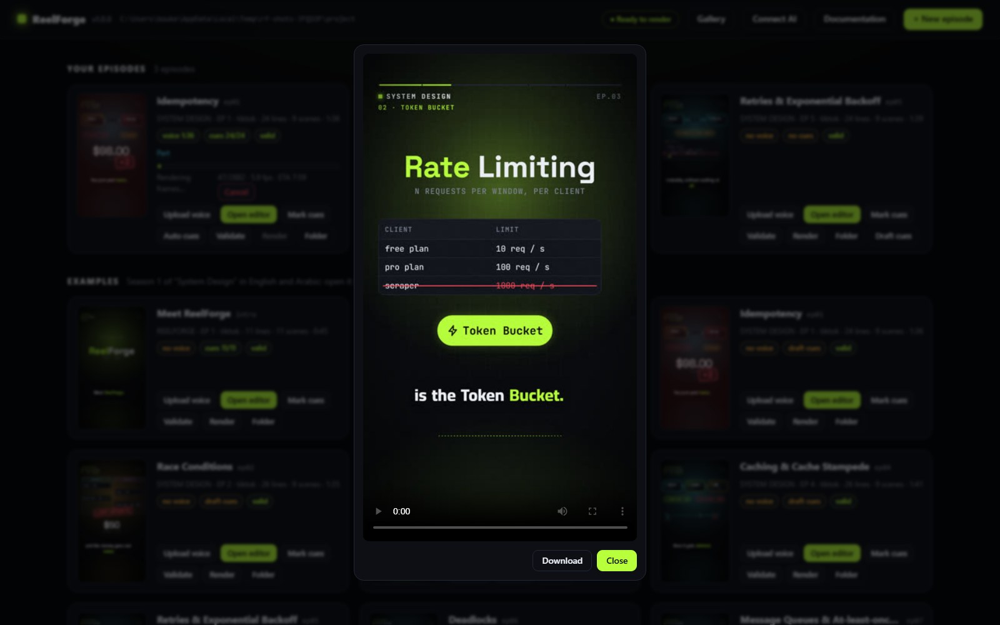

# لوحة التحكم

يفتح الأمر `reelforge studio` (أو `start.bat` أو `start.sh`) لوحة التحكم على العنوان `http://127.0.0.1:4310`.
تعرض اللوحة **حلقاتك** (مجلد `episodes/`) و**الأمثلة**.

تعرض كل بطاقة صورة مصغرة حية، والسلسلة، والـ preset، وعدد الأسطر والمشاهد، والمدة، وشارات الحالة:

| الشارة                                  | المعنى                                                           |
| --------------------------------------- | ---------------------------------------------------------------- |
| `voice 1:15` / `no voice`               | هل يوجد تسجيل صوتي، وما مدته                                     |
| `cues 24/24` / `draft cues` / `no cues` | عدد الجمل التي حُددت بدايتها؛ أما الـ cues التقديرية فمجرد تقدير |
| `valid` / `2 warnings` / `1 error`      | نتيجة الفحوص الثابتة (مرّر المؤشر فوق الخطأ لقراءته)             |

| الزر             | وظيفته                                                                                                                                         |
| ---------------- | ---------------------------------------------------------------------------------------------------------------------------------------------- |
| **Upload voice** | اختر تسجيلاً فيُحوَّل إلى `voice.wav` ‏(48 kHz)                                                                                                |
| **Open editor**  | يفتح المحرر المرئي للحلقة في تبويب جديد (راجع [المحرر](editor.md))                                                                             |
| **Mark cues**    | يفتح المحرر في وضع Cues، جاهزاً لتحديد بداية كل جملة                                                                                           |
| **Auto cues**    | يحاذي كل سطر وكل كلمة مع التسجيل (راجع [التوقيت والـ cues والمحاذاة](timing.md))                                                               |
| **Validate**     | يشغّل كل الفحوص، بما فيها فحصا تجاوز النص لصندوقه وطول الترجمة النصية في متصفح دون واجهة (headless)                                            |
| **Render**       | اختر الـ preset وحجم ملف النشر والمؤثرات والسرعة؛ ويظهر التقدم وعدد الإطارات في الثانية والوقت المتبقي مباشرةً، ويوقف **Cancel** التصدير بأمان |
| **Folder**       | يفتح مجلد الحلقة في مدير الملفات                                                                                                               |
| **Draft cues**   | (عند غياب الـ cues فقط) يقدّر التوقيت من طول النص                                                                                              |

للبدء من قالب قطاعي انقر **+ New episode** ثم اختر **Start from template**: اختر حزمة وقالباً، واملأ الحقول
واللغة، فتُفتح الحلقة في المحرر (راجع [القوالب والحزم](templates-and-packs.md)).

تظهر المخرجات الجاهزة كروابط على البطاقة، وتُفتح الفيديوهات في مشغّل فيه زر **Download**.

تعرض صفحة **Gallery** ‏(`/gallery`) كل ما يمكنك استخدامه في حلقاتك. يسرد تبويب **Components** المكونات الـ 62
مصنفةً حسب الفئة، مع مربع بحث وإطار معاينة من معرض المكونات؛ وعند النقر على مكوّن تظهر خصائصه (props) ومقتطف YAML
جاهز للنسخ. ويعرض تبويب **Themes** معاينة لكل theme مدمج أو خاص بالمشروع، مبنيةً على ألوانه وخطوطه، مع وضعه
(فاتح أو داكن) ونتيجة فحص التباين وفق WCAG. أما تبويب **Packs** فيسرد الحزم القطاعية بالإنجليزية أو العربية، ويفتح
الزر **Use this template** نافذة الحلقة الجديدة وقد اختير فيها القالب.

تقدم صفحة **Connect AI** ‏(`/connect`) إعدادات جاهزة للنسخ لعملاء الذكاء الاصطناعي؛ راجع
[التكامل مع الذكاء الاصطناعي](ai.md).

يفتح الزر **Documentation** هذا التوثيق على المسار `/docs/` من مجلد ReelForge على جهازك، فيعمل دون اتصال. وفيه
صفحات الموقع نفسها بالإنجليزية والعربية (بدّل بينهما من قائمة اللغة)، مع البحث.

لا يعمل إلا تصدير واحد في كل مرة. تستمع لوحة التحكم افتراضياً على `127.0.0.1`، فلا تصل إليها أجهزة أخرى.
ويربطها الخيار `--host` بعنوان آخر، وعندها تشترط نقاط الوصول (endpoints) الخاصة بالذكاء الاصطناعي token من
نوع bearer (راجع
[الأمان](ai.md#security)).
