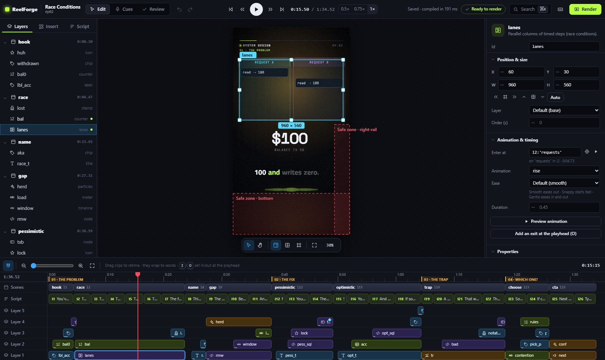
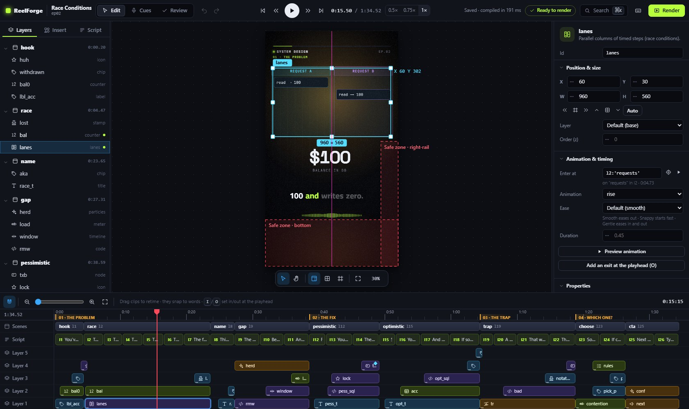
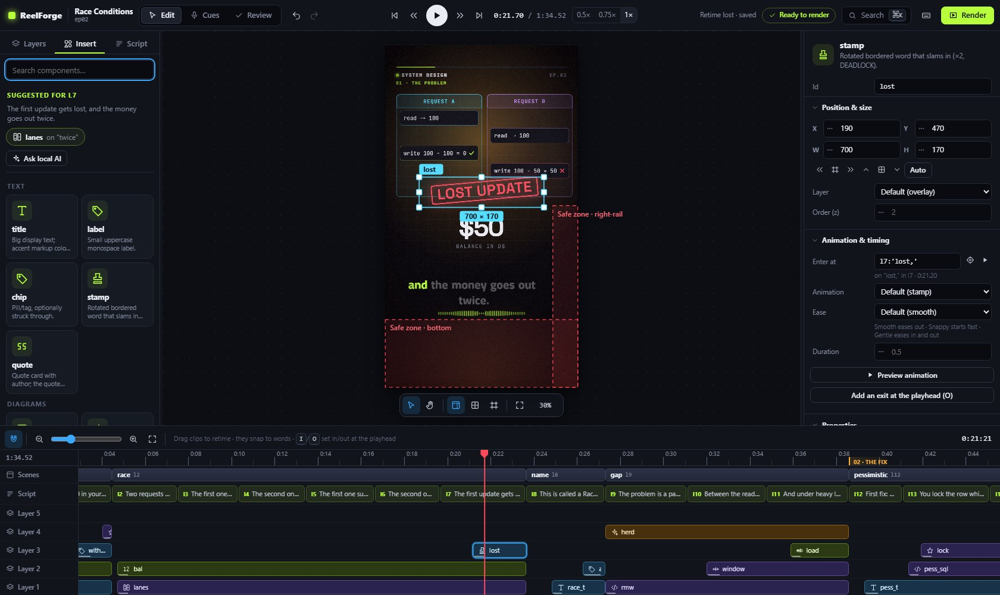
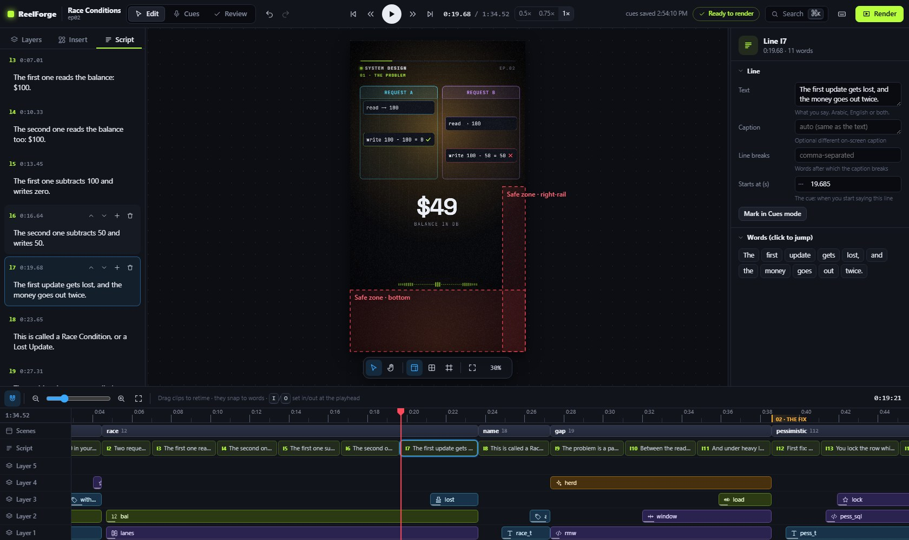
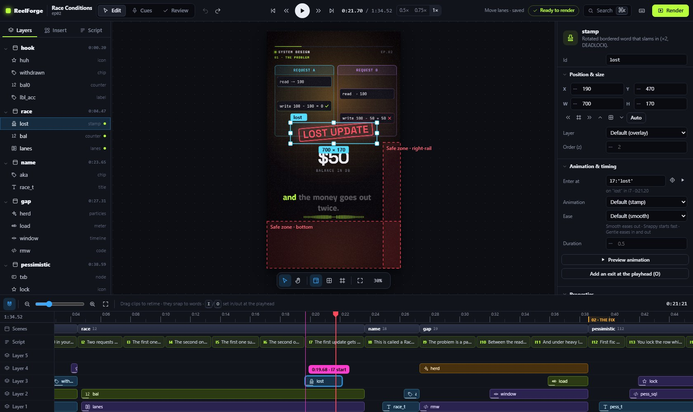
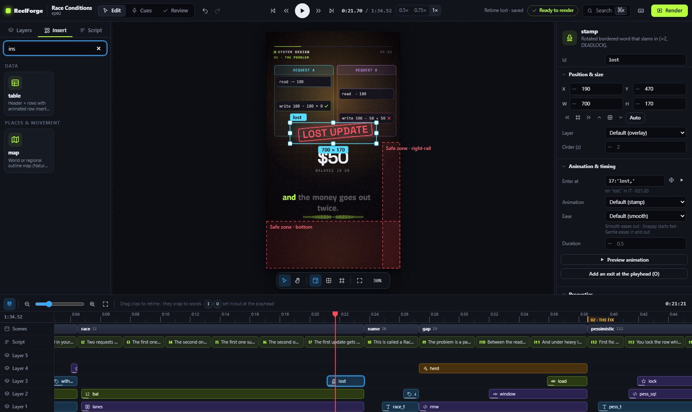
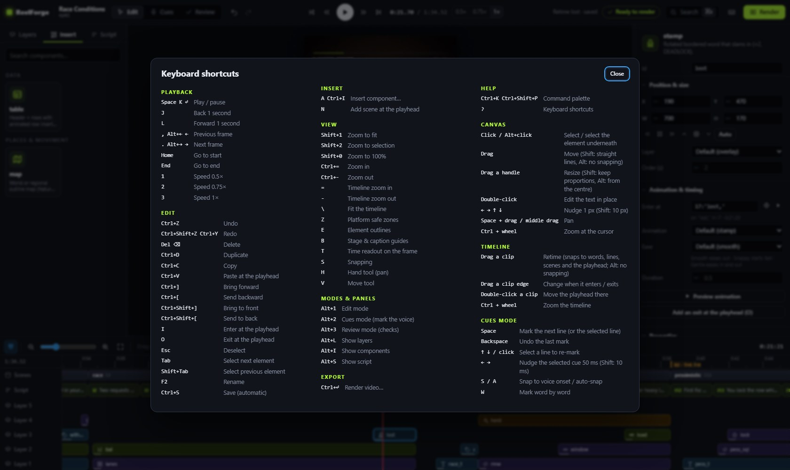
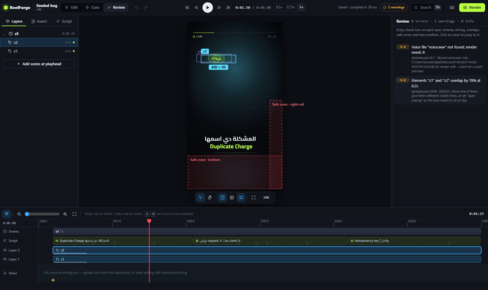
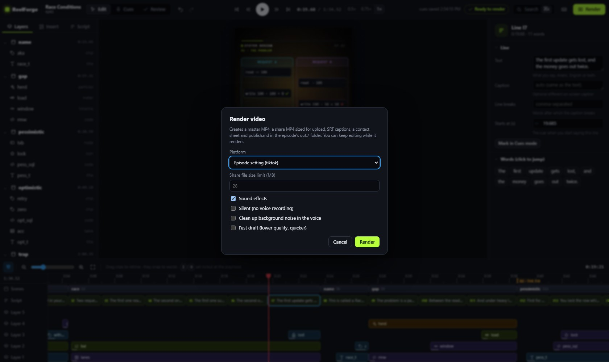

# المحرر

المحرر هو المكان الذي تصمم فيه الحلقة. يعمل مثل برنامج تصميم مبني فوق خط زمني للفيديو، لكنه مصمَّم لمهمة
واحدة: أن تضع مكوّنات متحركة على الإطار الحقيقي بمقاس 1080×1920 وتضبط توقيتها على الكلمات التي تنطقها.

افتحه من لوحة التحكم بزر **Open editor**، أو شغّل `reelforge edit <id>`. يفتحه الأمر `reelforge cue <id>` في
وضع Cues، والأمر `reelforge dev <id>` في وضع Review.

| المنطقة                  | ما تحتويه                                                                                                |
| ------------------------ | -------------------------------------------------------------------------------------------------------- |
| **الشريط العلوي**        | الأوضاع (Edit وCues وReview)، والتراجع والإعادة، والتشغيل والسرعة، والحالة، والفحوص، والبحث، و**Render** |
| **اللوحة اليسرى**        | **Layers** (المشاهد ثم العناصر)، و**Insert** (كل المكوّنات)، و**Script** (أسطرك)                         |
| **مساحة العمل (Canvas)** | الإطار الحقيقي، مرسوماً بالمحرك نفسه الذي يرسم الفيديو النهائي، ومتزامناً مع صوتك                        |
| **اللوحة اليمنى**        | **لوحة الخصائص** (Inspector) لما حددته (أو إعدادات الحلقة عند عدم تحديد شيء)                             |
| **الخط الزمني**          | الفصول والمشاهد وأسطر النص ومسار لكل طبقة، وموجة صوتك مع المؤثرات                                        |

يُكتب كل تعديل في `episode.yaml` فوراً مع الحفاظ على تعليقاتك وتنسيقك. ويمكن التراجع عن أي تعديل
(‏**⌘Z** أو **Ctrl+Z**)، بما في ذلك تعديلات الـ cues. يمكنك إبقاء `episode.yaml` مفتوحاً في محرر نصوص في الوقت
نفسه، وتظهر التعديلات التي تجريها هناك في المحرر بمجرد الحفظ.

## مساحة العمل (Canvas)

- **انقر** على عنصر لتحديده، ويحدد **Alt مع النقر** العنصر الذي تحته. ويظهر إطار حول العنصر عند المرور فوقه.
- **اسحب** للتحريك. تلتصق أدلة المحاذاة الذكية بمركز الإطار ومنطقة المشهد والعناصر الأخرى. اضغط **Shift**
  للتحريك في خط مستقيم، أو **Alt** لإيقاف الالتصاق.
- **اسحب مقبضاً** لتغيير الحجم. اضغط **Shift** للحفاظ على النسب، أو **Alt** لتغيير الحجم من المركز.
- استخدم **مفاتيح الأسهم** للتحريك بمقدار 1 px (و**Shift** بمقدار 10 px).
- **انقر مرتين** على `title` أو `label` أو `chip` أو `stamp` أو `quote` أو `node` أو بطاقة الختام **لتعديل
  نصه في مكانه**. اضغط **Enter** للحفظ أو **Esc** للإلغاء.
- **اسحب مكوّناً** من **Insert** إلى مساحة العمل لإضافته في ذلك الموضع.
- **كبّر** بـ **⌘/Ctrl مع عجلة الفأرة**، أو **Shift+1** (ملاءمة)، أو **Shift+2** (التحديد)، أو **Shift+0**
  ‏(100%). **تنقّل** بالعجلة، أو بالضغط المستمر على **Space**، أو بأداة **H**.
- يبدّل شريط الأدوات العائم عرض **المناطق الآمنة** (‏**Z**، حيث ترسم TikTok وReels وShorts أزرارها)، و**أدلة
  المسرح والترجمة النصية** (‏**B**)، و**حدود العناصر** (‏**E**).

## الطبقات والإدراج والنص

تعرض **Layers** كل مشهد وعناصره، وما في أعلى القائمة يُرسم فوق غيره. انقر للتحديد (ينتقل مؤشر التشغيل إلى
لحظة يكون فيها العنصر ظاهراً)، و**اسحب** لإعادة الترتيب، و**انقر مرتين** لإعادة التسمية. وتحدّث إعادة
التسمية أيضاً كل الأسهم التي تشير إلى العنصر. وتميّز نقطة خضراء ما يظهر على الشاشة عند مؤشر التشغيل.

تعرض **Insert** المكوّنات الـ 62 كلها في مجموعات: **Text** و**Diagrams** و**Data** و**Charts** و**Process &
structure** و**Places & movement** و**Time** و**People & messaging** و**Media & text** و**Health & data**
و**Code & devices** و**Effects & endings**. **انقر** على مكوّن لإضافته إلى المشهد الحالي عند مؤشر التشغيل، أو اسحبه إلى مساحة العمل. وتبدأ
العناصر الجديدة بمحتوى افتراضي مناسب يمكنك تغييره فوراً.

تحتوي **Script** على نصك، جملة منطوقة في كل سطر. عدّل السطر في مكانه، واستخدم أزراره للإضافة والحذف وإعادة
الترتيب. الأسطر العربية والإنجليزية والمختلطة كلها مدعومة، ويُكتشف الاتجاه تلقائياً.

## لوحة الخصائص (Inspector)

تعدّل لوحة الخصائص **كل خاصية** فيما حددته:

- **الموضع والحجم** (X وY وW وH)، وأزرار المحاذاة، والطبقة وترتيب التراكب.
- **الحركة والتوقيت**: متى يدخل العنصر، والحركة، ومنحنى تسارعها (ease) ومدتها، وخروج اختياري. يشغّل الزر
  **Preview animation** تلك اللحظة وحدها مرة واحدة، وعند اختيار حركة أو منحنى تسارع جديد تُعرض معاينته
  تلقائياً. ويضبط الزر **target** الزمن على موضع مؤشر التشغيل، فيكتب زمناً مرتبطاً بكلمة مثل `l3:'bucket'`
  كلما كان المؤشر على كلمة، وبذلك يبقى العنصر على تلك الكلمة حتى بعد إعادة التسجيل.
- **الخصائص**: كل خيارات المكوّن، مولّدة من الـ schema الخاص به: حقول نصية، وأرقام (اسحب المقبض المنقّط
  لتغييرها)، ومفاتيح تشغيل وإيقاف، وقوائم، وألوان (ألوان الثيم أو أي لون)، وأزمنة، وقوائم يمكنك الإضافة إليها
  وإعادة ترتيبها والحذف منها.
- **Effects** (الاهتزاز والوميض والتشويش والنبض والارتداد) و**States** (تغيير خصائص عند زمن معين، مثل عقدة
  يتحول لونها إلى الأحمر).
- **Sound**: تشغيل المؤثرات الصوتية التلقائية أو إيقافها.
- **YAML (advanced)**: نص YAML الدقيق للعنصر. يمكن تعديل أي شيء تدعمه الصيغة من هنا.

عند تحديد **مشهد**، تعدّل لوحة الخصائص بدايته ونهايته، والانتقال، وحركة الكاميرا (مع **Preview transition**)،
والمنطقة (المسرح أو الإطار كاملاً)، وتوهج الخلفية، والتخطيط التلقائي. وعند تحديد **سطر نص**، تعدّل النص
ونص الترجمة النصية وفواصل الأسطر والـ cue، وتعرض كل كلماته (انقر على كلمة للانتقال إليها). وعند **عدم تحديد شيء**،
تعدّل الحلقة نفسها: العنوان والسلسلة والمنصة والثيم واللغة ونصوص النشر والصوت والفصول.

## الخط الزمني

- **انقر على المسطرة أو اسحبها** لتحريك مؤشر التشغيل. تظهر الفصول على المسطرة.
- **المشاهد**: اسحب بداية المشهد لتحريكها.
- **النص**: كل سطر مقطع. اسحبه لتغيير الـ cue الخاص به، وتتحرك علامات كلماته معه.
- **مسارات الطبقات**: كل عنصر مقطع يمتد من دخوله حتى خروجه.
  - اسحب **جسم المقطع** لإعادة توقيته.
  - اسحب **الطرف الأيسر** لتغيير زمن الدخول.
  - اسحب **الطرف الأيمن** لتحديد زمن الخروج. سحبه إلى نهاية المشهد يلغي الخروج.
  - تشير المعيّنات إلى المؤثرات (برتقالية) وتغييرات الحالة (زرقاء).
- تلتصق المقاطع بـ **الكلمات** وبدايات الأسطر والمشاهد ومؤشر التشغيل. تعرض الشارة تعبير الزمن الذي سيُحفظ.
  اضغط **Alt** للسحب بحرية، أو **S** لإيقاف الالتصاق.
- يضبط **I** و**O** نقطتي دخول العنصر المحدد وخروجه عند مؤشر التشغيل.
- **كبّر** بـ **= / −** أو شريط التمرير أو **⌘/Ctrl مع العجلة**. ويعرض **\\** الحلقة كاملة.

## ابحث عن كل شيء: ⌘K أو Ctrl+K

تعثر لوحة الأوامر على كل أمر ومكوّن ومشهد وعنصر وسطر نص. اكتب بضعة أحرف واضغط **Enter**. جرّب
`insert counter` أو `go to scene trap` أو `safe zones`.

انقر بالزر الأيمن على مساحة العمل أو على طبقة أو مقطع لتصل إلى أكثر الإجراءات استخداماً. واضغط **?** لعرض كل الاختصارات.

## وضع المراجعة (Review)

يعرض وضع **Review** (‏**Alt+3**، أو النقر على مؤشر الفحوص في الشريط العلوي) كل مشكلة تجدها الفحوص: الـ schema،
والتوقيت، والتداخل، والمناطق الآمنة، وتجاوز النص لصندوقه مقيساً في متصفح حقيقي، وطول الترجمة النصية. لكل مشكلة
تلميح لإصلاحها، وبالنقر عليها تنتقل إلى زمنها ويُحدَّد العنصر.

إذا احتوى `episode.yaml` خطأً في البنية (syntax) (بعد تعديله يدوياً مثلاً)، يظهر شريط يعرض السطر والرسالة، ويواصل
المحرر عرض آخر نسخة سليمة.

## التصدير من المحرر

انقر **Render** (‏**⌘/Ctrl+Enter**) واختر المنصة، وحجم ملف النشر، والمؤثرات الصوتية، والوضع الصامت (حين لا
يوجد تسجيل بعد)، ومسودة سريعة. يمكنك مواصلة التحرير أثناء التصدير، ويظهر التقدم في الشريط العلوي. عند
الانتهاء تُفتح الفيديوهات في مشغّل مع روابط التنزيل.

## الاختصارات في لمحة

| المفاتيح                                 | الإجراء                                   |
| ---------------------------------------- | ----------------------------------------- |
| **Space** / **K**                        | تشغيل / إيقاف مؤقت                        |
| **J** / **L**، **,** / **.**             | −1 ث / +1 ث، الإطار السابق / التالي       |
| **Home** / **End**                       | البداية / النهاية                         |
| **1 2 3**                                | السرعة 0.5× و0.75× و1×                    |
| **⌘/Ctrl+Z**، **⌘/Ctrl+Shift+Z**         | تراجع، إعادة                              |
| **⌘/Ctrl+D**، **⌘/Ctrl+C**، **⌘/Ctrl+V** | تكرار، نسخ، لصق عند مؤشر التشغيل          |
| **Delete**                               | حذف التحديد                               |
| **⌘/Ctrl+]**، **⌘/Ctrl+[**               | تقديم طبقة للأمام، إرجاع طبقة للخلف       |
| **I** / **O**                            | الدخول / الخروج عند مؤشر التشغيل          |
| **A**                                    | إدراج مكوّن                               |
| **N**                                    | إضافة مشهد عند مؤشر التشغيل               |
| **Tab** / **Shift+Tab**                  | العنصر التالي / السابق                    |
| **Z**، **B**، **E**                      | المناطق الآمنة، أدلة المسرح، حدود العناصر |
| **S**                                    | الالتصاق                                  |
| **Alt+1 / 2 / 3**                        | Edit / Cues / Review                      |
| **⌘/Ctrl+K**                             | لوحة الأوامر                              |
| **?**                                    | كل الاختصارات                             |
