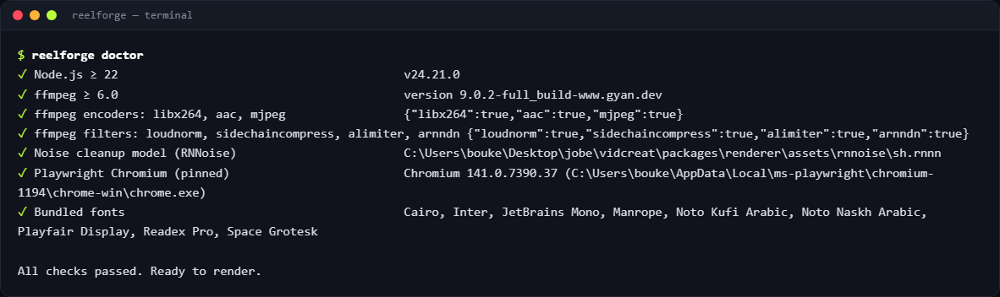

# التثبيت

انسخ المستودع (`git clone https://github.com/TerminalDZ/vidcreat.git`) أو فك ضغط أرشيف إصدار في أي مكان
تريده (مثل `Documents/ReelForge`). وللحصول على تصدير أسرع، تجنّب المجلدات التي يزامنها OneDrive أو iCloud.

## على Windows 10 و11

1. ثبّت **Node.js 22 LTS** من <https://nodejs.org> (مع الإعدادات الافتراضية). إن لم يكن مثبتاً، يستطيع
   المثبّت تثبيته عبر `winget`.
2. انقر مرتين على **`install.bat`**. سيتولى ما يلي:
   - التحقق من Node.js،
   - عرض تثبيت **ffmpeg** عبر `winget` (أجب بـ **Y**)،
   - تثبيت اعتماديات ReelForge،
   - تنزيل إصدار Chromium المحدَّد الذي يُستخدم في التصدير،
   - تشغيل فحص كامل للبيئة.
3. انقر مرتين على **`start.bat`** لفتح لوحة التحكم.

> إذا حذّرك Windows SmartScreen من السكربت، اختر **More info ← Run anyway**. وإذا ثُبّت ffmpeg للتو، أغلق
> `start.bat` وأعد فتحه حتى يتعرف Windows على قيمة PATH الجديدة.

## على macOS

1. ثبّت **Node.js 22 LTS** من <https://nodejs.org> و**Homebrew** من <https://brew.sh>.
2. افتح **Terminal** داخل مجلد ReelForge (من Finder: انقر بالزر الأيمن على المجلد ثم _New Terminal at
   Folder_) وشغّل:

   ```bash
   ./install.sh
   ```

   أجب بـ **Y** عندما يعرض عليك تشغيل `brew install ffmpeg`.

3. انقر مرتين على **`ReelForge.command`** (أو شغّل `./start.sh`) لفتح لوحة التحكم.

## على Linux

```bash
./install.sh          # add --yes to accept every prompt
./start.sh            # opens the dashboard
```

يستخدم المثبّت مدير الحزم لديك (`apt` أو `dnf` أو `pacman` أو `zypper`) لتثبيت ffmpeg، ويستطيع تثبيت
مكتبات النظام التي يحتاجها Chromium (سيطلب صلاحية `sudo`).

## من المصدر (للمطورين)

```bash
git clone https://github.com/TerminalDZ/vidcreat.git && cd vidcreat
corepack enable && pnpm install && pnpm build && pnpm reelforge doctor --fix
```

يشرح [دليل المساهمة](contributing.md) إعداد بيئة التطوير الكاملة على كل نظام.

## افحص الإعداد في أي وقت

```bash
reelforge doctor          # Windows: reelforge.cmd doctor
```

يفحص الأمر Node.js وffmpeg (الإصدار والمرمّزات والمرشحات) وChromium والخطوط المضمّنة، ويطبع الإصلاح
الدقيق لكل ما ينقص. وتعرض لوحة التحكم الفحص نفسه في مؤشر الحالة بالشريط العلوي.



## نماذج الكلام الاختيارية

تعمل المحاذاة التلقائية للـ cues دون أي تنزيل (بكشف فترات التوقف في الكلام ومطابقتها مع النص المعروف).
وللحصول على دقة على مستوى الكلمة مع وجود موسيقى في الخلفية، ثبّت نماذج الكلام الاختيارية مرة واحدة (نحو 180 MB):

```bash
reelforge align --setup     # downloads Whisper and Silero VAD into your user cache
reelforge align --status    # shows what is installed
```

## حل المشكلات {#troubleshooting}

| العَرَض                                  | الحل                                                                                                                                      |
| ---------------------------------------- | ----------------------------------------------------------------------------------------------------------------------------------------- |
| تعرض لوحة التحكم “setup issues”          | انقر على المؤشر: يعرض كل فحص فاشل طريقة إصلاحه. السبب الأكثر شيوعاً غياب ffmpeg.                                                          |
| الرسالة `ffmpeg not found`               | على Windows: `winget install Gyan.FFmpeg`، وعلى macOS: `brew install ffmpeg`، وعلى Linux: مدير الحزم. ثم افتح طرفية جديدة أو `start.bat`. |
| الرسالة “Cannot launch Chromium”         | شغّل `reelforge doctor --fix`. وعلى Linux أعد تشغيل المثبّت ووافق على تثبيت مكتبات النظام.                                                |
| لا يُعثر على ffmpeg رغم تثبيته (Windows) | أغلق كل الطرفيات و`start.bat` ثم أعد فتحها: لا يقرأ Windows قيمة PATH الجديدة إلا في النوافذ الجديدة.                                     |
| الأمر `pnpm` غير معروف                   | شغّل `corepack enable` مرة واحدة (يأتي Corepack مع Node.js 22)، ثم افتح طرفية جديدة.                                                      |
| التصدير بطيء أو يفشل بأخطاء القرص        | انقل المجلد خارج OneDrive أو iCloud واترك نحو 2 GB متاحة للملفات المؤقتة.                                                                 |

تجد إجابات أخرى في [أسئلة شائعة وحل المشكلات](faq.md).

## التحديث

إذا نسخت المستودع، شغّل `git pull` ثم أعد تشغيل المثبّت (أو `pnpm install && pnpm build`).

إذا نزّلت أرشيف إصدار، نزّل الإصدار الجديد من [صفحة الإصدارات](https://github.com/TerminalDZ/vidcreat/releases)،
وفك ضغطه بجانب القديم، وانسخ مجلد `episodes/` (وأي `themes/` أو `presets/` خاصة بك) إلى المجلد الجديد، ثم
شغّل المثبّت مجدداً. حلقاتك ملفات عادية، فلا شيء آخر يحتاج إلى ترحيل.

## إلغاء التثبيت

احذف مجلد ReelForge. أما Chromium المنزَّل فيوجد في مجلد التخزين المؤقت (cache) الخاص بالمستخدم
(`%LOCALAPPDATA%\ms-playwright` على Windows، و`~/Library/Caches/ms-playwright` على macOS،
و`~/.cache/ms-playwright` على Linux)، ويمكن حذفه أيضاً. وتوجد نماذج الكلام الاختيارية التي يثبّتها الأمر
`reelforge align --setup` في المجلد `reelforge` داخل مجلد التخزين المؤقت نفسه
(`%LOCALAPPDATA%\reelforge` و`~/Library/Caches/reelforge` و`~/.cache/reelforge`).
