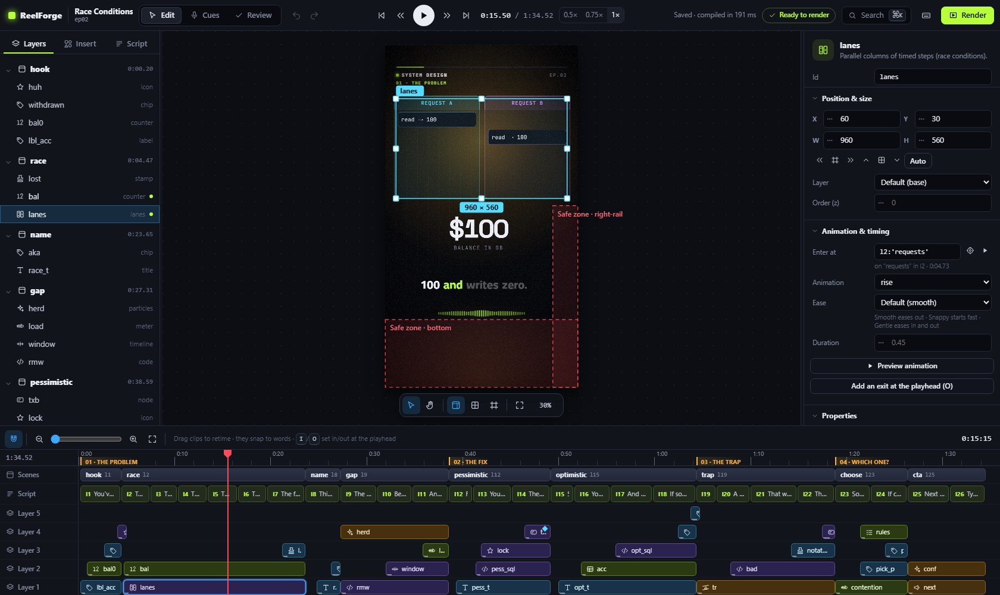

# مقدمة ومفاهيم

يحوّل **ReelForge** تسجيلاً صوتياً وملف YAML واحداً إلى فيديو شرح عمودي جاهز للنشر: بمقاس 1080×1920
وبمعدل 30 إطاراً في الثانية، وجاهز لـ **TikTok** و**Instagram Reels** و**YouTube Shorts**.

تكتب ما ستقوله جملةً جملة، وتصف ما يظهر على الشاشة و**عند أي كلمة** يظهر. فيحرّك ReelForge المخططات والكود
والجداول والرسوم البيانية والعناوين في اللحظة التي تنطقها فيها، ويضيف ترجمة نصية تظهر كلمة بكلمة، ومؤثرات
صوتية، وهوية السلسلة البصرية، ثم يعالج الصوت ويرمّز ملفات جاهزة للمنصات.

## أبرز المزايا

- **محرر حقيقي وبسيط.** تضع المكوّنات على الإطار كما في برامج التصميم، وتعيد توقيتها على خط زمني كما في
  برامج المونتاج، وتعدّل كل خاصية من لوحة الخصائص، مع التراجع، وأدلة المحاذاة الذكية، ولوحة أوامر،
  واختصارات لوحة مفاتيح لكل شيء.
- **متزامن مع كلماتك.** تظهر العناصر عند نطق الكلمة التي تسميها. أعد تسجيل جملة فيبقى كل ما بعدها
  متزامناً، لأن الحركات تتبع كلماتك لا الثواني.
- **العربية والإنجليزية.** ترجمة نصية تظهر كلمة بكلمة بالإنجليزية، وبالعربية باتجاه صحيح من اليمين إلى
  اليسار حتى حين تتخللها مصطلحات إنجليزية: تبقى `الـ client` متماسكة، وتقع `؟` في الجهة الصحيحة.
- **قوالب لقطاعات كثيرة.** تقدّم الحزم القطاعية (الرعاية الصحية، والعقارات، والخدمات اللوجستية، والتعليم،
  والمالية وغيرها) قوالب جاهزة: تملأ بضعة حقول فتحصل على حلقة مصمَّمة.
- **يعمل مع مساعدي الذكاء الاصطناعي (اختياري).** يتيح خادم MCP مدمج وواجهة REST لـ Claude وCursor وCopilot
  وCodex وGemini وغيرها من العملاء أن تكتب النصوص وتبني المشاهد وتفحص الإطارات نيابةً عنك.
- **مكوّنات متحركة** للشرح: عُقد وأسهم تتحرك عليها حزم البيانات، وكود يكتب نفسه، ورسوم بيانية، وخطوات
  ومسارات، وجداول، وخطوط زمنية، ومقاييس، وعدّادات، ونموذج هاتف، وأختام…
- **صوت احترافي**: مؤثرات صوتية مولّدة إجرائياً مع كل ضربة وانتقال، وصوت معالَج إلى −14 LUFS (مستوى
  الجهارة الذي تستهدفه المنصات)، وخفض تلقائي للمؤثرات تحت الصوت.
- **ملفات جاهزة للمنصات**: ملف MP4 رئيسي للأرشفة، وملف MP4 للنشر لا يتجاوز حد الرفع الذي تختاره، وملف
  ترجمة SRT، وورقة لقطات (contact sheet)، وملف `publish.md` فيه نص المنشور والوسوم والتعليق المثبّت.
- **لا ذكاء اصطناعي في محرك الرسم.** يرسم الإطارات محرك حتمي ويرمّزها FFmpeg. لا يولّد أصواتاً ولا صوراً
  أبداً: صوتك وكلماتك وتصميمك، بالنتيجة نفسها في كل مرة.
- **أدوات مساعدة محلية واختيارية.** تحدد محاذاة الكلام بداية كل سطر وكل كلمة من تسجيلك، ويقترح مساعد
  المشاهد مكوّناً للسطر. كلاهما يعمل على جهازك، ويمكنك دائماً أن تحدد الـ cues بالسمع وتصمم المشاهد بنفسك
  بدلاً منهما.
- **دون إنترنت وبخصوصية تامة.** كل شيء يعمل على جهازك: لا حساب ولا اشتراك ولا رفع ملفات. ينزّل الأمر
  `reelforge align --setup` نماذج الكلام الاختيارية مرة واحدة، وبعدها يعمل كل شيء دون اتصال.
- **نتائج ثابتة.** المدخلات نفسها تنتج دائماً الإطارات نفسها.

## المفاهيم الأساسية

| المصطلح              | المعنى                                                                                                                           |
| -------------------- | -------------------------------------------------------------------------------------------------------------------------------- |
| **الحلقة** (episode) | فيديو واحد: مجلد `episodes/<id>/` فيه `episode.yaml` وتسجيلك `voice.wav` والملف `cues.json` والمخرجات في `out/`.                 |
| **سطر النص**         | جملة منطوقة واحدة. تأخذ الأسطر المعرّفات `l1` و`l2`… بالترتيب، ومنها تُبنى الترجمة النصية.                                       |
| **الـ cue**          | لحظة بداية السطر في تسجيلك. تأتي الـ cues من المحاذاة التلقائية، أو من التحديد بالسمع، أو من تقدير قبل التسجيل.                  |
| **المشهد**           | مجموعة عناصر على الشاشة. يبدأ المشهد عند سطر (`at: l3`) وينتهي حيث يبدأ المشهد التالي.                                           |
| **العنصر**           | مكوّن واحد داخل مشهد، له خصائص (`props`) وصندوق (`place`) ووقت دخول ووقت خروج.                                                   |
| **المكوّن**          | لبنة بناء مثل `title` و`node` و`arrow` و`code` و`bar-chart` و`steps`. خصائصه صارمة وموثقة في مرجع المكوّنات.                     |
| **تعبير الزمن**      | زمن مكتوب نسبةً إلى كلماتك: `l3` و`l3.end` و`l3:'bucket'` و`@scene.end`، مع إزاحات مثل `+0.4`. والكلمات تصمد أمام إعادة التسجيل. |
| **الثيم**            | الألوان والخطوط والأحجام وإعدادات الحركة في `themes/<name>.theme.yaml`.                                                          |
| **الـ preset**       | تخطيط المنصة (`tiktok` أو `reels` أو `shorts`): مواضع الترويسة والمسرح والترجمة النصية، والمناطق الآمنة للمنصة.                  |
| **الحزمة والقالب**   | تجمع الحزمة القطاعية ثيماً وقوالب. والقالب حلقة فيها حقول مسمّاة (slots) تملؤها أنت.                                             |
| **الـ Timeline**     | الحلقة بعد تحويلها (compile) وحساب كل أزمنتها. هي العقد الوحيد بين الـ compiler ومحرك الرسم، ولهذا تبقى النتيجة قابلة للتكرار.   |

## كيف يُصنع الفيديو

1. **ابدأ** من قالب (`reelforge new <id> --pack <pack> --template <template>`)، أو من حلقة فارغة
   (`reelforge new <id>`)، أو من لوحة التحكم.
2. **اكتب النص**: جملة منطوقة قصيرة في كل سطر، بمعدل 2.3 كلمة في الثانية تقريباً.
3. **صمّم المشاهد** في المحرر أو في YAML، بحيث يدخل كل عنصر عند الكلمة التي تسميه.
4. **سجّل** صوتك. يحدد الأمر `reelforge align` بداية كل سطر وكل كلمة، ثم تراجعها بالسمع في وضع Cues.
5. **راجع**: يأتي كل فحص (التداخل، والمناطق الآمنة، وتجاوز النص لصندوقه، وسرعة الإلقاء) مع تلميح لإصلاحه.
6. **صدّر** الفيديو، ثم ارفع ملف النشر مع النصوص الموجودة في `publish.md`.

يشرح [البدء السريع](quick-start.md) هذه الخطوات في عشر دقائق تقريباً.

## محتويات المستودع

| المجلد أو الملف                               | المحتوى                                                                      |
| --------------------------------------------- | ---------------------------------------------------------------------------- |
| `install.bat` (`install.ps1`) و`install.sh`   | مثبّتات بأمر واحد لـ Windows وmacOS وLinux                                   |
| `start.bat` و`start.sh` و`ReelForge.command`  | فتح لوحة التحكم                                                              |
| `reelforge.cmd` و`reelforge`                  | واجهة سطر الأوامر                                                            |
| `examples/season1/`                           | تسع حلقات كاملة كأمثلة بالإنجليزية (سلسلة “System Design”)                   |
| `examples/season1-arabic/`                    | السلسلة نفسها بالعربية مع المصطلحات التقنية بالإنجليزية                      |
| `examples/promo/intro/`                       | فيديو تعريفي بـ ReelForge مدته 45 ثانية يستعرض الحركات                       |
| `packs/`                                      | الحزم القطاعية: ملفات التعريف (manifest) والقوالب وحلقات الأمثلة             |
| `skills/`                                     | أدلة مهام لمساعدي الذكاء الاصطناعي (بصيغة Agent Skills)                      |
| `AGENTS.md` و`CLAUDE.md` و`GEMINI.md`…        | تعليمات لمساعدي الذكاء الاصطناعي (راجع [التكامل مع الذكاء الاصطناعي](ai.md)) |
| `themes/` و`presets/`                         | ثيمات بصرية وتخطيطات منصات قابلة للتعديل                                     |
| `docs/` و`documentation/`                     | هذا التوثيق (مصدر الموقع، ونسخة تعمل دون اتصال)                              |
| `packages/`                                   | الكود المصدري الكامل بلغة TypeScript                                         |
| `LICENSE` و`NOTICE` و`THIRD-PARTY-NOTICES.md` | ترخيص Apache-2.0 والإشعارات وحقوق المكوّنات الخارجية                         |

## المتطلبات

|                  | الحد الأدنى                                               | الموصى به                                             |
| ---------------- | --------------------------------------------------------- | ----------------------------------------------------- |
| نظام التشغيل     | Windows 10 أو macOS 13 أو Ubuntu 22.04 (أو أي Linux حديث) | Windows 11 أو macOS 14+ أو Ubuntu 24.04               |
| المعالج والذاكرة | 4 أنوية و8 GB                                             | 8 خيوط أو أكثر و16 GB (يتسارع التصدير بزيادة الأنوية) |
| القرص            | 2 GB متاحة (مع ~2 GB مؤقتة لكل تصدير)                     | SSD                                                   |
| البرمجيات        | **Node.js 22 LTS** و**ffmpeg 6+**                         | يثبّتها المثبّت تلقائياً حيثما أمكن                   |

يستغرق تصدير حلقة مدتها دقيقتان من 5 إلى 10 دقائق تقريباً على حاسوب محمول بثمانية خيوط.
