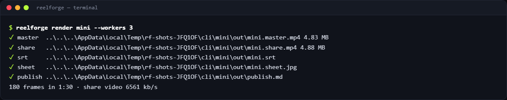

# التصدير والنشر

صدّر الفيديو من لوحة التحكم (زر **Render** على البطاقة)، أو من المحرر (‏**⌘/Ctrl+Enter**)، أو من سطر الأوامر.
تجد كل الخيارات في [مرجع CLI](../reference/cli.md#reelforge-render).

```bash
reelforge render ep10
reelforge render ep10 --preset reels --share-size 50
reelforge render ep10 --from 12 --to 20      # quick partial check → out/ep10.part.mp4
reelforge render --all                       # every episode in episodes/
```



## المخرجات (`episodes/<id>/out/`)

| الملف             | الاستخدام                                                                                      |
| ----------------- | ---------------------------------------------------------------------------------------------- |
| `<id>.master.mp4` | جودة الأرشفة: H.264 High وCRF 18 وAAC بمعدل 192 kb/s                                           |
| `<id>.share.mp4`  | **هذا الملف الذي ترفعه.** مرمَّز بتمريرتين (two-pass) كي لا يتجاوز حجم النشر (الافتراضي 28 MB) |
| `<id>.srt`        | ملف ترجمة نصية لـ YouTube أو لتسهيل الوصول                                                     |
| `<id>.sheet.jpg`  | ورقة لقطات من 12 إطاراً لمراجعة سريعة                                                          |
| `publish.md`      | نص الغلاف ونص المنشور والوسوم والتعليق المثبّت والفصول، جاهزة للصق                             |
| `<id>.cover.png`  | صورة الغلاف (`reelforge snap <id> <time> --cover`)                                             |

يُفحص كل فيديو بعد الترميز: ملف تعريف H.264 High، وyuv420p، ومعدل ثابت 30 إطاراً في الثانية، وصوت AAC بتردد
48 kHz، وخاصية “fast start” (التشغيل أثناء التنزيل)، وحد الحجم.

## الخيارات

| الخيار                           | المعنى                                                      |
| -------------------------------- | ----------------------------------------------------------- |
| `--preset tiktok\|reels\|shorts` | تخطيط المنصة ومناطقها الآمنة                                |
| `--share-size <MB>`              | الحد الأقصى لحجم ملف النشر                                  |
| `--workers <n>`                  | عمليات التصدير المتوازية (الافتراضي: عدد الأنوية ناقص واحد) |
| `--fast`                         | ترميز نهائي أسرع (مع ملف رئيسي أكبر قليلاً)                 |
| `--no-sfx`                       | دون مؤثرات صوتية                                            |
| `--silent`                       | السماح بالتصدير دون تسجيل (للمعاينة)                        |
| `--no-share`                     | الملف الرئيسي فقط                                           |
| `--lossless`                     | التقاط الإطارات بصيغة PNG بدل JPEG (أبطأ، للأرشفة)          |

## الأداء

يستخدم التصدير كل أنوية المعالج. الأزمنة التقريبية لحلقة مدتها دقيقتان: 4 أنوية ≈ 10 دقائق، و8 خيوط ≈ 5 إلى 6
دقائق. اضغط **Ctrl+C** (أو **Cancel** في لوحة التحكم) في أي وقت، وستُحذف الملفات الجزئية.

## قبل التصدير

- يعرض `reelforge validate <id>` **صفر أخطاء**، والتحذيرات أُصلحت أو عُرف سببها (مع الخيار `--strict` يفشل
  التحقق عند وجود تحذيرات أيضاً، وهذا مفيد في CI).
- عاين بضعة إطارات بعد دخول العناصر بقليل: `reelforge snap <id> "l3:'bucket'+0.8"`.
- المفتاح `meta.publish` (الغلاف ونص المنشور والوسوم والتعليق المثبّت) مملوء، ومنه يُبنى `publish.md`.
- سجّلت بالهاتف؟ اضبط `audio: { denoise: true }` أو مرّر `--denoise`.

## النشر

يجمع `publish.md` كل ما تلصقه عند الرفع: نص الغلاف، ونص المنشور، والوسوم، والتعليق المثبّت، وتوقيتات الفصول.
اصنع صورة غلاف بالأمر `reelforge snap <id> <time> --cover`.

- **TikTok**: ارفع `share.mp4` والصق نص المنشور والوسوم من `publish.md`.
- **Instagram Reels**: صدّر بالخيار `--preset reels` لتراعي مناطقها الآمنة.
- **YouTube Shorts**: صدّر بالخيار `--preset shorts` (بحد أقصى 3 دقائق)، ثم ارفع `<id>.srt` كملف ترجمة.

## التصدير على خادم أو في CI

يعمل كل شيء دون واجهة رسومية على Linux. يطبع الخيار `--json` أحداث تقدم قابلة للقراءة الآلية، ورموز الخروج
ثابتة (`0` نجاح، و`1` فشل، و`2` خطأ في الاستخدام)، ولا يحتاج التصدير إلى الشبكة بعد تثبيت Chromium وFFmpeg.
صدّر مجلداً كاملاً بالأمر `reelforge render --all`.
