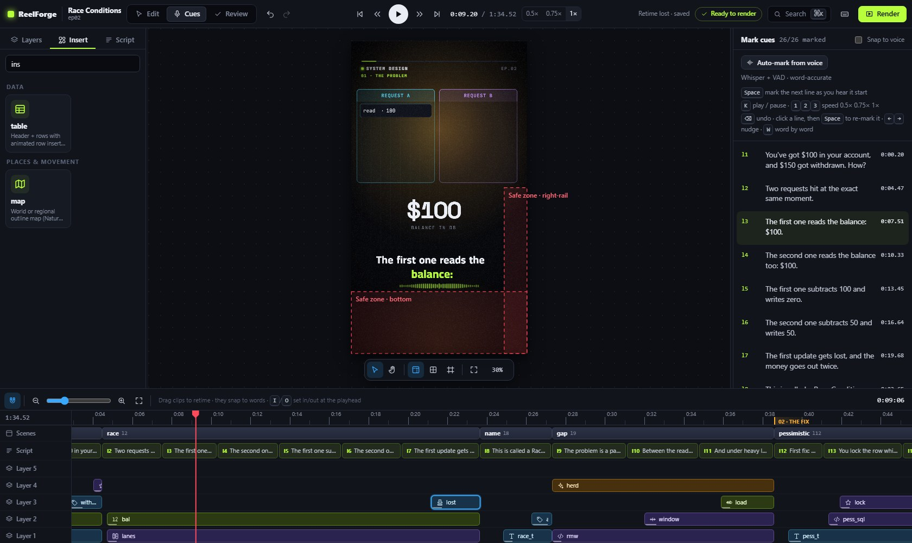
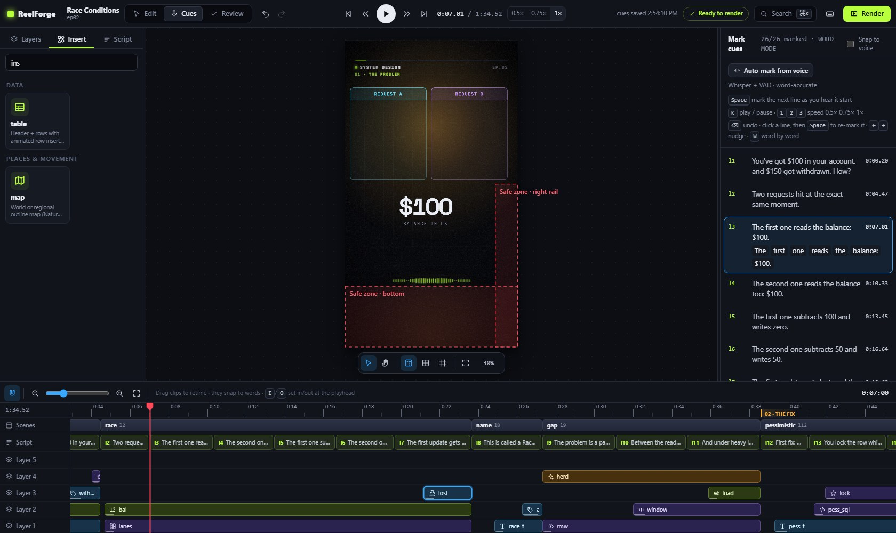

# التوقيت والـ cues والمحاذاة التلقائية

كل ما في الحلقة موقّت نسبةً إلى كلماتك. الـ **cue** هو لحظة بداية سطر النص في تسجيلك، ومنه تُحسب أزمنة
الكلمات. تبدأ المشاهد عند الأسطر، وتدخل العناصر عند الكلمات:

```yaml
scenes:
  - at: l3 # the scene starts with line 3
    elements:
      - use: bucket
        enter: { at: "l3:'bucket'" } # the element enters on the word "bucket"
```

أعد تسجيل جملة، وحرّك الـ cue الخاص بها، فتتبعه كل الحركات.

## تعابير الزمن

| الصيغة                           | المعنى                                                               |
| -------------------------------- | -------------------------------------------------------------------- |
| `12.5s` (أو رقم YAML مثل `12.5`) | ثوانٍ مطلقة                                                          |
| `l7`                             | بداية السطر `l7` بحسب الـ cue الخاص به                               |
| `l7.end`                         | بداية السطر التالي ناقص 0.15 ث                                       |
| `l7:'timeout'`                   | أول كلمة تطابق "timeout" (مع تجاهل علامات الترقيم والتطويل والتشكيل) |
| `l7:'request'#2`                 | المطابقة الثانية                                                     |
| `l7.3`                           | الكلمة الرابعة (العد يبدأ من الصفر)                                  |
| `@hook` و`@hook.end`             | بداية مشهد ونهايته                                                   |
| أي مما سبق مع `+0.4` أو `-0.2`   | إزاحة بالثواني                                                       |

ضع بين علامات اقتباس أي نص YAML يحتوي على `:` أو `'`، مثل `at: "l3:'bucket'"`. وفضّل تعابير الكلمات على
الثواني المطلقة، فالكلمات تصمد أمام إعادة التسجيل. تجد القائمة الكاملة في [كتابة الحلقات](../authoring.md).
وتعمل الكلمات العربية بالطريقة نفسها: `l7:'مرتين'`.

## قبل التسجيل: الـ cues التقديرية

تحصل كل حلقة جديدة على **cues تقديرية** محسوبة من طول كل سطر (نحو 13 حرفاً في الثانية مع فجوة قصيرة). فتُعرض
المعاينة بتوقيت واقعي، ويفحص التحقق سرعة الإلقاء منذ البداية. ولإنشائها استخدم الأمر
`reelforge cue <id> --draft`، أو الزر **Draft cues**، أو الأداة `draft_cues`.

## نصائح للتسجيل

- سجّل في غرفة هادئة، على بعد 20 إلى 30 سم من الميكروفون. أي معدل عينات مقبول، ويضبط ReelForge مستوى الجهارة
  تلقائياً (−14 LUFS).
- اقرأ سطراً واحداً في كل نَفَس، واترك وقفة قصيرة (0.3 إلى 0.5 ث) بين الأسطر. فالوقفات تسرّع تحديد الـ cues
  وتمنح الحركات مساحة.
- ستعيد التسجيل لاحقاً؟ ارفع التسجيل الجديد، وسينبهك ReelForge إلى أن التسجيل تغيّر لتعيد مراجعة الـ cues.
- سجّلت بالهاتف أو في غرفة فيها ضجيج؟ فعّل **Clean up noise** (من إعدادات الحلقة، أو `audio: { denoise: true }`،
  أو `reelforge render --denoise`). يزيل RNNoise الهسيس والطنين وضجيج الغرفة من الصوت قبل المعالجة النهائية (mastering)،
  وفي الاختبارات خفّض الضجيج بين الجمل بنحو 15 dB دون تغيير مستوى الصوت.

## الـ cues التلقائية

انقر **Auto-mark from voice** في وضع Cues، أو **Auto cues** في لوحة التحكم، أو شغّل `reelforge align <id>`.
يعرف ReelForge النص مسبقاً، فلا يبقى عليه إلا إيجاد بداية كل سطر وكل كلمة في التسجيل. استمع بعدها مرة
واحدة وأصلح أي سطر بالسمع (الأسطر الملوّنة بالكهرماني هي التي كانت الثقة فيها أقل). وتُسجَّل النتيجة كخطوة تراجع واحدة (‏**⌘/Ctrl+Z**).

يوجد محركان:

| المحرك                | المتطلبات                                     | السرعة (لدقيقة صوت)         | طريقة العمل                                                                                                                                                                      |
| --------------------- | --------------------------------------------- | --------------------------- | -------------------------------------------------------------------------------------------------------------------------------------------------------------------------------- |
| **الوقفات** (افتراضي) | لا شيء                                        | ~0.05 ث                     | يجد الوقفات، ثم يقسم التسجيل على أسطر النص بحيث يناسب طول كل سطر نصّه (برمجة ديناميكية). وتتبع الكلمات المقاطع الصوتية.                                                          |
| **Whisper** (اختياري) | `reelforge align --setup` مرة واحدة (~180 MB) | ~20 ث على معالج حاسوب محمول | نموذج كلام يسمع الكلمات، ولا يُستخدم منه إلا **التوقيت** مطابَقاً مع نصك، فلا تؤثر اللهجات ولا المصطلحات الإنجليزية في الجمل العربية. وهو الأفضل لتوقيت الكلمات ومع وجود موسيقى. |

مع تثبيت النماذج الاختيارية، يميّز نموذج صغير لاكتشاف الكلام (Silero VAD، بحجم 2 MB) الكلام عن الموسيقى
والأنفاس وضجيج الغرفة. وفي قياسات على كلام مسجّل بأزمنة معروفة، جاء كل سطر بفارق لا يتجاوز 100 ms (بمتوسط 15 ms)، مع
موسيقى في الخلفية أو بدونها. أما الكلمات فجاءت بفارق لا يتجاوز 100 ms في نحو 80% من الحالات، لذا راجع
بالسمع في وضع الكلمات اللحظات التي تحتاج دقة (مثل ختم يقع على كلمة بعينها).

يعرض الأمر `reelforge align --status` ما هو مثبت. وتُحفظ النماذج في مجلد التخزين المؤقت (cache) الخاص بالمستخدم
(`%LOCALAPPDATA%\reelforge` أو `~/Library/Caches/reelforge` أو `~/.cache/reelforge`، ويغيّر `$REELFORGE_CACHE`
مكانها)، ولا تُستخدم أبداً أثناء التصدير. ولا تُستبدل الـ cues التي حددتها يدوياً أبداً إلا بعد تأكيدك (`--force`
في سطر الأوامر).

| الخيار           | المعنى                                                               |
| ---------------- | -------------------------------------------------------------------- |
| `--engine <e>`   | `auto` (‏Whisper إن كان مثبتاً وإلا الوقفات)، أو `dsp`، أو `whisper` |
| `--model <size>` | نموذج Whisper: ‏`tiny` أو `base` (الافتراضي) أو `small`              |
| `--no-vad`       | اكتشاف الكلام من طاقة الصوت فقط                                      |
| `--no-words`     | cues للأسطر فقط                                                      |
| `--force`        | استبدال الـ cues المحددة يدوياً                                      |
| `--dry-run`      | طباعة النتيجة دون كتابة `cues.json`                                  |

## وضع Cues

افتح المحرر وانتقل إلى **Cues** (‏**Alt+2**)، أو انقر **Mark cues** في لوحة التحكم. يظهر النص على اليمين،
ويظهر مؤشر التشغيل والموجة الصوتية على الخط الزمني.



| المفتاح                        | الإجراء                                                          |
| ------------------------------ | ---------------------------------------------------------------- |
| **Enter** / **K**              | تشغيل / إيقاف مؤقت                                               |
| **1 / 2 / 3**                  | السرعة 0.5× و0.75× و1× (الأبطأ أدق)                              |
| **Space**                      | تحديد السطر التالي غير المحدد عند مؤشر التشغيل                   |
| **النقر على سطر** أو **↑ / ↓** | اختيار سطر لإعادة تحديده (ثم اضغط Space)                         |
| **← / →**                      | تحريك الـ cue المحدد بمقدار 50 ms (و**Shift** بمقدار 10 ms)      |
| **Backspace**                  | التراجع عن آخر تغيير                                             |
| **S** / **A**                  | إلصاق الـ cue المحدد بأقرب بداية للصوت / تبديل الالتصاق التلقائي |
| **G**                          | الانتقال إلى الـ cue المحدد                                      |
| **W**                          | وضع الكلمات: حدد كل كلمة في السطر المختار بـ Space               |
| **J / L** و**, / .**           | رجوع / تقدم ثانية واحدة، الإطار السابق / التالي                  |

يُحفظ كل تغيير فوراً في `cues.json` ويمكن التراجع عنه بـ **⌘/Ctrl+Z**. وتظهر الأسطر التي خرجت عن ترتيبها باللون الأحمر.
ويمكنك أيضاً سحب مقطع السطر على مسار **Script** في الخط الزمني، في وضع Edit أو Cues.

## وضع الكلمات

يقدّر ReelForge افتراضياً بداية كل كلمة من طولها. وللحظات الدقيقة (ختم يقع تماماً على كلمة “twice”)، اختر
السطر، واضغط **W**، وشغّل، ثم اضغط **Space** عند كل كلمة.



## فحوص سرعة الإلقاء

تنبّه قاعدة التحقق **V-14** عندما يُنطق سطر بأسرع من 3.5 كلمة في الثانية تقريباً (أسرع من أن تُقرأ
الترجمة النصية)، وعندما تبدأ الافتتاحية بعد 3 ثوانٍ، وتبلّغ أيضاً عن فترات صمت مدتها 1.5 ث أو أكثر. قسّم الأسطر
الطويلة، أو تمهّل عند التسجيل.
