# ReelForge من الداخل — شرح معماري مفصّل

> وثيقة تشرح **كيف يعمل** ReelForge من أول سطر في `episode.yaml` حتى ملف MP4 النهائي، وكيف
> هيكلة الكود، ولماذا اتُّخذت كل قرار. المصطلحات التقنية مكتوبة بالإنجليزية كما هي في الكود.
> الرسوم البيانية مكتوبة بـ Mermaid وتظهر تلقائياً في GitHub و VS Code.

## الفهرس

1. [الفكرة في دقيقة](#1-الفكرة-في-دقيقة)
2. [المفاهيم الأساسية (القاموس)](#2-المفاهيم-الأساسية-القاموس)
3. [الصورة الكبيرة](#3-الصورة-الكبيرة)
4. [هيكل المستودع](#4-هيكل-المستودع)
5. [الحزم الست وحدودها](#5-الحزم-الست-وحدودها)
6. [رحلة حلقة كاملة خطوة بخطوة](#6-رحلة-حلقة-كاملة-خطوة-بخطوة)
7. [ملف episode.yaml بالتفصيل](#7-ملف-episodeyaml-بالتفصيل)
8. [الزمن: cues والكلمات و time expressions](#8-الزمن-cues-والكلمات-و-time-expressions)
9. [حزمة core: المُترجِم (Compiler)](#9-حزمة-core-المترجم-compiler)
10. [حزمة runtime: الرسم بدالة render(t)](#10-حزمة-runtime-الرسم-بدالة-rendert)
11. [حزمة renderer: من الإطارات إلى MP4](#11-حزمة-renderer-من-الإطارات-إلى-mp4)
12. [حزمة audio: الصوت بدون ملفات صوتية](#12-حزمة-audio-الصوت-بدون-ملفات-صوتية)
13. [حزمة studio: لوحة التحكم والمحرر](#13-حزمة-studio-لوحة-التحكم-والمحرر)
14. [حزمة cli: الأوامر](#14-حزمة-cli-الأوامر)
15. [خادم MCP للوكلاء الأذكياء](#15-خادم-mcp-للوكلاء-الأذكياء)
16. [مجلد الحلقة على القرص](#16-مجلد-الحلقة-على-القرص)
17. [البناء والاختبارات و CI](#17-البناء-والاختبارات-و-ci)
18. [نموذج الأمان](#18-نموذج-الأمان)
19. [الحتمية (Determinism): لماذا نفس المدخلات = نفس الإطارات](#19-الحتمية-determinism)
20. [متغيرات البيئة والإعدادات الافتراضية](#20-متغيرات-البيئة-والإعدادات-الافتراضية)
21. [كيف أوسّع المشروع](#21-كيف-أوسع-المشروع)
22. [ملاحظات ونقاط تستحق الانتباه](#22-ملاحظات-ونقاط-تستحق-الانتباه)
23. [خريطة سريعة: أين أجد…؟](#23-خريطة-سريعة-أين-أجد)
24. [الميزات الذكية: cues تلقائية، تنظيف الصوت، والاقتراحات](#24-الميزات-الذكية-cues-تلقائية-تنظيف-الصوت-والاقتراحات)

---

## 1. الفكرة في دقيقة

ReelForge يأخذ شيئين:

- **تسجيل صوتي** (`voice.wav`) تقرأ فيه نصّك.
- **ملف واحد** `episode.yaml` تصف فيه: النص سطراً سطراً، والمشاهد، والعناصر (عناوين، مخططات، كود،
  جداول…)، و**على أي كلمة** يظهر كل عنصر.

ويُخرج **فيديو عمودي 1080×1920 بـ 30 إطاراً في الثانية** جاهزاً لـ TikTok و Reels و Shorts، مع:
ترجمة (captions) كلمة بكلمة بالعربية والإنجليزية، مؤثرات صوتية مولَّدة برمجياً، صوت مضبوط على
−14 LUFS، وملف للنشر.

ثلاث مبادئ تحكم كل شيء:

| المبدأ                   | المعنى                                                                                     |
| ------------------------ | ------------------------------------------------------------------------------------------ |
| **محلي بالكامل**         | لا سحابة، لا حساب، لا اتصال بالإنترنت أثناء الرسم (حتى الشبكة تُحجب برمجياً داخل المتصفح). |
| **بلا ذكاء اصطناعي**     | المحرك لا يولّد صوتاً ولا صوراً. التوقيت يحدده الإنسان (أو تقدير حسابي). الـ AI اختياري.   |
| **حتمي (Deterministic)** | نفس المدخلات تعطي نفس البكسلات حرفياً، بأي ترتيب وبأي عدد من العمّال (workers).            |

والسر التقني: **صفحة ويب** (HTML/SVG/Canvas) تعرض الإطار عند أي زمن `t` عبر دالة نقية `render(t)`،
ومتصفح Chromium بلا واجهة يلتقط صورة لكل إطار، ثم FFmpeg يحوّل الصور إلى فيديو.

---

## 2. المفاهيم الأساسية (القاموس)

قبل أي شيء، هذه الكلمات ستتكرر في كل مكان:

| المصطلح               | المعنى                                                                                                                                                       |
| --------------------- | ------------------------------------------------------------------------------------------------------------------------------------------------------------ |
| **Episode** (حلقة)    | مجلد فيه `episode.yaml` (+ `cues.json` + `voice.wav` + `assets/` + `out/`).                                                                                  |
| **Script line** (سطر) | جملة منطوقة واحدة. معرّفها الافتراضي `l1`, `l2`, … حسب الترتيب.                                                                                              |
| **Cue** (إشارة)       | **لحظة بداية** سطر في التسجيل بالثواني، مثلاً `l3: 6.8`. تُحفظ في `cues.json`.                                                                               |
| **Word time**         | لحظة بداية كل كلمة داخل السطر. تُقدَّر حسابياً من عدد الحروف، أو تُعلَّم يدوياً.                                                                             |
| **Time expression**   | طريقة لكتابة الزمن مربوطة بالكلام بدل الثواني: `l3:'bucket'` = "لحظة نطق كلمة bucket في السطر 3".                                                            |
| **Scene** (مشهد)      | فكرة واحدة على الشاشة. يبدأ عند سطر (`at: l3`) وينتهي عند بداية المشهد التالي.                                                                               |
| **Element** (عنصر)    | شيء مرسوم داخل مشهد: عنوان، سهم، جدول… له مكان (`place`) ودخول (`enter`) وخروج (`exit`).                                                                     |
| **Component** (مكوّن) | **نوع** العنصر. يوجد 21 مكوّناً (`title`, `arrow`, `code`, …). لكل واحد schema صارم للخصائص.                                                                 |
| **Canvas**            | الإطار الكامل 1080×1920.                                                                                                                                     |
| **Stage** (المسرح)    | المنطقة التي توضع فيها العناصر: 1080×1000، تبدأ عند y=270 في الـ canvas. إحداثيات العناصر **نسبية للمسرح**.                                                  |
| **Preset**            | تخطيط المنصة (tiktok / reels / shorts): مكان المسرح، مكان الترجمة، **المناطق الآمنة** التي تغطيها واجهة التطبيق.                                             |
| **Theme**             | الألوان والخطوط وأحجام النص وإعدادات الحركة والترجمة.                                                                                                        |
| **Timeline** (المخطط) | **الناتج المُترجَم** للحلقة: كائن JSON فيه كل شيء محسوب مسبقاً (أزمنة بالثواني، ألوان نهائية، صناديق نهائية). هو **العقد الوحيد** بين الـ core والـ runtime. |
| **Issue / V-rule**    | مشكلة يكتشفها التحقق، لها رمز من V-1 إلى V-14 ومستوى (error / warn / info) ورقم سطر.                                                                         |
| **Master / Share**    | ملفا الفيديو الناتجان: Master بجودة أرشيفية، و Share مضغوط ليناسب حد حجم الرفع (28 MB افتراضياً).                                                            |
| **Worker**            | عملية رسم متوازية: متصفح Chromium خاص + FFmpeg خاص، يرسم مقطعاً من الإطارات.                                                                                 |
| **Hub / Studio**      | Hub = لوحة التحكم بالمشروع (المنفذ 4310). Studio = محرر الحلقة الواحدة (المنفذ 4317).                                                                        |
| **MCP**               | Model Context Protocol: بروتوكول يسمح لـ Claude/Cursor/… باستدعاء أدوات ReelForge مباشرة.                                                                    |

---

## 3. الصورة الكبيرة

### 3.1 تدفق البيانات من المدخلات إلى المخرجات

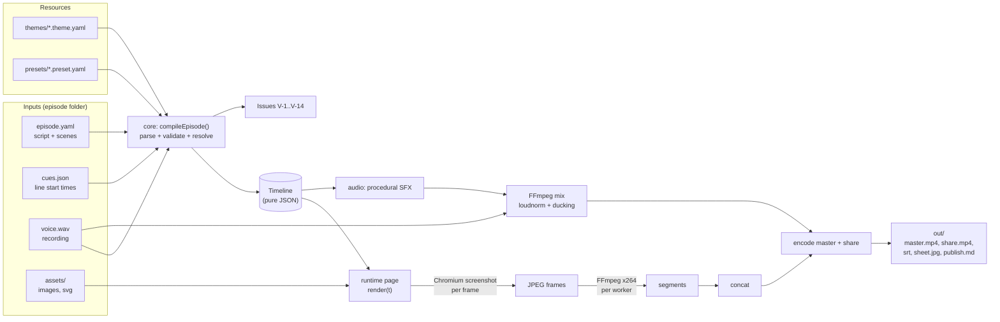

### 3.2 من يستخدم ماذا

نفس الـ **runtime** (صفحة الرسم) يُستخدم في مكانين، وهذا أهم قرار في التصميم: **ما تراه في المحرر هو
بالضبط ما سيُرسم في الفيديو**.

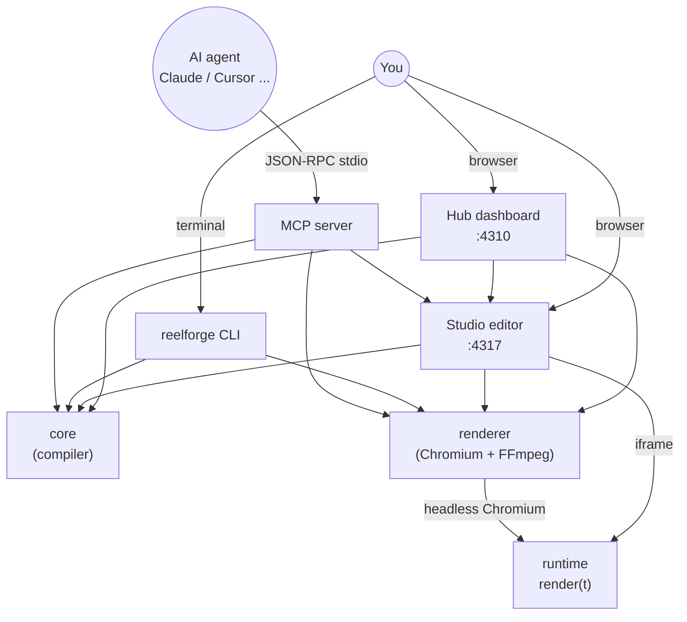

---

## 4. هيكل المستودع

```text
vidcreat/
├── packages/                ← كل الكود المصدري (TypeScript)
│   ├── audio/               ← WAV، مولّد الأرقام العشوائية الحتمي، المؤثرات الصوتية
│   ├── core/                ← schema، الزمن، الترجمة، الثيمات، المُترجِم، التحقق
│   ├── runtime/             ← صفحة المتصفح: render(t) و 21 مكوّناً
│   ├── renderer/            ← Chromium workers + FFmpeg + doctor
│   ├── studio/              ← خادما Hub و Studio + واجهات Vite
│   │   ├── src/server/      ← كود الخادم (Node)
│   │   └── client/          ← كود المتصفح (hub.html, index.html, src/*.ts, *.css)
│   └── cli/                 ← أمر reelforge + خادم MCP
├── examples/                ← حلقات جاهزة
│   ├── season1/ep01..ep09   ← سلسلة "System Design" بالإنجليزية
│   ├── season1-arabic/      ← نفس السلسلة بالعربية
│   └── promo/intro/         ← فيديو تعريفي بـ ReelForge نفسه
├── episodes/                ← حلقاتك أنت (مُستثنى من git)
├── themes/                  ← default, season1, workshop
├── presets/                 ← tiktok, reels, shorts
├── schema/                  ← episode.schema.json (مولَّد، للإكمال التلقائي في المحرر)
├── fixtures/                ← بيانات الاختبار: golden frames، حالات V-1..V-14، mini
├── tests/                   ← اختبارات المتصفح والتكامل
├── scripts/                 ← بناء التوثيق، الإصدار، لقطات الشاشة…
├── docs/                    ← التوثيق (manual، ADR، SRS، components)
├── documentation/           ← نسخة HTML للتوثيق (مولَّدة)
├── install.* / start.* / reelforge(.cmd)  ← المثبّت والمشغّلات
├── AGENTS.md, CLAUDE.md, GEMINI.md, llms.txt  ← تعليمات للوكلاء الأذكياء
└── .mcp.json, .cursor/, .vscode/, .gemini/    ← إعداد خادم MCP لكل أداة
```

حجم الكود تقريباً: **studio** ‏7800 سطر، **core** ‏4200، **runtime** ‏3500، **cli** ‏1700،
**renderer** ‏1400، **audio** ‏600.

---

## 5. الحزم الست وحدودها

### 5.1 رسم الاعتماديات

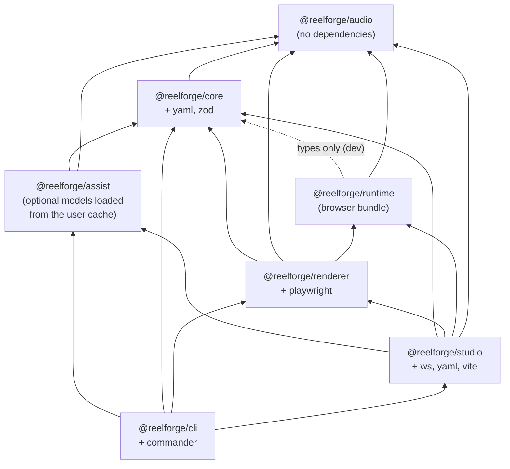

### 5.2 مسؤولية كل حزمة

| الحزمة     | يعمل في                       | المسؤولية                                                                                                                                      |
| ---------- | ----------------------------- | ---------------------------------------------------------------------------------------------------------------------------------------------- |
| `audio`    | Node **و** المتصفح            | قراءة/كتابة WAV، الـ envelope، اكتشاف بداية الصوت (onset)، تركيب 8 مؤثرات، أرقام عشوائية حتمية                                                 |
| `core`     | Node                          | schema الـ YAML، تعبيرات الزمن، الترجمة و bidi، الثيمات، الـ presets، **المُترجِم**، التحقق                                                    |
| `runtime`  | المتصفح فقط                   | الصفحة التي ترسم الإطار: `render(t)`، الخلفية، الترويسة، الترجمة، 21 مكوّناً                                                                   |
| `renderer` | Node                          | تشغيل Chromium، التقاط الإطارات، FFmpeg، مزج الصوت، فحص المخرجات، `doctor`، القياس V-9/V-10                                                    |
| `studio`   | Node (خادم) + المتصفح (واجهة) | لوحة التحكم، المحرر المرئي، تعليم الـ cues، التعديل المهيكل للـ YAML، طابور الرسم                                                              |
| `cli`      | Node                          | أمر `reelforge` بكل أوامره الفرعية، وخادم MCP                                                                                                  |
| `assist`   | Node                          | الـ cues التلقائية (DSP / Whisper / VAD) واقتراح المشاهد بالـ LLM المحلي (انظر [§24](#24-الميزات-الذكية-cues-تلقائية-تنظيف-الصوت-والاقتراحات)) |

### 5.3 القاعدة الذهبية: الـ Timeline هو العقد الوحيد

`core` لا يعرف شيئاً عن DOM، و `runtime` لا يعرف شيئاً عن YAML أو zod. الشيء الوحيد الذي يمر
بينهما هو كائن `Timeline` المعرّف في [types.ts](../packages/core/src/types.ts). نتيجة ذلك:

- حزمة الـ runtime صغيرة (لا تحتوي zod ولا مكتبة YAML).
- يمكن اختبار الـ core بدون متصفح.
- يوجد اختبار يتأكد أن قائمة المكوّنات في `core` (الـ schemas) مطابقة لقائمة المكوّنات في `runtime`
  (الرسم).

---

## 6. رحلة حلقة كاملة خطوة بخطوة

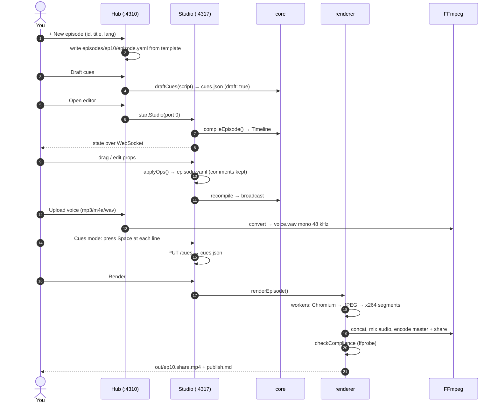

بالكلمات:

1. **الكتابة:** تكتب النص، جملة لكل سطر (حوالي 2.3 كلمة في الثانية؛ 45 ثانية ≈ 100–110 كلمة). السطر
   الأول هو الـ hook، والأخير دعوة للتفاعل.
2. **الإنشاء:** `reelforge new ep10` أو زر "New episode" ينشئ المجلد من قالب.
3. **التوقيت المؤقت:** قبل التسجيل، تُحسب cues تقديرية (draft) حتى ترى التوقيت بشكل واقعي.
4. **التصميم:** تضيف المشاهد والعناصر وتربط دخول كل عنصر بالكلمة التي تسمّيه.
5. **التحقق والمعاينة:** `validate` يعطي القائمة V-1…V-14، و `snap` يعطي صوراً لإطارات محددة.
6. **التسجيل:** تسجّل `voice.wav`، ثم في وضع Cues تضغط Space عند بداية كل سطر وأنت تستمع.
7. **الرسم:** `render` يُخرج الملفات في `out/`.

لأن العناصر مربوطة **بالكلمات** لا بالثواني، إعادة تسجيل جملة واحدة تعني فقط إعادة تعليم cue واحد،
وكل ما بعدها يبقى متزامناً تلقائياً.

---

## 7. ملف episode.yaml بالتفصيل

الـ schema معرّف بـ zod في [schema/episode.ts](../packages/core/src/schema/episode.ts). **كل كائن صارم
(strict)**: أي مفتاح غير معروف = خطأ V-1 مع اقتراح "هل تقصد…؟" (did-you-mean) ورقم السطر والعمود.

### 7.1 الأقسام الخمسة

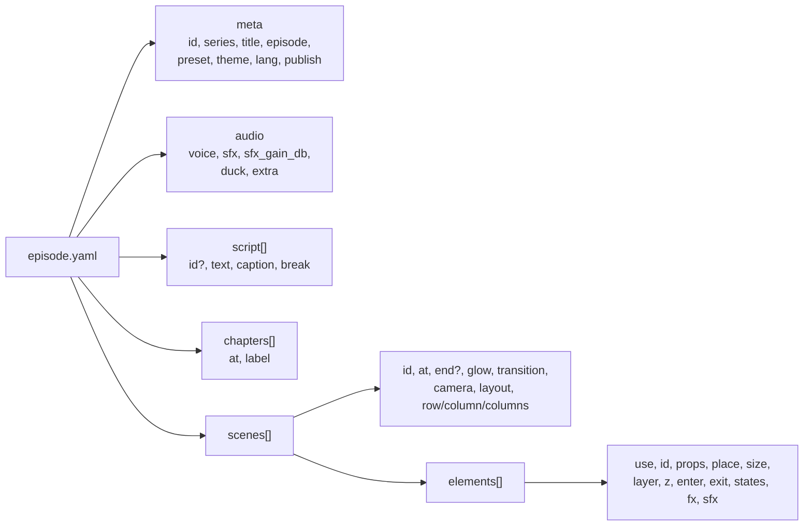

### 7.2 مثال مشروح

```yaml
meta:
  id: ep10 # حروف صغيرة وأرقام و - و _
  series: 'SYSTEM DESIGN'
  title: 'Rate Limiting'
  episode: 10
  preset: tiktok # يحدد مكان المسرح والمناطق الآمنة
  theme: default # الألوان والخطوط
  lang: en-US # الافتراضي في الـ schema هو ar-EG!
  publish: { cover: 'Flooded API?', caption: '…', hashtags: ['#systemdesign'], pinned: '…' }

audio:
  voice: voice.wav
  sfx: auto # auto | manual | none
  sfx_gain_db: -16 # مستوى المؤثرات تحت الصوت
  # duck: true       ← خفض المؤثرات تلقائياً عندما تتكلم

script: # المعرّفات الافتراضية: l1, l2, …
  - text: 'Your API just got flooded with requests.'
  - text: 'A rate limiter decides who gets through.'

chapters:
  - { at: l1, label: '01 · THE PROBLEM' }

scenes:
  - id: hook
    at: l1 # يبدأ مع السطر 1، وينتهي عند بداية المشهد التالي
    glow: red # لون التوهج في الخلفية
    transition: crossfade # كيف يدخل هذا المشهد
    camera: push-in # حركة كاميرا بطيئة طوال المشهد
    elements:
      - use: title # اسم المكوّن
        id: hook_title
        props: { text: 'Flooded **API**' } # **كلمة** = لون التمييز
        place: { x: 60, y: 160, w: 960, h: 240 } # إحداثيات المسرح
        enter: { at: "l1:'flooded'", anim: pop } # يدخل لحظة نطق "flooded"
        exit: { at: l2, anim: fade }
        fx: [{ at: "l1:'requests'", do: shake }]
```

### 7.3 الحقول المهمة للعنصر

| الحقل    | ماذا يفعل                                                                                                                     |
| -------- | ----------------------------------------------------------------------------------------------------------------------------- |
| `use`    | اسم المكوّن (من الـ 21). اسم غير موجود = **V-13** ويُحذف العنصر.                                                              |
| `id`     | اختياري. الافتراضي `<scene>-<use>-<n>`. يجب أن يكون فريداً في كل الحلقة.                                                      |
| `props`  | خصائص المكوّن، تُتحقق بـ schema المكوّن الصارم.                                                                               |
| `place`  | `x, y, w, h` أو `center` / `anchor` + `margin`. بدونه: يتوسط، أو يُرتَّب تلقائياً إن كان للمشهد `row` / `column` / `columns`. |
| `layer`  | `base` (الافتراضي) أو `overlay` (فوق الكل، مثل الأختام والشارات، ولا يدخل في فحص التداخل V-8).                                |
| `enter`  | `at` (الافتراضي: بداية المشهد)، `anim` (18 نوعاً)، `dur`، `ease`، ومعاملات مثل `dist`, `s0`, `cps`.                           |
| `exit`   | `at` (إلزامي)، `anim` (10 أنواع)، `dur` (الافتراضي 0.3).                                                                      |
| `states` | `[{ at, set: {...} }]` تغيير خصائص مع الزمن، مثلاً `status: err` لعقدة.                                                       |
| `fx`     | تأثيرات لحظية: `shake`, `flash`, `glitch`, `pulse`, `bump`. مع `target: camera` يهتز الإطار كله.                              |
| `sfx`    | `auto` / `none` / قائمة أصوات صريحة.                                                                                          |

---

## 8. الزمن: cues والكلمات و time expressions

هذا أذكى جزء في المشروع، ويستحق الفهم الجيد.

### 8.1 ثلاث طبقات للزمن

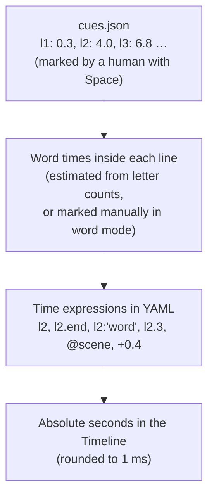

### 8.2 الـ cues

الـ cue هو **بداية** السطر. نهاية السطر = بداية السطر التالي (أو نهاية الصوت للسطر الأخير). شكل
`cues.json`:

```json
{
  "version": 1,
  "audio": { "file": "voice.wav", "duration": 45, "sha1": "…" },
  "cues": { "l1": 0.3, "l2": 4, "l3": 6.8 },
  "words": { "l2": [4.0, 4.31, 4.9] },
  "draft": true
}
```

- **من أين تأتي؟** من الإنسان: في وضع Cues تضغط Space عند بداية كل سطر وأنت تستمع (بسرعة 0.5×–1×).
  اختيارياً، "Snap to voice" يحرّك العلامة إلى أقرب ارتفاع حقيقي في الصوت خلال ±120 ms (انظر
  [§12](#12-حزمة-audio-الصوت-بدون-ملفات-صوتية)).
- **Draft cues (قبل التسجيل):** تقدير حسابي في
  [compile.ts](../packages/core/src/compile.ts) (`draftCues`): **13 حرفاً في الثانية** + فجوة 0.35 ث
  بين الأسطر، بدءاً من 0.2 ث. إذا وُجد تسجيل لاحقاً، تُمدَّد التقديرات خطياً لتطابق مدته.
- **لماذا لا يُستخدم التعرف على الكلام؟** قرار مقصود (ADR-004): المشروع بلا AI، والتعليم اليدوي
  لحلقة 90 ثانية يأخذ 2–3 دقائق فقط.
- **الحماية:** إذا تغيّر ملف الصوت بعد تعليم الـ cues، يختلف الـ `sha1` فيظهر تحذير V-4.

### 8.3 تقدير زمن كل كلمة

في [words.ts](../packages/core/src/words.ts) (`estimateWordStarts`): مدة السطر تُوزَّع على كلماته
**بنسبة عدد حروف كل كلمة** (بحد أدنى 2)، بعد حجز 0.18 ث كوقفة في نهاية السطر.

**مثال حقيقي من `examples/promo/intro`:**

السطر `l1` = "What if your voice could direct the whole video?"، الـ cue = 0.3، والسطر التالي
عند 4.0.

```text
span     = 4.0 − 0.3 − 0.18 = 3.52 s
weights  = What 4, if 2, your 4, voice 5, could 5, direct 6, the 3, whole 5, video 5  → total 39
voice    = 0.3 + 3.52 × (4+2+4)/39 = 0.3 + 0.903 = 1.203 s
```

إذن `l1:'voice'` = **1.203 ث**. وإذا علّمت الكلمات يدوياً (Word mode، مفتاح W)، وكان عدد الأزمنة
مساوياً لعدد الكلمات تماماً، تُستخدم الأزمنة اليدوية بدل التقدير.

### 8.4 قواعد كتابة time expressions

التعريف في [time.ts](../packages/core/src/time.ts):

```text
expr   := base offset*
base   := NUMBER "s" | NUMBER                ← ثوانٍ مطلقة
        | LINE_ID                            ← بداية السطر
        | LINE_ID ".end"                     ← نهاية السطر
        | LINE_ID ":" 'word' ("#" N)?        ← كلمة (والتكرار رقم N)
        | LINE_ID "." N                      ← الكلمة رقم N (يبدأ العد من 0)
        | "@" SCENE_ID (".start" | ".end")?  ← بداية/نهاية مشهد
offset := ("+" | "-") NUMBER "s"?
```

| التعبير          | المعنى                                                    |
| ---------------- | --------------------------------------------------------- |
| `12.5s` / `12.5` | الثانية 12.5                                              |
| `l7`             | بداية السطر 7 = الـ cue                                   |
| `l7.end`         | `max(start, next − 0.15)`: قبل بداية السطر التالي بـ 0.15 |
| `l7:'bucket'`    | أول ظهور لكلمة bucket في السطر 7                          |
| `l7:'the'#2`     | الظهور الثاني لـ the                                      |
| `l7.3`           | الكلمة الرابعة (العد من 0)                                |
| `@hook.end`      | نهاية المشهد hook                                         |
| `l7:'x'+0.4`     | بعد الكلمة بـ 0.4 ث (يمكن جمع عدة إزاحات)                 |

**مطابقة الكلمات ذكية:** قبل المقارنة تُحذف علامات الترقيم والتشكيل والتطويل، وتُوحَّد `أ إ آ` إلى
`ا`، وتُحوَّل الحروف إلى صغيرة. يمكن أيضاً البحث عن عبارة من عدة كلمات. إذا لم تُوجد الكلمة: خطأ
**V-2** مع اقتراح أقرب كلمة (Levenshtein).

> قاعدة YAML: ضع التعبير بين علامتي تنصيص مزدوجتين إذا احتوى `:` أو `'`، مثل `at: "l3:'bucket'"`.

---

## 9. حزمة core: المترجم (Compiler)

### 9.1 خريطة الملفات

| الملف                                                       | الدور                                                                         |
| ----------------------------------------------------------- | ----------------------------------------------------------------------------- |
| [types.ts](../packages/core/src/types.ts)                   | تعريف الـ `Timeline` وكل أنواعه (العقد مع الـ runtime)                        |
| [schema/episode.ts](../packages/core/src/schema/episode.ts) | schema الـ YAML بـ zod                                                        |
| [yamlsrc.ts](../packages/core/src/yamlsrc.ts)               | تحليل YAML مع **الاحتفاظ بمواقع السطور** حتى تشير الأخطاء إلى `file:line:col` |
| [zodissues.ts](../packages/core/src/zodissues.ts)           | تحويل أخطاء zod إلى Issues مفهومة مع did-you-mean                             |
| [time.ts](../packages/core/src/time.ts)                     | قواعد time expressions وتحليلها وحسابها                                       |
| [words.ts](../packages/core/src/words.ts)                   | تقدير أزمنة الكلمات وجدول توقيت الأسطر                                        |
| [text.ts](../packages/core/src/text.ts)                     | أدوات النص المختلط عربي/لاتيني (التطبيع، الاتجاه، عدّ الحروف)                 |
| [captions.ts](../packages/core/src/captions.ts)             | بناء الترجمة: التقطيع والـ bidi                                               |
| [cues.ts](../packages/core/src/cues.ts)                     | قراءة/كتابة `cues.json` (كتابة ذرّية)                                         |
| [compile.ts](../packages/core/src/compile.ts)               | **المُترجِم** `compileEpisode` (~650 سطراً هي قلب المشروع)                    |
| [lint.ts](../packages/core/src/lint.ts)                     | فحوص هندسية وزمنية ثابتة (V-6, V-7, V-8, V-11, V-12)                          |
| [theme.ts](../packages/core/src/theme.ts)                   | تحميل الثيمات مع `extends` وفحص التباين                                       |
| [preset.ts](../packages/core/src/preset.ts)                 | تحميل الـ presets                                                             |
| [project.ts](../packages/core/src/project.ts)               | مسارات المشروع والبحث عن الحلقات والموارد                                     |
| [components/](../packages/core/src/components/)             | تعريف الـ 21 مكوّناً: schema الخصائص، الحجم الافتراضي، الأصوات التلقائية      |
| [outputs.ts](../packages/core/src/outputs.ts)               | توليد `.srt` و `publish.md`                                                   |
| [template.ts](../packages/core/src/template.ts)             | قالب الحلقة الجديدة                                                           |
| [jsonschema.ts](../packages/core/src/jsonschema.ts)         | تحويل الـ schema إلى JSON Schema (للإكمال التلقائي، وللمحرر، ولـ MCP)         |

### 9.2 مراحل الترجمة

`compileEpisode(paths, opts)` دالة **نقية**: نفس الملفات = نفس الـ Timeline.

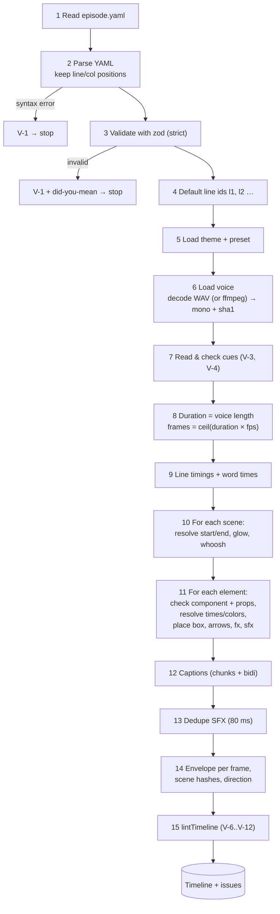

تفاصيل مهمة في كل مرحلة:

- **المدة** = مدة الصوت، أو `audio.duration` في cues، أو (كحل أخير) آخر cue + 3 ث.
- **أزمنة المشهد:** البداية = `at` محسوباً. النهاية = `end` إن وُجد، وإلا بداية المشهد التالي.
  مرجع دائري بين المشاهد (`@a.end` → `@b` → …) يُكتشف ويعطي خطأ.
- **منطقة المشهد (origin):** `layout: stage` (الافتراضي) → `{x:0, y:270, w:1080, h:1000}`.
  `layout: full` → الـ canvas كله.
- **حل الخصائص (`resolveProps`):** يمرّ على كل الخصائص بشكل عميق:
  - المفاتيح `at, until, strike, highlight` تتحول من تعبيرات إلى ثوانٍ.
  - المفاتيح `color, accent, danger` والمصفوفة `colors` تتحول من أسماء الثيم (`lime`) إلى CSS (`#b8ff3c`).
- **مدة الدخول الافتراضية** حسب الحركة: `blur/wipe/reveal/draw` ‏0.6، `spring` ‏0.8، `drop` ‏0.7،
  `stamp/glitch` ‏0.5، `type` ‏0.3، والباقي 0.45 من الثيم.
- **الأسهم:** `from: api.right` يُحسب من صندوق العنصر `api` **في نفس المشهد**. إذا لم يُذكر الجانب،
  يُختار تلقائياً حسب الاتجاه. ثم تُحسب نقاط المسار (مستقيم / بزاوية / منحنٍ).
- **تأثيرات تُنقل للمستوى العام:** `flash` يذهب إلى `timeline.flashes` (وميض على الشاشة كلها)، و
  `shake` مع `target: camera` يذهب إلى `timeline.shakes`. مكوّنا `stamp` و `trap` يضيفان وميضاً واهتزازاً
  تلقائياً.
- **الفشل لا يوقف كل شيء:** عنصر بمكوّن مجهول أو خصائص خاطئة يُحذف ويُبلَّغ عنه، لكن الـ Timeline يُعاد
  حتى مع وجود أخطاء (بقيم احتياطية). لهذا يستطيع المحرر عرض "آخر نسخة صالحة".

### 9.3 شكل الـ Timeline

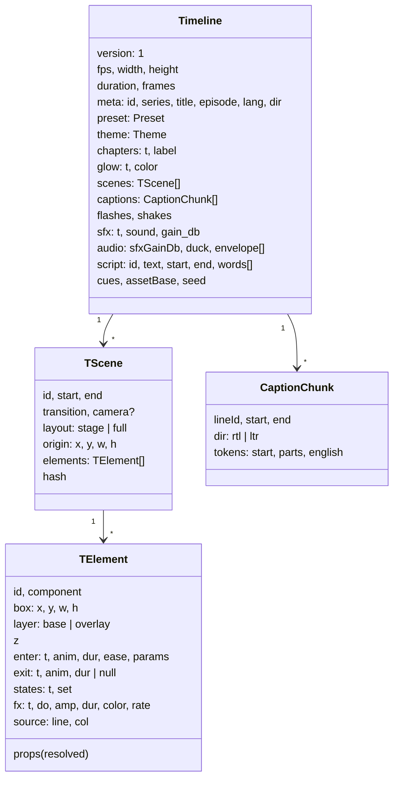

كل شيء فيه **محسوب مسبقاً**: الأزمنة بالثواني (بدقة 1 ms)، الألوان قيم CSS، الصناديق نهائية، نقاط
الأسهم جاهزة. الـ runtime لا يحتاج إلا أن يحسب "ماذا يظهر عند `t`".

`audio.envelope` مصفوفة فيها **قيمة لكل إطار** (0..1) تمثل علوّ الصوت، تحرّك شريط الموجة الصوتية في
الفيديو. و `seed` = hash لمعرّف الحلقة، أساس كل "عشوائية" في الرسم.

### 9.4 نظام الإحداثيات

```text
 canvas 1080 × 1920 (tiktok preset)
 y=0     ┌───────────────────────────────┐
         │                               │
 y≈120   │  progress bar · SERIES · EP.10│  ← Header (headerTop 150)
         │  chapter label                │
 y=270   ├───────────────────────────────┤ ─┐
         │ (0,0) of the STAGE            │  │
         │                               │  │  STAGE 1080 × 1000
         │   elements live here,         │  │  element place: {x,y,w,h}
         │   x ≥ 60, x+w ≤ 1020          │  │  are relative to this box
         │                         ┌─────┤  │
 y=900   │                         │right│  │  ← right-rail safe zone
         │   keep x+w ≤ 920 below  │rail │  │     (x ≥ 940, likes/comments)
 y=1270  ├─────────────────────────┤     ┤ ─┘
 y=1300  │  word-by-word CAPTIONS  │     │  ← captionsY
         │  ▁▃▅▇▅▃▁ waveform       │     │
 y=1540  ├─────────────────────────┴─────┤
         │  bottom safe zone             │  ← caption/username/music UI
 y=1920  └───────────────────────────────┘
```

| Preset | المسرح (y / h) | الترجمة y | الحافة اليمنى (right-rail) | المنطقة السفلى | حد الحجم | أقصى مدة |
| ------ | -------------- | --------- | -------------------------- | -------------- | -------- | -------- |
| tiktok | 270 / 1000     | 1300      | x 940 من y 900             | y 1540         | 28 MB    | 600 ث    |
| reels  | 270 / 1000     | 1290      | x 960 من y 1000            | y 1500         | 28 MB    | 900 ث    |
| shorts | **250** / 1000 | 1280      | x 960 من y 1000            | y 1560         | 28 MB    | 180 ث    |

القاعدة "x+w ≤ 920 تحت y 600" في AGENTS.md ليست مكتوبة في الكود. هي نتيجة الـ right-rail: y 900 في
الـ canvas = y 630 في المسرح.

### 9.5 الترجمة (Captions) والعربية

هذا جزء دقيق جداً لأن الخلط بين العربي والإنجليزي (`الـ client`) يكسر معظم المحركات. الحل في
[captions.ts](../packages/core/src/captions.ts) (تفكير) و [runtime/captions.ts](../packages/runtime/src/captions.ts)
(رسم)، وموثّق في ADR-007:

1. **الاتجاه لكل سطر:** RTL إذا احتوى السطر حرفاً عربياً.
2. **تجميع الكلمات (tokens):**
   - الكلمات اللاتينية المتتالية تندمج في token واحد: "Duplicate Charge".
   - الكلمة المنتهية بالتطويل `ـ` تلتصق بما بعدها بـ NBSP: `الـ client` لا تنفصل أبداً عند الالتفاف.
3. **عزل bidi:** داخل كل token، الأجزاء اللاتينية تُوضع في `<bdi>`. والـ token كله `inline-block`
   و `nowrap`، فيتصرف ككتلة واحدة في ترتيب الفقرة. علامات الترقيم مثل `؟` تبقى خارج العزل، فتظهر في
   المكان الصحيح.
4. **التقطيع (chunks):** الحد الأقصى 34 حرفاً لكل قطعة (من الثيم). القطعة الطويلة تُقسم عند علامة
   الترقيم الأقرب للمنتصف، أو من المنتصف. يمكن فرض فواصل بـ `break: ['word']` في السطر.
5. **الكاريوكي:** كل token يحمل زمن بدايته. أثناء الرسم: الكلمة الحالية بلون `active` (lime)، والسابقة
   بلون عادي، والقادمة شفافة (`future_opacity` 0.32)، والإنجليزية داخل العربي بلون `english` (cyan).
   والكلمة النشطة تنبض قليلاً.

ملف `.srt` الناتج يغلّف الأسطر العربية بعلامتي Unicode ‏RLE…PDF حتى تُعرض صحيحة في المشغلات.

### 9.6 الثيمات

ملفات `themes/<name>.theme.yaml` تدعم `extends` (وراثة مع دمج عميق، واكتشاف الحلقات الدائرية).
الثيم `default`:

| القسم      | القيم                                                                                 |
| ---------- | ------------------------------------------------------------------------------------- |
| `colors`   | bg `#07080c`, ink, dim, line, card, **lime** `#b8ff3c`, cyan, red, amber, violet      |
| `fonts`    | Space Grotesk (العناوين)، JetBrains Mono (الكود)، Cairo (العربي). **فقط هذه الثلاثة** |
| `type`     | caption 66, title 120, h2 84, body 32, label 24                                       |
| `chrome`   | header, progress, waveform, grain 0.07 (ثابت), vignette 0.75, grid                    |
| `motion`   | pop_overshoot 1.9, default_dur 0.45, crossfade 0.3                                    |
| `captions` | active lime, english cyan, future_opacity 0.32, max_lines 2, max_chars 34, scrim 0.78 |

خط غير مضمّن = **V-13** (لأن الرسم لا يصل للإنترنت). وتباين النص مع الخلفية أقل من 7:1 = تحذير V-1.

**لماذا الـ grain ثابت؟** (ADR-011): ضجيج يتغير كل إطار لا يمكن ضغطه. قِيس: بلا grain ‏1.9 Mb/s، مع
grain متحرك ‏64.5 Mb/s، مع grain ثابت ‏5.9 Mb/s. والمنصات تزيله أصلاً عند إعادة الترميز.

### 9.7 قواعد التحقق V-1 … V-14

| القاعدة  | المستوى              | ماذا تفحص                                                                                             | أين                 |
| -------- | -------------------- | ----------------------------------------------------------------------------------------------------- | ------------------- |
| **V-1**  | error (أحياناً warn) | كل أخطاء البنية: YAML، zod، معرّفات مكررة، ثيم/preset مجهول، سهم يشير لعنصر غير موجود، التباين، المدة | core                |
| **V-2**  | error                | تعبير زمني غير صالح أو لا يُحل (سطر/كلمة/مشهد مجهول، خارج المدة، مرجع دائري)                          | core                |
| **V-3**  | error/warn/info      | cues مفقودة أو غير مرتبة أو بعد نهاية الصوت؛ cue لسطر مجهول؛ cues تقديرية (info)                      | core                |
| **V-4**  | warn/error           | ملف الصوت مفقود (warn) أو غير مقروء (error) أو تغيّر منذ تعليم الـ cues                               | core                |
| **V-5**  | error                | نهاية المشهد قبل بدايته؛ عنصر يدخل خارج مشهده؛ خروج قبل الدخول                                        | core                |
| **V-6**  | warn                 | العنصر يخرج عن حدود المسرح                                                                            | core (lint)         |
| **V-7**  | warn                 | العنصر يتقاطع مع منطقة آمنة (واجهة المنصة)                                                            | core (lint)         |
| **V-8**  | warn                 | عنصران `base` ظاهران معاً يتداخلان بأكثر من 15%                                                       | core (lint)         |
| **V-9**  | warn                 | النص يفيض عن صندوقه **بعد الرسم الفعلي**                                                              | renderer (Chromium) |
| **V-10** | warn                 | قطعة ترجمة تُرسم في أسطر أكثر من `max_lines`                                                          | renderer (Chromium) |
| **V-11** | info                 | لا شيء يدخل في أول 1.5 ث من المشهد ("هواء ميت")                                                       | core (lint)         |
| **V-12** | warn                 | عنصر يدخل قبل نهاية مشهده بأقل من 0.1 ث ("وميض")                                                      | core (lint)         |
| **V-13** | error                | مكوّن مجهول، أو خط غير مضمّن                                                                          | core                |
| **V-14** | warn / info          | الإيقاع: سطر أسرع من 3.5 كلمة/ث، أو الـ hook يبدأ بعد 3 ث (warn)؛ صمت ≥ 1.5 ث في التسجيل (info)       | core (compile)      |

V-9 و V-10 وحدهما تحتاجان متصفحاً، لأن حجم النص الحقيقي لا يُعرف إلا بعد رسمه بالخط الفعلي. نتائجهما
تُخزَّن في `out/.cache/measure.json` بمفتاح hash (الـ runtime + المشاهد + الثيم + الـ preset)، فلا
تُعاد إلا إذا تغيّر شيء.

### 9.8 المكوّنات الـ 21

كل مكوّن له تعريف في [core/components](../packages/core/src/components/index.ts) (الـ schema والحجم
الافتراضي والأصوات) وتنفيذ في [runtime/components](../packages/runtime/src/components/index.ts) (الرسم)
بنفس الاسم.

| #   | المكوّن     | ما هو                                             | الحجم الافتراضي | صوت تلقائي                  |
| --- | ----------- | ------------------------------------------------- | --------------- | --------------------------- |
| 1   | `title`     | عنوان كبير، `**كلمة**` بلون التمييز، يتقلص ليناسب | 960×240         | whoosh عند الدخول           |
| 2   | `label`     | سطر صغير بخط mono مع نقطة متوهجة                  | 640×60          | —                           |
| 3   | `code`      | محرر كود يكتب نفسه سطراً سطراً مع تلوين وتظليل    | 960×520         | typing                      |
| 4   | `node`      | صندوق نظام (server/db) بحالة ok/err/warn/busy     | 300×170         | err / ding عند تغيّر الحالة |
| 5   | `arrow`     | سهم بين عنصرين مع packets متحركة وتسمية           | يُحسب           | whoosh                      |
| 6   | `chip`      | حبة نص صغيرة، يمكن شطبها                          | 340×84          | ding / err عند الشطب        |
| 7   | `stamp`     | ختم مائل يسقط بقوة (+ وميض + اهتزاز)              | 680×260         | hit                         |
| 8   | `table`     | جدول تظهر صفوفه تباعاً                            | 960×440         | ding لكل صف                 |
| 9   | `lanes`     | مسارات متوازية (race conditions)                  | 960×760         | tick / err                  |
| 10  | `checklist` | قائمة ✓/✗ ترسم نفسها                              | 880×460         | ding / err                  |
| 11  | `counter`   | رقم كبير يعدّ بين keyframes                       | 820×320         | —                           |
| 12  | `meter`     | شريط قياس مع حد (LIMIT) يحمرّ عند تجاوزه          | 880×180         | —                           |
| 13  | `timeline`  | محور زمني مع علامات ومؤشر                         | 960×260         | ding لكل علامة              |
| 14  | `grid`      | شبكة مربعات بحالات                                | 640×640         | —                           |
| 15  | `bucket`    | دلو tokens (rate limiting) تُستهلك وتُملأ         | 440×560         | tick                        |
| 16  | `phone`     | هاتف بتطبيق دفع وإشعارات ونقرات                   | 440×880         | tap / ding                  |
| 17  | `quote`     | اقتباس يُكتب مع إبراز كلمات                       | 940×460         | typing                      |
| 18  | `particles` | جسيمات: burst, confetti, herd, stream, dust       | يملأ المشهد     | —                           |
| 19  | `trap`      | فاصل "THE TRAP" بأشرطة تحذير و glitch             | يملأ المشهد     | hit + glitch                |
| 20  | `cta`       | بطاقة النهاية "الحلقة القادمة" مع صندوق تعليق     | 960×560         | typing                      |
| 21  | `icon`      | واحدة من 30 أيقونة مضمّنة، أو صورة من `assets/`   | 160×160         | —                           |

---

## 10. حزمة runtime: الرسم بدالة render(t)

### 10.1 الفكرة

الـ runtime **صفحة HTML صغيرة** ([runtime.html](../packages/runtime/page/runtime.html)) + ملف
`runtime.js` مجمّع بـ esbuild + خطوط محلية. تكشف للعالم الخارجي كائناً واحداً:

```ts
window.reelforge = {
  ready: Promise<void>,      // يكتمل بعد تحميل الخطوط والـ Timeline
  fonts: { ok, missing },    // للتأكد أن كل الخطوط حُمّلت (V-13)
  load(tl: Timeline),        // تحميل Timeline جديد (المحرر)
  render(t: number),         // ارسم الإطار عند الزمن t ← كل شيء هنا
  measure(),                 // قياس V-9 / V-10
  boxes(t),                  // صناديق العناصر الظاهرة (لنقر المحرر)
};
```

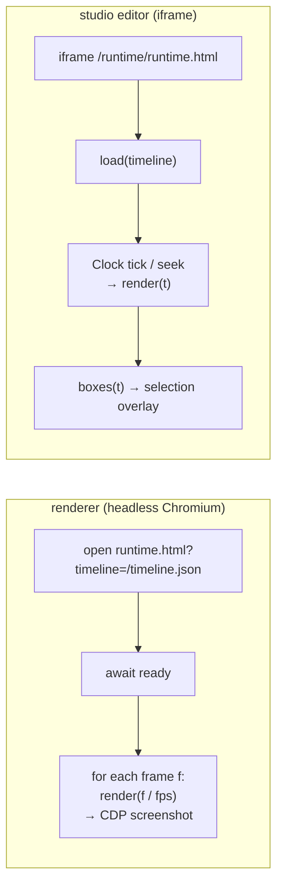

### 10.2 طبقات الإطار

`Engine` في [engine.ts](../packages/runtime/src/engine.ts) يبني كل المشاهد والعناصر **مرة واحدة**، ثم
`render(t)` يغيّر فقط ما يظهر وكيف. ترتيب الطبقات من الأسفل للأعلى:

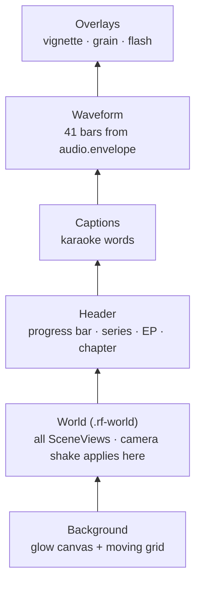

لاحظ أن اهتزاز الكاميرا يطبَّق على الـ World فقط، فالترويسة والترجمة لا تهتز.

### 10.3 ماذا يحدث داخل render(t)

```ts
t = clamp(t, 0, duration);
frame = Math.round(t * fps);
background.update(t); // لون التوهج (تلاشٍ 0.8 ث بين المشاهد)
world.transform = cameraShake(t); // اهتزازات timeline.shakes
for (scene of scenes) scene.update(t, frame);
header.update(t);
captions.update(t);
waveform.update(t);
overlays.update(t, frame);
```

**لكل مشهد** (`SceneView` في [scene.ts](../packages/runtime/src/scene.ts)):

- ظاهر إذا `start ≤ t < end + مدة انتقال الخروج`.
- **الانتقال الداخل** حسب `transition`:

| الانتقال              | التأثير                                          |
| --------------------- | ------------------------------------------------ |
| `crossfade` (افتراضي) | ظهور + تكبير 0.97→1 + تمويه 8→0                  |
| `cut`                 | فوري                                             |
| `slide-up`            | ينزلق من الأسفل 140 px                           |
| `zoom`                | تصغير 1.12→1 + تمويه                             |
| `push`                | يدفع المشهد القديم لليسار ويدخل من اليمين (معاً) |
| `blur`                | تمويه قوي 22→0                                   |

- **الكاميرا** طوال المشهد: `push-in` تكبير 1→1.06، `pull-out` العكس، `drift` انجراف ±18 px.
- **تجميد العناصر:** أثناء خروج المشهد، العناصر "تتجمد" على آخر لحظة من المشهد حتى لا تتحرك أثناء
  التلاشي.

**لكل عنصر** (`ElementView`):

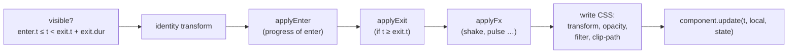

### 10.4 الحركات

**حركات الدخول (18):**

| الحركة            | ما يحدث                                              |
| ----------------- | ---------------------------------------------------- |
| `pop` (افتراضي)   | تكبير من 0.8 مع ارتداد (overshoot 1.9) + صعود بسيط   |
| `rise`            | يصعد 40 px مع ظهور                                   |
| `slide-l/slide-r` | ينزلق 140 px من الجانب                               |
| `fade`            | ظهور فقط                                             |
| `draw`            | يُكشف من بداية السطر (للأسهم: يُرسم الخط)            |
| `type`            | يُكتب حرفاً حرفاً (title/code)، أو كلمة كلمة للعربي  |
| `count`           | ظهور (القيمة نفسها من keyframes)                     |
| `flip`            | ينقلب 90° على المحور X                               |
| `zoom`            | من 1.35 للحجم الطبيعي مع تمويه                       |
| `stamp`           | يسقط من 2.2× ويستقر بارتجاج                          |
| `blur`            | يتضح من تمويه 16                                     |
| `wipe`            | يُمسح من جهة البداية (يحترم RTL)                     |
| `spring`          | نابض مخمَّد من 0.55                                  |
| `drop`            | يسقط من 220 px مع ارتداد                             |
| `reveal`          | يصعد من خلف قناع عند حافته السفلى (للعناوين الكبيرة) |
| `glitch`          | ارتعاش مع فصل ألوان أحمر/أزرق                        |
| `none`            | بلا حركة                                             |

**التسارع (ease):** `smooth` (cubic، افتراضي)، `snappy` (quint)، `gentle` (sine)، `linear`.

**حركات الخروج (10):** `fade`, `pop` (يصغر)، `rise` (يصعد)، `sink` (يهبط)، `slide-l/r`، `zoom` (يكبر)،
`blur`، `wipe`، `none`. كلها تتسارع للخارج (`easeInCubic`).

**التأثيرات `fx`:** `shake` (ارتجاج عشوائي حتمي 40 Hz)، `glitch`، `pulse` (نبض متكرر)، `bump` (نبضة
واحدة)، `flash` (وميض الشاشة كلها).

**`states`:** لكل زمن، كل `set` سابق يُدمج فوق الخصائص، مع حفظ زمن آخر تغيير لكل مفتاح (`$since`) حتى
يستطيع المكوّن تحريك التغيير (مثلاً العقدة تومض عندما تصبح `err`). **لا شيء يتراكم**: الحالة تُحسب من
الصفر في كل إطار.

### 10.5 كيف يُكتب مكوّن

```ts
interface RuntimeComponent {
  name: string;
  handles?: EnterAnim[]; // حركات يرسمها المكوّن بنفسه (title/code: type، arrow: draw، trap: glitch)
  mount(root, props, theme, ctx): Instance; // مرة واحدة: بناء DOM
}
interface Instance {
  update(t, local, state): void; // كل إطار: دالة نقية في t
}
```

- `mount` يبني الـ DOM مرة واحدة، ويمكنه قياس النص (`fitText` يصغّر الخط بالبحث الثنائي حتى يناسب).
- `update` يُستدعى كل إطار ويجب أن يكون **دالة في t فقط**.
- أغلب المكوّنات HTML/CSS. **SVG**: الأسهم، الدلو، علامات checklist، الأيقونات. **Canvas**: الجسيمات،
  التوهج، الشبكة، الـ grain.
- كتابة الـ DOM تمر عبر كاش (`css()`, `attr()`, `text()`) لا يكتب إلا إذا تغيرت القيمة، وهذا يسرّع
  الرسم كثيراً.

### 10.6 الحتمية داخل المتصفح

- لا `Date.now`، لا `Math.random`، لا `setTimeout`، لا `requestAnimationFrame` في كود الـ runtime.
- ملف الـ CSS الأساسي يفرض `animation: none !important; transition: none !important` على كل شيء.
- العشوائية تأتي من `rnd(seed)` و `mulberry32(seed)` في حزمة audio، والبذرة = hash(معرّف العنصر) XOR
  `timeline.seed`.
- الجسيمات: مواقعها **صيغة مغلقة** في `t − start`، لا محاكاة خطوة بخطوة. لذلك الإطار 500 يمكن رسمه
  قبل الإطار 10.
- اختبار يرسم المعرض كله للأمام وللخلف ويقارن الـ DOM، واختبار آخر يقارن SHA-1 لصور JPEG.

---

## 11. حزمة renderer: من الإطارات إلى MP4

### 11.1 خريطة الملفات

| الملف                                             | الدور                                                            |
| ------------------------------------------------- | ---------------------------------------------------------------- |
| [render.ts](../packages/renderer/src/render.ts)   | `renderEpisode()`: خط الإنتاج الكامل بمراحله                     |
| [workers.ts](../packages/renderer/src/workers.ts) | تقسيم الإطارات وتشغيل العمّال المتوازيين وإعادة المحاولة         |
| [host.ts](../packages/renderer/src/host.ts)       | تشغيل Chromium وخدمة الصفحة **بدون خادم HTTP** وحجب الشبكة       |
| [capture.ts](../packages/renderer/src/capture.ts) | التقاط الإطار عبر CDP ‏`Page.captureScreenshot`                  |
| [encode.ts](../packages/renderer/src/encode.ts)   | إعدادات H.264، الـ master والـ share، فحص المطابقة، ورقة اللقطات |
| [audio.ts](../packages/renderer/src/audio.ts)     | كتابة مسار المؤثرات ومزج الصوت (loudnorm + ducking)              |
| [ffmpeg.ts](../packages/renderer/src/ffmpeg.ts)   | إيجاد وتشغيل ffmpeg/ffprobe وقراءة التقدم                        |
| [measure.ts](../packages/renderer/src/measure.ts) | فحوص V-9 و V-10 في متصفح، مع كاش                                 |
| [snap.ts](../packages/renderer/src/snap.ts)       | صور PNG لأزمنة محددة (`reelforge snap`)                          |
| [doctor.ts](../packages/renderer/src/doctor.ts)   | فحص البيئة                                                       |

### 11.2 المراحل

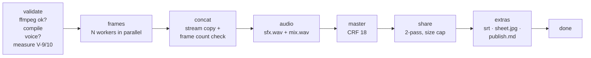

- كل الملفات المؤقتة في `out/.tmp/<timestamp>-<hex>/` وتُحذف عند النجاح.
- **الرسم الجزئي** (`--from 10 --to 15`) يُخرج فقط `<id>.part.mp4` بدون share ولا إضافات.
- **الإلغاء** (Ctrl+C مرة، أو زر Cancel) يقتل كل عمليات ffmpeg ويحذف الملفات الجزئية. ضغطة ثانية =
  خروج فوري (رمز 130).
- فشل فحص المطابقة **لا يرمي استثناء**: يعيد `ok: false` مع قائمة المشاكل (وهذا ما كان يظهر في رسالة
  `Output check failed: pixel format yuvj420p`).

### 11.3 العمّال المتوازيون

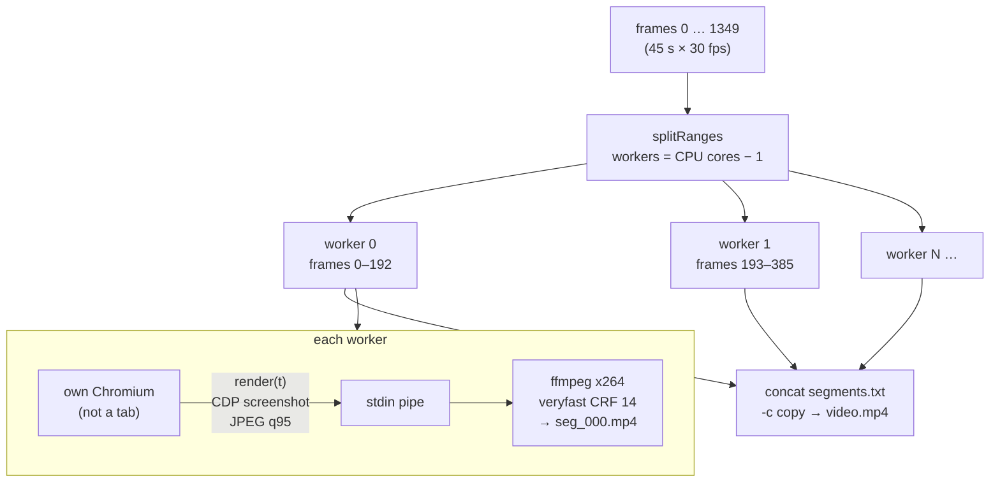

- كل عامل له **متصفح منفصل** (لا تبويب)، لأن التبويبات تتشارك عملية الرسم فتتسلسل.
- الصفحة تُخدَم عبر **اعتراض الطلبات** في Playwright على عنوان وهمي `http://reelforge.local`:
  `/timeline.json` من الذاكرة، `/runtime/*` من ملفات الـ runtime، `/episode/assets/*` من مجلد الحلقة.
  **أي عنوان آخر يُحجب** ويُسجَّل، وإن وُجد يفشل العامل (NFR-8: لا شبكة أبداً).
- إعدادات Chromium للحتمية: بدون GPU، بدون LCD text و hinting، ألوان sRGB، مقياس 1، منطقة زمنية UTC.
- عامل تعطّل؟ يُعاد مقطعه **مرة واحدة**، ويُصحَّح عداد التقدم حتى لا يُحسب مرتين.
- بعد الدمج يُعدّ عدد الإطارات بـ ffprobe؛ أي اختلاف = خطأ.

### 11.4 الترميز (Encoding)

إعدادات H.264 المشتركة: `libx264`، profile **High**، GOP 60 (ثانيتان)، B-frames 2، معدل إطارات ثابت،
و **تحويل الألوان `YUV420_TV`**:

```text
-vf scale=out_range=tv:out_color_matrix=bt709:flags=accurate_rnd+full_chroma_int,format=yuv420p
-pix_fmt yuv420p -color_range tv -colorspace bt709 -color_primaries bt709 -color_trc bt709
```

> **قصة هذا السطر:** صور JPEG ملتقطة بمدى ألوان كامل (full range). منذ FFmpeg 7، الخيار
> `-pix_fmt yuv420p` وحده لم يعد يحوّل المدى، فيخرج الفيديو بمدى كامل ويراه ffprobe ‏`yuvj420p`، فيفشل
> فحص المطابقة (وبعض المنصات ترفضه). الحل: فلتر `scale` يحوّل فعلياً إلى المدى المحدود BT.709 (معيار
> فيديو HD والهواتف)، والوسوم تصف ذلك. يُطبَّق على المقاطع الوسيطة وعلى الترميز النهائي.

| المخرج     | الفيديو                                                 | الصوت            | ملاحظات                                            |
| ---------- | ------------------------------------------------------- | ---------------- | -------------------------------------------------- |
| **Master** | CRF 18، preset `slow` (`medium` مع `--fast`)            | AAC 192k، 48 kHz | جودة أرشيفية                                       |
| **Share**  | **تمريرتان** بمعدل bits محسوب، maxrate 1.5×، bufsize 3× | AAC 128k         | لا يتجاوز الحجم المحدد؛ لا يزيد عن معدل الـ master |
| **Part**   | مثل master لكن `medium` دائماً                          | AAC 192k         | للرسم الجزئي                                       |

**معادلة الـ share** (ADR-006):

```text
video_kbps = floor(MB × 8192 × 0.97 / duration) − 128      (0.97 = هامش 3% لحاوية MP4)
           ثم يُحصر بين 250 و 8000 kb/s، ولا يتجاوز معدل الـ master
```

مثال حقيقي: حلقة 45 ث، حد 28 MB → `floor(28×8192×0.97/45) − 128 = 4944 − 128 = 4816 kb/s`. وهذا
بالضبط ما طبعه الرسم: `share video 4816 kb/s`. إذا خرج الملف أكبر من الحد، يُعاد ترميزه مرة واحدة بـ
90%.

**فحص المطابقة `checkCompliance`** (بـ ffprobe): h264، High، `yuv420p`، `30/1`، AAC، 48 kHz، ذرّة
`moov` قبل `mdat` (faststart: الفيديو يبدأ قبل اكتمال التحميل)، والحجم ضمن الحد.

**ورقة اللقطات `sheet.jpg`:** 12 إطاراً موزعة بالتساوي، شبكة 4×3، كل لقطة 360×640.

### 11.5 مزج الصوت

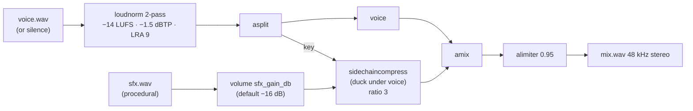

- **−14 LUFS** هو هدف علوّ الصوت عند المنصات. القياس في تمريرة أولى، ثم تطبيق خطي في الثانية.
- **Ducking:** عندما تتكلم، تنخفض المؤثرات تلقائياً (الصوت هو "مفتاح" الضاغط).
- بدون تسجيل (`--silent`): الصوت صمت، والمؤثرات وحدها.

### 11.6 القياس و doctor

- `measureTimeline`: متصفح واحد يستدعي `window.reelforge.measure()`. لكل عنصر يرسم لحظتين قرب نهايته
  (الحالة المستقرة، لا ارتداد الحركة)، ويُبلغ عن الفيض فقط إذا فاض في الاثنتين. فشل القياس لا يوقف
  الرسم.
- `doctor` يفحص: Node ≥ 22، ffmpeg ≥ 6 مع المُرمّزات (libx264, aac, mjpeg) والفلاتر (loudnorm,
  sidechaincompress, alimiter)، تشغيل Chromium فعلياً، ووجود الخطوط. `--fix` ينزّل Chromium.

---

## 12. حزمة audio: الصوت بدون ملفات صوتية

حزمة نقية بلا اعتماديات، تعمل في Node والمتصفح.

| الملف                                            | الدور                                                                               |
| ------------------------------------------------ | ----------------------------------------------------------------------------------- |
| [prng.ts](../packages/audio/src/prng.ts)         | `hashString` (FNV-1a)، `rnd(seed)` (hash عديم الحالة)، `mulberry32` (مولّد متتالية) |
| [wav.ts](../packages/audio/src/wav.ts)           | قراءة WAV ‏8/16/24/32-bit و float و extensible، وكتابته                             |
| [envelope.ts](../packages/audio/src/envelope.ts) | `frameEnvelope` (علوّ الصوت لكل إطار)، `peaks` (رسم الموجة)، `snapToOnset`          |
| [synth.ts](../packages/audio/src/synth.ts)       | تركيب 8 أصوات من موجات وضجيج                                                        |
| [sfx.ts](../packages/audio/src/sfx.ts)           | تجميع الأحداث في مسار واحد مُطبَّع إلى −0.9 dBFS                                    |

**الأصوات الثمانية** (ADR-008: لا مكتبات عينات، لا ترخيص، حتمية بالكامل):

| الصوت    | المدة  | كيف يُصنع                                |
| -------- | ------ | ---------------------------------------- |
| `whoosh` | 0.42 ث | ضجيج أبيض عبر مرشحات يتحرك ترددها        |
| `hit`    | 0.7 ث  | موجة جيبية تنخفض من 55 إلى 38 Hz + نقرة  |
| `ding`   | 0.9 ث  | نغمتان 1320 و 1980 Hz                    |
| `err`    | 0.42 ث | موجة مربعة 190 Hz على نبضتين             |
| `glitch` | 0.38 ث | ضجيج "أخذ واحتفاظ" مقطّع                 |
| `tick`   | 15 ms  | نقرة ضجيج حادة                           |
| `tap`    | 90 ms  | نغمة 220 Hz قصيرة + نقرة                 |
| `typing` | 0.36 ث | 5 نقرات `tick` بفواصل وقوى عشوائية حتمية |

**من أين تأتي أحداث المؤثرات** (مع `audio.sfx: auto`):

1. `whoosh` عند كل انتقال مشهد (عدا الأول و `cut`).
2. أصوات المكوّنات (جدول §9.8).
3. أصوات الـ `fx` (flash → hit، glitch → glitch).
4. قوائم `sfx` الصريحة في العناصر، و `audio.extra`.

ثم تُزال المكررات: نفس الصوت خلال 80 ms يُحتفظ بالأعلى فقط.

**`snapToOnset`:** حول الزمن الذي علّمته (±120 ms) يحسب RMS كل 2.5 ms ويبحث عن أكبر ارتفاع مفاجئ (>6
dB وفوق مستوى الضجيج). يُستخدم في المتصفح أثناء تعليم الـ cues لتصحيح تأخر رد فعلك.

---

## 13. حزمة studio: لوحة التحكم والمحرر

### 13.1 خادمان

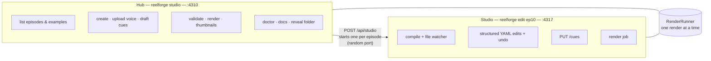

| الجانب         | Hub (لوحة التحكم)                              | Studio (المحرر)                                    |
| -------------- | ---------------------------------------------- | -------------------------------------------------- |
| الملف          | [hub.ts](../packages/studio/src/server/hub.ts) | [index.ts](../packages/studio/src/server/index.ts) |
| المنفذ         | 4310                                           | 4317 (أو عشوائي إذا فُتح من Hub / MCP)             |
| الواجهة        | `hub.html` + `hub.ts`                          | `index.html` + `main.ts` و 15 وحدة                 |
| مراقبة الملفات | لا (يحدّث عند العودة للنافذة)                  | نعم: `fs.watch` + إعادة ترجمة خلال 40 ms           |
| التحديث الحي   | WebSocket `/ws`: رسائل `job` و `project`       | WebSocket `/ws`: رسائل `state` كاملة و `job`       |

### 13.2 مسارات API

**Studio:**

| الطريقة | المسار                                                                 | الغرض                                                          |
| ------- | ---------------------------------------------------------------------- | -------------------------------------------------------------- |
| GET     | `/api/meta`                                                            | كتالوج المكوّنات وschemas خصائصها والحركات والأيقونات والثيمات |
| GET     | `/api/state`                                                           | الحالة الحالية (Timeline، issues، الصوت، المخرجات، التاريخ)    |
| POST    | `/api/edit`                                                            | `{ops, label}` تعديلات مهيكلة على `episode.yaml`               |
| POST    | `/api/undo`, `/api/redo`                                               | تراجع / إعادة                                                  |
| PUT     | `/cues`                                                                | حفظ `cues.json` (يُتحقق منه ويُضاف sha1 الصوت الحقيقي)         |
| POST    | `/api/render`, `.../cancel`                                            | بدء / إلغاء الرسم                                              |
| GET     | `/episode/voice*`, `/episode/out/*`, `/episode/assets/*`, `/runtime/*` | ملفات ثابتة                                                    |

**Hub:**

| الطريقة | المسار                      | الغرض                                                       |
| ------- | --------------------------- | ----------------------------------------------------------- |
| GET     | `/api/project`              | كل الحلقات مع ملخص (الصوت، الـ cues، الأخطاء، المخرجات)     |
| GET     | `/api/doctor`               | فحص البيئة                                                  |
| GET     | `/api/thumb`                | صورة مصغّرة (تُولَّد وتُخزَّن في `out/.cache/thumb.jpg`)    |
| GET     | `/files`                    | ملفات من `out/` فقط                                         |
| PUT     | `/api/voice`                | رفع تسجيل (حتى 1 GB) → تحويل بـ ffmpeg إلى WAV أحادي 48 kHz |
| POST    | `/api/episodes`             | حلقة جديدة                                                  |
| POST    | `/api/studio`               | فتح المحرر لحلقة                                            |
| POST    | `/api/validate`             | تحقق كامل + V-9/V-10                                        |
| POST    | `/api/render`, `.../cancel` | الرسم                                                       |
| POST    | `/api/cues/draft`           | cues تقديرية                                                |
| POST    | `/api/reveal`               | فتح المجلد في مستكشف الملفات                                |

### 13.3 التعديل المهيكل مع الحفاظ على التعليقات

المحرر **لا يعيد كتابة الملف من الصفر**. يرسل عمليات صغيرة بمسار YAML:

```json
{
  "label": "Move hook_title",
  "ops": [
    {
      "op": "set",
      "path": ["scenes", 0, "elements", 1, "place"],
      "value": { "x": 60, "y": 180, "w": 960, "h": 240 }
    }
  ]
}
```

الأنواع: `set`, `delete`, `insert`, `move`. التنفيذ في [edit.ts](../packages/studio/src/server/edit.ts)
يعمل على **شجرة مستند YAML** (مكتبة `yaml`) لا على كائن JSON:

- تغيير قيمة بسيطة يعدّل العقدة في مكانها، فيبقى أسلوب التنصيص والتعليق `# keep me` كما هو.
- الكائنات الصغيرة تُكتب بأسلوب `{ x: 1 }`، مع احترام أسلوب المسافات الموجود في الملف.
- الحذف ينظّف الحاويات الفارغة (`enter: {}` تُحذف).
- الكتابة **ذرّية** (ملف مؤقت ثم إعادة تسمية).

**التاريخ (History):** حتى 200 خطوة في ذاكرة الخادم، يشمل `episode.yaml` و `cues.json` والـ assets. إذا
عُدّل الملف من خارج المحرر، يُمسح التاريخ (حتى لا يتراجع فوق تعديلاتك).

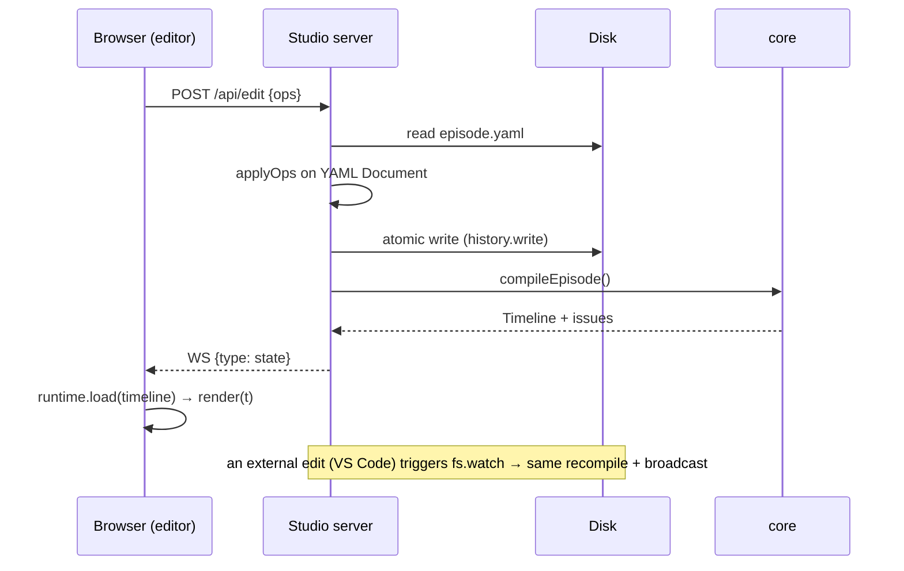

### 13.4 بنية المحرر في المتصفح

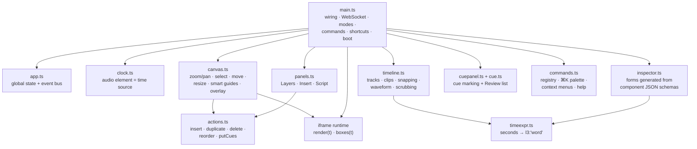

أهم الأفكار:

- **الساعة:** إذا وُجد تسجيل، عنصر `<audio>` هو مصدر الزمن (فيتزامن الصوت مع الصورة). بدونه ساعة
  الحاسوب. الـ runtime نفسه يبقى نقياً؛ الساعة في المحرر فقط.
- **النقر على الـ canvas:** `runtime.boxes(t)` يعطي صناديق العناصر الظاهرة. Alt+نقر يختار العنصر تحته.
- **السحب:** أثناء السحب يُحرَّك عنصر الـ DOM داخل الـ iframe مباشرة (سريع)، وعند الإفلات تُرسل عملية
  `set place`. محاذاة ذكية (smart guides) لحواف ومراكز الإطار والعناصر الأخرى.
- **الـ timeline:** سحب مقطع عنصر **يلتصق بالكلمات** ويُحفظ كتعبير كلامي. هذا دور `exprFor(t)` في
  [timeexpr.ts](../packages/studio/client/src/timeexpr.ts): الزمن 1.203 يصبح `l1:'voice'`، وليس `1.203`.
- **المفتش (Inspector):** يُبنى **تلقائياً** من JSON Schema لخصائص كل مكوّن: enum → قائمة، boolean →
  مفتاح، رقم → حقل بسحب، لون → عينات الثيم، زمن → حقل مع زر "الآن" ووصف بشري للتعبير.
- **الأوامر:** سجل واحد يخدم اختصارات لوحة المفاتيح، ولوحة ⌘K، وقوائم النقر الأيمن، وصفحة `?`. ويعمل حتى
  مع لوحة مفاتيح عربية (تحويل عبر `e.code`).
- **الأوضاع:** Edit (تصميم)، Cues (تعليم)، Review (قائمة المشاكل، النقر عليها ينقلك للعنصر).
- **الشاشات الصغيرة:** تحت 900 px تصبح اللوحتان الجانبيتان أدراجاً منزلقة، وتحت 640 px ينقسم الشريط
  العلوي إلى صفين.

### 13.5 تعليم الـ cues

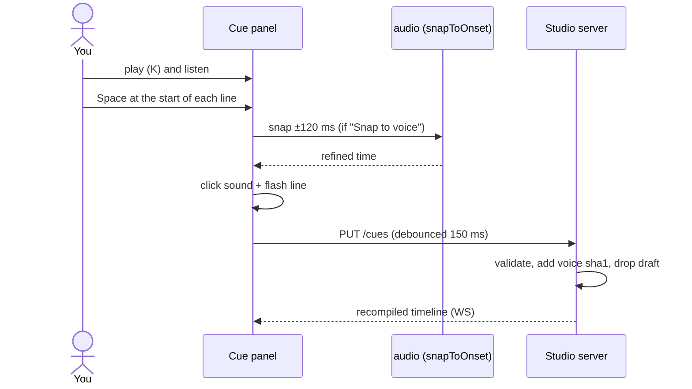

المفاتيح: Space تعليم، Backspace تراجع، ←/→ تعديل ±50 ms (Shift: ±10 ms)، W وضع الكلمات، S محاذاة
للصوت، A تشغيل/إيقاف المحاذاة التلقائية، G اذهب للـ cue، 1/2/3 السرعة.

### 13.6 الرسم من الواجهة

`RenderRunner` في [jobs.ts](../packages/studio/src/server/jobs.ts) يسمح **برسم واحد في كل مرة** (طلب
ثانٍ = 409). الـ Hub يشارك نفس الـ runner مع كل المحررات التي يفتحها. التقدم يُرسل عبر WebSocket كل 200
ms، وعند الانتهاء يفتح المحرر نافذة المخرجات مع مشغّل فيديو.

---

## 14. حزمة cli: الأوامر

الملف [cli/src/index.ts](../packages/cli/src/index.ts) (مكتبة commander). المشغّلات `reelforge` /
`reelforge.cmd` تستدعي `packages/cli/bin/reelforge.js`.

| الأمر                             | يستدعي                      | ماذا يفعل                                                                           |
| --------------------------------- | --------------------------- | ----------------------------------------------------------------------------------- |
| `studio`                          | `startHub`                  | لوحة التحكم على 4310                                                                |
| `new <id> [--lang en\|ar]`        | `episodeTemplate`           | `episodes/<id>/episode.yaml` من قالب                                                |
| `cue <id> [--draft]`              | `draftCues` / `startStudio` | cues تقديرية، أو المحرر في وضع Cues                                                 |
| `edit <id>` / `dev <id>`          | `startStudio`               | المحرر في وضع Edit / Review                                                         |
| `validate <id> [--strict]`        | `compileEpisode` + measure  | كل القواعد مع أرقام الأسطر                                                          |
| `render [id] [--all]`             | `renderEpisode`             | الرسم (خيارات: `--from/--to`، `--workers`، `--share-size`، `--fast`، `--silent`، …) |
| `snap <id> [times…] [--cover]`    | `snapFrames`                | صور PNG لأزمنة أو تعبيرات، وورقة لقطات                                              |
| `doctor [--fix]`                  | `runDoctor`                 | فحص البيئة                                                                          |
| `theme new <name> --accent <hex>` | توليد HSL                   | ثيم جديد من لون واحد                                                                |
| `schema`                          | `episodeJsonSchema`         | `schema/episode.schema.json`                                                        |
| `mcp`                             | `startMcp`                  | خادم MCP على stdio                                                                  |

**البحث عن الحلقة** (`resolveEpisode`) بهذا الترتيب: `episodes/<id>` ← مسار نسبي للمشروع ← مسار نسبي
للمجلد الحالي ← `examples/<id>` ← `examples/season1/<id>`.

**رموز الخروج:** 0 نجاح، 1 فشل، 2 استخدام خاطئ، 130 رسم أُلغي. **`--json`:** كل أمر يطبع كائن JSON
واحداً، عدا `render` الذي يطبع سطر JSON لكل حدث (`progress`, `log`, ثم `result` أو `error`).

---

## 15. خادم MCP للوكلاء الأذكياء

[mcp.ts](../packages/cli/src/mcp.ts) خادم **مكتوب يدوياً** (بدون SDK): JSON-RPC 2.0، رسالة في كل سطر،
عبر stdin/stdout. كل `console.log` يُحوَّل إلى stderr حتى لا يفسد البروتوكول.

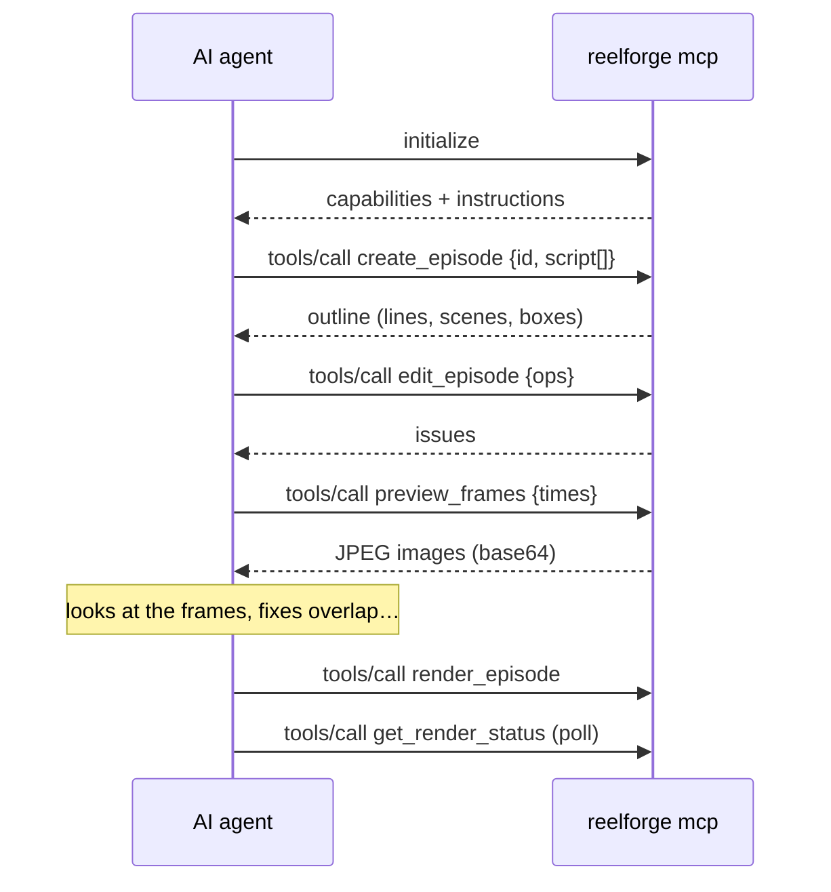

| الأداة                                                   | الغرض                                                                    |
| -------------------------------------------------------- | ------------------------------------------------------------------------ |
| `list_episodes`                                          | كل الحلقات مع حالتها                                                     |
| `get_episode`                                            | الـ YAML + مخطط مُترجم (أزمنة الأسطر والكلمات، مسارات العناصر، صناديقها) |
| `create_episode`                                         | حلقة من نص، مع cues تقديرية                                              |
| `edit_episode`                                           | نفس عمليات المحرر `set/delete/insert/move` (تحفظ التعليقات)              |
| `write_episode_yaml`                                     | استبدال الملف كله (يُرفض إن كان فيه V-1/V-13 إلا مع `force`)             |
| `validate_episode`                                       | كل القواعد                                                               |
| `preview_frames`                                         | حتى 8 إطارات **تُعاد كصور** حتى "يرى" الوكيل عمله                        |
| `list_components` / `get_component_schema`               | المكوّنات وخصائصها الدقيقة                                               |
| `draft_cues` / `set_cues`                                | توقيت تقديري أو معروف                                                    |
| `render_episode` / `get_render_status` / `cancel_render` | الرسم في الخلفية                                                         |
| `open_editor`                                            | رابط المحرر للإنسان                                                      |
| `doctor`                                                 | فحص البيئة                                                               |

بالإضافة إلى موارد (التوثيق والـ schema) و prompt جاهز `make_explainer`. ملفات الإعداد موجودة لكل
أداة: `.mcp.json` (Claude Code)، `.cursor/mcp.json`، `.vscode/mcp.json`، `.gemini/settings.json`.

---

## 16. مجلد الحلقة على القرص

```text
episodes/ep10/
├── episode.yaml          ← المصدر الوحيد للحقيقة (Git-friendly)
├── cues.json             ← أزمنة بداية الأسطر (+ كلمات اختيارياً)
├── voice.wav             ← التسجيل (الرفع يحوّل mp3/m4a/… إلى WAV أحادي 48 kHz)
├── assets/               ← صور و SVG تستخدمها العناصر (assets/logo.svg)
└── out/
    ├── ep10.master.mp4   ← جودة أرشيفية
    ├── ep10.share.mp4    ← هذا ما ترفعه (≤ 28 MB)
    ├── ep10.srt          ← ترجمة
    ├── ep10.sheet.jpg    ← 12 لقطة للمراجعة السريعة
    ├── publish.md        ← العنوان، الوصف، الهاشتاغات، التعليق المثبت، الفصول
    ├── ep10.part.mp4     ← (رسم جزئي)
    ├── ep10.cover.png    ← (snap --cover، ويُستخدم كصورة مصغّرة)
    ├── snaps/            ← (صور snap)
    ├── .cache/           ← measure.json (V-9/V-10) و thumb.jpg
    └── .tmp/<run-id>/    ← مؤقت أثناء الرسم: seg_*.mp4, video.mp4, sfx.wav, mix.wav
```

---

## 17. البناء والاختبارات و CI

### 17.1 البناء

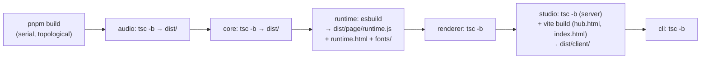

- TypeScript 5.9 strict، Node 22، pnpm 10 workspace.
- الـ runtime يُجمَّع بـ **esbuild** (ملف IIFE واحد لـ Chrome 120) مع **نسخ الخطوط محلياً** (Cairo,
  Space Grotesk, JetBrains Mono) وتوليد `fonts.css`. لا اتصال بالشبكة عند الرسم.
- واجهتا الـ studio تُجمَّعان بـ **Vite** (TypeScript عادي بدون framework).
- مجلدات `dist/` مستثناة من git، لكن ملف الإصدار يشحنها مبنية مسبقاً، لذا المستخدم لا يحتاج للبناء.

### 17.2 الاختبارات

| المجموعة  | الأمر               | ماذا تغطي                                                                                                                                 |
| --------- | ------------------- | ----------------------------------------------------------------------------------------------------------------------------------------- |
| `unit`    | `pnpm test:unit`    | ‏WAV، المولّد الحتمي، الأصوات (hash ثابت)، الزمن، الترجمة و bidi، المُترجِم وكل قاعدة V، الحركات (سلاسة بلا قفزات)، تعديل YAML، `exprFor` |
| `browser` | `pnpm test:browser` | **golden frames** (مقارنة بكسلات، فشل إذا اختلف أكثر من 0.2%)، الحتمية، خط الرسم كاملاً، CLI، MCP، المحرر، لوحة التحكم                    |

- `fixtures/lint/v01…v13`: حلقة فيها خطأ مقصود لكل قاعدة.
- `fixtures/golden/`: صور مرجعية للترجمة العربية وكل المكوّنات. بعد تغيير بصري مقصود:
  `UPDATE_GOLDEN=1 pnpm test:browser`.
- `fixtures/mini`: حلقة 6 ث بتسجيل حقيقي، تُرسم كاملة في الاختبار.

### 17.3 CI

ملف [ci.yml](../.github/workflows/ci.yml):

- **Linux:** بناء، typecheck، lint، فحص التراخيص، تغطية (≥85% من الأسطر)، اختبارات المتصفح، `doctor`،
  تحقق من أمثلة season1، و**رسم مع قطع الشبكة فعلياً** (`unshare --net`) لإثبات أنه يعمل بلا إنترنت.
- **macOS و Windows:** اختبارات الوحدة، `doctor`، تحقق من الأمثلة.

---

## 18. نموذج الأمان

الخوادم المحلية خطر حقيقي إن لم تُحمَ (أي موقع تفتحه قد يحاول إرسال طلبات إلى `localhost`). الحمايات:

| التهديد                        | الحماية                                                                              |
| ------------------------------ | ------------------------------------------------------------------------------------ |
| الوصول من الشبكة               | الربط على **127.0.0.1** فقط                                                          |
| DNS rebinding                  | فحص ترويسة `Host` في كل طلب و WebSocket                                              |
| CSRF من موقع آخر               | فحص `Origin`، و **POST يقبل JSON فقط** (النماذج HTML لا تستطيع إرسال JSON بدون CORS) |
| الخروج من المجلد (`../../etc`) | `safeJoin` لكل مسار، وكل حلقة يجب أن تكون داخل المشروع                               |
| SVG خبيث في assets             | رفض `<script` و `on*=` و `javascript:`، وخدمة الملفات مع CSP ‏`sandbox`              |
| رفع ملفات ضخمة أو غريبة        | حد 1 GB، امتدادات صوتية فقط، تحويل بـ ffmpeg                                         |
| تسريب بيانات أثناء الرسم       | Chromium **لا يصل لأي عنوان** غير الوهمي `reelforge.local`؛ أي محاولة تُفشل الرسم    |

---

## 19. الحتمية (Determinism)

لماذا "نفس المدخلات = نفس الإطارات" مهم؟ لأنه يسمح بـ: رسم الإطارات **بأي ترتيب** وعلى **أي عدد من
العمّال**، وإعادة رسم جزء فقط، وتمرير المحرر للأمام والخلف بشكل صحيح دائماً، واختبارات بصرية موثوقة.

كيف يُضمن (ADR-003):

| المصدر المحتمل للاختلاف | كيف أُزيل                                                        |
| ----------------------- | ---------------------------------------------------------------- |
| الوقت الحقيقي           | `render(t)` يأخذ `t` كمدخل، لا ساعة داخل الـ runtime             |
| رسوم CSS المتحركة       | ممنوعة بـ `!important` في الـ CSS الأساسي                        |
| العشوائية               | `rnd(seed)` و `mulberry32(seed)`؛ البذرة من معرّف الحلقة والعنصر |
| الحالة المتراكمة        | `states` تُحسب من الصفر لكل `t`؛ الجسيمات صيغ مغلقة              |
| الخطوط                  | مضمّنة محلياً ومحمّلة قبل أول إطار، والتحقق منها V-13            |
| رسم المتصفح             | بدون GPU، بدون LCD text/hinting، sRGB، مقياس 1، UTC، لغة en-US   |
| الصوت                   | المؤثرات مولّدة من بذرة، والمزج بإعدادات ثابتة                   |

**الاستثناء الوحيد:** الترميز النهائي بـ x264 قد يختلف بالبايت بين إصدارات FFmpeg، لكن الإطارات
الملتقطة نفسها متطابقة.

---

## 20. متغيرات البيئة والإعدادات الافتراضية

| المتغير                  | الافتراضي              | الأثر                    |
| ------------------------ | ---------------------- | ------------------------ |
| `REELFORGE_ROOT`         | المجلد الحالي          | جذر المشروع              |
| `REELFORGE_PRESET`       | `meta.preset`          | فرض preset               |
| `REELFORGE_WORKERS`      | عدد الأنوية − 1        | عدد العمّال              |
| `REELFORGE_JPEG_QUALITY` | 95                     | جودة التقاط الإطارات     |
| `REELFORGE_SHARE_SIZE`   | 28 (من الـ preset)     | حد حجم الـ share بالـ MB |
| `REELFORGE_PORT`         | 4310 (Hub) / 4317      | منفذ الخادم              |
| `REELFORGE_FFMPEG`       | `ffmpeg` من PATH       | مسار ffmpeg              |
| `REELFORGE_FFPROBE`      | `ffprobe` من PATH      | مسار ffprobe             |
| `REELFORGE_CHROMIUM`     | Chromium من Playwright | مسار متصفح بديل          |
| `REELFORGE_NO_OPEN`      | —                      | لا تفتح المتصفح تلقائياً |
| `REELFORGE_DEBUG`        | —                      | طباعة stack traces       |

قيم صوتية ثابتة: −14 LUFS، −1.5 dBTP، LRA 9، المؤثرات تُطبَّع إلى −0.9 dBFS ثم `sfx_gain_db` (−16)،
محدِّد 0.95، 48 kHz ستيريو.

---

## 21. كيف أوسع المشروع

### 21.1 إضافة مكوّن جديد

```mermaid
flowchart LR
    A["1 core/components:<br/>zod schema + size +<br/>default enter + events (sfx)"] --> B["2 runtime/components:<br/>mount() + update(t)"]
    B --> C["3 register in both<br/>registries (same name)"]
    C --> D["4 add to gallery<br/>fixtures/golden/components/episode.yaml"]
    D --> E["5 node scripts/gen-components-doc.mjs"]
    E --> F["6 UPDATE_GOLDEN=1 pnpm test:browser"]
```

قواعد إلزامية: `update` دالة في `t` فقط، لا مؤقتات ولا `Math.random`؛ استخدم `ctx.seed` للعشوائية؛ ضع
`data-fit` على حاويات النص حتى يفحصها V-9. الخصائص تصل محلولة (أزمنة بالثواني، ألوان CSS).

### 21.2 ثيم جديد

أسرع طريقة: `reelforge theme new brand --accent "#ff5a1f"`. أو انسخ ملفاً في `themes/` واستخدم
`extends: default` وغيّر ما تريد فقط. الخطوط مقيّدة بالثلاثة المضمّنة.

### 21.3 Preset جديد

ملف `presets/<name>.preset.yaml`: `canvas`، `header_top`، `stage`، `captions_y`، `safe` (المناطق التي
تغطيها واجهة المنصة)، `share_mb`، `max_duration`.

### 21.4 قبل أي commit

```bash
pnpm typecheck && pnpm lint && pnpm test:unit
pnpm test            # إذا لمست الرسم أو الخوادم (يحتاج FFmpeg و Chromium)
```

---

## 22. ملاحظات ونقاط تستحق الانتباه

أثناء دراسة الكود ظهرت أمور ليست أخطاء بالضرورة، لكن معرفتها توفّر عليك وقتاً:

**سلوكيات قد تفاجئك:**

- اللغة الافتراضية في الـ schema هي `ar-EG`، والاتجاه يصبح RTL إذا احتوى **أي** سطر حرفاً عربياً.
- `audio.sfx: manual` يتجاهل أيضاً `fx.sound` الصريح، لا الأصوات التلقائية فقط.
- الـ draft cues تعدّ **الحروف** (مع علامات الترقيم) بمعدل 13 حرفاً/ث، بينما توزيع الكلمات داخل السطر
  يعدّ الحروف بدون ترقيم.
- `resolveEpisode` يعرف اختصاراً لـ `examples/season1/<id>` فقط؛ `season1-arabic` و `promo` تحتاج مساراً
  كاملاً (`examples/promo/intro`).
- `--keep-tmp` يحتفظ بالملفات المؤقتة **عند الفشل فقط**، كما يقول نص المساعدة.
- الأسهم تربط عناصر **من نفس المشهد** فقط.

**نقاط ضعف محتملة في الكود:**

- إلغاء رسم يقتل **كل** عمليات ffmpeg في نفس العملية (قائمة عامة)، وهذا يهم لو شُغّل رسمان معاً في
  نفس العملية (حالياً الـ RenderRunner يمنع ذلك).
- إعادة ترميز الـ share بنسبة 90% لا تُرسل تقدماً ولا تحترم سقف معدل الـ master.
- عند الإلغاء لا يُحذف `.srt` و `publish.md`.
- محاولة الوصول للشبكة تُكتشف في نهاية مقطع العامل فقط، ثم يُعاد المقطع رغم أنه سيفشل غالباً بنفس
  الطريقة.
- في [screens.ts](../packages/runtime/src/components/screens.ts) سطر يضرب في `* 0`، فإشعارات الهاتف
  القادمة من `states` تظهر كلها في نفس اللحظة.
- `HEAD = 132` (عرض أسماء المسارات في الـ timeline) مكرر في JS و CSS.
- `timeexpr.ts` في الواجهة يستورد من `core` بمسار نسبي بدل اسم الحزمة.
- `pnpm typecheck` يستخدم `tsc -b` الذي يكتب ملفات البناء أيضاً.
- لا يوجد زر في لوحة التحكم لفتح وضع Review مباشرة، وCI لا يتحقق من الأمثلة العربية.
- لا توجد اختبارات وحدة لخط الرسم والعمّال والترميز (تغطيها اختبارات المتصفح على Linux فقط).

---

## 23. خريطة سريعة: أين أجد…؟

| أريد أن…                               | اذهب إلى                                                                                                                  |
| -------------------------------------- | ------------------------------------------------------------------------------------------------------------------------- |
| أفهم شكل الـ Timeline                  | [core/src/types.ts](../packages/core/src/types.ts)                                                                        |
| أضيف حقلاً لـ episode.yaml             | [core/src/schema/episode.ts](../packages/core/src/schema/episode.ts) ثم `compile.ts`                                      |
| أغيّر صيغة time expressions            | [core/src/time.ts](../packages/core/src/time.ts)                                                                          |
| أغيّر طريقة تقدير أزمنة الكلمات        | [core/src/words.ts](../packages/core/src/words.ts)                                                                        |
| أصلح مشكلة في الترجمة العربية          | [core/src/captions.ts](../packages/core/src/captions.ts) و [runtime/src/captions.ts](../packages/runtime/src/captions.ts) |
| أضيف قاعدة تحقق                        | [core/src/lint.ts](../packages/core/src/lint.ts) (+ `fixtures/lint/`)                                                     |
| أغيّر حركة دخول أو انتقال مشهد         | [runtime/src/scene.ts](../packages/runtime/src/scene.ts) و [anim.ts](../packages/runtime/src/anim.ts)                     |
| أغيّر الترويسة أو الخلفية أو الـ grain | [runtime/src/chrome.ts](../packages/runtime/src/chrome.ts)                                                                |
| أغيّر شكل مكوّن                        | `packages/runtime/src/components/*.ts`                                                                                    |
| أغيّر جودة الفيديو أو حجم الـ share    | [renderer/src/encode.ts](../packages/renderer/src/encode.ts)                                                              |
| أغيّر علوّ الصوت أو الـ ducking        | [renderer/src/audio.ts](../packages/renderer/src/audio.ts)                                                                |
| أضيف مؤثراً صوتياً                     | [audio/src/synth.ts](../packages/audio/src/synth.ts) (+ `SOUNDS`)                                                         |
| أضيف API للخادم                        | [studio/src/server/index.ts](../packages/studio/src/server/index.ts) أو [hub.ts](../packages/studio/src/server/hub.ts)    |
| أعدّل واجهة المحرر                     | `packages/studio/client/src/` و [style.css](../packages/studio/client/src/style.css)                                      |
| أضيف أمر CLI                           | [cli/src/index.ts](../packages/cli/src/index.ts)                                                                          |
| أضيف أداة MCP                          | [cli/src/mcp.ts](../packages/cli/src/mcp.ts)                                                                              |
| أفهم **لماذا** اتُّخذ قرار ما          | [docs/adr/](adr/)                                                                                                         |
| أعرف خصائص كل مكوّن                    | [docs/components.md](components.md)                                                                                       |
| أكتب حلقة جيدة                         | [docs/authoring.md](authoring.md) و [AGENTS.md](../AGENTS.md)                                                             |
| أحسّن الـ cues التلقائية               | [audio/src/align.ts](../packages/audio/src/align.ts) و [assist/src/cues.ts](../packages/assist/src/cues.ts)               |
| أضيف كلمة مفتاحية للاقتراحات           | [core/src/suggest.ts](../packages/core/src/suggest.ts)                                                                    |

---

## 24. الميزات الذكية: cues تلقائية، تنظيف الصوت، والاقتراحات

مرتبة حسب **القيمة مقابل الموارد**. المستوى 0 يعمل على أي جهاز بلا أي نموذج؛ المستويان 1 و 2
**اختياريان** ولا يُثبَّتان إلا عند الطلب، ولا يُستخدم أي نموذج أثناء الرسم (الرسم يبقى حتمياً).

| المستوى | الميزة                          | يحتاج                                   | الوقت (دقيقة صوت) | أين                                                                                       |
| ------- | ------------------------------- | --------------------------------------- | ----------------- | ----------------------------------------------------------------------------------------- |
| 0       | cues تلقائية للأسطر والكلمات    | لا شيء                                  | ~0.05 ث           | [align.ts](../packages/audio/src/align.ts), [autocue.ts](../packages/core/src/autocue.ts) |
| 0       | تنظيف الصوت (RNNoise)           | FFmpeg الموجود + نموذج 290 KB مضمّن     | ~1 ث              | [renderer/audio.ts](../packages/renderer/src/audio.ts)                                    |
| 0       | V-14 الإيقاع                    | لا شيء                                  | فوري              | [compile.ts](../packages/core/src/compile.ts)                                             |
| 0       | smart insert بالكلمات المفتاحية | لا شيء                                  | فوري              | [suggest.ts](../packages/core/src/suggest.ts)                                             |
| 1       | Whisper forced alignment        | `reelforge align --setup` (~180 MB مرة) | ~20 ث على CPU     | [assist/](../packages/assist/src/)                                                        |
| 1       | Silero VAD                      | ضمن الإعداد نفسه (2 MB)                 | ~0.8 ث            | [vad.ts](../packages/assist/src/vad.ts)                                                   |
| 2       | اقتراح مشهد بـ LLM محلي         | Ollama + `qwen2.5:1.5b` (~1 GB)         | 10–60 ث لكل سطر   | [llm.ts](../packages/assist/src/llm.ts)                                                   |

### 24.1 الـ cues التلقائية (DSP، بلا نموذج)

```mermaid
flowchart LR
    W["voice samples"] --> E["10 ms energy track<br/>(block sums, O(n))"]
    E --> T["adaptive threshold<br/>percentiles + hysteresis"]
    G["Silero VAD mask<br/>(optional gate)"] -.-> T
    T --> M["voiced mask<br/>drop clicks < 30 ms<br/>fill gaps < 50 ms"]
    M --> P["pauses = candidate<br/>line boundaries"]
    S["script lines →<br/>syllable weights"] --> DP
    P --> DP["DP: N lines over M pauses<br/>cost = (ln(voiced/expected))²<br/>− reward(pause length)"]
    DP --> R["refine to the sample:<br/>first 1 ms above threshold"]
    R --> L["line cues"]
    L --> WD["words: pauses inside the line ↔<br/>punctuation (DP), syllables,<br/>energy valleys"]
```

- **الوزن المتوقع لكل سطر** = مجموع المقاطع الصوتية لكلماته (حروف العلة للاتيني، والحروف الساكنة
  والطويلة للعربي).
- **الـ DP:** يختار حدّاً واحداً لكل سطر من بين فترات الصمت، بحيث يكون "زمن الكلام" في كل سطر
  متناسباً مع وزنه (لا الزمن الكلي، فالوقفات لا تُحسب)، ويفضّل الوقفات الطويلة. التعقيد محدود
  بنافذة نسبة 1:5، فـ 10 دقائق و 120 سطراً تأخذ ~0.2 ث.
- **الكلمات:** الوقفات داخل السطر تُربط بالفجوات بين الكلمات (الكلمة المنتهية بعلامة ترقيم أرجح)،
  وما بينها يُوزَّع بالمقاطع ثم يُنقل إلى أقرب "وادٍ" في الطاقة إن كان قريباً.
- **عتبة ذكية:** العتبة مرتبطة بأرضية الضجيج **وبمستوى الكلام** معاً، وإلا فإن الصمت الرقمي
  (−120 dB) يجعلها تلتقط النَّفَس قبل الكلمة.

### 24.2 Whisper + مطابقة مع النص المعروف

```mermaid
sequenceDiagram
    participant A as alignEpisode
    participant R as resample (48k → 16k)
    participant V as Silero VAD
    participant W as Whisper (transformers.js)
    participant D as fuzzy DTW
    A->>R: voice mono
    R->>V: 16 kHz
    V-->>A: speech mask (gate for the DSP map)
    R->>W: 16 kHz
    W-->>A: heard words + start/end (text ignored)
    A->>D: script words × heard words
    D-->>A: match per word (1:1, 1:2, 2:1, skips)
    A->>A: measure this recording's lag (median vs real pause ends)
    A->>A: lines → snap to pause ends · words → fuse with DSP (±120 ms)
```

- **لا نثق بنص Whisper:** "ReelForge" قد يُسمع "real forge"، والدارجة تُكتب بأشكال مختلفة. المطابقة
  بـ Levenshtein بعد توحيد الحروف (`ة/ه`, `ى/ي`, `أ/إ/آ`) مع دمج 1:2 و 2:1 وتخطّي الكلمات
  الزائدة (um) أو المفقودة. في الاختبارات: 96–100% من الكلمات طوبقت.
- **تصحيح التأخر:** توقيتات Whisper تتأخر بشكل ثابت تقريباً (~0.1–0.2 ث). يُقاس التأخر **لكل تسجيل**
  (الوسيط بين بدايات أسطر Whisper ونهايات الوقفات الحقيقية) ويُطرح.
- **الدمج:** إذا اتفق تقدير DSP لكلمة مع Whisper ضمن 120 ms نأخذ DSP (حوافه أدق)، وإلا نثق بـ
  Whisper (لا ينجرف).
- **الموارد:** المكتبة والنماذج في كاش المستخدم وليست في التثبيت. بعد التثبيت تُحذف ملفات المنصات
  الأخرى ومحرك المتصفح: **463 MB → 101 MB**. النموذج يُحمَّل مرة ويُحرَّر تلقائياً بعد 3 دقائق خمول.

**دقة مقاسة** (`node scripts/eval-assist.mjs`، صوتان، نظيف + ضجيج 12 dB + موسيقى 14 dB):

| المحرك        | الأسطر (متوسط / أقصى) | الكلمات p90 | كلمات ≤ 100 ms | الوقت (43 ث) |
| ------------- | --------------------- | ----------- | -------------- | ------------ |
| DSP           | 50 / 1836 ms          | 250 ms      | 73%            | 38 ms        |
| DSP + VAD     | **15 / 45 ms**        | 169 ms      | 80%            | 0.6 ث        |
| Whisper + VAD | **15 / 45 ms**        | **142 ms**  | **81%**        | ~15 ث        |

الخطأ الكبير لـ DSP وحده كان مع الموسيقى الخلفية: الموسيقى ترفع العتبة فتظهر وقفات وهمية داخل
الجمل. الحل: الـ VAD يقرر **وجود** الكلام، والطاقة تقرر **مكان الحافة** فقط.

### 24.3 تنظيف الصوت

```mermaid
flowchart LR
    V["voice.wav"] --> A["aresample 48k"] --> N["arnndn=m=sh.rnnn<br/>(RNNoise, speech in<br/>noisy recordings)"] --> L["loudnorm 2-pass<br/>(measured on the<br/>cleaned voice)"] --> M["mix"]
```

يُفعَّل بـ `audio.denoise: true` أو `--denoise` أو خانة في نافذة الرسم. يعمل FFmpeg من مجلد النموذج
(`cwd`) حتى لا نحتاج تهريب مسارات Windows داخل نص الفلتر. مقاس: الضجيج بين الجمل −34.6 → −49.8 dB
(**−15 dB**) والكلام ثابت (−19.7 → −20.2 dB).

### 24.4 الاقتراحات (smart insert)

- **قاموس** (فوري، بلا نموذج): كلمات عربية وإنجليزية → مكوّن، مع props مستخرجة من السطر (الأرقام
  بالكلمات "thirty thousand" → 30000، "X vs Y" → أعمدة جدول، أسماء المكونات Client/DB → `node`)،
  ويدخل العنصر **على الكلمة نفسها** (`l3:'bucket'`). كل اقتراح يُتحقق منه بـ schema المكوّن. اختبار:
  أكثر من 150 اقتراحاً لكل أسطر الأمثلة (عربي وإنجليزي) تُترجم بلا أي خطأ.
- **LLM محلي** (اختياري): Ollama مع **grammar** مولَّد من schemas الـ Zod (`oneOf` بالمكوّنات، و
  `enum` بكلمات السطر الفعلية)، فالنموذج لا يستطيع اختراع مكوّن أو خاصية. الأزمنة تُشتق من الكلمة
  دائماً، والعناصر تُتحقق منها مرة ثانية، والأسهم التي تشير لعناصر غير موجودة تتحول لنقاط.

### 24.5 الأمان والسياسات

- الـ cues التي علّمها الإنسان **لا تُستبدل أبداً** إلا بتأكيد (`force`). ملف `cues.json` التلقائي
  يحمل `auto: true` (معلومة V-3)، وأول حفظ يدوي في وضع Cues يزيلها.
- في المحرر، الاستبدال يمر عبر سجل التراجع، فـ Ctrl+Z يعيد الـ cues القديمة.
- خطوة واحدة للمحاذاة في وقت واحد (409 لو مشغول). Ollama محلي فقط (`127.0.0.1`).
