# من داخل ReelForge — شرح معماري مفصّل

> [English version](architecture.md)

> وثيقة تشرح **كيف يعمل** ReelForge ‏1.0 من أول سطر في `episode.yaml` حتى ملف MP4 النهائي، وكيف نُظِّم
> الكود، ولماذا اتُّخذ كل قرار. المصطلحات التقنية مكتوبة بالإنجليزية كما هي في الكود. والرسوم
> البيانية مكتوبة بـ Mermaid وتظهر رسوماً تلقائياً في GitHub وVS Code (وعلى موقع التوثيق تظهر حالياً كنص Mermaid).

## الفهرس

1. [الفكرة في دقيقة](#s1)
2. [المفاهيم الأساسية (القاموس)](#s2)
3. [الصورة الكبيرة](#s3)
4. [هيكل المستودع](#s4)
5. [الحزم السبع وحدودها](#s5)
6. [رحلة حلقة كاملة خطوة بخطوة](#s6)
7. [ملف episode.yaml بالتفصيل](#s7)
8. [الزمن: cues والكلمات وtime expressions](#s8)
9. [حزمة core: الـ compiler والثيمات والحزم الصناعية](#s9)
10. [حزمة runtime: الرسم بدالة render(t)](#s10)
11. [حزمة renderer: من الإطارات إلى MP4](#s11)
12. [حزمة audio: الصوت بدون ملفات صوتية](#s12)
13. [حزمة studio: لوحة التحكم والمحرر](#s13)
14. [حزمة cli: الأوامر](#s14)
15. [سجل الأدوات وطرق الاتصال الثلاث (MCP وREST)](#s15)
16. [مجلد الحلقة على القرص](#s16)
17. [البناء والاختبارات وCI والتوثيق والإصدار](#s17)
18. [نموذج الأمان](#s18)
19. [الحتمية (Determinism): لماذا نفس المدخلات = نفس الإطارات](#s19)
20. [متغيرات البيئة والإعدادات الافتراضية](#s20)
21. [كيف أوسّع المشروع](#s21)
22. [ملاحظات ونقاط تستحق الانتباه](#s22)
23. [خريطة سريعة: أين أجد…؟](#s23)
24. [الميزات الذكية: cues تلقائية، تنظيف الصوت، والاقتراحات](#s24)

> عن الروابط: لكل قسم مرقّم مرساة ثابتة (`#s1` … `#s24`) مكتوبة كعنصر `<a id>` في عنوانه، فتعمل الروابط
> نفسها على GitHub وعلى موقع التوثيق، وهي مشتركة بين النسختين العربية والإنجليزية.

---

## 1. الفكرة في دقيقة <a id="s1"></a>

يأخذ ReelForge مُدخلين:

- **تسجيل صوتي** (`voice.wav`) تقرأ فيه نصّك.
- **ملف واحد** `episode.yaml` تصف فيه: النص سطراً سطراً، والمشاهد، والعناصر (عناوين، مخططات، كود،
  جداول، خرائط…)، و**على أي كلمة** يظهر كل عنصر.

ويُخرج **فيديو عمودياً بمقاس 1080×1920 وبمعدل 30 إطاراً في الثانية** جاهزاً لـ TikTok وReels وShorts،
مع ترجمة نصية (captions) تظهر كلمة بكلمة بالعربية والإنجليزية، ومؤثرات صوتية مولَّدة برمجياً، وصوت مضبوط
على −14 LUFS، وملف للنشر.

ثلاثة مبادئ تحكم كل شيء:

| المبدأ                            | المعنى                                                                                                                                                                                                                                           |
| --------------------------------- | ------------------------------------------------------------------------------------------------------------------------------------------------------------------------------------------------------------------------------------------------ |
| **محلي بالكامل**                  | لا سحابة، لا حساب، لا اتصال بالإنترنت أثناء التصدير (بل تُحجب الشبكة برمجياً داخل المتصفح).                                                                                                                                                      |
| **لا ذكاء اصطناعي في محرك الرسم** | لا يولّد المحرك صوتاً ولا صوراً، ولا يُستخدم أي نموذج أثناء الرسم. أما المساعدات الاختيارية (محاذاة الـ cues، اقتراح المشاهد) فهي أدوات تأليف محلية تُفعَّل عند الطلب (ADR-013)، ولا يتصل اقتراح المشاهد بخدمة سحابية إلا إذا أعددتها أنت بنفسك. |
| **حتمي (Deterministic)**          | المدخلات نفسها تعطي البكسلات نفسها حرفياً، بأي ترتيب وبأي عدد من العمّال (workers).                                                                                                                                                              |

والسر التقني: **صفحة ويب** (HTML/SVG/Canvas) تعرض الإطار عند أي زمن `t` عبر دالة نقية `render(t)`،
ومتصفح Chromium بلا واجهة يلتقط صورة لكل إطار، ثم يحوّل FFmpeg الصور إلى فيديو.

وحول هذا القلب طبقتان للتأليف: **لوحة تحكم ومحرر مرئي** للإنسان، و**سجل أدوات واحد** (24 أداة) يخدم
الوكلاء الأذكياء عبر MCP وREST، مع **12 حزمة صناعية** فيها قوالب جاهزة بخانات (slots) تجعل حتى النموذج
الصغير قادراً على إنتاج حلقة صالحة.

---

## 2. المفاهيم الأساسية (القاموس) <a id="s2"></a>

قبل أي شيء، هذه مصطلحات ستتكرر في كل مكان:

| المصطلح                | المعنى                                                                                                                                                           |
| ---------------------- | ---------------------------------------------------------------------------------------------------------------------------------------------------------------- |
| **Episode** (حلقة)     | مجلد فيه `episode.yaml` (+ `cues.json` + `voice.wav` + `assets/` + `out/`).                                                                                      |
| **Script line** (سطر)  | جملة منطوقة واحدة. معرّفها الافتراضي `l1`, `l2`, … حسب الترتيب.                                                                                                  |
| **Cue**                | **لحظة بداية** سطر في التسجيل بالثواني، مثلاً `l3: 6.8`. تُحفظ في `cues.json`.                                                                                   |
| **Word time**          | لحظة بداية كل كلمة داخل السطر. تُقدَّر حسابياً من عدد الحروف، أو تحددها المحاذاة التلقائية، أو تُحدَّد يدوياً.                                                   |
| **Time expression**    | طريقة لكتابة الزمن مربوطة بالكلام بدل الثواني: `l3:'bucket'` = «لحظة نطق كلمة bucket في السطر 3».                                                                |
| **Scene** (مشهد)       | فكرة واحدة على الشاشة. يبدأ عند سطر (`at: l3`) وينتهي عند بداية المشهد التالي.                                                                                   |
| **Element** (عنصر)     | شيء مرسوم داخل مشهد: عنوان، سهم، جدول… له مكان (`place`) ودخول (`enter`) وخروج (`exit`).                                                                         |
| **Component** (مكوّن)  | **نوع** العنصر. يوجد 62 مكوّناً (`title`, `arrow`, `map`, …). لكل واحد schema صارم للخصائص.                                                                      |
| **Canvas**             | الإطار الكامل 1080×1920.                                                                                                                                         |
| **Stage** (المسرح)     | المنطقة التي توضع فيها العناصر: 1080×1000، تبدأ عند y=270 في الـ canvas. إحداثيات العناصر **نسبةً إلى المسرح**.                                                  |
| **Preset**             | تخطيط المنصة (tiktok / reels / shorts): مكان المسرح، مكان الترجمة، **المناطق الآمنة** التي تغطيها واجهة التطبيق. كلها 9:16 في الإصدار 1.0 (ADR-016).             |
| **Theme**              | الألوان والخطوط وأحجام النص وإعدادات الحركة والترجمة، بوضع داكن (`dark`) أو فاتح (`light`). يوجد 16 ثيماً مضمّناً.                                               |
| **Timeline**           | **ناتج تحويل (compile)** الحلقة: كائن JSON فيه كل شيء محسوب مسبقاً (أزمنة بالثواني، ألوان نهائية، صناديق نهائية). هو **العقد الوحيد** بين الـ core والـ runtime. |
| **Issue / V-rule**     | مشكلة يكتشفها التحقق، لها رمز من V-1 إلى V-14 ومستوى (error / warn / info) ورقم سطر.                                                                             |
| **Master / Share**     | ملفا الفيديو الناتجان: Master بجودة أرشيفية، وShare مضغوط ليناسب حد حجم الرفع (28 MB افتراضياً).                                                                 |
| **Worker**             | عملية رسم متوازية: متصفح Chromium خاص + FFmpeg خاص، يرسم مقطعاً من الإطارات.                                                                                     |
| **Hub / Studio**       | Hub = لوحة التحكم بالمشروع (المنفذ 4310، الأمر `reelforge studio`). Studio = محرر الحلقة الواحدة (المنفذ 4317، الأمر `reelforge edit`).                          |
| **Pack** (حزمة صناعية) | مجلد `packs/<id>/` لقطاع واحد (الصحة، العقارات…): ثيم، وقوالب، وblueprints مقترحة، وأمثلة، ودليل للوكلاء.                                                        |
| **Template / Slot**    | القالب = ملف `episode.yaml` فيه خانات `{{slot}}`؛ وملء الخانات بقيم مسطّحة يعطي حلقة صالحة.                                                                      |
| **Blueprint**          | مشهد كامل بمعاملات مسطّحة (hook، stat-reveal، comparison…) يضع العناصر في المنطقة الآمنة ويربطها بالكلمات. يوجد 13 blueprint.                                    |
| **Tool / Toolset**     | أداة في سجل الأدوات الوحيد (24 أداة)، موسومة بمجموعات (`basic`, `design`, `render`) يختار منها العميل.                                                           |
| **MCP**                | Model Context Protocol: بروتوكول يسمح لـ Claude/Cursor/… باستدعاء أدوات ReelForge مباشرة (عبر stdio أو HTTP).                                                    |
| **Skill** (دليل مهمة)  | مجلد في `skills/` بصيغة Agent Skills ‏(`SKILL.md` + `references/`) يشرح للوكيل مهمة كاملة. يوجد 8 أدلة.                                                          |
| **Assist** (المساعدات) | الحزمة الاختيارية `@reelforge/assist`: محاذاة الـ cues (DSP / Whisper / VAD) واقتراح المشاهد بنموذج لغوي.                                                        |
| **Token** (رمز الوصول) | رمز سري يحمي `/mcp` و`/api/v1` عندما تُربط لوحة التحكم بعنوان غير محلي (ADR-015).                                                                                |

---

## 3. الصورة الكبيرة <a id="s3"></a>

### 3.1 تدفق البيانات من المدخلات إلى المخرجات

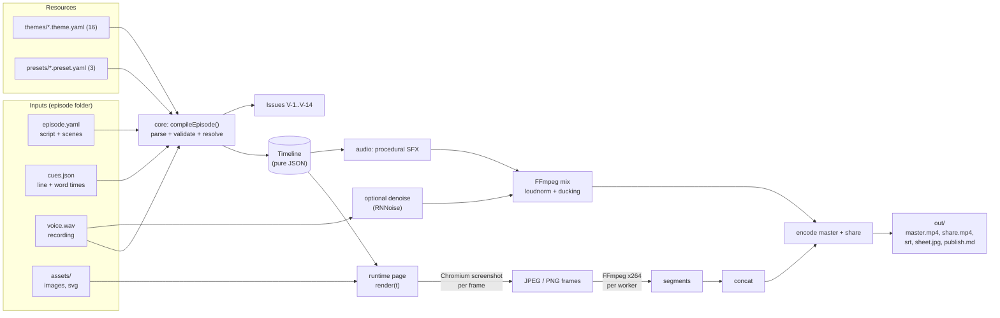

ويأتي `cues.json` من أحد ثلاثة مصادر: تقدير حسابي قبل التسجيل (draft)، أو محاذاة تلقائية من التسجيل
(`reelforge align`)، أو تحديد يدوي بالسمع في المحرر. والـ compiler لا يميّز بينها إلا في رسائل V-3.

### 3.2 من يستخدم ماذا

يُستخدم الـ **runtime** نفسه (صفحة الرسم) في المحرر وفي التصدير، وهذا أهم قرار في التصميم: **ما تراه في
المحرر هو بالضبط ما سيُرسم في الفيديو**. وكل أدوات الوكلاء معرّفة **مرة واحدة** في سجل الأدوات داخل حزمة
studio، وتخدمها ثلاث طرق اتصال.

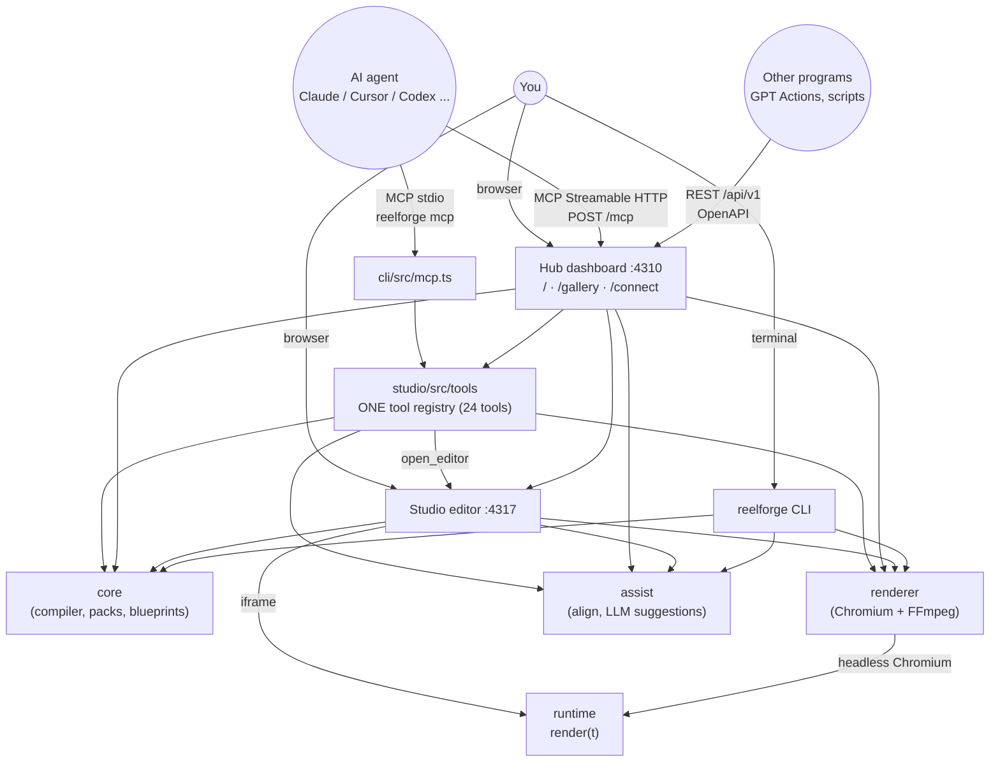

---

## 4. هيكل المستودع <a id="s4"></a>

```text
vidcreat/
├── packages/                ← كل الكود المصدري (TypeScript)، سبع حزم
│   ├── audio/               ← WAV، الـ envelope، تحليل الكلام والمحاذاة (align.ts)، المؤثرات، PRNG
│   ├── core/                ← schema، الزمن، الترجمة، الثيمات، الـ presets، الـ compiler، التحقق،
│   │                          الحزم الصناعية، الـ blueprints، الاقتراحات، الـ cues التلقائية
│   ├── assist/              ← اختياري: Whisper + Silero VAD، طبقة مزوّدي الـ LLM
│   │   └── runtime/         ← package-lock.json + models.json (النماذج مثبّتة بـ SHA-256)
│   ├── runtime/             ← صفحة المتصفح: render(t) و 62 مكوّناً، الأيقونات، QR، الخرائط
│   ├── renderer/            ← Chromium workers + FFmpeg + doctor
│   │   └── assets/rnnoise/  ← نموذج تنظيف الصوت sh.rnnn
│   ├── studio/              ← خادما Hub و Studio + سجل الأدوات + واجهات Vite
│   │   ├── src/server/      ← كود الخوادم (Node): hub، المحرر، الأمان، المعرض، نقاط الوكلاء
│   │   ├── src/tools/       ← سجل الأدوات: الأدوات، MCP، OpenAPI، الموارد
│   │   └── client/          ← hub.html، index.html (المحرر)، connect.html، gallery.html
│   └── cli/                 ← أمر reelforge + ناقل MCP على stdio
├── packs/                   ← 12 حزمة صناعية: pack.yaml + templates/ + examples/
├── themes/                  ← 16 ثيماً (داكنة وفاتحة)
├── presets/                 ← tiktok, reels, shorts
├── skills/                  ← 8 أدلة مهام بصيغة Agent Skills
├── examples/                ← حلقات جاهزة
│   ├── season1/ep01..ep09   ← سلسلة "System Design" بالإنجليزية
│   ├── season1-arabic/      ← نفس السلسلة بالعربية
│   └── promo/               ← intro و range (فيديوهات تعريفية بـ ReelForge نفسه)
├── episodes/                ← حلقاتك أنت (مُستثنى من git)
├── schema/                  ← episode.schema.json (مولَّد، للإكمال التلقائي في المحرر)
├── fixtures/                ← golden frames، حالات lint ‏v01…v14، mini، align، motion
├── tests/                   ← اختبارات المتصفح والتكامل (CLI، MCP، الوكلاء، المعرض، التصدير…)
├── scripts/                 ← توليد التوثيق وفحوصه، التقييم، التراخيص، الإصدار، لقطات الشاشة…
├── docs/                    ← موقع التوثيق (VitePress)، ADR، المراجع المولَّدة، هذا الدليل
├── documentation/           ← نسخة HTML للتوثيق تعمل دون اتصال (مولَّدة)
├── .github/workflows/       ← ci.yml، docs.yml، release.yml
├── install.* / start.* / reelforge(.cmd) / ReelForge.command  ← المثبّت والمشغّلات
├── AGENTS.md, CLAUDE.md, GEMINI.md, llms.txt, llms-full.txt   ← تعليمات للوكلاء الأذكياء
└── .mcp.json, .cursor/, .vscode/, .gemini/, .windsurf/, .claude-plugin/  ← إعداد MCP لكل أداة
```

حجم الكود تقريباً (أسطر TypeScript/HTML/CSS في `src/` و`client/`): **studio** ‏16800 سطر (منها نحو 10000
للواجهات)، **runtime** ‏11000 (منها 1500 سطر بيانات مولّدة للخريطة والأيقونات)، **core** ‏7400،
**renderer** ‏1500، **assist** ‏1500، **cli** ‏1100، **audio** ‏1100.

---

## 5. الحزم السبع وحدودها <a id="s5"></a>

### 5.1 مخطط الاعتماديات

المخطط مأخوذ من ملفات `package.json` الفعلية (السهم = «تعتمد على»):

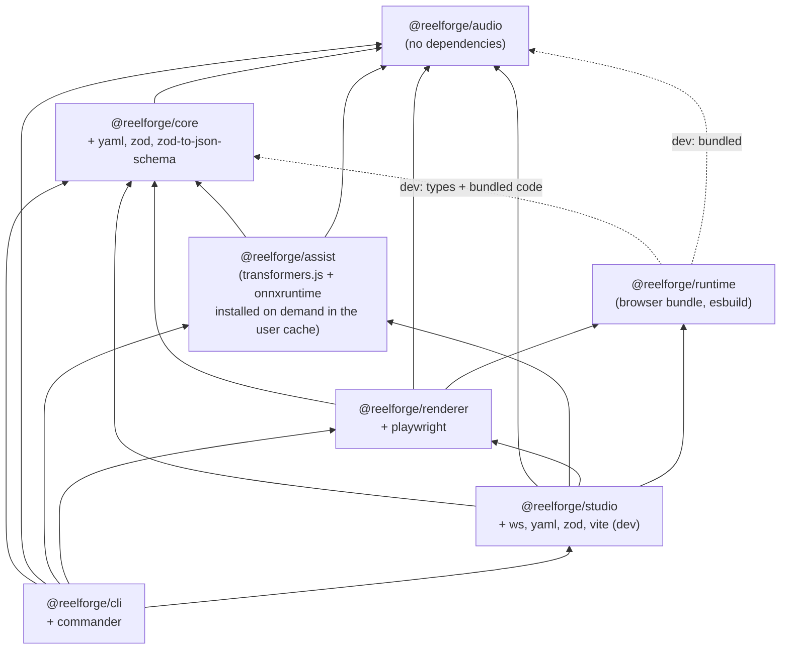

ليس للـ runtime أي اعتمادية تشغيل: يجمّع esbuild ما يحتاجه من `audio` (المولّد الحتمي) ومن `core` (الأنواع
فقط) في ملف واحد، ولذلك يظهران في `devDependencies`.

### 5.2 مسؤولية كل حزمة

| الحزمة     | يعمل في                       | المسؤولية                                                                                                                                                 |
| ---------- | ----------------------------- | --------------------------------------------------------------------------------------------------------------------------------------------------------- |
| `audio`    | Node **و** المتصفح            | قراءة/كتابة WAV، الـ envelope، اكتشاف بداية الصوت (onset)، تحليل الكلام وتقسيمه إلى أسطر وكلمات (`align.ts`)، توليد 8 مؤثرات، أرقام عشوائية حتمية         |
| `core`     | Node                          | schema الـ YAML، تعبيرات الزمن، الترجمة النصية وbidi، الثيمات ومولّدها، الـ presets، **الـ compiler**، التحقق، الحزم الصناعية، الـ blueprints، الاقتراحات |
| `assist`   | Node                          | الـ cues التلقائية بأفضل محرك متاح (DSP / Whisper / VAD)، تثبيت النماذج الموثّق، طبقة مزوّدي الـ LLM واقتراح المشاهد (انظر [§24](#s24))                   |
| `runtime`  | المتصفح فقط                   | الصفحة التي ترسم الإطار: `render(t)`، الخلفية، الترويسة، الترجمة النصية، 62 مكوّناً، 258 أيقونة، مولّد QR، الخرائط                                        |
| `renderer` | Node                          | تشغيل Chromium، التقاط الإطارات، FFmpeg، مزج الصوت وتنظيفه، فحص المخرجات، `doctor`، القياس V-9/V-10                                                       |
| `studio`   | Node (خادم) + المتصفح (واجهة) | لوحة التحكم، المحرر المرئي، المعرض، صفحة Connect AI، التعديل المهيكل للـ YAML، طابور التصدير، **سجل الأدوات** وطرقه الثلاث                                |
| `cli`      | Node                          | أمر `reelforge` بكل أوامره الفرعية، وناقل MCP على stdio                                                                                                   |

### 5.3 القاعدة الذهبية: الـ Timeline هو العقد الوحيد

لا تعرف حزمة `core` شيئاً عن DOM، ولا تعرف `runtime` شيئاً عن YAML أو zod. والشيء الوحيد الذي يمر
بينهما هو كائن `Timeline` المعرّف في [types.ts](../packages/core/src/types.ts). نتيجة ذلك:

- حزمة الـ runtime صغيرة (لا تحتوي zod ولا مكتبة YAML).
- يمكن اختبار الـ core بدون متصفح.
- يوجد اختبار يتأكد أن قائمة المكوّنات في `core` (الـ schemas) مطابقة لقائمة المكوّنات في `runtime`
  (الرسم).

وقاعدة ثانية مماثلة على مستوى الوكلاء (ADR-014): **لا تعرّف أي طريقة اتصال أداة خاصة بها**. فكل أداة تعيش في
`packages/studio/src/tools/`، وتلتقطها MCP stdio وMCP HTTP وREST ووثيقة OpenAPI وبطاقة الخادم تلقائياً.

---

## 6. رحلة حلقة كاملة خطوة بخطوة <a id="s6"></a>

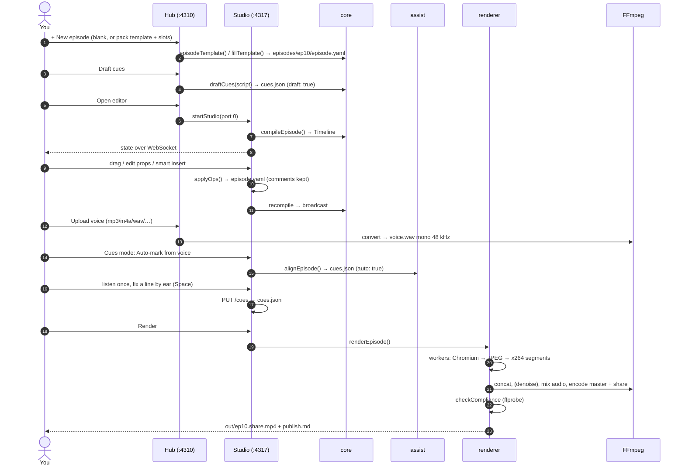

بالكلمات:

1. **الكتابة:** تكتب النص، جملة لكل سطر (نحو 2.3 كلمة في الثانية؛ 45 ثانية ≈ 100–110 كلمة). السطر
   الأول هو الـ hook، والأخير دعوة للتفاعل.
2. **الإنشاء:** ينشئ الأمر `reelforge new ep10` أو زر **New episode** المجلد من قالب عام، أو من قالب حزمة
   صناعية (`reelforge new ep10 --pack healthcare --slot org="…"`).
3. **التوقيت التقديري:** قبل التسجيل، تُحسب cues تقديرية (draft) حتى ترى التوقيت بشكل واقعي.
4. **التصميم:** تضيف المشاهد والعناصر (يدوياً، أو بـ blueprint، أو بالاقتراحات) وتربط دخول كل عنصر بالكلمة
   التي تسمّيه.
5. **التحقق والمعاينة:** يعرض `validate` مشكلات القواعد V-1…V-14، ويُخرج `snap` صوراً لإطارات محددة.
6. **التسجيل والتوقيت:** تسجّل `voice.wav`، ثم تحدد المحاذاة التلقائية الأسطر والكلمات، وتستمع مرة واحدة في
   وضع Cues وتصحح أي سطر بالضغط على Space.
7. **التصدير:** يُخرج `render` الملفات في `out/`.

لأن العناصر مربوطة **بالكلمات** لا بالثواني، فإعادة تسجيل جملة واحدة لا تتطلب إلا إعادة المحاذاة أو تحديد
cue واحد، وكل ما بعدها يبقى متزامناً تلقائياً.

ويمر الوكيل الذكي بالرحلة نفسها عبر الأدوات: `create_from_template` أو `create_episode`، ثم `add_scene`
أو `edit_episode`، ثم `validate_episode` و`preview_frames`، ثم `align_cues` و`render_episode` (انظر
[§15](#s15)).

---

## 7. ملف episode.yaml بالتفصيل <a id="s7"></a>

الـ schema معرّف بـ zod في [schema/episode.ts](../packages/core/src/schema/episode.ts). **كل كائن صارم
(strict)**: أي مفتاح غير معروف = خطأ V-1 مع اقتراح «هل تقصد…؟» (did-you-mean) ورقم السطر والعمود.

### 7.1 الأقسام الخمسة

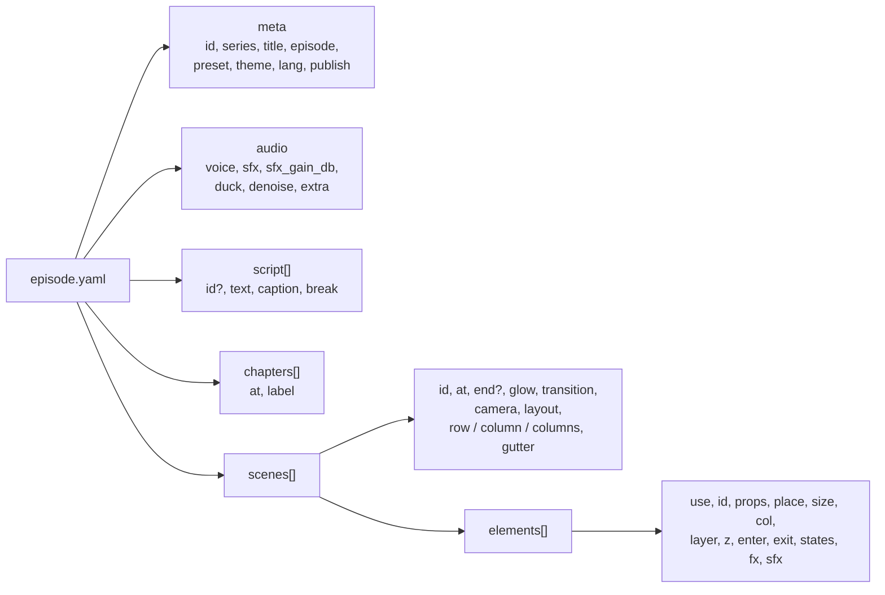

### 7.2 مثال مشروح

```yaml
meta:
  id: ep10 # حروف وأرقام و - و _
  series: 'SYSTEM DESIGN'
  title: 'Rate Limiting'
  episode: 10
  preset: tiktok # يحدد مكان المسرح والمناطق الآمنة
  theme: default # الألوان والخطوط (أو clinical، harbor، minimal…)
  lang: en-US # الافتراضي في الـ schema هو ar-EG!
  publish: { cover: 'Flooded API?', caption: '…', hashtags: ['#systemdesign'], pinned: '…' }

audio:
  voice: voice.wav
  sfx: auto # auto | manual | none
  sfx_gain_db: -16 # مستوى المؤثرات تحت الصوت
  # duck: true       ← خفض المؤثرات تلقائياً عندما تتكلم (الافتراضي)
  # denoise: true    ← إزالة ضجيج الخلفية من تسجيلات الهاتف عند التصدير

script: # المعرّفات الافتراضية: l1, l2, …
  - text: 'Your API just got flooded with requests.'
  - text: 'A rate limiter decides who gets through.'

chapters:
  - { at: l1, label: '01 · THE PROBLEM' }

scenes:
  - id: hook
    at: l1 # يبدأ مع السطر 1، وينتهي عند بداية المشهد التالي
    glow: red # لون التوهج في الخلفية
    transition: crossfade # كيف يدخل هذا المشهد
    camera: push-in # حركة كاميرا بطيئة طوال المشهد
    elements:
      - use: title # اسم المكوّن
        id: hook_title
        props: { text: 'Flooded **API**' } # **كلمة** = لون التمييز
        place: { x: 60, y: 160, w: 960, h: 240 } # إحداثيات المسرح
        enter: { at: "l1:'flooded'", anim: pop } # يدخل لحظة نطق "flooded"
        exit: { at: l2, anim: fade }
        fx: [{ at: "l1:'requests'", do: shake }]
```

### 7.3 الحقول المهمة للعنصر

| الحقل    | ماذا يفعل                                                                                                                                      |
| -------- | ---------------------------------------------------------------------------------------------------------------------------------------------- |
| `use`    | اسم المكوّن (من الـ 62). اسم غير موجود = **V-13** ويُحذف العنصر.                                                                               |
| `id`     | اختياري. الافتراضي `<scene>-<use>-<n>`. يجب أن يكون فريداً في كل الحلقة.                                                                       |
| `props`  | خصائص المكوّن، ويتحقق منها schema المكوّن الصارم.                                                                                              |
| `place`  | `x, y, w, h` أو `center` / `anchor` + `margin`. ودونه يتوسط العنصر، أو يُرتَّب تلقائياً إن كان للمشهد `row` / `column` / `columns` (مع `col`). |
| `size`   | `w, h` دون موضع: يغيّر الحجم ويترك الترتيب للتخطيط التلقائي.                                                                                   |
| `layer`  | `base` (الافتراضي) أو `overlay` (فوق الكل، مثل الأختام والشارات، ولا يدخل في فحص التداخل V-8).                                                 |
| `enter`  | `at` (الافتراضي: بداية المشهد)، `anim` (18 نوعاً)، `dur`، `ease`، ومعاملات مثل `dist`, `s0`, `cps`, `rot`, `amp`.                              |
| `exit`   | `at` (إلزامي)، `anim` (10 أنواع)، `dur` (الافتراضي 0.3).                                                                                       |
| `states` | `[{ at, set: {...} }]` تغيير خصائص مع الزمن، مثلاً `status: err` لعقدة.                                                                        |
| `fx`     | تأثيرات لحظية: `shake`, `flash`, `glitch`, `pulse`, `bump`. مع `target: camera` يهتز الإطار كله.                                               |
| `sfx`    | `auto` / `none` / قائمة أصوات صريحة.                                                                                                           |

---

## 8. الزمن: cues والكلمات وtime expressions <a id="s8"></a>

هذا أذكى جزء في المشروع، ويستحق أن تفهمه جيداً.

### 8.1 ثلاث طبقات للزمن

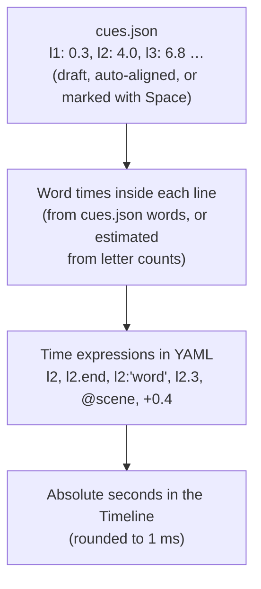

### 8.2 الـ cues

الـ cue هو **بداية** السطر. نهاية السطر = بداية السطر التالي (أو نهاية الصوت للسطر الأخير). شكل
`cues.json`:

```json
{
  "version": 1,
  "audio": { "file": "voice.wav", "duration": 45, "sha1": "…" },
  "cues": { "l1": 0.3, "l2": 4, "l3": 6.8 },
  "words": { "l2": [4.0, 4.31, 4.9] },
  "draft": true
}
```

- **من أين تأتي؟** ثلاثة مصادر، وكلها تكتب الملف نفسه:
  - **تقديرية (`draft: true`):** حساب في [compile.ts](../packages/core/src/compile.ts) (`draftCues`): **13
    حرفاً في الثانية** + فجوة 0.35 ث بين الأسطر، بدءاً من 0.2 ث. وإذا وُجد تسجيل، تمدّ لوحة التحكم التقديرات
    خطياً لتطابق مدته.
  - **تلقائية (`auto: true`):** المحاذاة من التسجيل بـ **Auto-mark from voice** أو `reelforge align` أو أداة
    `align_cues` (انظر [§24](#s24)). تحدد الأسطر **والكلمات**، وتبقى معلومة V-3 ظاهرة حتى تحفظها أنت مرة في وضع
    Cues.
  - **يدوية:** في وضع Cues تضغط Space عند بداية كل سطر وأنت تستمع (بسرعة 0.5×–1×). واختيارياً، يحرّك **Snap
    to voice** العلامة إلى أقرب ارتفاع حقيقي في الصوت خلال ±120 ms (انظر [§12](#s12)).
- **القراران ADR-004 وADR-013:** اختار ADR-004 التحديد اليدوي، لأن محرك الرسم يجب أن يبقى بلا تعلم آلي. ثم سمح ADR-013
  بأن **يقترح** الحاسوب الـ cues، بشرط أن تبقى أداة تأليف فقط: لا تستبدل ما حدده الإنسان إلا بتأكيد، ولا
  يُستخدم أي نموذج أثناء التصدير.
- **الحماية:** إذا تغيّر ملف الصوت بعد تحديد الـ cues، يختلف الـ `sha1` فيظهر تحذير V-4.

### 8.3 تقدير زمن كل كلمة

إذا لم يحمل `cues.json` أزمنة الكلمات، يوزّع [words.ts](../packages/core/src/words.ts) (`estimateWordStarts`)
مدة السطر على كلماته **بنسبة عدد حروف كل كلمة** (بحد أدنى 2)، بعد حجز 0.18 ث كوقفة في نهاية السطر.

**مثال حقيقي من `examples/promo/intro`:**

السطر `l1` = "What if your voice could direct the whole video?"، الـ cue = 0.3، والسطر التالي
عند 4.0.

```text
span     = 4.0 − 0.3 − 0.18 = 3.52 s
weights  = What 4, if 2, your 4, voice 5, could 5, direct 6, the 3, whole 5, video 5  → total 39
voice    = 0.3 + 3.52 × (4+2+4)/39 = 0.3 + 0.903 = 1.203 s
```

إذن `l1:'voice'` = **1.203 ث** بالتقدير. وإذا كانت أزمنة الكلمات موجودة في `cues.json` (من المحاذاة
التلقائية، أو من وضع الكلمات بالمفتاح W)، وكان عددها مساوياً لعدد الكلمات تماماً، تُستخدم بدل التقدير؛
وإلا يظهر تحذير V-3 ويُستخدم التقدير.

### 8.4 قواعد كتابة time expressions

التعريف في [time.ts](../packages/core/src/time.ts):

```text
expr   := base offset*
base   := NUMBER "s" | NUMBER                ← ثوانٍ مطلقة
        | LINE_ID                            ← بداية السطر
        | LINE_ID ".end"                     ← نهاية السطر
        | LINE_ID ":" 'word' ("#" N)?        ← كلمة (والتكرار رقم N)
        | LINE_ID "." N                      ← الكلمة رقم N (يبدأ العد من 0)
        | "@" SCENE_ID (".start" | ".end")?  ← بداية/نهاية مشهد
offset := ("+" | "-") NUMBER "s"?
```

| التعبير          | المعنى                                                    |
| ---------------- | --------------------------------------------------------- |
| `12.5s` / `12.5` | الثانية 12.5                                              |
| `l7`             | بداية السطر 7 = الـ cue                                   |
| `l7.end`         | `max(start, next − 0.15)`: قبل بداية السطر التالي بـ 0.15 |
| `l7:'bucket'`    | أول ظهور لكلمة bucket في السطر 7                          |
| `l7:'the'#2`     | الظهور الثاني لـ the                                      |
| `l7.3`           | الكلمة الرابعة (العد من 0)                                |
| `@hook.end`      | نهاية المشهد hook                                         |
| `l7:'x'+0.4`     | بعد الكلمة بـ 0.4 ث (يمكن جمع عدة إزاحات)                 |

**مطابقة الكلمات ذكية:** قبل المقارنة تُحذف علامات الترقيم والتشكيل والتطويل، وتُوحَّد `أ إ آ` إلى
`ا`، وتُحوَّل الحروف إلى صغيرة. يمكن أيضاً البحث عن عبارة من عدة كلمات. وإذا لم تُوجد الكلمة فالنتيجة خطأ
**V-2** مع اقتراح أقرب كلمة (Levenshtein).

> قاعدة YAML: ضع التعبير بين علامتي تنصيص مزدوجتين إذا احتوى `:` أو `'`، مثل `at: "l3:'bucket'"`.

---

## 9. حزمة core: الـ compiler والثيمات والحزم الصناعية <a id="s9"></a>

### 9.1 خريطة الملفات

| الملف                                                       | الدور                                                                                      |
| ----------------------------------------------------------- | ------------------------------------------------------------------------------------------ |
| [types.ts](../packages/core/src/types.ts)                   | تعريف الـ `Timeline` وكل أنواعه (العقد مع الـ runtime)                                     |
| [schema/episode.ts](../packages/core/src/schema/episode.ts) | schema الـ YAML بـ zod، وقوائم الحركات والانتقالات والكاميرا                               |
| [yamlsrc.ts](../packages/core/src/yamlsrc.ts)               | تحليل YAML مع **الاحتفاظ بمواقع السطور** حتى تشير الأخطاء إلى `file:line:col`              |
| [zodissues.ts](../packages/core/src/zodissues.ts)           | تحويل أخطاء zod إلى Issues مفهومة مع did-you-mean                                          |
| [time.ts](../packages/core/src/time.ts)                     | قواعد time expressions وتحليلها وحسابها                                                    |
| [words.ts](../packages/core/src/words.ts)                   | تقدير أزمنة الكلمات وجدول توقيت الأسطر                                                     |
| [text.ts](../packages/core/src/text.ts)                     | أدوات النص المختلط عربي/لاتيني (التطبيع، الاتجاه، عدّ الحروف والمقاطع)                     |
| [captions.ts](../packages/core/src/captions.ts)             | بناء الترجمة النصية: التقطيع والـ bidi                                                     |
| [cues.ts](../packages/core/src/cues.ts)                     | قراءة/كتابة `cues.json` (كتابة ذرّية)                                                      |
| [autocue.ts](../packages/core/src/autocue.ts)               | `autoCues`: الـ cues التلقائية بلا نموذج فوق محاذي `audio`                                 |
| [compile.ts](../packages/core/src/compile.ts)               | **الـ compiler** `compileEpisode` (~1175 سطراً هي قلب المشروع)، والـ draft cues، وفحص V-14 |
| [lint.ts](../packages/core/src/lint.ts)                     | فحوص هندسية وزمنية ثابتة (V-6, V-7, V-8, V-11, V-12)                                       |
| [theme.ts](../packages/core/src/theme.ts)                   | تحميل الثيمات مع `extends`، والخطوط المضمّنة، وفحوص التباين                                |
| [themegen.ts](../packages/core/src/themegen.ts)             | مولّد الثيم من لون واحد (`reelforge theme new`)                                            |
| [preset.ts](../packages/core/src/preset.ts)                 | تحميل الـ presets                                                                          |
| [project.ts](../packages/core/src/project.ts)               | مسارات المشروع والبحث عن الحلقات والموارد                                                  |
| [components/](../packages/core/src/components/)             | تعريف الـ 62 مكوّناً: schema الخصائص، الحجم الافتراضي، الأصوات التلقائية، أسماء 258 أيقونة |
| [suggest.ts](../packages/core/src/suggest.ts)               | الاقتراحات بالقاموس (smart insert) لكل سطر                                                 |
| [blueprints.ts](../packages/core/src/blueprints.ts)         | الـ 13 blueprint (مشاهد بمعاملات مسطّحة)                                                   |
| [packs.ts](../packages/core/src/packs.ts)                   | schema ملف `pack.yaml`، وقراءة الحزم، وملء القوالب (`fillTemplate`)                        |
| [outputs.ts](../packages/core/src/outputs.ts)               | توليد `.srt` و`publish.md`                                                                 |
| [template.ts](../packages/core/src/template.ts)             | القالب العام للحلقة الجديدة                                                                |
| [jsonschema.ts](../packages/core/src/jsonschema.ts)         | تحويل الـ schema إلى JSON Schema (للإكمال التلقائي، وللمحرر، وللأدوات)                     |

### 9.2 مراحل التحويل (compile)

الدالة `compileEpisode(paths, opts)` **نقية**: الملفات نفسها = الـ Timeline نفسه.

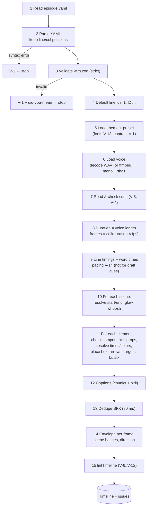

تفاصيل مهمة في كل مرحلة:

- **المدة** = مدة الصوت، أو `audio.duration` في cues، أو (كحل أخير) آخر cue + 3 ث. وإذا تجاوزت حد المنصة
  (`max_duration` في الـ preset) يظهر تحذير V-1.
- **أزمنة المشهد:** البداية = `at` محسوباً. النهاية = `end` إن وُجد، وإلا بداية المشهد التالي.
  ويُكتشف أي مرجع دائري بين المشاهد (`@a.end` → `@b` → …) فيعطي خطأ.
- **منطقة المشهد (origin):** `layout: stage` (الافتراضي) → `{x:0, y:270, w:1080, h:1000}`.
  `layout: full` → الـ canvas كله.
- **حل الخصائص (`resolveProps`):** يمرّ على كل الخصائص بشكل عميق:
  - المفاتيح `at, until, strike, highlight` تتحول من تعبيرات إلى ثوانٍ.
  - المفاتيح `color, accent, danger` والمصفوفة `colors` تتحول من أسماء الثيم (`lime`) إلى CSS (`#b8ff3c`).
- **مدة الدخول الافتراضية** حسب الحركة: `blur/wipe/reveal/draw` ‏0.6، `spring` ‏0.8، `drop` ‏0.7،
  `stamp/glitch` ‏0.5، `type` ‏0.3، والباقي 0.45 من الثيم.
- **الأسهم والأهداف:** `from: api.right` يُحسب من صندوق العنصر `api` **في المشهد نفسه**. إذا لم يُذكر الجانب،
  يُختار تلقائياً حسب الاتجاه. ثم تُحسب نقاط المسار (مستقيم / بزاوية / منحنٍ). وبالطريقة نفسها تتحول خاصية
  الهدف في `spotlight` و`callout` من معرّف عنصر إلى صندوق.
- **تأثيرات تُنقل إلى المستوى العام:** يذهب `flash` إلى `timeline.flashes` (وميض على الشاشة كلها)، ويذهب
  `shake` مع `target: camera` إلى `timeline.shakes`. ويضيف المكوّنان `stamp` و`trap` وميضاً واهتزازاً
  تلقائياً.
- **الاتجاه:** يصبح `meta.dir` ‏RTL إذا احتوى النص حرفاً عربياً **أو** بدأ `meta.lang` بـ `ar`.
- **الفشل لا يوقف كل شيء:** يُحذف العنصر ذو المكوّن المجهول أو الخصائص الخاطئة ويُبلَّغ عنه، لكن الـ
  Timeline يُعاد حتى مع وجود أخطاء (بقيم احتياطية)، ولهذا يستطيع المحرر عرض «آخر نسخة صالحة».

### 9.3 شكل الـ Timeline

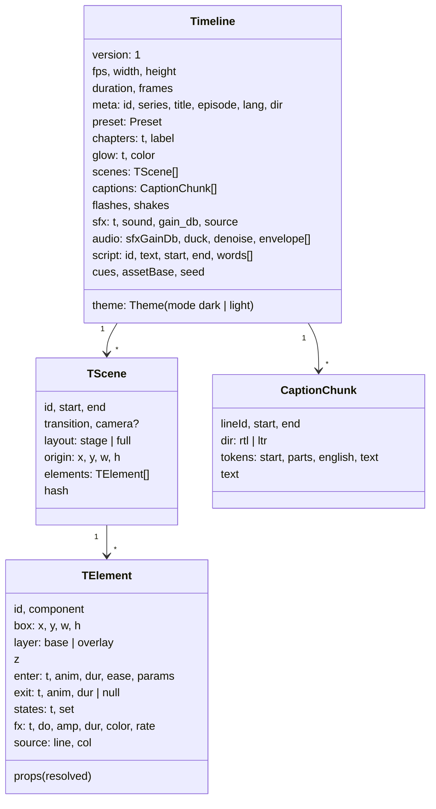

كل شيء فيه **محسوب مسبقاً**: الأزمنة بالثواني (بدقة 1 ms)، الألوان قيم CSS، الصناديق نهائية، نقاط
الأسهم جاهزة. ولا يحتاج الـ runtime إلا إلى حساب «ما الذي يظهر عند `t`».

المصفوفة `audio.envelope` فيها **قيمة لكل إطار** (0..1) تمثل علوّ الصوت، وتحرّك شريط الموجة الصوتية في
الفيديو. أما `seed` فهو hash لمعرّف الحلقة، وأساس كل «عشوائية» في الرسم. ويحمل `audio.denoise` اختيار
تنظيف الصوت حتى يقرأه الـ renderer.

### 9.4 نظام الإحداثيات

```text
 canvas 1080 × 1920 (tiktok preset)
 y=0     ┌───────────────────────────────┐
         │                               │
 y≈120   │  progress bar · SERIES · EP.10│  ← Header (headerTop 150)
         │  chapter label                │
 y=270   ├───────────────────────────────┤ ─┐
         │ (0,0) of the STAGE            │  │
         │                               │  │  STAGE 1080 × 1000
         │   elements live here,         │  │  element place: {x,y,w,h}
         │   x ≥ 60, x+w ≤ 1020          │  │  are relative to this box
         │                         ┌─────┤  │
 y=900   │                         │right│  │  ← right-rail safe zone
         │   keep x+w ≤ 920 below  │rail │  │     (x ≥ 940, likes/comments)
 y=1270  ├─────────────────────────┤     ┤ ─┘
 y=1300  │  word-by-word CAPTIONS  │     │  ← captionsY
         │  ▁▃▅▇▅▃▁ waveform       │     │
 y=1540  ├─────────────────────────┴─────┤
         │  bottom safe zone             │  ← caption/username/music UI
 y=1920  └───────────────────────────────┘
```

| Preset | المسرح (y / h) | الترجمة النصية (y) | الحافة اليمنى (right-rail) | المنطقة السفلى | حد الحجم | أقصى مدة |
| ------ | -------------- | ------------------ | -------------------------- | -------------- | -------- | -------- |
| tiktok | 270 / 1000     | 1300               | x 940 من y 900             | y 1540         | 28 MB    | 600 ث    |
| reels  | 270 / 1000     | 1290               | x 960 من y 1000            | y 1500         | 28 MB    | 900 ث    |
| shorts | **250** / 1000 | 1280               | x 960 من y 1000            | y 1560         | 28 MB    | 180 ث    |

القاعدة «x+w ≤ 920 تحت y 600» الواردة في AGENTS.md ليست مكتوبة في الكود، بل هي نتيجة للـ right-rail:
فالقيمة y 900 في الـ canvas = y 630 في المسرح.

**لماذا 9:16 فقط؟** (ADR-016): كل العناصر والقوالب والـ blueprints والأدلة وفحوص V-6/V-7/V-8 تفترض مسرحاً
بارتفاع 1000 px. المقاس المربع أو الأفقي يحتاج نموذج تخطيط نسبياً، لا preset جديداً، ولذلك أُجِّل إلى ما بعد
الإصدار 1.0.

### 9.5 الترجمة النصية (Captions) والعربية

هذا جزء دقيق جداً، لأن المزج بين العربية والإنجليزية (`الـ client`) يُربك معظم المحركات. الحل في
[captions.ts](../packages/core/src/captions.ts) (المنطق) و[runtime/captions.ts](../packages/runtime/src/captions.ts)
(الرسم)، وهو موثّق في ADR-007:

1. **الاتجاه لكل سطر:** RTL إذا احتوى السطر حرفاً عربياً.
2. **تجميع الكلمات (tokens):**
   - تندمج الكلمات اللاتينية المتتالية في token واحد: «Duplicate Charge».
   - تلتصق الكلمة المنتهية بالتطويل `ـ` بما بعدها عبر NBSP: `الـ client` لا تنفصل أبداً عند الالتفاف.
3. **عزل bidi:** داخل كل token تُوضع الأجزاء اللاتينية في `<bdi>`. والـ token كله `inline-block`
   و`nowrap`، فيتصرف ككتلة واحدة في ترتيب الفقرة. وتبقى علامات الترقيم مثل `؟` خارج العزل، فتظهر في
   المكان الصحيح.
4. **التقطيع (chunks):** الحد الأقصى 34 حرفاً لكل قطعة (من الثيم). وتُقسم القطعة الطويلة عند علامة
   الترقيم الأقرب إلى المنتصف، أو من المنتصف. يمكن فرض فواصل بـ `break: ['word']` في السطر.
5. **الكاريوكي:** يحمل كل token زمن بدايته. أثناء الرسم: الكلمة الحالية بلون `active` (lime)، والسابقة
   بلون عادي، والقادمة شفافة (`future_opacity` 0.32)، والإنجليزية داخل العربي بلون `english` (cyan).
   والكلمة النشطة تنبض قليلاً.

ويغلّف ملف `.srt` الناتج الأسطر العربية بعلامتي Unicode ‏RLE…PDF حتى تُعرض بشكل صحيح في المشغلات.

### 9.6 الثيمات

تدعم ملفات `themes/<name>.theme.yaml` المفتاح `extends` (وراثة مع دمج عميق، واكتشاف الوراثة الدائرية).
ويبحث المحمّل في `themes/` الخاص بمشروعك أولاً ثم في التثبيت. يوجد **16 ثيماً** مضمّناً، كلها ترث من
`default`:

| الوضع        | الثيمات                                                                                                               |
| ------------ | --------------------------------------------------------------------------------------------------------------------- |
| داكن (dark)  | `default`, `season1`, `workshop`, `bistro`, `bold`, `editorial`, `harbor`, `industrial`, `ledger`, `retail`, `voyage` |
| فاتح (light) | `campus`, `civic`, `clinical`, `estate`, `minimal`                                                                    |

الثيم `default`:

| القسم      | القيم                                                                                                                                                                                                            |
| ---------- | ---------------------------------------------------------------------------------------------------------------------------------------------------------------------------------------------------------------- |
| `mode`     | `dark` (أو `light`: يضيف الـ runtime الصنف `rf-light` وأنماط [light.ts](../packages/runtime/src/light.ts) للأسطح والظلال)                                                                                        |
| `colors`   | bg `#07080c`, ink, dim, line, card, **lime** `#b8ff3c`, cyan, red, amber, violet                                                                                                                                 |
| `fonts`    | من الخطوط التسعة المضمّنة فقط (`BUNDLED_FONTS`، كلها بترخيص OFL): Space Grotesk وInter وManrope وPlayfair Display للعناوين، JetBrains Mono للكود، وCairo وReadex Pro وNoto Kufi Arabic وNoto Naskh Arabic للعربي |
| `type`     | caption 66, title 120, h2 84, body 32, label 24                                                                                                                                                                  |
| `chrome`   | header, progress, waveform, grain 0.07، `grain_fps` 0 (ثابت)، vignette 0.75، grid، `glow` 1 (الثيمات الفاتحة نحو 0.5)                                                                                            |
| `motion`   | pop_overshoot 1.9, default_dur 0.45, crossfade 0.3                                                                                                                                                               |
| `captions` | active lime, english cyan, future_opacity 0.32, max_lines 2, max_chars 34, scrim 0.78                                                                                                                            |

**فحوص التباين على مستويين:**

- **عند التحميل (كل حلقة):** خط غير مضمّن = **V-13** (لأن التصدير لا يصل إلى الإنترنت). ولون الترجمة (`ink`
  و`captions.active` و`captions.english`) أقل من **7:1** مع الخلفية = تحذير V-1 (`captionContrastIssues`).
- **في الاختبارات (كل ثيم في `themes/`):** يتحقق [themes.test.ts](../packages/core/test/themes.test.ts) بـ
  `themeContrast` من معيار WCAG 2.1 AA: كل لون نصي (`ink`, `dim`, والألوان الخمسة، ولونا الترجمة) ≥ **4.5:1**
  على السطحين `bg` و`card`. ويُعامل `dim` كنص عادي لا كبير، لأنه يكتب العناوين الفرعية وتسميات المحاور.

**مولّد الثيمات** ([themegen.ts](../packages/core/src/themegen.ts)): يأخذ الأمر
`reelforge theme new brand --accent "#ff5a1f" [--mode light] [--font Inter]` لوناً واحداً ويبني لوحة كاملة
بـ HSL: خلفية وبطاقة من درجة اللون نفسه، وألوان ثانوية تبقى في عائلاتها (cyan أزرق، violet بنفسجي) مع إبعادها
عن لون التمييز. وكل لون لا يحقق التباين يُحرَّك في الإضاءة حتى يحققه، ويرفض المولّد أي نتيجة تفشل في الفحصين.

**لماذا الـ grain ثابت؟** (ADR-011): الضجيج الذي يتغير مع كل إطار لا يمكن ضغطه. وفي القياس: بلا grain ‏1.9 Mb/s، مع
grain متحرك ‏64.5 Mb/s، مع grain ثابت ‏5.9 Mb/s. والمنصات تزيله أصلاً عند إعادة الترميز.

### 9.7 قواعد التحقق V-1 … V-14

| القاعدة  | المستوى              | ماذا تفحص                                                                                                                                      | أين                 |
| -------- | -------------------- | ---------------------------------------------------------------------------------------------------------------------------------------------- | ------------------- |
| **V-1**  | error (أحياناً warn) | كل أخطاء البنية: YAML، zod، معرّفات مكررة، ثيم/preset مجهول، سهم أو هدف يشير لعنصر غير موجود؛ وتحذيرات: تباين الترجمة < 7:1، مدة فوق حد المنصة | core                |
| **V-2**  | error                | تعبير زمني غير صالح أو لا يُحل (سطر/كلمة/مشهد مجهول، خارج المدة، مرجع دائري)                                                                   | core                |
| **V-3**  | error/warn/info      | cues مفقودة أو غير مرتبة أو بعد نهاية الصوت؛ cue لسطر مجهول؛ عدد كلمات غير مطابق (warn)؛ cues تقديرية أو تلقائية (info)                        | core                |
| **V-4**  | warn/error           | ملف الصوت مفقود (warn) أو غير مقروء (error) أو تغيّر منذ تحديد الـ cues                                                                        | core                |
| **V-5**  | error                | نهاية المشهد قبل بدايته؛ عنصر يدخل خارج مشهده؛ خروج قبل الدخول                                                                                 | core                |
| **V-6**  | warn                 | العنصر يخرج عن حدود المسرح                                                                                                                     | core (lint)         |
| **V-7**  | warn                 | العنصر يتقاطع مع منطقة آمنة (واجهة المنصة)                                                                                                     | core (lint)         |
| **V-8**  | warn                 | عنصران `base` ظاهران معاً يتداخلان بأكثر من 15% (تُستثنى `particles`, `trap`, `spotlight`)                                                     | core (lint)         |
| **V-9**  | warn                 | النص يفيض عن صندوقه **بعد الرسم الفعلي**                                                                                                       | renderer (Chromium) |
| **V-10** | warn                 | قطعة ترجمة تُرسم في أسطر أكثر من `max_lines`                                                                                                   | renderer (Chromium) |
| **V-11** | info                 | لا شيء يدخل في أول 1.5 ث من المشهد («هواء ميت»)                                                                                                | core (lint)         |
| **V-12** | warn                 | عنصر يدخل قبل نهاية مشهده بأقل من 0.1 ث («وميض»)                                                                                               | core (lint)         |
| **V-13** | error                | مكوّن مجهول، أو خط غير مضمّن                                                                                                                   | core                |
| **V-14** | warn / info          | الإيقاع: سطر أسرع من 3.5 كلمة/ث، أو الـ hook يبدأ بعد 3 ث (warn)؛ صمت ≥ 1.5 ث في التسجيل (info). لا يُفحص مع cues تقديرية                      | core (compile)      |

القاعدتان V-9 وV-10 وحدهما تحتاجان متصفحاً، لأن حجم النص الحقيقي لا يُعرف إلا بعد رسمه بالخط الفعلي.
وتُخزَّن نتائجهما في `out/.cache/measure.json` بمفتاح hash (الـ runtime + المشاهد + الثيم + الـ preset)، فلا
تُعاد إلا إذا تغيّر شيء. ولكل قاعدة حلقة اختبار فيها خطأ مقصود في `fixtures/lint/v01…v14`.

### 9.8 المكوّنات الـ 62

كل مكوّن له تعريف في [core/components](../packages/core/src/components/index.ts) (الـ schema والحجم
الافتراضي والأصوات) وتنفيذ في [runtime/components](../packages/runtime/src/components/index.ts) (الرسم)
بالاسم نفسه. القائمة الكاملة بخصائصها وصورة لكل مكوّن في [مرجع المكوّنات](ar/reference/components.md)، وهي
مولّدة من الـ schemas. وهذا تصنيفها (هو نفسه في AGENTS.md):

| الفئة                 | المكوّنات                                                                                                                                                                                              |
| --------------------- | ------------------------------------------------------------------------------------------------------------------------------------------------------------------------------------------------------ |
| النص (8)              | `title`, `label`, `chip`, `stamp`, `quote`, `kinetic-text`, `bullet-list`, `speech-bubble`                                                                                                             |
| المخططات (8)          | `node`, `arrow`, `lanes`, `grid`, `timeline`, `bucket`, `callout` (تسمية بسهم نحو عنصر), `spotlight` (يعتّم كل شيء إلا عنصراً)                                                                         |
| البيانات والرسوم (13) | `counter`, `meter` (`style: gauge`), `table`, `checklist`, `bar-chart`, `line-chart`, `donut-chart`, `stat-card`, `progress-ring`, `comparison`, `before-after`, `ranking`, `vitals` (تخطيط قلب + نبض) |
| الهياكل (8)           | `steps`, `flow`, `org-chart`, `tree`, `cycle`, `funnel`, `pyramid`, `matrix-2x2`                                                                                                                       |
| الأماكن (5)           | `map` (دول ودبابيس ومسارات), `route` (مركبة متحركة), `floor-plan`, `building`, `container-stack`                                                                                                       |
| الوقت والأشخاص (8)    | `calendar`, `clock` (`mode: countdown`), `schedule-board`, `appointment`, `person-card`, `chat`, `notification`, `lower-third`                                                                         |
| الوسائط والتجارة (6)  | `image` (Ken Burns), `logo`, `split-screen`, `pricing-table` (`variant: tag`), `qr-code`, `rating` (للتوضيح فقط)                                                                                       |
| أخرى (6)              | `code` (يكتب نفسه), `phone`, `icon` (258 أيقونة), `particles`, `trap` (فاصل «THE TRAP»), `cta` (نهاية «الحلقة القادمة»)                                                                                |

**المكوّنات الأصلية الـ 21** (كانت المجموعة الأولى، وما زالت الأكثر استخداماً في أمثلة season1):

| #   | المكوّن     | ما هو                                            | الحجم الافتراضي | صوت تلقائي                  |
| --- | ----------- | ------------------------------------------------ | --------------- | --------------------------- |
| 1   | `title`     | عنوان كبير، `**كلمة**` بلون التمييز، يتقلص ليتسع | 960×240         | whoosh عند الدخول           |
| 2   | `label`     | سطر صغير بخط mono مع نقطة متوهجة                 | 640×60          | —                           |
| 3   | `code`      | محرر كود يكتب نفسه سطراً سطراً مع تلوين وتظليل   | 960×520         | typing                      |
| 4   | `node`      | صندوق نظام (server/db) بحالة ok/err/warn/busy    | 300×170         | err / ding عند تغيّر الحالة |
| 5   | `arrow`     | سهم بين عنصرين مع حزم بيانات متحركة وتسمية       | يُحسب           | whoosh                      |
| 6   | `chip`      | شارة نصية صغيرة، يمكن شطبها                      | 340×84          | ding / err عند الشطب        |
| 7   | `stamp`     | ختم مائل يسقط بقوة (+ وميض + اهتزاز)             | 680×260         | hit                         |
| 8   | `table`     | جدول تظهر صفوفه تباعاً                           | 960×440         | ding لكل صف                 |
| 9   | `lanes`     | مسارات متوازية (race conditions)                 | 960×760         | tick / err                  |
| 10  | `checklist` | قائمة ✓/✗ ترسم نفسها                             | 880×460         | ding / err                  |
| 11  | `counter`   | رقم كبير يعدّ بين keyframes                      | 820×320         | —                           |
| 12  | `meter`     | شريط قياس مع حد (LIMIT) يحمرّ عند تجاوزه         | 880×180         | —                           |
| 13  | `timeline`  | محور زمني مع علامات ومؤشر                        | 960×260         | ding لكل علامة              |
| 14  | `grid`      | شبكة مربعات بحالات                               | 640×640         | —                           |
| 15  | `bucket`    | دلو tokens (rate limiting) تُستهلك وتُملأ        | 440×560         | tick                        |
| 16  | `phone`     | هاتف بتطبيق دفع وإشعارات ونقرات                  | 440×880         | tap / ding                  |
| 17  | `quote`     | اقتباس يُكتب مع إبراز كلمات                      | 940×460         | typing                      |
| 18  | `particles` | جسيمات: burst, confetti, herd, stream, dust      | يملأ المشهد     | —                           |
| 19  | `trap`      | فاصل «THE TRAP» بأشرطة تحذير وglitch             | يملأ المشهد     | hit + glitch                |
| 20  | `cta`       | بطاقة النهاية «الحلقة القادمة» مع صندوق تعليق    | 960×560         | typing                      |
| 21  | `icon`      | واحدة من 258 أيقونة مضمّنة، أو صورة من `assets/` | 160×160         | —                           |

### 9.9 الحزم الصناعية والقوالب والـ blueprints

هذه الطبقة تجعل التأليف ممكناً بمعاملات بسيطة، وكلها تُنتج YAML عادياً يمر بالـ schema نفسه.

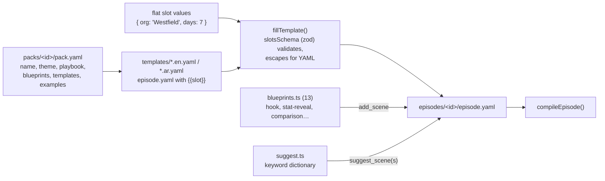

- **الحزم (12):** `education`, `events-ngo`, `finance`, `food`, `government`, `healthcare`, `manufacturing`,
  `ports-logistics`, `real-estate`, `retail`, `tech`, `tourism`. لكل حزمة ثيم (مثلاً `clinical` للصحة،
  `harbor` للموانئ، و`default` للتقنية)، و**3 قوالب** بالإنجليزية والعربية (36 قالباً)، ومثالان مولّدان
  (`examples/<name>-en` و`-ar`، يعيد `scripts/gen-pack-examples.mjs` بناءهما)، ومرجع في
  `skills/reelforge-industry-playbooks/references/`.
- **مخطط الحزمة** (`packSchema` في [packs.ts](../packages/core/src/packs.ts)): `id`, `name` و`description`
  (نص أو `{ en, ar }`)، `theme`، `playbook`، `blueprints`، `templates[]` (لكل قالب `id`, `title`,
  `description`, `slots`, `files: { en, ar? }`)، `examples`. ولكل خانة `label` و`type` (`text` / `number` /
  `color`) و`max`/`min` و`default` (قد يكون مترجماً). وتحل حزم مشروعك (`<root>/packs/`) محل حزم التثبيت
  بالمعرّف نفسه.
- **ملء القالب:** يبني `slotsSchema` مدقق zod من الخانات (النص سطر واحد، بلا `{{`، بطول أقصى)، ثم يستبدل
  `fillTemplate` كل `{{slot}}` (و`{{id}}` بمعرّف الحلقة) مع تهريب النص لـ YAML بين علامتي تنصيص مفردتين. لا
  يكتب النموذج YAML أبداً، فلا يستطيع كسر البنية.
- **الـ blueprints (13):** `hook`, `problem-solution`, `stat-reveal`, `comparison`, `process-steps`,
  `timeline`, `before-after`, `bar-stats`, `quote`, `cta`, `map-route`, `appointment`, `chat`. يأخذ كل واحد
  `line` (سطر البداية) و`at` و`glow` اختيارياً ومعاملات مسطّحة قصيرة، ويعيد مشهداً كاملاً داخل المنطقة
  الآمنة يدخل على كلمة السطر.
- **مستويات الأدوات حسب حجم النموذج:**

| المستوى | لمن              | الأدوات                                                                                     |
| ------- | ---------------- | ------------------------------------------------------------------------------------------- |
| Tier 1  | النماذج الصغيرة  | `list_templates` ← `create_from_template` ← `validate_episode` (خانات مسطّحة فقط، بلا YAML) |
| Tier 2  | النماذج المتوسطة | `create_episode` ← `suggest_scenes` ← `list_blueprints` / `add_scene` (مشهد بمعاملات)       |
| Tier 3  | النماذج القوية   | `edit_episode` / `write_episode_yaml` (تأليف حر بمسارات YAML)                               |

---

## 10. حزمة runtime: الرسم بدالة render(t) <a id="s10"></a>

### 10.1 الفكرة

الـ runtime **صفحة HTML صغيرة** ([runtime.html](../packages/runtime/page/runtime.html)) + ملف
`runtime.js` مجمّع بـ esbuild (IIFE لـ Chrome 120) + خطوط محلية، وتتيح للعالم الخارجي كائناً واحداً
([main.ts](../packages/runtime/src/main.ts)):

```ts
window.reelforge = {
  ready: Promise<void>,      // يكتمل بعد تحميل الخطوط والـ Timeline
  fonts: { ok, missing },    // للتأكد أن كل الخطوط حُمّلت (V-13)
  load(tl: Timeline),        // تحميل Timeline جديد (المحرر)، وينتظر فك ترميز الصور
  render(t: number),         // ارسم الإطار عند الزمن t ← كل شيء هنا
  measure(),                 // قياس V-9 / V-10
  boxes(t),                  // صناديق العناصر الظاهرة (لنقر المحرر)
  duration, timeline, error,
};
```

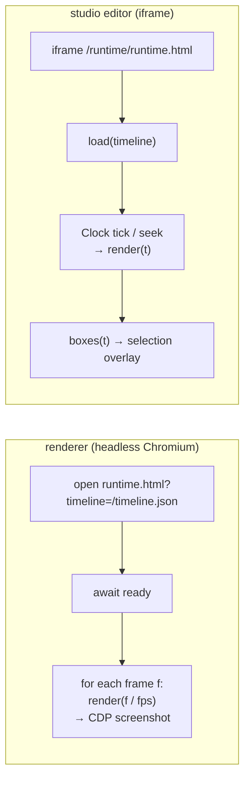

### 10.2 خريطة الملفات

| الملف                                                      | الدور                                                                                           |
| ---------------------------------------------------------- | ----------------------------------------------------------------------------------------------- |
| [engine.ts](../packages/runtime/src/engine.ts)             | `Engine`: يبني المشاهد مرة واحدة، و`render(t)` و`measure()` و`boxes(t)`                         |
| [scene.ts](../packages/runtime/src/scene.ts)               | `SceneView` و`ElementView`: الانتقالات، الكاميرا، الدخول والخروج، `fx`، `states`                |
| [anim.ts](../packages/runtime/src/anim.ts)                 | دوال التسارع والحركة (كلها نقية في الزمن)                                                       |
| [chrome.ts](../packages/runtime/src/chrome.ts)             | الخلفية والتوهج والشبكة، الترويسة وشريط التقدم، الموجة الصوتية، الـ grain والـ vignette والوميض |
| [captions.ts](../packages/runtime/src/captions.ts)         | رسم الترجمة: الكاريوكي والعزل بـ `<bdi>`                                                        |
| [fonts.ts](../packages/runtime/src/fonts.ts)               | تحميل الخطوط التسعة صراحةً قبل أول إطار، والتحقق منها                                           |
| [light.ts](../packages/runtime/src/light.ts)               | أنماط الثيمات الفاتحة (`#rf-root.rf-light`)؛ لا تمس إطارات الثيمات الداكنة                      |
| [icons.ts](../packages/runtime/src/icons.ts)               | 258 أيقونة: رسوم ReelForge الأصلية + مجموعة مختارة من Lucide ‏(ISC) في `data/lucide-icons.ts`   |
| [qr.ts](../packages/runtime/src/qr.ts)                     | مولّد QR مكتوب للمشروع (ISO/IEC 18004، الإصدارات 1–10، تصحيح L/M) بلا اعتماديات                 |
| [geo.ts](../packages/runtime/src/geo.ts)                   | رياضيات الخريطة: مناظر مسمّاة، إسقاط equirectangular مضبوط، مسارات great-circle                 |
| `data/world.ts`                                            | حدود الدول من Natural Earth ‏1:110m (ملكية عامة)، يولّدها `scripts/gen-world-map.mjs`           |
| [components/](../packages/runtime/src/components/index.ts) | تنفيذ الـ 62 مكوّناً في ملفات حسب الفئة (انظر الجدول التالي)                                    |
| `styles.ts`, `styles-general.ts`, `dom.ts`, `color.ts`     | الـ CSS الأساسي، أدوات DOM مع ذاكرة مؤقتة، مزج الألوان                                          |

| ملف المكوّنات  | المكوّنات                                                                                                                              |
| -------------- | -------------------------------------------------------------------------------------------------------------------------------------- |
| `text.ts`      | `title`, `label`, `quote`, `stamp`, `counter`, `cta`                                                                                   |
| `diagram.ts`   | `node`, `arrow`, `chip`, `icon`, `particles`                                                                                           |
| `code.ts`      | `code`                                                                                                                                 |
| `data.ts`      | `table`, `lanes`, `checklist`, `meter`, `timeline`, `grid`, `bucket`                                                                   |
| `screens.ts`   | `phone`, `trap`                                                                                                                        |
| `datavis.ts`   | `bar-chart`, `line-chart`, `donut-chart`, `stat-card`, `progress-ring`, `comparison`, `before-after`, `ranking`                        |
| `structure.ts` | `steps`, `flow`, `org-chart`, `tree`, `cycle`, `funnel`, `pyramid`, `matrix-2x2`                                                       |
| `place.ts`     | `map`, `route`, `floor-plan`, `building`, `container-stack`                                                                            |
| `time.ts`      | `calendar`, `clock`, `schedule-board`, `appointment`                                                                                   |
| `people.ts`    | `person-card`, `chat`, `notification`, `speech-bubble`, `lower-third`                                                                  |
| `media.ts`     | `image`, `logo`, `kinetic-text`, `bullet-list`, `callout`, `spotlight`, `split-screen`, `pricing-table`, `qr-code`, `rating`, `vitals` |

### 10.3 طبقات الإطار

يبني `Engine` كل المشاهد والعناصر **مرة واحدة**، ثم لا تغيّر `render(t)` إلا ما يظهر وكيف يظهر. ترتيب الطبقات
من الأسفل إلى الأعلى:

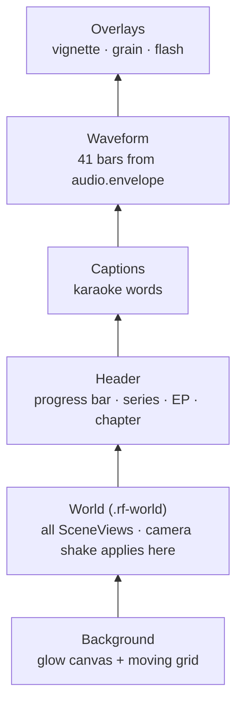

لاحظ أن اهتزاز الكاميرا يطبَّق على الـ World فقط، فلا تهتز الترويسة ولا الترجمة النصية.

### 10.4 ماذا يحدث داخل render(t)

```ts
t = clamp(t, 0, duration);
frame = Math.round(t * fps);
background.update(t); // لون التوهج (تلاشٍ 0.8 ث بين المشاهد)
world.transform = cameraShake(t); // اهتزازات timeline.shakes
for (scene of scenes) scene.update(t, frame);
header.update(t);
captions.update(t);
waveform.update(t);
overlays.update(t, frame);
```

**لكل مشهد** (`SceneView` في [scene.ts](../packages/runtime/src/scene.ts)):

- يكون المشهد ظاهراً إذا تحقق `start ≤ t < end + مدة انتقال الخروج`.
- **انتقال الدخول** بحسب `transition`:

| الانتقال              | التأثير                                          |
| --------------------- | ------------------------------------------------ |
| `crossfade` (افتراضي) | ظهور + تكبير 0.97→1 + تمويه 8→0                  |
| `cut`                 | فوري                                             |
| `slide-up`            | ينزلق من الأسفل 140 px                           |
| `zoom`                | تصغير 1.12→1 + تمويه                             |
| `push`                | يدفع المشهد القديم لليسار ويدخل من اليمين (معاً) |
| `blur`                | تمويه قوي 22→0                                   |

- **الكاميرا** طوال المشهد: `push-in` تكبير 1→1.06، `pull-out` العكس، `drift` انجراف ±18 px.
- **تجميد العناصر:** أثناء خروج المشهد «تتجمد» العناصر على آخر لحظة من المشهد حتى لا تتحرك أثناء
  التلاشي.

**لكل عنصر** (`ElementView`):

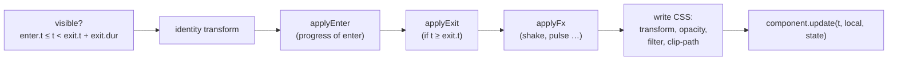

### 10.5 الحركات

**حركات الدخول (18):**

| الحركة            | ما يحدث                                              |
| ----------------- | ---------------------------------------------------- |
| `pop` (افتراضي)   | تكبير من 0.8 مع ارتداد (overshoot 1.9) + صعود بسيط   |
| `rise`            | يصعد 40 px مع ظهور                                   |
| `slide-l/slide-r` | ينزلق 140 px من الجانب                               |
| `fade`            | ظهور فقط                                             |
| `draw`            | يُكشف من بداية السطر (للأسهم: يُرسم الخط)            |
| `type`            | يُكتب حرفاً حرفاً (title/code)، أو كلمة كلمة للعربي  |
| `count`           | ظهور (القيمة نفسها من keyframes)                     |
| `flip`            | ينقلب 90° على المحور X                               |
| `zoom`            | من 1.35 إلى الحجم الطبيعي مع تمويه                   |
| `stamp`           | يسقط من 2.2× ويستقر بارتجاج                          |
| `blur`            | يتضح من تمويه 16                                     |
| `wipe`            | ينكشف من جهة البداية (يحترم RTL)                     |
| `spring`          | نابض مخمَّد من 0.55                                  |
| `drop`            | يسقط من 220 px مع ارتداد                             |
| `reveal`          | يصعد من خلف قناع عند حافته السفلى (للعناوين الكبيرة) |
| `glitch`          | ارتعاش مع فصل ألوان أحمر/أزرق                        |
| `none`            | بلا حركة                                             |

**التسارع (ease):** `smooth` (cubic، افتراضي)، `snappy` (quint)، `gentle` (sine)، `linear`.

**حركات الخروج (10):** `fade`, `pop` (يصغر)، `rise` (يصعد)، `sink` (يهبط)، `slide-l/r`، `zoom` (يكبر)،
`blur`، `wipe`، `none`. وكلها تتسارع نحو الخروج (`easeInCubic`).

**التأثيرات `fx`:** `shake` (ارتجاج عشوائي حتمي 40 Hz)، `glitch`، `pulse` (نبض متكرر)، `bump` (نبضة
واحدة)، `flash` (وميض الشاشة كلها).

**الحالات `states`:** عند كل زمن تُدمج كل قيم `set` السابقة فوق الخصائص، مع حفظ زمن آخر تغيير لكل مفتاح (`$since`)
حتى يستطيع المكوّن تحريك التغيير (مثلاً تومض العقدة عندما تصبح `err`). **لا شيء يتراكم**: تُحسب الحالة من
الصفر في كل إطار.

### 10.6 كيف يُكتب مكوّن

```ts
interface RuntimeComponent {
  name: string;
  handles?: EnterAnim[]; // حركات يرسمها المكوّن بنفسه (title/code: type، arrow: draw، trap: glitch)
  mount(root, props, theme, ctx): Instance; // مرة واحدة: بناء DOM
}
interface Instance {
  update(t, local, state): void; // كل إطار: دالة نقية في t
}
```

- تبني `mount` الـ DOM مرة واحدة، ويمكنها قياس النص (تصغّر `fitText` الخط بالبحث الثنائي حتى يتسع).
- تُستدعى `update` في كل إطار، ويجب أن تكون **دالة في t فقط**.
- أغلب المكوّنات مبنية بـ HTML/CSS. وتستخدم **SVG**: الأسهم، والدلو، وعلامات checklist، والأيقونات، والرسوم
  البيانية، والخرائط، ورمز QR. وتستخدم **Canvas**: الجسيمات، والتوهج، والشبكة، والـ grain.
- تمر كتابة الـ DOM عبر ذاكرة مؤقتة (`css()`, `attr()`, `text()`) لا تكتب إلا إذا تغيرت القيمة، وهذا يسرّع
  الرسم كثيراً.
- يتخطى `measure()` المكوّنات التي لا نص فيها يُقاس (`arrow`, `particles`, `trap`, `icon`)، ويقيس الباقي في
  الحالة المستقرة قرب نهاية العنصر.

### 10.7 الحتمية داخل المتصفح

- لا `Date.now`، لا `Math.random`، لا `setTimeout`، لا `requestAnimationFrame` في كود الـ runtime.
- يفرض ملف الـ CSS الأساسي `animation: none !important; transition: none !important` على كل شيء.
- تأتي العشوائية من `rnd(seed)` و`mulberry32(seed)` في حزمة audio، والبذرة = hash(معرّف العنصر) XOR
  `timeline.seed`.
- الجسيمات: تُحسب مواقعها **بصيغة مغلقة** في `t − start`، لا بمحاكاة خطوة بخطوة، ولذلك يمكن رسم الإطار 500
  قبل الإطار 10.
- تُفك ترميز كل الصور (`img.decode()`) قبل أول إطار، حتى لا يتوقف الإطار على توقيت التحميل.
- يوجد اختبار يرسم المعرض كله تقدماً وتراجعاً ويقارن الـ DOM، واختبار آخر يقارن SHA-1 لصور JPEG.

---

## 11. حزمة renderer: من الإطارات إلى MP4 <a id="s11"></a>

### 11.1 خريطة الملفات

| الملف                                             | الدور                                                                          |
| ------------------------------------------------- | ------------------------------------------------------------------------------ |
| [render.ts](../packages/renderer/src/render.ts)   | `renderEpisode()`: خط الإنتاج الكامل بمراحله                                   |
| [workers.ts](../packages/renderer/src/workers.ts) | تقسيم الإطارات وتشغيل العمّال المتوازيين وإعادة المحاولة                       |
| [host.ts](../packages/renderer/src/host.ts)       | تشغيل Chromium وخدمة الصفحة **بدون خادم HTTP** وحجب الشبكة، و`safeJoin`        |
| [capture.ts](../packages/renderer/src/capture.ts) | التقاط الإطار عبر CDP ‏`Page.captureScreenshot` (JPEG، أو PNG مع `--lossless`) |
| [encode.ts](../packages/renderer/src/encode.ts)   | إعدادات H.264، الـ master والـ share، فحص المطابقة، ورقة اللقطات               |
| [audio.ts](../packages/renderer/src/audio.ts)     | كتابة مسار المؤثرات، وتنظيف الصوت (RNNoise)، ومزجه (loudnorm + ducking)        |
| [ffmpeg.ts](../packages/renderer/src/ffmpeg.ts)   | إيجاد وتشغيل ffmpeg/ffprobe وقراءة التقدم والمُرمّزات والفلاتر                 |
| [measure.ts](../packages/renderer/src/measure.ts) | فحوص V-9 وV-10 في متصفح، مع تخزين مؤقت                                         |
| [snap.ts](../packages/renderer/src/snap.ts)       | صور PNG لأزمنة محددة (`reelforge snap`، و`preview_frames`)                     |
| [doctor.ts](../packages/renderer/src/doctor.ts)   | فحص البيئة                                                                     |

### 11.2 المراحل

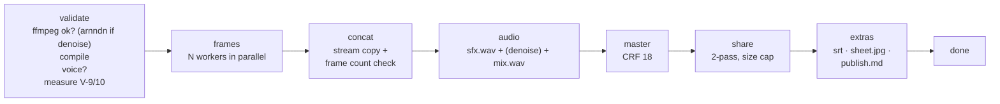

- توضع كل الملفات المؤقتة في `out/.tmp/<timestamp>-<hex>/` وتُحذف عند النجاح.
- **التصدير الجزئي** (`--from 10 --to 15`) لا يُخرج إلا `<id>.part.mp4`، دون ملف share ولا إضافات.
- **الإلغاء** (Ctrl+C مرة، أو زر Cancel) يقتل كل عمليات ffmpeg ويحذف الملفات الجزئية. والضغطة الثانية =
  خروج فوري (رمز الخروج 130).
- فشل فحص المطابقة **لا يرمي استثناءً**، بل يعيد `ok: false` مع قائمة المشكلات (وهذا ما كانت تُظهره الرسالة
  `Output check failed: pixel format yuvj420p`).
- **تنظيف الصوت** يُفعَّل بـ `audio.denoise` أو `--denoise` (ويتغلب `--no-denoise` على الملف)، ويحتاج فلتر
  `arnndn` في ffmpeg، وإلا يتوقف التصدير برسالة واضحة.

### 11.3 العمّال المتوازيون

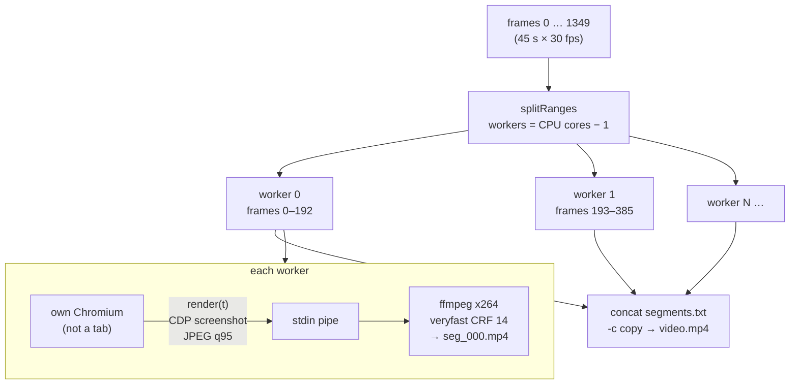

- لكل عامل **متصفح منفصل** (لا تبويب)، لأن التبويبات تتشارك عملية الرسم فيُنفَّذ عملها بالتتابع.
- تُخدَم الصفحة عبر **اعتراض الطلبات** في Playwright على عنوان وهمي `http://reelforge.local`:
  `/timeline.json` من الذاكرة، `/runtime/*` من ملفات الـ runtime، `/episode/assets/*` من مجلد الحلقة.
  ويُحجب **أي عنوان آخر** ويُسجَّل، وإن وُجد طلب كهذا يفشل العامل (NFR-8: لا شبكة أبداً).
- إعدادات Chromium للحتمية: بدون GPU، بدون LCD text وhinting، ألوان sRGB، مقياس 1، منطقة زمنية UTC، لغة en-US.
- عامل تعطّل؟ يُعاد مقطعه **مرة واحدة**، ويُصحَّح عداد التقدم حتى لا يُحسب مرتين.
- بعد الدمج يُعدّ عدد الإطارات بـ ffprobe؛ أي اختلاف = خطأ.

### 11.4 الترميز (Encoding)

إعدادات H.264 المشتركة: `libx264`، profile **High**، GOP 60 (ثانيتان)، B-frames 2، معدل إطارات ثابت،
و**تحويل الألوان `YUV420_TV`**:

```text
-vf scale=out_range=tv:out_color_matrix=bt709:flags=accurate_rnd+full_chroma_int,format=yuv420p
-pix_fmt yuv420p -color_range tv -colorspace bt709 -color_primaries bt709 -color_trc bt709
```

> **قصة هذا السطر:** تُلتقط صور JPEG بمدى ألوان كامل (full range). ومنذ FFmpeg 7 لم يعد الخيار
> `-pix_fmt yuv420p` وحده يحوّل المدى، فيخرج الفيديو بمدى كامل ويراه ffprobe ‏`yuvj420p`، فيفشل فحص
> المطابقة (وترفضه بعض المنصات). الحل: فلتر `scale` يحوّل فعلياً إلى المدى المحدود BT.709 (معيار فيديو HD
> والهواتف)، مع وسوم تصف ذلك. ويُطبَّق على المقاطع الوسيطة وعلى الترميز النهائي.

| المخرج     | الفيديو                                                 | الصوت            | ملاحظات                                              |
| ---------- | ------------------------------------------------------- | ---------------- | ---------------------------------------------------- |
| **Master** | CRF 18، preset `slow` (`medium` مع `--fast`)            | AAC 192k، 48 kHz | جودة أرشيفية                                         |
| **Share**  | **تمريرتان** بمعدل بتات محسوب، maxrate 1.5×، bufsize 3× | AAC 128k         | لا يتجاوز الحجم المحدد، ولا يزيد على معدل الـ master |
| **Part**   | مثل master لكن `medium` دائماً                          | AAC 192k         | للتصدير الجزئي                                       |

**معادلة الـ share** (ADR-006):

```text
video_kbps = floor(MB × 8192 × 0.97 / duration) − 128      (0.97 = هامش 3% لحاوية MP4)
           ثم يُحصر بين 250 و 8000 kb/s، ولا يتجاوز معدل الـ master
```

مثال حقيقي: حلقة 45 ث، حد 28 MB → `floor(28×8192×0.97/45) − 128 = 4944 − 128 = 4816 kb/s`. وهذا
بالضبط ما طبعه أمر التصدير: `share video 4816 kb/s`. وإذا خرج الملف أكبر من الحد، يُعاد ترميزه مرة واحدة
بنسبة 90% من المعدل.

**فحص المطابقة `checkCompliance`** (بـ ffprobe): h264، High، `yuv420p`، `30/1`، AAC، 48 kHz، ذرّة
`moov` قبل `mdat` (faststart: يبدأ تشغيل الفيديو قبل اكتمال التنزيل)، والحجم ضمن الحد.

**ورقة اللقطات `sheet.jpg`:** 12 إطاراً موزعة بالتساوي، شبكة 4×3، كل لقطة 360×640.

### 11.5 مزج الصوت

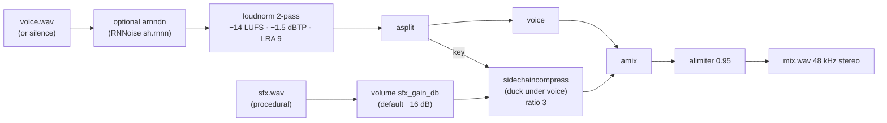

- **−14 LUFS** هو مستوى الجهارة الذي تستهدفه المنصات. يُقاس في تمريرة أولى (على الصوت **بعد** التنظيف إن
  فُعّل)، ثم يُطبَّق التصحيح خطياً في الثانية.
- **خفض المؤثرات (Ducking):** عندما تتكلم تنخفض المؤثرات تلقائياً (الصوت هو «مفتاح» الضاغط).
- دون تسجيل (`--silent`): يكون مسار الصوت صامتاً، وتبقى المؤثرات وحدها.

### 11.6 القياس وdoctor

- تستخدم `measureTimeline` متصفحاً واحداً يستدعي `window.reelforge.measure()`. ولكل عنصر ترسم لحظتين قرب
  نهايته (الحالة المستقرة، لا ارتداد الحركة)، ولا تُبلغ عن الفيض إلا إذا فاض النص في الاثنتين. وفشل القياس
  لا يوقف التصدير.
- يفحص `doctor`: Node ≥ 22، ffmpeg ≥ 6 مع المُرمّزات (libx264, aac, mjpeg) والفلاتر (loudnorm,
  sidechaincompress, alimiter, arnndn)، ووجود نموذج RNNoise، وتشغيل Chromium المثبّت فعلياً، ووجود ملفات
  الخطوط. ومع `--fix` يُنزّل Chromium. وتضيف لوحة التحكم إلى نتيجته حالة المساعدات (`assistStatus`) ومزوّد
  الـ LLM (`providerStatus`).

---

## 12. حزمة audio: الصوت بدون ملفات صوتية <a id="s12"></a>

حزمة نقية بلا اعتماديات، تعمل في Node والمتصفح.

| الملف                                            | الدور                                                                                                                  |
| ------------------------------------------------ | ---------------------------------------------------------------------------------------------------------------------- |
| [prng.ts](../packages/audio/src/prng.ts)         | `hashString` (FNV-1a)، `rnd(seed)` (hash عديم الحالة)، `mulberry32` (مولّد متتالية)                                    |
| [wav.ts](../packages/audio/src/wav.ts)           | قراءة WAV ‏8/16/24/32-bit وfloat وextensible، وكتابته                                                                  |
| [envelope.ts](../packages/audio/src/envelope.ts) | `frameEnvelope` (علوّ الصوت لكل إطار)، `peaks` (رسم الموجة)، `snapToOnset`                                             |
| [align.ts](../packages/audio/src/align.ts)       | `analyzeSpeech` (خريطة الكلام كل 10 ms)، `pausesIn`، `alignLines` (DP)، `alignWords`، `refineOnset` (انظر [§24](#s24)) |
| [synth.ts](../packages/audio/src/synth.ts)       | توليد 8 أصوات من موجات وضجيج                                                                                           |
| [sfx.ts](../packages/audio/src/sfx.ts)           | تجميع الأحداث في مسار واحد مُطبَّع إلى −0.9 dBFS                                                                       |

**الأصوات الثمانية** (ADR-008: لا مكتبات عينات، لا ترخيص، حتمية بالكامل):

| الصوت    | المدة  | كيف يُصنع                                  |
| -------- | ------ | ------------------------------------------ |
| `whoosh` | 0.42 ث | ضجيج أبيض عبر مرشحات يتحرك ترددها          |
| `hit`    | 0.7 ث  | موجة جيبية تنخفض من 55 إلى 38 Hz + نقرة    |
| `ding`   | 0.9 ث  | نغمتان 1320 و 1980 Hz                      |
| `err`    | 0.42 ث | موجة مربعة 190 Hz على نبضتين               |
| `glitch` | 0.38 ث | ضجيج «أخذ واحتفاظ» (sample-and-hold) مقطّع |
| `tick`   | 15 ms  | نقرة ضجيج حادة                             |
| `tap`    | 90 ms  | نغمة 220 Hz قصيرة + نقرة                   |
| `typing` | 0.36 ث | 5 نقرات `tick` بفواصل وقوى عشوائية حتمية   |

**من أين تأتي أحداث المؤثرات** (مع `audio.sfx: auto`):

1. صوت `whoosh` عند كل انتقال بين المشاهد (عدا المشهد الأول والانتقال `cut`).
2. أصوات المكوّنات (جدول §9.8).
3. أصوات الـ `fx` (flash → hit، glitch → glitch).
4. قوائم `sfx` الصريحة في العناصر، و`audio.extra`.

ثم تُزال المكررات: إذا تكرر الصوت نفسه خلال 80 ms يُحتفظ بالأعلى منها فقط.

**الدالة `snapToOnset`:** حول الزمن الذي حددته (±120 ms) تحسب RMS كل 2.5 ms وتبحث عن أكبر ارتفاع مفاجئ (>6
dB وفوق مستوى الضجيج). وتُستخدم في المتصفح أثناء تحديد الـ cues لتعويض تأخر رد فعلك.

**والدالة `analyzeSpeech`** هي أيضاً أساس الفحص V-14 للصمت الطويل (`longSilences` في الـ compiler، مع ذاكرة مؤقتة
لكل تسجيل بمفتاح الـ sha1).

---

## 13. حزمة studio: لوحة التحكم والمحرر <a id="s13"></a>

### 13.1 خادمان وأربع واجهات

```mermaid
flowchart LR
    subgraph HUB["Hub — reelforge studio — :4310"]
        H1["list episodes, examples, packs"]
        H2["create (blank / template) ·<br/>upload voice · draft & auto cues"]
        H3["validate · render · thumbnails"]
        H4["gallery · Connect AI · doctor · docs"]
        H5["agent endpoints:<br/>/mcp · /api/v1 · /llms*.txt ·<br/>/.well-known/mcp.json"]
    end
    subgraph STU["Studio — reelforge edit ep10 — :4317"]
        S1["compile + file watcher"]
        S2["structured YAML edits + undo"]
        S3["PUT /cues · auto cues"]
        S4["suggestions (dictionary / LLM)"]
        S5["render job"]
    end
    HUB -->|"POST /api/studio<br/>starts one per episode<br/>(random port)"| STU
    RR[("RenderRunner<br/>one render at a time")]
    HUB --- RR
    STU --- RR
```

| الجانب         | Hub (لوحة التحكم)                                       | Studio (المحرر)                                               |
| -------------- | ------------------------------------------------------- | ------------------------------------------------------------- |
| الملف          | [hub.ts](../packages/studio/src/server/hub.ts)          | [index.ts](../packages/studio/src/server/index.ts)            |
| المنفذ         | 4310 (و`--host` لعنوان آخر)                             | 4317 (أو عشوائي إذا فُتح من Hub / الأدوات)، و127.0.0.1 دائماً |
| الواجهات       | `hub.html` + `hub.ts`، و`gallery.html`، و`connect.html` | `index.html` + `main.ts` ونحو 15 وحدة                         |
| مراقبة الملفات | لا (يحدّث عند العودة إلى النافذة)                       | نعم: `fs.watch` + إعادة تحويل (recompile) خلال 40 ms          |
| التحديث الحي   | WebSocket `/ws`: رسائل `job` و`project`                 | WebSocket `/ws`: رسائل `state` كاملة و`job`                   |

تبني Vite أربع صفحات من `client/` (في [vite.config.ts](../packages/studio/vite.config.ts)): المحرر
(`index.html`)، ولوحة التحكم (`hub.html`)، وصفحة **Connect AI** ‏(`connect.html`، وصفات إعداد لكل عميل من
`connect-clients.ts`)، و**المعرض** (`gallery.html`: المكوّنات مع صور golden مسبقة، والثيمات مع معاينة
الألوان والخطوط، والحزم، مع زر «نسخ مقطع YAML»). وتتشارك المحرر والمعرض تصنيف المكوّنات في
`component-groups.ts`.

### 13.2 مسارات API

**خادم Studio:**

| الطريقة | المسار                                                                 | الغرض                                                          |
| ------- | ---------------------------------------------------------------------- | -------------------------------------------------------------- |
| GET     | `/api/meta`                                                            | كتالوج المكوّنات وschemas خصائصها والحركات والأيقونات والثيمات |
| GET     | `/api/state`                                                           | الحالة الحالية (Timeline، issues، الصوت، المخرجات، التاريخ)    |
| GET     | `/api/suggest?line=l3`                                                 | اقتراحات القاموس لسطر، وحالة الـ LLM                           |
| GET     | `/api/assist`                                                          | هل Whisper وVAD مثبّتان، وهل توجد cues يدوية، وهل تجري محاذاة  |
| POST    | `/api/edit`                                                            | `{ops, label}` تعديلات مهيكلة على `episode.yaml`               |
| POST    | `/api/undo`, `/api/redo`                                               | تراجع / إعادة                                                  |
| POST    | `/api/assets`                                                          | قائمة ملفات SVG في `assets/`                                   |
| PUT     | `/api/asset`                                                           | حفظ SVG في `assets/` (يُرفض ما فيه script)                     |
| PUT     | `/cues`                                                                | حفظ `cues.json` (يُتحقق منه ويُضاف sha1 الصوت الحقيقي)         |
| POST    | `/api/cues/auto`                                                       | محاذاة تلقائية (`engine`, `force`, `words`) عبر سجل التراجع    |
| POST    | `/api/suggest/llm`                                                     | اقتراح مشهد بنموذج لغوي (409 إن لم يوجد نموذج)                 |
| POST    | `/api/render`, `.../cancel`                                            | بدء / إلغاء التصدير                                            |
| GET     | `/episode/voice*`, `/episode/out/*`, `/episode/assets/*`, `/runtime/*` | ملفات ثابتة                                                    |

**خادم Hub (الواجهة الداخلية؛ ليست جزءاً من وعد الثبات في ADR-014):**

| الطريقة | المسار                                           | الغرض                                                       |
| ------- | ------------------------------------------------ | ----------------------------------------------------------- |
| GET     | `/api/project`                                   | كل الحلقات مع ملخص (الصوت، الـ cues، الأخطاء، المخرجات)     |
| GET     | `/api/packs`                                     | الحزم وقوالبها وخاناتها (بالعربية والإنجليزية)              |
| GET     | `/api/connect`                                   | بيانات صفحة Connect AI (والـ token لهذا الحاسوب فقط)        |
| GET     | `/api/gallery/components`, `/api/gallery/themes` | بيانات المعرض، و`/gallery/frames/*` و`/gallery/fonts/*`     |
| GET     | `/api/doctor`                                    | فحص البيئة + حالة المساعدات + مزوّد الـ LLM                 |
| GET     | `/api/thumb`                                     | صورة مصغّرة (تُولَّد وتُخزَّن في `out/.cache/thumb.jpg`)    |
| GET     | `/files`                                         | ملفات من `out/` فقط (مع CSP ‏`sandbox`)                     |
| GET     | `/docs/*`                                        | التوثيق دون اتصال من `documentation/`                       |
| PUT     | `/api/voice`                                     | رفع تسجيل (حتى 1 GB) → تحويل بـ ffmpeg إلى WAV أحادي 48 kHz |
| POST    | `/api/episodes`                                  | حلقة جديدة (فارغة، أو من `pack` + `template` + `slots`)     |
| POST    | `/api/studio`                                    | فتح المحرر لحلقة (`edit` / `cue` / `dev`)                   |
| POST    | `/api/validate`                                  | تحقق كامل + V-9/V-10                                        |
| POST    | `/api/render`, `.../cancel`                      | بدء / إلغاء التصدير                                         |
| POST    | `/api/cues/draft`, `/api/cues/auto`              | cues تقديرية / محاذاة تلقائية (409 إن جرت محاذاة أخرى)      |
| POST    | `/api/reveal`                                    | فتح المجلد في مستكشف الملفات                                |

ومسارات الوكلاء (`/mcp` و`/api/v1/*` و`/llms.txt` و`/llms-full.txt` و`/.well-known/mcp.json`) موصوفة في
[§15](#s15)، ويعالجها [agents.ts](../packages/studio/src/server/agents.ts) قبل أي مسار آخر.

### 13.3 التعديل المهيكل مع الحفاظ على التعليقات

**لا يعيد المحرر كتابة الملف من الصفر**، بل يرسل عمليات صغيرة بمسار YAML:

```json
{
  "label": "Move hook_title",
  "ops": [
    {
      "op": "set",
      "path": ["scenes", 0, "elements", 1, "place"],
      "value": { "x": 60, "y": 180, "w": 960, "h": 240 }
    }
  ]
}
```

أنواع العمليات: `set`, `delete`, `insert`, `move`. ويعمل التنفيذ في
[edit.ts](../packages/studio/src/server/edit.ts) على **شجرة مستند YAML** (مكتبة `yaml`) لا على كائن JSON،
وتستخدم أداة `edit_episode` الكود نفسه:

- تغيير قيمة بسيطة يعدّل العقدة في مكانها، فيبقى أسلوب التنصيص والتعليق `# keep me` كما هو.
- تُكتب الكائنات الصغيرة بأسلوب `{ x: 1 }`، مع احترام أسلوب المسافات الموجود في الملف.
- ويُنظِّف الحذف الحاويات الفارغة (فيُحذف `enter: {}`).
- الكتابة **ذرّية** (ملف مؤقت ثم إعادة تسمية).

**التاريخ (History):** حتى 200 خطوة في ذاكرة الخادم، تشمل `episode.yaml` و`cues.json` والـ assets. إذا
عُدّل الملف من خارج المحرر، يُمسح التاريخ (حتى لا يتراجع فوق تعديلاتك).

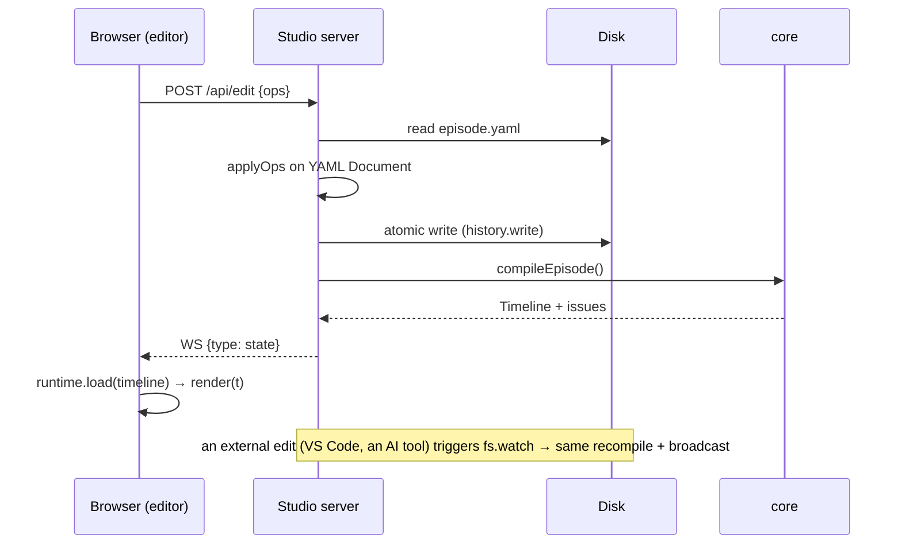

### 13.4 بنية المحرر في المتصفح

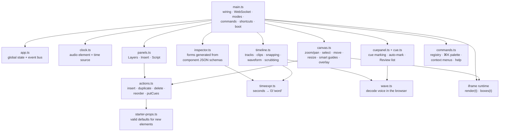

أهم الأفكار:

- **الساعة:** إذا وُجد تسجيل فعنصر `<audio>` هو مصدر الزمن (فيتزامن الصوت مع الصورة)، ودونه تُستخدم ساعة
  الحاسوب. ويبقى الـ runtime نفسه نقياً، فالساعة موجودة في المحرر فقط.
- **النقر على الـ canvas:** تعطي `runtime.boxes(t)` صناديق العناصر الظاهرة، ويختار Alt+نقر العنصر الذي
  تحته.
- **السحب:** أثناء السحب يُحرَّك عنصر الـ DOM داخل الـ iframe مباشرة (سريع)، وعند الإفلات تُرسل عملية
  `set place`. وتلتصق أدلة المحاذاة الذكية (smart guides) بحواف الإطار والعناصر الأخرى ومراكزها.
- **الخط الزمني (timeline):** يلتصق مقطع العنصر عند سحبه **بالكلمات**، ويُحفظ زمنه كتعبير مرتبط بكلمة.
  وهذا دور `exprFor(t)` في
  [timeexpr.ts](../packages/studio/client/src/timeexpr.ts): الزمن 1.203 يصبح `l1:'voice'`، وليس `1.203`.
- **لوحة الخصائص (Inspector):** تُبنى **تلقائياً** من JSON Schema لخصائص كل مكوّن: enum → قائمة،
  boolean → مفتاح تشغيل، رقم → حقل يُعدَّل بالسحب، لون → ألوان الثيم، زمن → حقل مع زر «الآن» ووصف مقروء
  للتعبير.
- **الإدراج الذكي:** تعرض لوحة Insert اقتراحات القاموس لسطر الزمن الحالي (`/api/suggest`)، أو اقتراح نموذج
  لغوي إن كان مُعدّاً (`/api/suggest/llm`)، وتبدأ العناصر الجديدة بخصائص صالحة من `starter-props.ts`.
- **الأوامر:** سجل واحد يخدم اختصارات لوحة المفاتيح، ولوحة ⌘K، وقوائم النقر الأيمن، وصفحة `?`. ويعمل حتى
  مع لوحة مفاتيح عربية (تحويل عبر `e.code`).
- **الأوضاع:** Edit (التصميم)، وCues (تحديد الـ cues)، وReview (قائمة المشكلات، والنقر على أي منها ينقلك
  إلى العنصر). وتفتح لوحة التحكم أي وضع منها مباشرة.
- **الشاشات الصغيرة:** تحت 900 px تصبح اللوحتان الجانبيتان أدراجاً منزلقة، وتحت 640 px ينقسم الشريط
  العلوي إلى صفين.

### 13.5 تحديد الـ cues

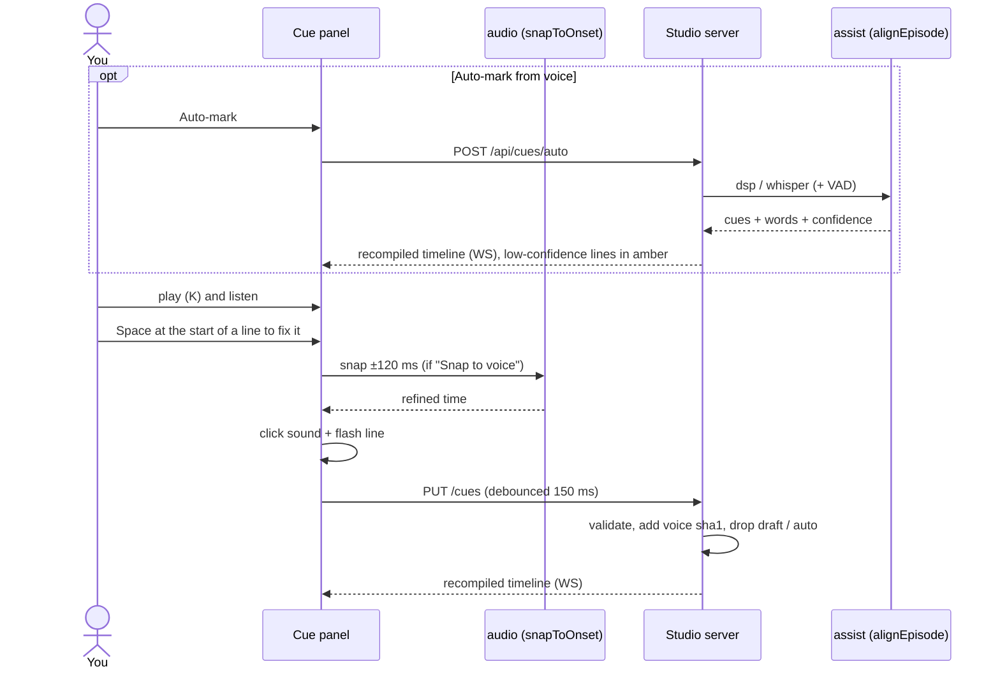

المفاتيح: Space للتحديد، وBackspace للتراجع، و←/→ للتعديل ±50 ms (Shift: ±10 ms)، وW لوضع الكلمات، وS
للإلصاق بالصوت، وA لتشغيل الإلصاق التلقائي أو إيقافه، وG للانتقال إلى الـ cue، و1/2/3 للسرعة.

### 13.6 التصدير من الواجهة

يسمح `RenderRunner` في [jobs.ts](../packages/studio/src/server/jobs.ts) **بتصدير واحد في كل مرة** (الطلب
الثاني = 409). ويشارك الـ Hub الـ runner نفسه مع كل المحررات التي يفتحها ومع أدوات الوكلاء. ويُرسَل التقدم عبر
WebSocket كل 200 ms، وعند الانتهاء يفتح المحرر نافذة المخرجات مع مشغّل فيديو.

---

## 14. حزمة cli: الأوامر <a id="s14"></a>

الملف [cli/src/index.ts](../packages/cli/src/index.ts) (مكتبة commander). ويستدعي المشغّلان `reelforge`
و`reelforge.cmd` الملف `packages/cli/bin/reelforge.js`. والخيارات العامة: `--root`، `--json`، `--verbose`.

| الأمر                                                  | يستدعي                          | ماذا يفعل                                                                                                              |
| ------------------------------------------------------ | ------------------------------- | ---------------------------------------------------------------------------------------------------------------------- |
| `studio [--port] [--host]`                             | `startHub`                      | لوحة التحكم على 4310؛ أي عنوان غير محلي مع `--host` يفرض الـ token                                                     |
| `new <id> [--lang en\|ar]`                             | `episodeTemplate`               | `episodes/<id>/episode.yaml` من القالب العام                                                                           |
| `new <id> --pack <id> [--template] [--slot k=v]…`      | `findTemplate` + `fillTemplate` | حلقة من قالب حزمة صناعية؛ الخانات الناقصة تأخذ قيمها الافتراضية                                                        |
| `packs [--lang]`                                       | `listPacks`                     | الحزم وقوالبها وخاناتها                                                                                                |
| `cue <id> [--draft]`                                   | `draftCues` / `startStudio`     | cues تقديرية، أو المحرر في وضع Cues                                                                                    |
| `align [id] [--engine] [--model] [--setup] [--status]` | `alignEpisode` / `setupAssist`  | محاذاة الـ cues من التسجيل (`--no-vad`, `--no-words`, `--force`, `--dry-run`)، أو تثبيت النماذج مرة واحدة، أو حالتها   |
| `edit <id>` / `dev <id>`                               | `startStudio`                   | المحرر في وضع Edit / Review                                                                                            |
| `validate <id> [--strict] [--no-measure]`              | `compileEpisode` + measure      | كل القواعد مع أرقام الأسطر                                                                                             |
| `render [id] [--all]`                                  | `renderEpisode`                 | التصدير (`--from/--to`، `--workers`، `--share-size`، `--fast`، `--silent`، `--lossless`، `--denoise`، `--keep-tmp`، …) |
| `snap <id> [times…] [--every] [--cover]`               | `snapFrames`                    | صور PNG لأزمنة أو تعبيرات، وورقة لقطات، أو غلاف                                                                        |
| `doctor [--fix]`                                       | `runDoctor`                     | فحص البيئة                                                                                                             |
| `theme new <name> --accent <hex> [--mode] [--font]`    | `generateTheme`                 | ثيم كامل يحقق WCAG AA من لون واحد                                                                                      |
| `schema`                                               | `episodeJsonSchema`             | `schema/episode.schema.json`                                                                                           |
| `mcp [--toolsets basic,design,render]`                 | `startMcp`                      | ناقل MCP على stdio فوق سجل الأدوات                                                                                     |

**البحث عن الحلقة** (`resolveEpisode`) بهذا الترتيب: `episodes/<id>` ← مسار نسبي للمشروع ← مسار نسبي
للمجلد الحالي ← `examples/<id>` ← `examples/season1/<id>`. لذا يعمل `promo/intro` و`season1-arabic/ep01`
مباشرة.

**رموز الخروج:** 0 نجاح، 1 فشل، 2 استخدام خاطئ (ومنها toolset مجهول)، 130 تصدير أُلغي. **`--json`:** كل أمر
يطبع كائن JSON واحداً، عدا `render` الذي يطبع سطر JSON لكل حدث (`progress`, `log`, ثم `result` أو `error`).

---

## 15. سجل الأدوات وطرق الاتصال الثلاث (MCP وREST) <a id="s15"></a>

### 15.1 سجل واحد (ADR-014)

كل أدوات الوكلاء معرّفة **مرة واحدة** في [packages/studio/src/tools/](../packages/studio/src/tools/registry.ts):
ملف لكل مجموعة (`episodes.ts`, `preview.ts`, `components.ts`, `cues.ts`, `render.ts`, `guide.ts`,
`authoring.ts`) تجمعها `registry.ts`. ولكل أداة عبر `defineTool`: اسم ثابت، و`title`، ووصف قصير، وschema
مدخلات zod (وschema مخرجات حيث يفيد)، ومجموعاتها (toolsets)، وتلميحات MCP ‏(`readOnlyHint`,
`destructiveHint`, `idempotentHint`)، و`handler(args, ctx)`. ويُولَّد JSON Schema من zod
(`zod-to-json-schema`)، ويُتحقق من المدخلات بالـ schema نفسه، والمدخلات الخاطئة تعود خطأً مقروءاً للنموذج.

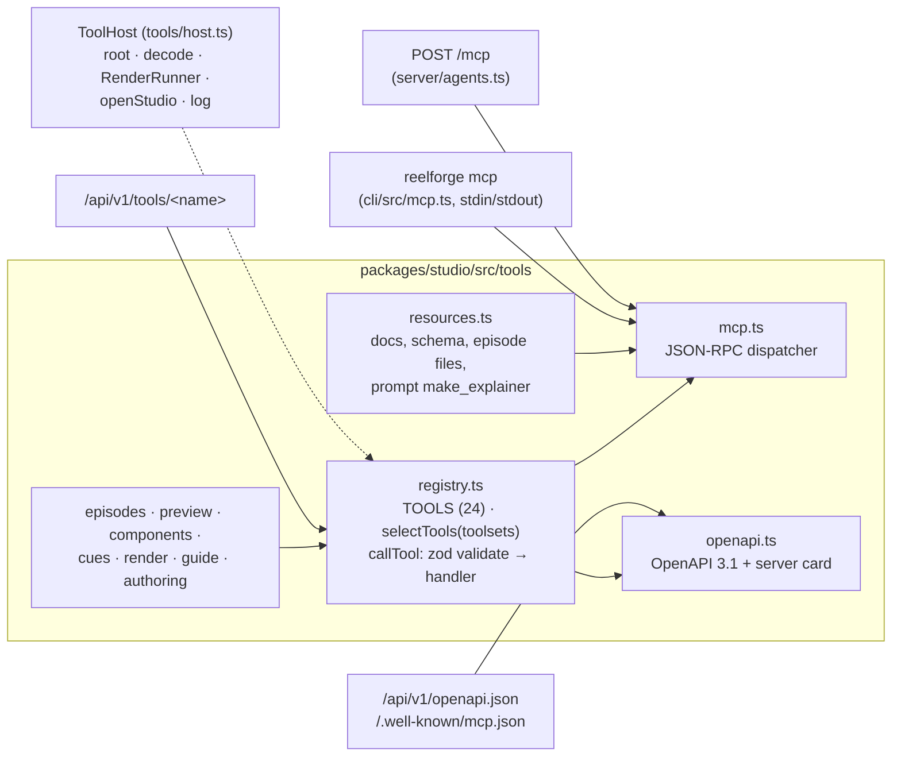

### 15.2 الأدوات الأربع والعشرون

| الأداة                                     | المجموعات             | الغرض                                                                                         |
| ------------------------------------------ | --------------------- | --------------------------------------------------------------------------------------------- |
| `list_episodes`                            | basic                 | كل الحلقات مع حالتها                                                                          |
| `get_episode`                              | basic, design         | الـ YAML + ملخص مُحوَّل (compiled outline): أزمنة الأسطر والكلمات، ومسارات العناصر، وصناديقها |
| `list_templates` / `create_from_template`  | basic                 | قوالب الحزم الصناعية؛ حلقة من خانات مسطّحة (Tier 1)                                           |
| `create_episode`                           | basic                 | حلقة من نص، مع cues تقديرية                                                                   |
| `suggest_scenes`                           | basic, design         | خطة مشاهد لكل سطر: blueprint وأفضل عنصر                                                       |
| `list_blueprints` / `add_scene`            | basic, design         | مشهد كامل من blueprint بمعاملات (Tier 2)                                                      |
| `edit_episode`                             | design                | عمليات المحرر نفسها `set/delete/insert/move` (مع الحفاظ على التعليقات)                        |
| `write_episode_yaml`                       | design                | استبدال الملف كله (`destructiveHint`؛ يُرفض إن كان فيه V-1/V-13 إلا مع `force`)               |
| `validate_episode`                         | basic                 | كل القواعد V-1…V-14                                                                           |
| `preview_frames`                           | basic                 | حتى 8 إطارات **تُعاد كصور** مع وصف نصي للتخطيط (صناديق، تداخل V-8، مناطق V-7)                 |
| `list_components` / `get_component_schema` | design                | المكوّنات الـ 62 وخصائصها الدقيقة                                                             |
| `suggest_scene`                            | basic, design         | أفكار عناصر لسطر (القاموس، أو `llm: true` للنموذج المُعدّ)                                    |
| `draft_cues` / `set_cues`                  | basic                 | توقيت تقديري أو معروف                                                                         |
| `align_cues`                               | basic                 | cues لكل سطر وكلمة من `voice.wav` (لا تستبدل اليدوية إلا مع `force`)                          |
| `render_episode` / `cancel_render`         | render                | التصدير في الخلفية وإلغاؤه                                                                    |
| `get_render_status`                        | basic, render         | متابعة التصدير                                                                                |
| `open_editor`                              | render                | رابط المحرر للإنسان                                                                           |
| `doctor`                                   | render                | فحص البيئة                                                                                    |
| `get_guide`                                | basic, design, render | أدلة المهام من `skills/` (مختصرة، أو `detail: true`، أو `"<topic>/<reference>"`)              |

وكل أداة كتابة (`create_from_template`, `add_scene`, `create_episode`, `edit_episode`,
`write_episode_yaml`, `set_cues`, `draft_cues`, `align_cues`) تعيد في نتيجتها المهيكلة ملخص التحقق، و`fixes`
(تلميح لكل مشكلة)، و`next` (الخطوة التالية المقترحة).

**المجموعات (toolsets)** وسوم على الأدوات: يطلب العميل مجموعة أو أكثر فيحصل على اتحادها، و`all` هو
الافتراضي. مثلاً `reelforge mcp --toolsets basic` أو `/mcp?toolsets=basic,design`. والاسم المجهول خطأ.

### 15.3 الطرق الثلاث

| الطريقة                 | أين                                                    | التفاصيل                                                                                                                                                                                                              |
| ----------------------- | ------------------------------------------------------ | --------------------------------------------------------------------------------------------------------------------------------------------------------------------------------------------------------------------- |
| **MCP stdio**           | `reelforge mcp` ([mcp.ts](../packages/cli/src/mcp.ts)) | JSON-RPC 2.0، رسالة في كل سطر؛ يحمل stdout البروتوكول فقط ويُحوَّل كل `console.log` إلى stderr؛ إشعارات التقدم مدعومة                                                                                                 |
| **MCP Streamable HTTP** | `POST /mcp` على لوحة التحكم                            | ردود JSON (مفردة أو دفعة)، `Mcp-Session-Id` يُصدر عند `initialize` ويُفحص بعدها (حتى 200 جلسة)، `DELETE` ينهي الجلسة، `GET` = 405؛ جسم حتى 8 MB                                                                       |
| **REST**                | `/api/v1` على لوحة التحكم                              | `GET /api/v1/tools` (و`?format=openai` لتعريفات الدوال)، `POST /api/v1/tools/<name>` بالمدخلات JSON → `{ ok, result, text, images? }`، `GET /api/v1/health`، `GET /api/v1/openapi.json` (OpenAPI 3.1، عملية لكل أداة) |

ونسخ البروتوكول المدعومة: `2025-06-18` و`2025-03-26` و`2024-11-05`. وتخدم لوحة التحكم أيضاً `/llms.txt`
و`/llms-full.txt` (يبنيه `pnpm docs:llms`) و`/.well-known/mcp.json` (بطاقة خادم مولّدة من السجل، فيها أمر
stdio للمشروع). وتعرض صفحة **Connect AI** ‏(`/connect`) إعداداً جاهزاً للنسخ لكل عميل.

```mermaid
sequenceDiagram
    participant A as AI agent
    participant M as reelforge (stdio or /mcp)
    A->>M: initialize
    M-->>A: capabilities + instructions (+ Mcp-Session-Id over HTTP)
    A->>M: tools/call list_templates
    A->>M: tools/call create_from_template {pack, template, slots}
    M-->>A: summary + fixes + next
    A->>M: tools/call add_scene / edit_episode {ops}
    M-->>A: issues + fixes
    A->>M: tools/call preview_frames {times}
    M-->>A: JPEG images (base64) + layout text
    Note over A: looks at the frames, fixes overlap…
    A->>M: tools/call render_episode
    A->>M: tools/call get_render_status (poll)
```

**وعد الثبات:** أسماء الأدوات ومدخلاتها ومسارات `/api/v1` تتبع semver منذ 1.0: داخل الإصدار الرئيسي تُضاف
الأدوات والمدخلات الاختيارية فقط، ولا يُعاد تسمية شيء أو حذفه. أما مسارات الواجهة الداخلية (`/api/project`…)
فليست ضمن الوعد.

### 15.4 الموارد والأدلة وإعدادات العملاء

- **الموارد (MCP resources):** `reelforge://docs/authoring` و`reelforge://docs/components` و
  `reelforge://docs/ai-agents` (AGENTS.md) و`reelforge://schema/episode`، وملفات كل حلقة. وprompt جاهز
  `make_explainer` (`topic`, `lang`, `seconds`).
- **الأدلة (skills):** ثمانية أدلة بصيغة Agent Skills: `reelforge-make-video`, `reelforge-script-writing`,
  `reelforge-scene-design`, `reelforge-timing`, `reelforge-brand-and-themes`, `reelforge-industry-playbooks`
  (مرجع لكل حزمة)، `reelforge-review-and-render`, `reelforge-contribute-component`. تقرؤها `get_guide`، ويتحقق
  منها `scripts/check-skills.mjs` (الـ frontmatter، الروابط، أمثلة YAML)، ويحزمها `.claude-plugin/` مع خادم
  MCP كإضافة لـ Claude Code.
- **ملفات الإعداد** موجودة لكل عميل: `.mcp.json` (Claude Code)، `.cursor/mcp.json`، `.vscode/mcp.json`،
  `.gemini/settings.json`، و`.windsurf/rules/`.

---

## 16. مجلد الحلقة على القرص <a id="s16"></a>

```text
episodes/ep10/
├── episode.yaml          ← المصدر الوحيد للحقيقة (Git-friendly)
├── cues.json             ← أزمنة بداية الأسطر (+ الكلمات)، draft / auto / يدوي
├── voice.wav             ← التسجيل (الرفع يحوّل mp3/m4a/… إلى WAV أحادي 48 kHz)
├── assets/               ← صور و SVG تستخدمها العناصر (assets/logo.svg)
└── out/
    ├── ep10.master.mp4   ← جودة أرشيفية
    ├── ep10.share.mp4    ← هذا ما ترفعه (≤ 28 MB)
    ├── ep10.srt          ← ترجمة
    ├── ep10.sheet.jpg    ← 12 لقطة للمراجعة السريعة
    ├── publish.md        ← العنوان، الوصف، الهاشتاغات، التعليق المثبت، الفصول
    ├── ep10.part.mp4     ← (رسم جزئي)
    ├── ep10.cover.png    ← (snap --cover، ويُستخدم كصورة مصغّرة)
    ├── snaps/            ← (صور snap)
    ├── .cache/           ← measure.json (V-9/V-10) و thumb.jpg
    └── .tmp/<run-id>/    ← مؤقت أثناء الرسم: seg_*.mp4, video.mp4, sfx.wav, mix.wav
```

وخارج المشروع، في مجلدات المستخدم: الـ token وملف `llm.json` في مجلد الإعدادات (`%APPDATA%\reelforge`،
`~/Library/Application Support/reelforge`، `~/.config/reelforge`)، ومكتبة النماذج الاختيارية في مجلد التخزين
المؤقت (`%LOCALAPPDATA%\reelforge\assist`، `~/Library/Caches/reelforge/assist`، `~/.cache/reelforge/assist`).

---

## 17. البناء والاختبارات وCI والتوثيق والإصدار <a id="s17"></a>

### 17.1 البناء

```mermaid
flowchart LR
    B["pnpm build<br/>(pnpm -r, one package at a time,<br/>topological order)"] --> A1["audio: tsc -b"]
    A1 --> C1["core: tsc -b"]
    C1 --> AS["assist: tsc -b"]
    C1 --> R1["runtime: build.mjs (esbuild)<br/>→ dist/page/runtime.js<br/>+ runtime.html + fonts/"]
    R1 --> RE["renderer: tsc -b"]
    AS --> ST
    RE --> ST["studio: tsc -b (server + tools)<br/>+ vite build (4 pages)<br/>→ dist/client/"]
    ST --> CL["cli: tsc -b"]
```

- اللغة والأدوات: TypeScript 5.9 strict، وNode 22، وpnpm 10 workspace.
- يُجمَّع الـ runtime بـ **esbuild** (ملف IIFE واحد لـ Chrome 120) مع **نسخ الخطوط التسعة محلياً** (كلها OFL
  من `@fontsource-variable`، مع ملفات الترخيص) وتوليد `fonts.css`. ولا اتصال بالشبكة عند التصدير.
- تُجمَّع واجهات الـ studio الأربع بـ **Vite** (TypeScript عادي دون framework).
- مجلدات `dist/` مستثناة من git، لكن أرشيف الإصدار يتضمنها مبنيةً مسبقاً، لذا لا يحتاج المستخدم إلى البناء.

### 17.2 الاختبارات

| المجموعة  | الأمر               | ماذا تغطي                                                                                                                                                                                                                                        |
| --------- | ------------------- | ------------------------------------------------------------------------------------------------------------------------------------------------------------------------------------------------------------------------------------------------ |
| `unit`    | `pnpm test:unit`    | ‏`packages/*/test`: ‏WAV، المحاذاة، المولّد الحتمي، الأصوات، الزمن، الترجمة وbidi، الـ compiler وكل قاعدة V، الثيمات وتباينها، الحزم والـ blueprints والاقتراحات، الحركات، تعديل YAML، الأدوات، المزوّدات، التثبيت الموثّق، مساعدات الـ renderer |
| `browser` | `pnpm test:browser` | ‏`tests/`: **golden frames** (يفشل إذا اختلف أكثر من 0.2% على النظام الذي رُسمت عليه، و0.6% على غيره)، الحتمية، خط التصدير كاملاً، CLI، MCP، الوكلاء، المحرر، لوحة التحكم، المعرض، الحركة                                                        |

- المجلد `fixtures/lint/v01…v14`: حلقة فيها خطأ مقصود لكل قاعدة.
- المجلد `fixtures/golden/`: صور مرجعية للترجمة العربية وكل المكوّنات (ومنها صور المعرض). بعد تغيير بصري مقصود:
  `UPDATE_GOLDEN=1 pnpm test:browser`.
- المجلد `fixtures/mini`: حلقة مدتها 6 ث بتسجيل حقيقي، تُصدَّر كاملة في الاختبار.
- المجلد `fixtures/align`: تسجيلات بأزمنة كلمات معروفة لقياس دقة المحاذاة.
- الأمر `REELFORGE_TEST_MODELS=1 pnpm test:unit` يضيف اختبارات Whisper والنموذج اللغوي الحقيقية (بعد
  `reelforge align --setup`).

### 17.3 CI

ملف [ci.yml](../.github/workflows/ci.yml) يعمل على **Linux وWindows وmacOS** (Node 22، FFmpeg من مدير حزم
النظام، Chromium المثبّت من Playwright مع تخزين مؤقت). الخطوات على الأنظمة الثلاثة:

1. البناء `pnpm build`، ثم `check-docs-fresh.mjs` (المراجع المولّدة محدّثة).
2. الأمران `pnpm typecheck` و`pnpm lint` (ESLint، Prettier، فحص mojibake، فحص الـ skills).
3. اختبارات الوحدة (مع **تغطية ≥ 85% من الأسطر** لـ core وruntime وaudio على Linux).
4. اختبارات المتصفح والتكامل، وفحص التراخيص، و`doctor`.
5. التحقق من أمثلة season1، و`eval-agents.mjs --mock` (نموذج مُبرمَج، دون اتصال)، و`eval-align.mjs`.
6. الأمران `pnpm docs:build` (التوثيق دون اتصال) و`pnpm docs:site` (يفشل على الروابط الميتة).
7. على Linux فقط: **تصدير مع قطع الشبكة فعلياً** (`unshare --net`) لإثبات أنه يعمل بلا إنترنت، ورفع المخرجات
   وصور الفروق.

ومهمة ثانية `links` تفحص كل الروابط النسبية في ملفات Markdown بـ lychee دون اتصال.

### 17.4 موقع التوثيق والمراجع المولّدة

- **الموقع:** VitePress في `docs/` (الإعداد في `docs/.vitepress/config.mts`)، بلغتين (الجذر بالإنجليزية و`/ar/`
  بالعربية، RTL)، مع بحث محلي. ويُبنى بـ `pnpm docs:site` إلى `docs/.site`، وينشره
  [docs.yml](../.github/workflows/docs.yml) على GitHub Pages. ويقدّم الموقع هذا الدليل عبر `rewrites`: هذه
  النسخة على `/ar/guide/architecture` والإنجليزية على `/guide/architecture`. وتحوّل إضافة `repoLinks` الروابط
  النسبية الخارجة من `docs/` إلى GitHub، فيعمل الـ Markdown نفسه على GitHub وعلى الموقع.
- **المراجع المولّدة من الكود** (`pnpm docs:gen` = [gen-docs.mjs](../scripts/gen-docs.mjs)): صيغة الحلقة،
  والمكوّنات مع صورة مرسومة لكل منها، وCLI، وأدوات MCP وREST، وإعداد العملاء، وفهرس الحزم، بالإنجليزية
  و`docs/ar/reference/` بعناوين عربية؛ إضافة إلى `docs/components.md` و`llms-full.txt`. والناتج حتمي، ويقارنه
  `check-docs-fresh.mjs` بالملفات المحفوظة.
- **التوثيق دون اتصال:** يجمع `scripts/build-docs.mjs` الصفحات الإنجليزية في `documentation/index.html`،
  وتقدّمه لوحة التحكم على `/docs`.

### 17.5 الإصدار

- يعمل [release.yml](../.github/workflows/release.yml) عند وسم `v*`: يتأكد أن الوسم يطابق `package.json`، ثم بناء
  وفحوص كاملة، و`pnpm -r pack`، واستخراج ملاحظات الإصدار من `CHANGELOG.md`، ومسودة GitHub Release. والنشر على
  npm معطّل حتى يجهز نطاق `@reelforge`.
- يبني `scripts/release.mjs` أرشيفاً محمولاً (`ReelForge-<v>.zip`، مبني مسبقاً مع التوثيق دون اتصال) ثم يفكّه
  ويتحقق: تثبيت ← doctor ← validate ← render.
- سكربتات مساندة: `check-licenses.mjs` (MIT/Apache/BSD/ISC/OFL فقط)، و`gen-notices.mjs`
  (`THIRD-PARTY-NOTICES.md`)، و`pin-assist-models.mjs` (تثبيت النماذج)، و`vendor-icons.mjs` (أيقونات Lucide)،
  و`gen-world-map.mjs` (بيانات الخريطة)، و`gen-pack-examples.mjs`، و`screenshots.mjs` و`marketing.mjs` (صور
  التوثيق والغلاف)، و`eval-assist.mjs` (مقارنة محركات المحاذاة).

---

## 18. نموذج الأمان <a id="s18"></a>

الخوادم المحلية خطر حقيقي إن لم تُحمَ (أي موقع تفتحه قد يحاول إرسال طلبات إلى `localhost`)، ونقاط الوكلاء
تستطيع كتابة الحلقات وبدء التصدير. القواعد في [security.ts](../packages/studio/src/server/security.ts) وADR-015:

| التهديد                        | الحماية                                                                                                                                                                                   |
| ------------------------------ | ----------------------------------------------------------------------------------------------------------------------------------------------------------------------------------------- |
| الوصول من الشبكة               | الربط على **127.0.0.1** افتراضياً. لوحة التحكم وحدها تقبل `--host` (أو `REELFORGE_HOST`)، والمحررات تبقى على 127.0.0.1 دائماً                                                             |
| DNS rebinding                  | قائمة سماح لترويسة `Host` في كل طلب وWebSocket: اسم loopback ‏(`127.0.0.0/8`, `localhost`, `[::1]`) على منفذ الخادم، أو عنوان الربط نفسه، أو اسم في `REELFORGE_ALLOWED_HOSTS`; وإلا 403   |
| CSRF من موقع آخر               | فحص `Origin` بالقائمة نفسها، و**الكتابة تقبل JSON فقط** (لا تستطيع نماذج HTML إرسال JSON)، و**لا CORS** أبداً فلا يقرأ موقع آخر الردود                                                    |
| عميل على حاسوب آخر             | **Bearer token** مطلوب على `/mcp` و`/api/v1` عند الربط بعنوان غير محلي (أو `REELFORGE_REQUIRE_TOKEN=1`): ‏32 بايت عشوائية base64url في مجلد الإعدادات (0600 داخل 0700)، ومقارنة بزمن ثابت |
| واجهة اللوحة من الشبكة         | العميل البعيد لا يصل إلا إلى `/mcp` و`/api/v1` و`/llms*.txt` و`/.well-known/mcp.json`؛ أما الواجهة والـ API الداخلي والـ WebSocket فتجيب هذا الحاسوب فقط (فحص عنوان الاتصال الفعلي)       |
| تسريب الـ token                | لا تعطي `/api/connect` الـ token إلا لطلب من هذا الحاسوب يعلّمه المتصفح same-origin ‏(`Sec-Fetch-Site`)                                                                                   |
| الخروج من المجلد (`../../etc`) | `safeJoin` لكل مسار، وكل حلقة يجب أن تكون داخل المشروع، والمخرجات من `out/` فقط                                                                                                           |
| SVG خبيث في assets             | رفض `<script` و`on*=` و`javascript:`، وخدمة الملفات مع CSP ‏`sandbox`                                                                                                                     |
| رفع ملفات ضخمة أو غريبة        | حد 1 GB، امتدادات صوتية فقط، تحويل بـ ffmpeg؛ وجسم طلبات الوكلاء حتى 8 MB                                                                                                                 |
| تسريب بيانات أثناء التصدير     | لا يصل Chromium **إلى أي عنوان** غير العنوان الوهمي `reelforge.local`، وأي محاولة تُفشل التصدير                                                                                           |
| سلسلة توريد النماذج            | المكتبة من lockfile محفوظ (`npm ci`)، وكل ملف نموذج مثبّت على commit ومُتحقق منه بـ SHA-256 قبل تحميله، والتحميل عن بعد معطّل وقت التشغيل ([§24.2](#s24))                                 |

```mermaid
flowchart TD
    Q["request"] --> H{"Host + Origin<br/>allowed?"}
    H -->|no| F1["403"]
    H -->|yes| AG{"agent path?<br/>/mcp · /api/v1 ·<br/>/llms*.txt · /.well-known"}
    AG -->|yes| T{"token required?<br/>(non-loopback bind or<br/>REELFORGE_REQUIRE_TOKEN)"}
    T -->|"yes, wrong/missing"| F2["401"]
    T -->|"no / valid"| OK1["tool registry"]
    AG -->|no| L{"TCP peer is<br/>this computer?"}
    L -->|no| F3["403"]
    L -->|yes| W{"write?"}
    W -->|"not JSON"| F4["415"]
    W -->|"GET / JSON"| OK2["dashboard API"]
```

والـ HTTP العادي يحمل الـ token نصاً واضحاً؛ على شبكة غير موثوقة ضع لوحة التحكم خلف وكيل TLS وأضف اسمه إلى
`REELFORGE_ALLOWED_HOSTS`.

---

## 19. الحتمية (Determinism) <a id="s19"></a>

لماذا يهم مبدأ «المدخلات نفسها = الإطارات نفسها»؟ لأنه يسمح برسم الإطارات **بأي ترتيب** وعلى **أي عدد من
العمّال**، وبإعادة رسم جزء فقط، وبالتنقل في المحرر تقدماً وتراجعاً بشكل صحيح دائماً، وباختبارات بصرية موثوقة.

كيف يُضمن (ADR-003):

| المصدر المحتمل للاختلاف | كيف أُزيل                                                                      |
| ----------------------- | ------------------------------------------------------------------------------ |
| الوقت الحقيقي           | تأخذ `render(t)` الزمن `t` مُدخلاً، ولا ساعة داخل الـ runtime                  |
| رسوم CSS المتحركة       | ممنوعة بـ `!important` في الـ CSS الأساسي                                      |
| العشوائية               | `rnd(seed)` و`mulberry32(seed)`؛ البذرة من معرّف الحلقة والعنصر                |
| الحالة المتراكمة        | تُحسب `states` من الصفر لكل `t`، والجسيمات صيغ مغلقة                           |
| الخطوط والصور           | مضمّنة محلياً ومحمّلة قبل أول إطار، ويتحقق منها V-13؛ والصور تُفك قبل أول إطار |
| رسم المتصفح             | بدون GPU، بدون LCD text/hinting، sRGB، مقياس 1، UTC، لغة en-US                 |
| الصوت                   | المؤثرات مولّدة من بذرة، والمزج بإعدادات ثابتة                                 |
| النماذج                 | لا تُستخدم أثناء الرسم أبداً؛ يقرأ الـ renderer ملف `cues.json` كأي ملف آخر    |

**الاستثناء الوحيد:** الترميز النهائي بـ x264 قد يختلف بالبايت بين إصدارات FFmpeg، لكن الإطارات
الملتقطة نفسها متطابقة.

---

## 20. متغيرات البيئة والإعدادات الافتراضية <a id="s20"></a>

| المتغير                   | الافتراضي                    | الأثر                                                     |
| ------------------------- | ---------------------------- | --------------------------------------------------------- |
| `REELFORGE_ROOT`          | المجلد الحالي                | جذر المشروع (أو `--root`)                                 |
| `REELFORGE_PRESET`        | `meta.preset`                | فرض preset                                                |
| `REELFORGE_WORKERS`       | عدد الأنوية − 1              | عدد العمّال                                               |
| `REELFORGE_JPEG_QUALITY`  | 95                           | جودة التقاط الإطارات                                      |
| `REELFORGE_SHARE_SIZE`    | 28 (من الـ preset)           | حد حجم الـ share بالـ MB                                  |
| `REELFORGE_PORT`          | 4310 (Hub) / 4317            | منفذ الخادم                                               |
| `REELFORGE_HOST`          | `127.0.0.1`                  | عنوان ربط لوحة التحكم (غير المحلي يفرض الـ token)         |
| `REELFORGE_ALLOWED_HOSTS` | —                            | أسماء Host إضافية مسموحة (مفصولة بفواصل، مع منفذ اختياري) |
| `REELFORGE_REQUIRE_TOKEN` | —                            | `1` = اطلب الـ token حتى على 127.0.0.1                    |
| `REELFORGE_CONFIG_DIR`    | مجلد إعدادات المستخدم        | مكان الـ token و`llm.json`                                |
| `REELFORGE_CACHE`         | مجلد التخزين المؤقت للمستخدم | مكان مكتبة النماذج والنماذج (`assist/`)                   |
| `HF_ENDPOINT`             | `https://huggingface.co`     | مرآة لتنزيل النماذج (يبقى التحقق بـ SHA-256)              |
| `REELFORGE_LLM_PROVIDER`  | يُستنتج من العنوان           | `openai` / `anthropic` / `ollama`                         |
| `REELFORGE_LLM_BASE_URL`  | `http://127.0.0.1:11434`     | خادم النموذج (`REELFORGE_OLLAMA` اسم قديم مدعوم)          |
| `REELFORGE_LLM_MODEL`     | `qwen2.5:1.5b` (Ollama)      | اسم النموذج                                               |
| `REELFORGE_LLM_API_KEY`   | —                            | مفتاح API لخدمة سحابية                                    |
| `REELFORGE_FFMPEG`        | `ffmpeg` من PATH             | مسار ffmpeg                                               |
| `REELFORGE_FFPROBE`       | `ffprobe` من PATH            | مسار ffprobe                                              |
| `REELFORGE_CHROMIUM`      | Chromium من Playwright       | مسار متصفح بديل                                           |
| `REELFORGE_NO_OPEN`       | —                            | عدم فتح المتصفح تلقائياً (وكذلك عند وجود `CI`)            |
| `REELFORGE_DEBUG`         | —                            | طباعة stack traces                                        |
| `REELFORGE_TEST_MODELS`   | —                            | `1` = تشغيل اختبارات النماذج الحقيقية                     |

قيم صوتية ثابتة: −14 LUFS، −1.5 dBTP، LRA 9، المؤثرات تُطبَّع إلى −0.9 dBFS ثم `sfx_gain_db` (−16)،
محدِّد 0.95، 48 kHz ستيريو.

---

## 21. كيف أوسع المشروع <a id="s21"></a>

### 21.1 إضافة مكوّن جديد

```mermaid
flowchart LR
    A["1 core/components:<br/>zod schema + size +<br/>default enter + events (sfx)"] --> B["2 runtime/components:<br/>mount() + update(t)"]
    B --> C["3 register in both<br/>registries (same name)"]
    C --> D["4 add to gallery<br/>fixtures/golden/components/episode.yaml"]
    D --> E["5 pnpm docs:gen<br/>(docs/components.md + reference)"]
    E --> F["6 UPDATE_GOLDEN=1 pnpm test:browser"]
```

قواعد إلزامية: يجب أن تكون `update` دالة في `t` فقط، فلا مؤقتات ولا `Math.random`؛ واستخدم `ctx.seed`
للعشوائية؛ وضع `data-fit` على حاويات النص حتى يفحصها V-9؛ وتأكد أنه مقروء في الثيمات الفاتحة (أضف قواعد إلى
`light.ts` إن لزم). وتصل الخصائص محلولة (أزمنة بالثواني، وألوان CSS). وأضفه إلى فئة في `component-groups.ts`
حتى يظهر في المحرر والمعرض. والدليل `reelforge-contribute-component` يشرح الخطوات للوكلاء.

### 21.2 ثيم جديد

أسرع طريقة: `reelforge theme new brand --accent "#ff5a1f" [--mode light] [--font Manrope]`. أو انسخ ملفاً في
`themes/` واستخدم `extends: default` وغيّر ما تريد فقط. الخطوط مقيّدة بالتسعة المضمّنة، ويجب أن يجتاز الثيم
اختبار التباين (§9.6).

### 21.3 Preset جديد

يحتوي ملف `presets/<name>.preset.yaml` على: `canvas`، `header_top`، `stage`، `captions_y`، `safe` (المناطق التي
تغطيها واجهة المنصة)، `share_mb`، `max_duration`. وتذكّر ADR-016: مقاس غير 9:16 يحتاج نموذج تخطيط نسبياً أولاً.

### 21.4 أداة جديدة للوكلاء

عرّفها بـ `defineTool` في ملف مجموعة داخل `packages/studio/src/tools/` (schema zod، المجموعات، التلميحات،
الـ handler)، وأضف المجموعة إلى `registry.ts`. تظهر تلقائياً في MCP stdio وHTTP وREST ووثيقة OpenAPI وبطاقة
الخادم، ثم أعد توليد المرجع بـ `pnpm docs:gen`. وأدوات الكتابة تعيد `checked(...)` (الملخص و`fixes` و`next`).

### 21.5 حزمة صناعية أو قالب أو blueprint

- **حزمة:** مجلد `packs/<id>/` فيه `pack.yaml` (يتحقق منه `packSchema`) وقوالب `templates/*.en.yaml`
  و`*.ar.yaml` بخانات `{{slot}}` بين علامتي تنصيص مفردتين، ثم `node scripts/gen-pack-examples.mjs <id>`
  و`pnpm docs:gen`. ويمكن لمشروعك إضافة حزم في `<root>/packs/`.
- **مخطط مشهد (blueprint):** `defineBlueprint` في [blueprints.ts](../packages/core/src/blueprints.ts) بمعاملات zod مسطّحة
  تعيد مشهداً داخل المنطقة الآمنة.
- **دليل (skill):** مجلد في `skills/` فيه `SKILL.md` بـ frontmatter (`name` = اسم المجلد، `description` ≤ 300
  حرف)، ثم `pnpm check:skills`.

### 21.6 قبل أي commit

```bash
pnpm typecheck && pnpm lint && pnpm test:unit
pnpm test            # إذا لمست الرسم أو الخوادم (يحتاج FFmpeg و Chromium)
pnpm docs:gen        # إذا غيّرت schema أو مكوّناً أو أمراً أو أداة أو حزمة
```

---

## 22. ملاحظات ونقاط تستحق الانتباه <a id="s22"></a>

أثناء دراسة الكود ظهرت أمور ليست أخطاء بالضرورة، لكن معرفتها توفّر عليك وقتاً:

**سلوكيات قد تفاجئك:**

- اللغة الافتراضية في الـ schema هي `ar-EG`، ويصبح الاتجاه RTL إذا احتوى **أي** سطر حرفاً عربياً أو بدأ
  `meta.lang` بـ `ar`.
- يتجاهل الإعداد `audio.sfx: manual` أيضاً `fx.sound` الصريح، لا الأصوات التلقائية وحدها.
- الـ draft cues تعدّ **الحروف** بمعدل 13 حرفاً/ث، بينما المحاذاة التلقائية تزن الأسطر **بالمقاطع الصوتية**.
- لا يُفحص الإيقاع V-14 مع cues تقديرية، لأن سرعتها مفترضة لا مقاسة.
- يحتفظ الخيار `--keep-tmp` بالملفات المؤقتة **عند الفشل فقط**، كما يقول نص المساعدة.
- لا تربط الأسهم والأهداف إلا عناصر **من المشهد نفسه**.
- لا تُرسل إشعارات التقدم إلا عبر stdio؛ أما MCP عبر HTTP فيرد بـ JSON عادي.
- يحتاج MCP عبر HTTP وREST أن تكون لوحة التحكم (`reelforge studio`) تعمل؛ أما stdio فلا.

**نقاط ضعف محتملة في الكود:**

- إلغاء تصدير يقتل **كل** عمليات ffmpeg في العملية نفسها (`killAll` على قائمة عامة)، وهذا يهم لو شُغّل
  تصديران معاً في العملية نفسها (ويمنع الـ RenderRunner ذلك حالياً).
- إعادة ترميز الـ share بنسبة 90% لا تُرسل تقدماً ولا تحترم سقف معدل الـ master.
- عند الإلغاء لا يُحذف `.srt` و`publish.md`.
- لا تُكتشف محاولة الوصول إلى الشبكة إلا في نهاية مقطع العامل، ثم يُعاد المقطع رغم أنه سيفشل غالباً
  بالطريقة نفسها.
- في [screens.ts](../packages/runtime/src/components/screens.ts) سطر يضرب في `* 0`، فإشعارات الهاتف
  القادمة من `states` تظهر كلها في اللحظة نفسها.
- القيمة `HEAD = 132` (عرض أسماء المسارات في الـ timeline) مكررة في JS وCSS.
- يستورد `timeexpr.ts` في الواجهة من `core` بمسار نسبي بدل اسم الحزمة.
- يستخدم `pnpm typecheck` الأمر `tsc -b` الذي يكتب ملفات البناء أيضاً.
- لا يتحقق CI من الأمثلة العربية (`season1-arabic`) ولا من أمثلة الحزم بـ `validate`.
- اختبارات الوحدة للـ renderer تغطي المساعدات فقط (المعادلة، التقسيم، ذرات MP4)؛ أما خط التصدير والعمّال
  والترميز فتغطيها اختبارات المتصفح.

---

## 23. خريطة سريعة: أين أجد…؟ <a id="s23"></a>

| أريد أن…                               | اذهب إلى                                                                                                                                                                      |
| -------------------------------------- | ----------------------------------------------------------------------------------------------------------------------------------------------------------------------------- |
| أفهم شكل الـ Timeline                  | [core/src/types.ts](../packages/core/src/types.ts)                                                                                                                            |
| أضيف حقلاً لـ episode.yaml             | [core/src/schema/episode.ts](../packages/core/src/schema/episode.ts) ثم `compile.ts`                                                                                          |
| أغيّر صيغة time expressions            | [core/src/time.ts](../packages/core/src/time.ts)                                                                                                                              |
| أغيّر طريقة تقدير أزمنة الكلمات        | [core/src/words.ts](../packages/core/src/words.ts)                                                                                                                            |
| أصلح مشكلة في الترجمة النصية العربية   | [core/src/captions.ts](../packages/core/src/captions.ts) و[runtime/src/captions.ts](../packages/runtime/src/captions.ts)                                                      |
| أضيف قاعدة تحقق                        | [core/src/lint.ts](../packages/core/src/lint.ts) (+ `fixtures/lint/`)                                                                                                         |
| أغيّر حركة دخول أو انتقال مشهد         | [runtime/src/scene.ts](../packages/runtime/src/scene.ts) و[anim.ts](../packages/runtime/src/anim.ts)                                                                          |
| أغيّر الترويسة أو الخلفية أو الـ grain | [runtime/src/chrome.ts](../packages/runtime/src/chrome.ts)                                                                                                                    |
| أغيّر شكل مكوّن                        | `packages/runtime/src/components/*.ts` (جدول §10.2)                                                                                                                           |
| أصلح مكوّناً في ثيم فاتح               | [runtime/src/light.ts](../packages/runtime/src/light.ts)                                                                                                                      |
| أضيف أيقونة                            | [scripts/vendor-icons.mjs](../scripts/vendor-icons.mjs) أو [runtime/src/icons.ts](../packages/runtime/src/icons.ts)                                                           |
| أعدّل الثيمات أو التباين               | [themes/](../themes/) و[core/src/theme.ts](../packages/core/src/theme.ts) و[themegen.ts](../packages/core/src/themegen.ts)                                                    |
| أغيّر جودة الفيديو أو حجم الـ share    | [renderer/src/encode.ts](../packages/renderer/src/encode.ts)                                                                                                                  |
| أغيّر علوّ الصوت أو الـ ducking        | [renderer/src/audio.ts](../packages/renderer/src/audio.ts)                                                                                                                    |
| أضيف مؤثراً صوتياً                     | [audio/src/synth.ts](../packages/audio/src/synth.ts) (+ `SOUNDS`)                                                                                                             |
| أضيف API للخادم                        | [studio/src/server/index.ts](../packages/studio/src/server/index.ts) أو [hub.ts](../packages/studio/src/server/hub.ts)                                                        |
| أعدّل الأمان أو الـ token              | [studio/src/server/security.ts](../packages/studio/src/server/security.ts) و[ADR-015](adr/015-local-server-security.md)                                                       |
| أعدّل واجهة المحرر                     | `packages/studio/client/src/` و[style.css](../packages/studio/client/src/style.css)                                                                                           |
| أعدّل المعرض أو صفحة Connect AI        | [gallery.ts](../packages/studio/client/src/gallery.ts) و[connect-clients.ts](../packages/studio/client/src/connect-clients.ts)                                                |
| أضيف أمر CLI                           | [cli/src/index.ts](../packages/cli/src/index.ts)                                                                                                                              |
| أضيف أداة للوكلاء                      | [studio/src/tools/registry.ts](../packages/studio/src/tools/registry.ts) (+ ملف مجموعة)                                                                                       |
| أعدّل MCP أو REST                      | [tools/mcp.ts](../packages/studio/src/tools/mcp.ts) و[server/agents.ts](../packages/studio/src/server/agents.ts) و[tools/openapi.ts](../packages/studio/src/tools/openapi.ts) |
| أضيف حزمة صناعية أو قالباً             | [packs/](../packs/) و[core/src/packs.ts](../packages/core/src/packs.ts)                                                                                                       |
| أضيف blueprint                         | [core/src/blueprints.ts](../packages/core/src/blueprints.ts)                                                                                                                  |
| أعدّل دليلاً للوكلاء                   | [skills/](../skills/)                                                                                                                                                         |
| أحسّن الـ cues التلقائية               | [audio/src/align.ts](../packages/audio/src/align.ts) و[assist/src/cues.ts](../packages/assist/src/cues.ts)                                                                    |
| أغيّر النماذج المثبّتة                 | [scripts/pin-assist-models.mjs](../scripts/pin-assist-models.mjs) و[assist/runtime/README.md](../packages/assist/runtime/README.md)                                           |
| أضيف مزوّد LLM                         | [assist/src/providers.ts](../packages/assist/src/providers.ts)                                                                                                                |
| أضيف كلمة مفتاحية للاقتراحات           | [core/src/suggest.ts](../packages/core/src/suggest.ts)                                                                                                                        |
| أعدّل موقع التوثيق                     | `docs/.vitepress/config.mts` و[scripts/gen-docs.mjs](../scripts/gen-docs.mjs)                                                                                                 |
| أفهم **لماذا** اتُّخذ قرار ما          | [docs/adr/](adr/) و[سجلات القرارات](ar/guide/adr.md)                                                                                                                          |
| أعرف خصائص كل مكوّن                    | [مرجع المكوّنات](ar/reference/components.md) و[docs/components.md](components.md)                                                                                             |
| أكتب حلقة جيدة                         | [docs/authoring.md](authoring.md) و[AGENTS.md](../AGENTS.md)                                                                                                                  |

---

## 24. الميزات الذكية: cues تلقائية، تنظيف الصوت، والاقتراحات <a id="s24"></a>

مرتبة بحسب **القيمة مقابل الموارد**. يعمل المستوى 0 على أي جهاز بلا أي نموذج؛ والمستويان 1 و2
**اختياريان** ولا يُثبَّتان إلا عند الطلب، ولا يُستخدم أي نموذج أثناء التصدير (فيبقى الرسم حتمياً).

| المستوى | الميزة                          | يحتاج                                                                              | الوقت (دقيقة صوت)      | أين                                                                                          |
| ------- | ------------------------------- | ---------------------------------------------------------------------------------- | ---------------------- | -------------------------------------------------------------------------------------------- |
| 0       | cues تلقائية للأسطر والكلمات    | لا شيء                                                                             | ~0.05 ث                | [align.ts](../packages/audio/src/align.ts), [autocue.ts](../packages/core/src/autocue.ts)    |
| 0       | تنظيف الصوت (RNNoise)           | FFmpeg الموجود + نموذج مضمّن (`sh.rnnn`)                                           | ~1 ث                   | [renderer/audio.ts](../packages/renderer/src/audio.ts)                                       |
| 0       | V-14 الإيقاع                    | لا شيء                                                                             | فوري                   | [compile.ts](../packages/core/src/compile.ts)                                                |
| 0       | smart insert بالكلمات المفتاحية | لا شيء                                                                             | فوري                   | [suggest.ts](../packages/core/src/suggest.ts)                                                |
| 1       | Whisper forced alignment        | `reelforge align --setup` (~180 MB مرة: المكتبة + base + VAD)                      | ~20 ث على CPU          | [assist/](../packages/assist/src/)                                                           |
| 1       | Silero VAD                      | ضمن الإعداد نفسه (2 MB)                                                            | ~0.8 ث                 | [vad.ts](../packages/assist/src/vad.ts)                                                      |
| 2       | اقتراح مشهد بنموذج لغوي         | أي خادم متوافق مع OpenAI، أو Anthropic، أو Ollama (`qwen2.5:1.5b` ~1 GB افتراضياً) | 10–60 ث لكل سطر محلياً | [llm.ts](../packages/assist/src/llm.ts), [providers.ts](../packages/assist/src/providers.ts) |

### 24.1 الـ cues التلقائية (DSP، بلا نموذج)

```mermaid
flowchart LR
    W["voice samples"] --> E["10 ms energy track<br/>(block sums, O(n))"]
    E --> T["adaptive threshold<br/>percentiles + hysteresis"]
    G["Silero VAD mask<br/>(optional gate)"] -.-> T
    T --> M["voiced mask<br/>drop clicks < 30 ms<br/>fill gaps < 50 ms"]
    M --> P["pauses = candidate<br/>line boundaries"]
    S["script lines →<br/>syllable weights"] --> DP
    P --> DP["DP: N lines over M pauses<br/>cost = (ln(voiced/expected))²<br/>− reward(pause length)"]
    DP --> R["refine to the sample:<br/>first 1 ms above threshold"]
    R --> L["line cues + confidence"]
    L --> WD["words: pauses inside the line ↔<br/>punctuation (DP), syllables,<br/>energy valleys"]
```

- **الوزن المتوقع لكل سطر** = مجموع المقاطع الصوتية لكلماته (حروف العلة للاتيني، والحروف الساكنة
  والطويلة للعربي).
- **الـ DP:** يختار حدّاً واحداً لكل سطر من بين فترات الصمت، بحيث يكون «زمن الكلام» في كل سطر
  متناسباً مع وزنه (لا الزمن الكلي، فالوقفات لا تُحسب)، ويفضّل الوقفات الطويلة. التعقيد محدود
  بنافذة نسبة 1:5، فمعالجة 10 دقائق و120 سطراً تستغرق ~0.2 ث.
- **الكلمات:** تُربط الوقفات داخل السطر بالفجوات بين الكلمات (الكلمة المنتهية بعلامة ترقيم أرجح)،
  وما بينها يُوزَّع بالمقاطع ثم يُنقل إلى أقرب «وادٍ» في الطاقة إن كان قريباً.
- **عتبة ذكية:** العتبة مرتبطة بأرضية الضجيج **وبمستوى الكلام** معاً، وإلا فإن الصمت الرقمي
  (−120 dB) يجعلها تلتقط النَّفَس قبل الكلمة.
- **الثقة:** لكل سطر قيمة 0..1، ويعرض المحرر الأسطر الضعيفة بلون amber حتى تستمع إليها أولاً.

### 24.2 Whisper + مطابقة مع النص المعروف

```mermaid
sequenceDiagram
    participant A as alignEpisode
    participant R as resample (48k → 16k)
    participant V as Silero VAD
    participant W as Whisper (transformers.js)
    participant D as fuzzy DTW
    A->>R: voice mono
    R->>V: 16 kHz
    V-->>A: speech mask (gate for the DSP map)
    R->>W: 16 kHz
    W-->>A: heard words + start/end (text ignored)
    A->>D: script words × heard words
    D-->>A: match per word (1:1, 1:2, 2:1, skips)
    A->>A: measure this recording's lag (median vs real pause ends)
    A->>A: lines → snap to pause ends · words → fuse with DSP (±120 ms)
```

- **لا نثق بنص Whisper:** قد تُسمع «ReelForge» على أنها «real forge»، والدارجة تُكتب بأشكال مختلفة. وتتم
  المطابقة بـ Levenshtein بعد توحيد الحروف (`ة/ه`, `ى/ي`, `أ/إ/آ`) مع دمج 1:2 و 2:1 وتخطّي الكلمات
  الزائدة (um) أو المفقودة. وفي الاختبارات طوبقت 96–100% من الكلمات.
- **تصحيح التأخر:** تتأخر توقيتات Whisper بشكل ثابت تقريباً (~0.1–0.2 ث). يُقاس التأخر **لكل تسجيل**
  (الوسيط بين بدايات أسطر Whisper ونهايات الوقفات الحقيقية) ويُطرح.
- **الدمج:** إذا اتفق تقدير DSP لكلمة مع Whisper ضمن 120 ms نأخذ DSP (حوافه أدق)، وإلا نثق بـ
  Whisper (لا ينجرف).
- **المحرك:** `--engine auto` (الافتراضي) يختار Whisper إن كان مثبّتاً، وإلا DSP. والأحجام `tiny` و`base`
  (الافتراضي) و`small`. ويُحمَّل النموذج مرة واحدة ويُحرَّر تلقائياً بعد 3 دقائق من الخمول (~0.5–0.8 GB أثناء
  التحميل).

**سلسلة التوريد في `reelforge align --setup`** ([setup.ts](../packages/assist/src/setup.ts)):

```mermaid
flowchart TD
    S["reelforge align --setup"] --> L{"runtime installed<br/>from this lockfile?<br/>(.reelforge-lock = sha256)"}
    L -->|no| CI["copy package.json + package-lock.json<br/>npm ci --omit=dev (user cache)"]
    CI --> PR["prune other platforms<br/>+ onnxruntime-web<br/>(~460 MB → ~100 MB)"]
    PR --> MK["write .reelforge-lock"]
    L -->|yes| MD
    MK --> MD["for each pinned model<br/>(models.json: repo @ commit,<br/>file → sha256 + size)"]
    MD --> DL["download to *.part<br/>(HF_ENDPOINT mirror allowed)"]
    DL --> H{"sha256 matches?"}
    H -->|no| X["delete, stop with error<br/>(nothing installed)"]
    H -->|yes| MV["rename in place<br/>write .reelforge-verified = revision"]
    MV --> RUN["at run time: transformers.js<br/>allowRemoteModels = false"]
```

- المكتبة (`@huggingface/transformers` ‏4.3.2 و`onnxruntime-node`) **ليست جزءاً من تثبيت ReelForge**، بل
  تُثبَّت مرة واحدة في مجلد التخزين المؤقت للمستخدم بـ `npm ci` من
  [package-lock.json](../packages/assist/runtime/package-lock.json) المحفوظ، فكل نسخة وhash سلامة تأتي من
  الملف المحفوظ. وإذا تغيّر الـ lockfile يُعاد التثبيت.
- كل نموذج في [models.json](../packages/assist/runtime/models.json) مثبّت على **commit** في Hugging Face، وكل
  ملف على **SHA-256** وحجمه؛ والجدول الكامل في [assist/runtime/README.md](../packages/assist/runtime/README.md).
  أي عدم تطابق يوقف الإعداد دون تثبيت شيء.
- يعيد `scripts/pin-assist-models.mjs` بناء التثبيت عند الانتقال إلى commits أحدث فقط، وتُراجَع الفروق قبل
  الحفظ.
- يعرض `reelforge align --status` (و`/api/doctor`) المثبّت وحجمه على القرص.

**دقة مقاسة** (`node scripts/eval-assist.mjs`، صوتان، نظيف + ضجيج 12 dB + موسيقى 14 dB):

| المحرك        | الأسطر (متوسط / أقصى) | الكلمات p90 | كلمات ≤ 100 ms | الوقت (43 ث) |
| ------------- | --------------------- | ----------- | -------------- | ------------ |
| DSP           | 50 / 1836 ms          | 250 ms      | 73%            | 38 ms        |
| DSP + VAD     | **15 / 45 ms**        | 169 ms      | 80%            | 0.6 ث        |
| Whisper + VAD | **15 / 45 ms**        | **142 ms**  | **81%**        | ~15 ث        |

كان الخطأ الكبير لـ DSP وحده مع موسيقى الخلفية: ترفع الموسيقى العتبة فتظهر وقفات وهمية داخل الجمل. الحل:
يقرر الـ VAD **وجود** الكلام، وتقرر الطاقة **مكان الحافة** فقط. ويقيس `scripts/eval-align.mjs` الدقة في CI
على كل تحديث.

### 24.3 تنظيف الصوت

```mermaid
flowchart LR
    V["voice.wav"] --> A["aresample 48k"] --> N["arnndn=m=sh.rnnn<br/>(RNNoise, speech in<br/>noisy recordings)"] --> L["loudnorm 2-pass<br/>(measured on the<br/>cleaned voice)"] --> M["mix"]
```

يُفعَّل بـ `audio.denoise: true` أو `--denoise` أو خانة في نافذة التصدير. والنموذج
(`packages/renderer/assets/rnnoise/sh.rnnn`، «somnolent-hogwash» من rnnoise-nu، غير خاضع لحقوق النسخ) يأتي مع
التثبيت. ويعمل FFmpeg من مجلد النموذج (`cwd`) حتى لا نحتاج إلى تهريب (escape) مسارات Windows داخل نص الفلتر.
وبالقياس: الضجيج بين الجمل −34.6 → −49.8 dB (**−15 dB**) والكلام ثابت (−19.7 → −20.2 dB).

### 24.4 الاقتراحات (smart insert) وطبقة مزوّدي الـ LLM

- **قاموس** (فوري، بلا نموذج، [suggest.ts](../packages/core/src/suggest.ts)): كلمات عربية وإنجليزية → مكوّن،
  مع props مستخرجة من السطر (الأرقام بالكلمات "thirty thousand" → 30000، "X vs Y" → أعمدة جدول، أسماء مكونات
  النظام Client/DB → `node`)، ويدخل العنصر **على الكلمة نفسها** (`l3:'bucket'`). ويُتحقق من كل اقتراح بـ schema
  المكوّن. وفي الاختبار تُحوَّل (compile) أكثر من 150 اقتراحاً لكل أسطر الأمثلة (بالعربية والإنجليزية) دون أي
  خطأ. وهذا ما تستخدمه `suggest_scene` و`suggest_scenes` افتراضياً.
- **نموذج لغوي** (اختياري، [llm.ts](../packages/assist/src/llm.ts)): يُبنى JSON Schema من schemas الـ Zod
  (`oneOf` بالمكوّنات المرشحة مع خصائصها الدقيقة، و`enum` بكلمات السطر الفعلية لكلمة الدخول)، فالنموذج لا
  يستطيع اختراع مكوّن أو خاصية. وتُشتق الأزمنة من الكلمة دائماً، ويُتحقق من العناصر مرة ثانية، وتُعاد
  الإجابات الخاطئة إلى النموذج مرة أو مرتين مع المشكلات، وتتحول الأسهم التي تشير إلى عناصر غير موجودة إلى
  نقاط. والقائمة المعروضة صغيرة عمداً (`title`, `chip`, `icon` + ترشيحات القاموس) لأن النماذج الصغيرة بطيئة
  على الحواسيب المحمولة.
- **طبقة المزوّدين** ([providers.ts](../packages/assist/src/providers.ts)): دالة واحدة `chatJson` تعيد كائن JSON
  مطابقاً لـ schema من أحد ثلاثة:

```mermaid
flowchart LR
    CFG["llmConfig()<br/>REELFORGE_LLM_* env →<br/>&lt;config dir&gt;/llm.json →<br/>default: local Ollama"] --> CJ["chatJson(schema)"]
    CJ --> OA["openai: any OpenAI-compatible<br/>/chat/completions<br/>(Ollama /v1, LM Studio, llama.cpp,<br/>vLLM, OpenRouter, OpenAI, Groq…)"]
    CJ --> AN["anthropic: Messages API<br/>(forced tool call carries the schema)"]
    CJ --> OL["ollama: native /api/chat<br/>(format grammar)"]
    OA --> V["structured output, best first:<br/>response_format JSON Schema →<br/>Ollama grammar →<br/>plain JSON + validate-and-repair (≤ 2 retries)"]
    AN --> V
    OL --> V
```

لا شيء مُعدّ افتراضياً سوى محاولة Ollama المحلي؛ وإن لم يُجب خادم، تعود الواجهة والأدوات إلى القاموس، وتشرح
`llmUnavailableReason` ما ينقص. والمهلة 180 ث لأن النماذج الصغيرة على الحواسيب المشغولة بطيئة. **ملاحظة
خصوصية:** إذا أعددت خدمة سحابية (`REELFORGE_LLM_API_KEY`) فإن نص السطر وسياقه يُرسلان إليها؛ أما المحلي فيبقى
على جهازك.

### 24.5 الأمان والسياسات

- الـ cues التي حددها الإنسان **لا تُستبدل أبداً** إلا بتأكيد (`force` أو `--force` أو نافذة في المحرر). ويحمل
  ملف `cues.json` التلقائي `auto: true` (معلومة V-3)، ويزيلها أول حفظ يدوي في وضع Cues.
- في المحرر يمر الاستبدال عبر سجل التراجع، فيعيد Ctrl+Z الـ cues القديمة.
- لا تعمل إلا عملية محاذاة واحدة في كل مرة لكل خادم (409 إذا كانت هناك عملية جارية).
- لا تُستخدم النماذج أثناء التصدير أبداً، ولا تُحمَّل إلا الملفات التي تحقق منها الإعداد.
- لا يتصل اقتراح المشاهد بأي خدمة خارجية إلا بإعداد صريح منك؛ والافتراضي خادم محلي على `127.0.0.1`.
