# ReelForge inside out: a detailed architecture guide

> [النسخة العربية](architecture-ar.md)

> This guide explains **how** ReelForge 1.0 works, from the first line of `episode.yaml` to the final
> MP4, how the code is organized, and why each decision was made. Diagrams are written in Mermaid and
> render on GitHub and in VS Code (the documentation site currently shows their Mermaid source).

## Contents

1. [The idea in one minute](#s1)
2. [Core concepts (glossary)](#s2)
3. [The big picture](#s3)
4. [Repository layout](#s4)
5. [The seven packages and their boundaries](#s5)
6. [An episode from start to finish](#s6)
7. [episode.yaml in detail](#s7)
8. [Time: cues, words and time expressions](#s8)
9. [Package core: the compiler, themes and industry packs](#s9)
10. [Package runtime: drawing with render(t)](#s10)
11. [Package renderer: from frames to MP4](#s11)
12. [Package audio: sound without sound files](#s12)
13. [Package studio: dashboard and editor](#s13)
14. [Package cli: the commands](#s14)
15. [The tool registry and its three transports (MCP and REST)](#s15)
16. [The episode folder on disk](#s16)
17. [Build, tests, CI, documentation and releases](#s17)
18. [Security model](#s18)
19. [Determinism: why the same inputs give the same frames](#s19)
20. [Environment variables and defaults](#s20)
21. [Extending the project](#s21)
22. [Notes and things worth knowing](#s22)
23. [Quick map: where do I find…?](#s23)
24. [Smart features: automatic cues, noise cleanup and suggestions](#s24)

> About links: every numbered section has a fixed anchor (`#s1` … `#s24`), written as an `<a id>`
> element in its heading, so the same links work on GitHub and on the documentation site, and they are
> shared by the English and Arabic versions.

---

## 1. The idea in one minute <a id="s1"></a>

ReelForge takes two inputs:

- **A voice recording** (`voice.wav`) of you reading your script.
- **One file**, `episode.yaml`, that describes the script line by line, the scenes, the elements
  (titles, diagrams, code, tables, maps…) and **on which spoken word** each element appears.

It produces a **vertical 1080×1920 video at 30 frames per second**, ready for TikTok, Reels and Shorts,
with word-by-word captions in Arabic and English, procedurally generated sound effects, audio mastered
to −14 LUFS, and a publishing sheet.

Three principles govern everything:

| Principle                      | Meaning                                                                                                                                                                                                                                                |
| ------------------------------ | ------------------------------------------------------------------------------------------------------------------------------------------------------------------------------------------------------------------------------------------------------ |
| **Fully local**                | No cloud, no account, no internet access while rendering (the network is blocked inside the browser).                                                                                                                                                  |
| **No AI in the render engine** | The engine generates no voice and no images, and no model runs while rendering. The optional helpers (cue alignment, scene suggestions) are local, opt-in authoring aids (ADR-013); scene suggestions reach a cloud service only if you configure one. |
| **Deterministic**              | The same inputs give exactly the same pixels, in any order and with any number of workers.                                                                                                                                                             |

The technical trick: a **web page** (HTML/SVG/Canvas) draws the frame at any time `t` through a pure
function `render(t)`, headless Chromium screenshots every frame, and FFmpeg turns the images into a video.

Around this core sit two authoring layers: a **dashboard and visual editor** for people, and **one tool
registry** (24 tools) that serves AI agents over MCP and REST, plus **12 industry packs** whose
templates have slots, so even a small model can produce a valid episode.

---

## 2. Core concepts (glossary) <a id="s2"></a>

These terms appear everywhere:

| Term                | Meaning                                                                                                                                                                  |
| ------------------- | ------------------------------------------------------------------------------------------------------------------------------------------------------------------------ |
| **Episode**         | A folder with `episode.yaml` (+ `cues.json` + `voice.wav` + `assets/` + `out/`).                                                                                         |
| **Script line**     | One spoken sentence. Its default id is `l1`, `l2`, … by position.                                                                                                        |
| **Cue**             | The **start time** of a line in the recording, in seconds, e.g. `l3: 6.8`. Stored in `cues.json`.                                                                        |
| **Word time**       | The start time of each word in a line. Estimated from letter counts, set by automatic alignment, or marked by hand.                                                      |
| **Time expression** | A way to write a time anchored to speech instead of seconds: `l3:'bucket'` = "the moment the word bucket is spoken in line 3".                                           |
| **Scene**           | One idea on screen. Starts on a line (`at: l3`) and ends where the next scene starts.                                                                                    |
| **Element**         | Something drawn in a scene: a title, an arrow, a table… It has a position (`place`), an entrance (`enter`) and an exit (`exit`).                                         |
| **Component**       | The **type** of an element. There are 62 (`title`, `arrow`, `map`, …), each with a strict props schema.                                                                  |
| **Canvas**          | The full 1080×1920 frame.                                                                                                                                                |
| **Stage**           | The area where elements are placed: 1080×1000, starting at canvas y=270. Element coordinates are **relative to the stage**.                                              |
| **Preset**          | A platform layout (tiktok / reels / shorts): where the stage and captions sit and the **safe zones** covered by the app UI. All are 9:16 in 1.0 (ADR-016).               |
| **Theme**           | Colors, fonts, text sizes, motion and caption settings, in `dark` or `light` mode. 16 themes ship with ReelForge.                                                        |
| **Timeline**        | The **compiled** episode: a JSON object with everything precomputed (times in seconds, final colors, final boxes). It is the **only contract** between core and runtime. |
| **Issue / V-rule**  | A problem found by validation, with a code from V-1 to V-14, a level (error / warn / info) and a line number.                                                            |
| **Master / Share**  | The two output videos: the master at archive quality, and the share file sized for upload limits (28 MB by default).                                                     |
| **Worker**          | A parallel render process: its own Chromium plus its own FFmpeg, rendering one range of frames.                                                                          |
| **Hub / Studio**    | Hub = the project dashboard (port 4310, `reelforge studio`). Studio = the editor for one episode (port 4317, `reelforge edit`).                                          |
| **Pack**            | A `packs/<id>/` folder for one sector (healthcare, real estate…): a theme, templates, recommended blueprints, examples and an agent playbook.                            |
| **Template / Slot** | A template is an `episode.yaml` with `{{slot}}` placeholders; filling the slots with flat values gives a valid episode.                                                  |
| **Blueprint**       | A whole scene from flat parameters (hook, stat-reveal, comparison…) with elements placed in the safe area and synced to words. There are 13.                             |
| **Tool / Toolset**  | A tool in the one tool registry (24 tools), tagged with toolsets (`basic`, `design`, `render`) that clients select from.                                                 |
| **MCP**             | Model Context Protocol: lets Claude, Cursor and others call ReelForge tools directly (over stdio or HTTP).                                                               |
| **Skill**           | A folder in `skills/` in the Agent Skills format (`SKILL.md` + `references/`) that teaches an agent a whole task. There are 8.                                           |
| **Assist**          | The optional `@reelforge/assist` package: cue alignment (DSP / Whisper / VAD) and scene suggestions from a language model.                                               |
| **Token**           | A secret that guards `/mcp` and `/api/v1` when the dashboard is bound to a non-local address (ADR-015).                                                                  |

---

## 3. The big picture <a id="s3"></a>

### 3.1 Data flow from inputs to outputs

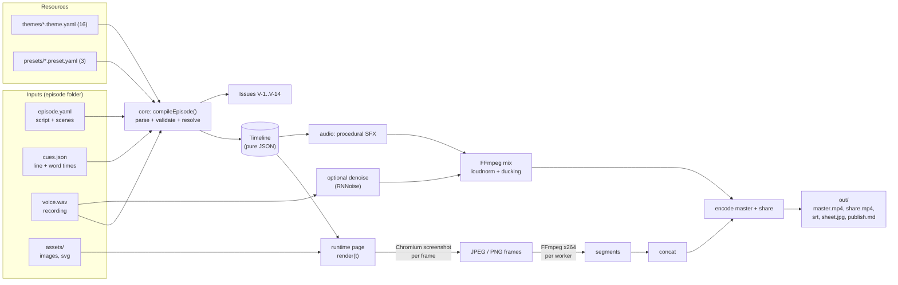

`cues.json` comes from one of three sources: an estimate before recording (draft), automatic alignment
from the recording (`reelforge align`), or marking by ear in the editor. The compiler treats them the
same; only the V-3 messages differ.

### 3.2 Who uses what

The same **runtime** (the drawing page) is used in the editor and in the renderer. This is the most
important design decision: **what you see in the editor is exactly what gets rendered**. All agent tools
are defined **once**, in the tool registry inside the studio package, and three transports serve them.

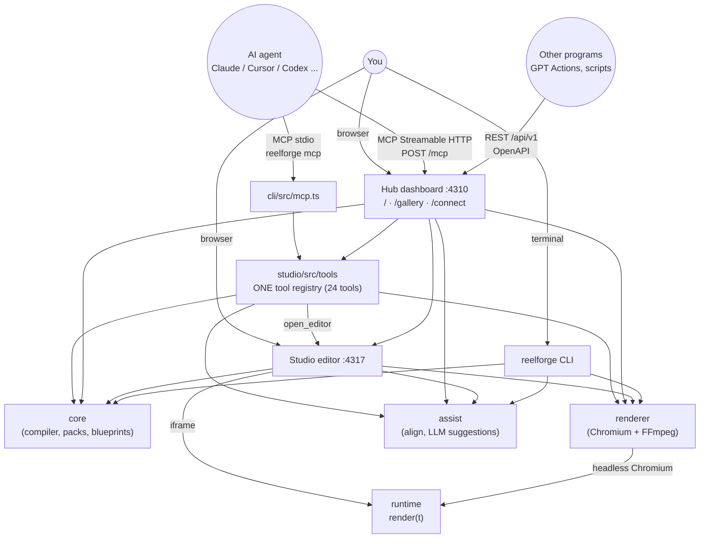

---

## 4. Repository layout <a id="s4"></a>

```text
vidcreat/
├── packages/                ← all source code (TypeScript), seven packages
│   ├── audio/               ← WAV, envelopes, speech analysis and alignment (align.ts), SFX, PRNG
│   ├── core/                ← schema, time, captions, themes, presets, compiler, validation,
│   │                          industry packs, blueprints, suggestions, automatic cues
│   ├── assist/              ← optional: Whisper + Silero VAD, the LLM provider layer
│   │   └── runtime/         ← package-lock.json + models.json (models pinned by SHA-256)
│   ├── runtime/             ← browser page: render(t) and 62 components, icons, QR, maps
│   ├── renderer/            ← Chromium workers + FFmpeg + doctor
│   │   └── assets/rnnoise/  ← the sh.rnnn noise cleanup model
│   ├── studio/              ← Hub and Studio servers + the tool registry + Vite clients
│   │   ├── src/server/      ← server code (Node): hub, editor, security, gallery, agent endpoints
│   │   ├── src/tools/       ← the tool registry: tools, MCP, OpenAPI, resources
│   │   └── client/          ← hub.html, index.html (editor), connect.html, gallery.html
│   └── cli/                 ← the reelforge command + the MCP stdio transport
├── packs/                   ← 12 industry packs: pack.yaml + templates/ + examples/
├── themes/                  ← 16 themes (dark and light)
├── presets/                 ← tiktok, reels, shorts
├── skills/                  ← 8 task guides in the Agent Skills format
├── examples/                ← ready-made episodes
│   ├── season1/ep01..ep09   ← the "System Design" series in English
│   ├── season1-arabic/      ← the same series in Arabic
│   └── promo/               ← intro and range (videos about ReelForge itself)
├── episodes/                ← your own episodes (ignored by git)
├── schema/                  ← episode.schema.json (generated, for editor autocompletion)
├── fixtures/                ← golden frames, lint cases v01…v14, mini, align, motion
├── tests/                   ← browser and integration tests (CLI, MCP, agents, gallery, render…)
├── scripts/                 ← doc generation and checks, evals, licenses, release, screenshots…
├── docs/                    ← documentation site (VitePress), ADRs, generated references, this guide
├── documentation/           ← offline HTML documentation (generated)
├── .github/workflows/       ← ci.yml, docs.yml, release.yml
├── install.* / start.* / reelforge(.cmd) / ReelForge.command  ← installer and launchers
├── AGENTS.md, CLAUDE.md, GEMINI.md, llms.txt, llms-full.txt   ← instructions for AI agents
└── .mcp.json, .cursor/, .vscode/, .gemini/, .windsurf/, .claude-plugin/  ← MCP setup per client
```

Approximate code size (TypeScript/HTML/CSS lines in `src/` and `client/`): **studio** 16,800 (about
10,000 of them for the clients), **runtime** 11,000 (1,500 of them generated map and icon data),
**core** 7,400, **renderer** 1,500, **assist** 1,500, **cli** 1,100, **audio** 1,100.

---

## 5. The seven packages and their boundaries <a id="s5"></a>

### 5.1 Dependency graph

Taken from the actual `package.json` files (arrow = "depends on"):

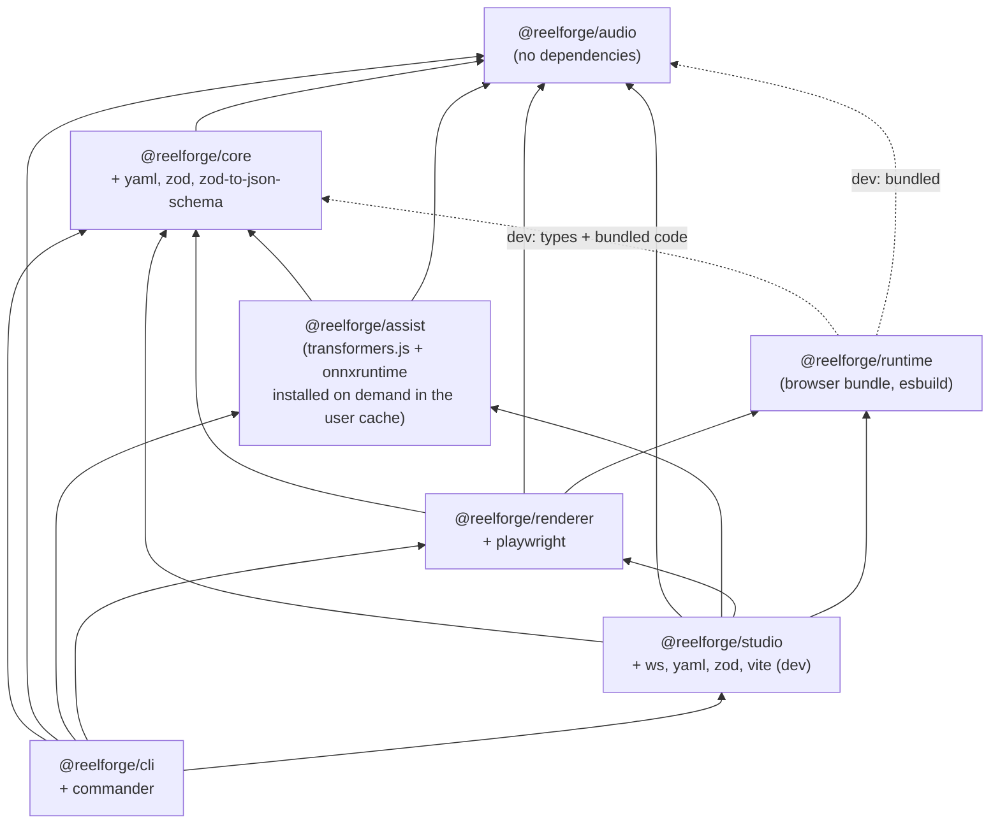

The runtime has no runtime dependencies: esbuild bundles what it needs from `audio` (the deterministic
PRNG) and from `core` (types only) into one file, which is why both are `devDependencies`.

### 5.2 What each package does

| Package    | Runs in                      | Responsibility                                                                                                                                                   |
| ---------- | ---------------------------- | ---------------------------------------------------------------------------------------------------------------------------------------------------------------- |
| `audio`    | Node **and** the browser     | WAV read/write, envelopes, onset detection, speech analysis and splitting into lines and words (`align.ts`), 8 sound effects, deterministic randomness           |
| `core`     | Node                         | The YAML schema, time expressions, captions and bidi, themes and the theme generator, presets, **the compiler**, validation, packs, blueprints, suggestions      |
| `assist`   | Node                         | Automatic cues with the best available engine (DSP / Whisper / VAD), verified model installation, the LLM provider layer and scene suggestions (see [§24](#s24)) |
| `runtime`  | The browser only             | The page that draws a frame: `render(t)`, background, header, captions, 62 components, 258 icons, a QR encoder, maps                                             |
| `renderer` | Node                         | Launching Chromium, capturing frames, FFmpeg, audio mix and cleanup, output checks, `doctor`, the V-9/V-10 measuring pass                                        |
| `studio`   | Node (server) + browser (UI) | Dashboard, visual editor, gallery, Connect AI page, structured YAML edits, render queue, **the tool registry** and its three transports                          |
| `cli`      | Node                         | The `reelforge` command with all its subcommands, and the MCP stdio transport                                                                                    |

### 5.3 The golden rule: the Timeline is the only contract

`core` knows nothing about the DOM, and `runtime` knows nothing about YAML or zod. The only thing that
passes between them is the `Timeline` object defined in [types.ts](../packages/core/src/types.ts). As a
result:

- The runtime bundle stays small (no zod, no YAML library).
- core can be tested without a browser.
- A test checks that the component list in `core` (the schemas) matches the one in `runtime` (the
  drawing code).

A second rule of the same kind applies to agents (ADR-014): **no transport declares a tool of its own**.
Every tool lives in `packages/studio/src/tools/`, and MCP stdio, MCP HTTP, REST, the OpenAPI document and
the server card all pick it up automatically.

---

## 6. An episode from start to finish <a id="s6"></a>

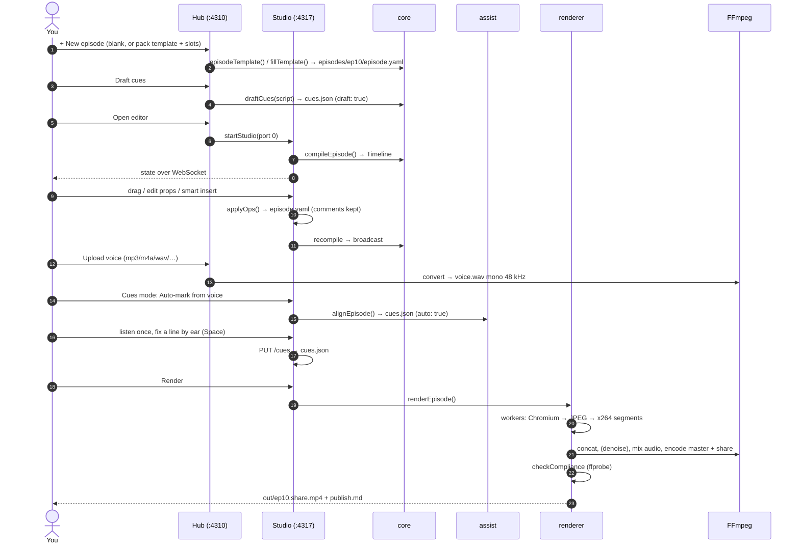

In words:

1. **Write.** One sentence per line (about 2.3 words per second; 45 seconds ≈ 100–110 words). The first
   line is the hook, the last one a call to action.
2. **Create.** `reelforge new ep10` or the **New episode** button creates the folder from the generic
   template, or from an industry pack template (`reelforge new ep10 --pack healthcare --slot org="…"`).
3. **Estimate timing.** Before recording, draft cues give realistic timing for previews.
4. **Design.** Add scenes and elements (by hand, from a blueprint, or from suggestions) and make each
   element enter on the word that names it.
5. **Validate and preview.** `validate` reports V-1…V-14 issues, and `snap` writes PNG frames at given
   times.
6. **Record and time.** Record `voice.wav`; automatic alignment marks every line and word; listen once in
   Cues mode and fix any line by pressing Space.
7. **Render.** `render` writes the outputs to `out/`.

Because elements are anchored to **words**, not seconds, re-recording one sentence only means aligning
again or re-marking one cue, and everything after it stays in sync.

An AI agent takes the same path through the tools: `create_from_template` or `create_episode`, then
`add_scene` or `edit_episode`, then `validate_episode` and `preview_frames`, then `align_cues` and
`render_episode` (see [§15](#s15)).

---

## 7. episode.yaml in detail <a id="s7"></a>

The schema is defined with zod in [schema/episode.ts](../packages/core/src/schema/episode.ts). **Every
object is strict**: an unknown key is a V-1 error with a did-you-mean suggestion and the line and column.

### 7.1 The five sections

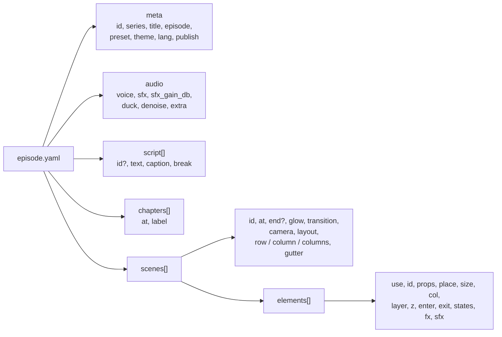

### 7.2 An annotated example

```yaml
meta:
  id: ep10 # letters, digits, - and _
  series: 'SYSTEM DESIGN'
  title: 'Rate Limiting'
  episode: 10
  preset: tiktok # sets the stage position and safe zones
  theme: default # colors and fonts (or clinical, harbor, minimal…)
  lang: en-US # the schema default is ar-EG!
  publish: { cover: 'Flooded API?', caption: '…', hashtags: ['#systemdesign'], pinned: '…' }

audio:
  voice: voice.wav
  sfx: auto # auto | manual | none
  sfx_gain_db: -16 # effects level under the voice
  # duck: true       ← lower the effects while you speak (default)
  # denoise: true    ← remove background noise from phone recordings when rendering

script: # default ids: l1, l2, …
  - text: 'Your API just got flooded with requests.'
  - text: 'A rate limiter decides who gets through.'

chapters:
  - { at: l1, label: '01 · THE PROBLEM' }

scenes:
  - id: hook
    at: l1 # starts with line 1, ends where the next scene starts
    glow: red # background glow color
    transition: crossfade # how this scene comes in
    camera: push-in # slow camera move over the whole scene
    elements:
      - use: title # component name
        id: hook_title
        props: { text: 'Flooded **API**' } # **word** = accent color
        place: { x: 60, y: 160, w: 960, h: 240 } # stage coordinates
        enter: { at: "l1:'flooded'", anim: pop } # enters when "flooded" is spoken
        exit: { at: l2, anim: fade }
        fx: [{ at: "l1:'requests'", do: shake }]
```

### 7.3 The important element fields

| Field    | What it does                                                                                                                                                                 |
| -------- | ---------------------------------------------------------------------------------------------------------------------------------------------------------------------------- |
| `use`    | The component name (one of the 62). An unknown name is **V-13** and the element is dropped.                                                                                  |
| `id`     | Optional. Defaults to `<scene>-<use>-<n>`. Must be unique across the episode.                                                                                                |
| `props`  | The component's props, checked by its strict schema.                                                                                                                         |
| `place`  | `x, y, w, h`, or `center` / `anchor` + `margin`. Without it the element is centered, or laid out automatically when the scene has `row` / `column` / `columns` (with `col`). |
| `size`   | `w, h` without a position: changes the size and leaves placement to the automatic layout.                                                                                    |
| `layer`  | `base` (default) or `overlay` (on top of everything, e.g. stamps and badges; excluded from the V-8 overlap check).                                                           |
| `enter`  | `at` (default: the scene start), `anim` (18 kinds), `dur`, `ease`, and parameters such as `dist`, `s0`, `cps`, `rot`, `amp`.                                                 |
| `exit`   | `at` (required), `anim` (10 kinds), `dur` (default 0.3).                                                                                                                     |
| `states` | `[{ at, set: {...} }]` changes props over time, e.g. `status: err` on a node.                                                                                                |
| `fx`     | One-off effects: `shake`, `flash`, `glitch`, `pulse`, `bump`. With `target: camera` the whole frame shakes.                                                                  |
| `sfx`    | `auto` / `none` / an explicit list of sounds.                                                                                                                                |

---

## 8. Time: cues, words and time expressions <a id="s8"></a>

This is the cleverest part of the project and worth understanding well.

### 8.1 Three layers of time

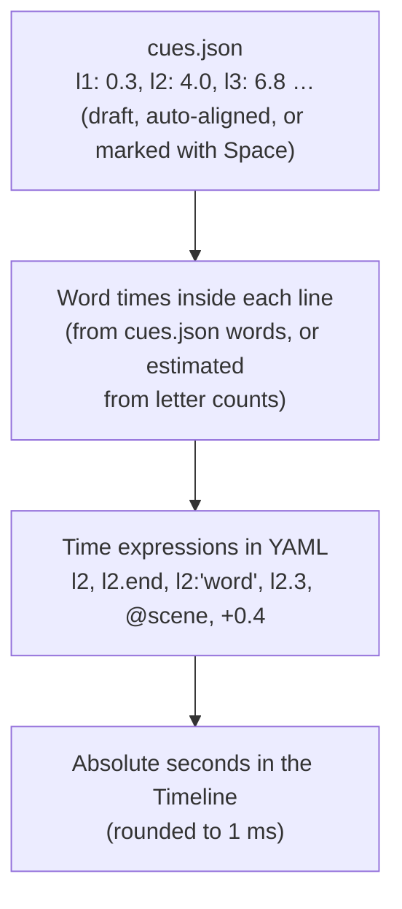

### 8.2 Cues

A cue is the **start** of a line. A line ends where the next one starts (or at the end of the audio for
the last line). The shape of `cues.json`:

```json
{
  "version": 1,
  "audio": { "file": "voice.wav", "duration": 45, "sha1": "…" },
  "cues": { "l1": 0.3, "l2": 4, "l3": 6.8 },
  "words": { "l2": [4.0, 4.31, 4.9] },
  "draft": true
}
```

- **Where do they come from?** Three sources, all writing the same file:
  - **Draft (`draft: true`):** an estimate in [compile.ts](../packages/core/src/compile.ts) (`draftCues`):
    **13 letters per second** plus a 0.35 s gap between lines, starting at 0.2 s. When a recording
    exists, the dashboard stretches the estimate linearly to its length.
  - **Automatic (`auto: true`):** alignment from the recording with **Auto-mark from voice**,
    `reelforge align` or the `align_cues` tool (see [§24](#s24)). It places lines **and words**; a V-3
    info message stays until you save once in Cues mode.
  - **By hand:** in Cues mode you press Space at the start of each line while listening (at 0.5×–1×).
    Optionally, **Snap to voice** moves the mark to the nearest real onset within ±120 ms (see
    [§12](#s12)).
- **ADR-004 and ADR-013:** ADR-004 chose hand-marked cues because the render engine must contain no
  machine learning. ADR-013 then allowed the computer to **suggest** cues, provided they remain an
  authoring aid: they never replace what a person marked without confirmation, and no model runs at
  render time.
- **Protection:** if the voice file changes after cues were marked, its `sha1` differs and V-4 warns.

### 8.3 Estimating word times

When `cues.json` has no word times, [words.ts](../packages/core/src/words.ts) (`estimateWordStarts`)
spreads the line's duration over its words **in proportion to each word's letter count** (minimum 2),
after reserving 0.18 s as an end-of-line pause.

**A real example from `examples/promo/intro`:**

Line `l1` = "What if your voice could direct the whole video?", cue = 0.3, next line at 4.0.

```text
span     = 4.0 − 0.3 − 0.18 = 3.52 s
weights  = What 4, if 2, your 4, voice 5, could 5, direct 6, the 3, whole 5, video 5  → total 39
voice    = 0.3 + 3.52 × (4+2+4)/39 = 0.3 + 0.903 = 1.203 s
```

So `l1:'voice'` is **1.203 s** by estimate. When `cues.json` holds word times (from automatic alignment,
or from word mode with the W key) and their count equals the number of words exactly, they replace the
estimate; otherwise V-3 warns and the estimate is used.

### 8.4 Time expression grammar

Defined in [time.ts](../packages/core/src/time.ts):

```text
expr   := base offset*
base   := NUMBER "s" | NUMBER                ← absolute seconds
        | LINE_ID                            ← line start
        | LINE_ID ".end"                     ← line end
        | LINE_ID ":" 'word' ("#" N)?        ← a word (its Nth occurrence)
        | LINE_ID "." N                      ← word number N (0-based)
        | "@" SCENE_ID (".start" | ".end")?  ← scene start/end
offset := ("+" | "-") NUMBER "s"?
```

| Expression       | Meaning                                                       |
| ---------------- | ------------------------------------------------------------- |
| `12.5s` / `12.5` | second 12.5                                                   |
| `l7`             | start of line 7 = its cue                                     |
| `l7.end`         | `max(start, next − 0.15)`: 0.15 s before the next line starts |
| `l7:'bucket'`    | the first occurrence of "bucket" in line 7                    |
| `l7:'the'#2`     | the second occurrence of "the"                                |
| `l7.3`           | the fourth word (0-based)                                     |
| `@hook.end`      | the end of scene hook                                         |
| `l7:'x'+0.4`     | 0.4 s after the word (several offsets can be chained)         |

**Word matching is forgiving:** before comparing, punctuation, Arabic diacritics and tatweel are removed,
`أ إ آ` are folded to `ا`, and letters are lowercased. A multi-word phrase can be matched too. When the
word is not found, the result is a **V-2** error with the closest word suggested (Levenshtein).

> YAML rule: wrap the expression in double quotes when it contains `:` or `'`, e.g. `at: "l3:'bucket'"`.

---

## 9. Package core: the compiler, themes and industry packs <a id="s9"></a>

### 9.1 File map

| File                                                        | Role                                                                                             |
| ----------------------------------------------------------- | ------------------------------------------------------------------------------------------------ |
| [types.ts](../packages/core/src/types.ts)                   | The `Timeline` and all its types (the contract with the runtime)                                 |
| [schema/episode.ts](../packages/core/src/schema/episode.ts) | The YAML schema in zod, plus the lists of animations, transitions and cameras                    |
| [yamlsrc.ts](../packages/core/src/yamlsrc.ts)               | YAML parsing that **keeps line positions**, so errors point to `file:line:col`                   |
| [zodissues.ts](../packages/core/src/zodissues.ts)           | Turns zod errors into readable Issues with did-you-mean                                          |
| [time.ts](../packages/core/src/time.ts)                     | The time expression grammar, parser and evaluator                                                |
| [words.ts](../packages/core/src/words.ts)                   | Word time estimates and the line timing table                                                    |
| [text.ts](../packages/core/src/text.ts)                     | Mixed Arabic/Latin text helpers (normalization, direction, letter and syllable counts)           |
| [captions.ts](../packages/core/src/captions.ts)             | Builds captions: chunking and bidi                                                               |
| [cues.ts](../packages/core/src/cues.ts)                     | Reads/writes `cues.json` (atomic writes)                                                         |
| [autocue.ts](../packages/core/src/autocue.ts)               | `autoCues`: model-free automatic cues on top of the `audio` aligner                              |
| [compile.ts](../packages/core/src/compile.ts)               | **The compiler**, `compileEpisode` (~1,175 lines, the heart of the project), draft cues and V-14 |
| [lint.ts](../packages/core/src/lint.ts)                     | Static geometry and timing checks (V-6, V-7, V-8, V-11, V-12)                                    |
| [theme.ts](../packages/core/src/theme.ts)                   | Theme loading with `extends`, the bundled fonts, contrast checks                                 |
| [themegen.ts](../packages/core/src/themegen.ts)             | The one-color theme generator (`reelforge theme new`)                                            |
| [preset.ts](../packages/core/src/preset.ts)                 | Preset loading                                                                                   |
| [project.ts](../packages/core/src/project.ts)               | Project paths, episode and resource lookup                                                       |
| [components/](../packages/core/src/components/)             | The 62 component definitions: props schemas, default sizes, automatic sounds, 258 icon names     |
| [suggest.ts](../packages/core/src/suggest.ts)               | Keyword-dictionary suggestions (smart insert) per line                                           |
| [blueprints.ts](../packages/core/src/blueprints.ts)         | The 13 blueprints (scenes from flat parameters)                                                  |
| [packs.ts](../packages/core/src/packs.ts)                   | The `pack.yaml` schema, pack discovery and template filling (`fillTemplate`)                     |
| [outputs.ts](../packages/core/src/outputs.ts)               | Writes `.srt` and `publish.md`                                                                   |
| [template.ts](../packages/core/src/template.ts)             | The generic new-episode template                                                                 |
| [jsonschema.ts](../packages/core/src/jsonschema.ts)         | Converts the schema to JSON Schema (autocompletion, the editor, the tools)                       |

### 9.2 Compile stages

`compileEpisode(paths, opts)` is **pure**: the same files give the same Timeline.

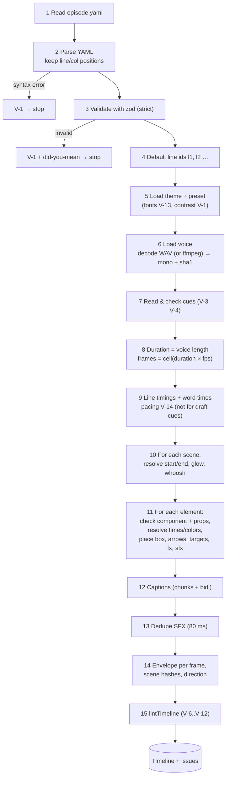

Important details of each stage:

- **Duration** = the voice length, or `audio.duration` from the cues, or (as a last resort) the last cue
  - 3 s. Beyond the platform limit (`max_duration` in the preset) V-1 warns.
- **Scene times:** start = the evaluated `at`. End = `end` when given, otherwise the start of the next
  scene. Circular references between scenes (`@a.end` → `@b` → …) are detected and reported.
- **Scene area (origin):** `layout: stage` (default) → `{x:0, y:270, w:1080, h:1000}`. `layout: full` →
  the whole canvas.
- **Prop resolution (`resolveProps`)** walks all props deeply:
  - The keys `at, until, strike, highlight` turn from expressions into seconds.
  - The keys `color, accent, danger` and the `colors` array turn from theme names (`lime`) into CSS
    (`#b8ff3c`).
- **Default enter duration** by animation: `blur/wipe/reveal/draw` 0.6, `spring` 0.8, `drop` 0.7,
  `stamp/glitch` 0.5, `type` 0.3, everything else 0.45 from the theme.
- **Arrows and targets:** `from: api.right` is computed from the box of element `api` **in the same
  scene**. Without a side, one is picked automatically from the direction. Then the path points are
  computed (straight / elbow / curved). The target props of `spotlight` and `callout` are turned from an
  element id into a box the same way.
- **Effects lifted to the timeline:** `flash` goes to `timeline.flashes` (a full-screen flash), and
  `shake` with `target: camera` goes to `timeline.shakes`. The `stamp` and `trap` components add a flash
  and a shake automatically.
- **Direction:** `meta.dir` is RTL when the script contains an Arabic letter **or** `meta.lang` starts
  with `ar`.
- **Failure does not stop everything:** an element with an unknown component or invalid props is dropped
  and reported, but a Timeline is still returned (with fallbacks), which is why the editor can keep
  showing the "last good" version.

### 9.3 The shape of the Timeline

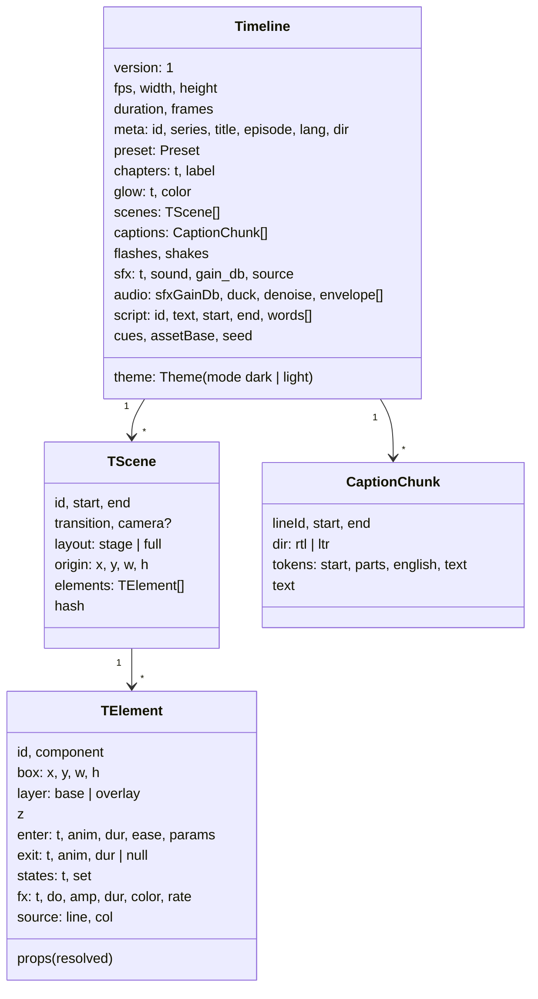

Everything is **precomputed**: times in seconds (1 ms precision), colors as CSS values, final boxes,
ready arrow points. The runtime only has to work out "what is visible at `t`".

`audio.envelope` holds **one value per frame** (0..1) for the voice loudness and drives the waveform bar
in the video. `seed` is a hash of the episode id and the basis of all "randomness" in drawing.
`audio.denoise` carries the noise cleanup choice to the renderer.

### 9.4 Coordinate system

```text
 canvas 1080 × 1920 (tiktok preset)
 y=0     ┌───────────────────────────────┐
         │                               │
 y≈120   │  progress bar · SERIES · EP.10│  ← Header (headerTop 150)
         │  chapter label                │
 y=270   ├───────────────────────────────┤ ─┐
         │ (0,0) of the STAGE            │  │
         │                               │  │  STAGE 1080 × 1000
         │   elements live here,         │  │  element place: {x,y,w,h}
         │   x ≥ 60, x+w ≤ 1020          │  │  are relative to this box
         │                         ┌─────┤  │
 y=900   │                         │right│  │  ← right-rail safe zone
         │   keep x+w ≤ 920 below  │rail │  │     (x ≥ 940, likes/comments)
 y=1270  ├─────────────────────────┤     ┤ ─┘
 y=1300  │  word-by-word CAPTIONS  │     │  ← captionsY
         │  ▁▃▅▇▅▃▁ waveform       │     │
 y=1540  ├─────────────────────────┴─────┤
         │  bottom safe zone             │  ← caption/username/music UI
 y=1920  └───────────────────────────────┘
```

| Preset | Stage (y / h)  | Captions (y) | Right rail        | Bottom zone | Size cap | Max length |
| ------ | -------------- | ------------ | ----------------- | ----------- | -------- | ---------- |
| tiktok | 270 / 1000     | 1300         | x 940 from y 900  | y 1540      | 28 MB    | 600 s      |
| reels  | 270 / 1000     | 1290         | x 960 from y 1000 | y 1500      | 28 MB    | 900 s      |
| shorts | **250** / 1000 | 1280         | x 960 from y 1000 | y 1560      | 28 MB    | 180 s      |

The "x+w ≤ 920 below y 600" rule in AGENTS.md is not in the code; it follows from the right rail: canvas
y 900 is stage y 630.

**Why only 9:16?** (ADR-016): every element, template, blueprint, guide and the V-6/V-7/V-8 checks
assume a 1000 px tall stage. Square or landscape output needs a relative layout model, not a new preset,
so it is on the roadmap after 1.0.

### 9.5 Captions and Arabic

This part is subtle, because mixing Arabic and English (`الـ client`) confuses most engines. The solution
lives in [captions.ts](../packages/core/src/captions.ts) (logic) and
[runtime/captions.ts](../packages/runtime/src/captions.ts) (drawing), documented in ADR-007:

1. **Direction per line:** RTL when the line contains an Arabic letter.
2. **Grouping words into tokens:**
   - Consecutive Latin words merge into one token: "Duplicate Charge".
   - A word ending in tatweel `ـ` is glued to the next one with an NBSP: `الـ client` never breaks across
     lines.
3. **Bidi isolation:** inside each token, the Latin parts are wrapped in `<bdi>`. The whole token is
   `inline-block` and `nowrap`, so it behaves as one block in paragraph order. Punctuation such as `؟`
   stays outside the isolation and lands in the right place.
4. **Chunking:** at most 34 characters per chunk (from the theme). A long chunk is split at the
   punctuation mark nearest the middle, or in the middle. `break: ['word']` on a line forces breaks.
5. **Karaoke:** every token carries its start time. While drawing, the current word uses the `active`
   color (lime), past words the normal color, upcoming words are faded (`future_opacity` 0.32), and
   English inside Arabic uses the `english` color (cyan). The active word pulses slightly.

The `.srt` output wraps Arabic lines in the Unicode RLE…PDF marks so players display them correctly.

### 9.6 Themes

`themes/<name>.theme.yaml` files support `extends` (inheritance with deep merge and cycle detection). The
loader looks in your project's `themes/` first, then in the installation. **16 themes** ship with
ReelForge, all extending `default`:

| Mode  | Themes                                                                                                                |
| ----- | --------------------------------------------------------------------------------------------------------------------- |
| dark  | `default`, `season1`, `workshop`, `bistro`, `bold`, `editorial`, `harbor`, `industrial`, `ledger`, `retail`, `voyage` |
| light | `campus`, `civic`, `clinical`, `estate`, `minimal`                                                                    |

The `default` theme:

| Section    | Values                                                                                                                                                                                                                        |
| ---------- | ----------------------------------------------------------------------------------------------------------------------------------------------------------------------------------------------------------------------------- |
| `mode`     | `dark` (or `light`: the runtime adds the `rf-light` class and the [light.ts](../packages/runtime/src/light.ts) rules for surfaces and shadows)                                                                                |
| `colors`   | bg `#07080c`, ink, dim, line, card, **lime** `#b8ff3c`, cyan, red, amber, violet                                                                                                                                              |
| `fonts`    | Only the nine bundled fonts (`BUNDLED_FONTS`, all SIL OFL): Space Grotesk, Inter, Manrope and Playfair Display for display, JetBrains Mono for code, and Cairo, Readex Pro, Noto Kufi Arabic and Noto Naskh Arabic for Arabic |
| `type`     | caption 66, title 120, h2 84, body 32, label 24                                                                                                                                                                               |
| `chrome`   | header, progress, waveform, grain 0.07, `grain_fps` 0 (static), vignette 0.75, grid, `glow` 1 (light themes around 0.5)                                                                                                       |
| `motion`   | pop_overshoot 1.9, default_dur 0.45, crossfade 0.3                                                                                                                                                                            |
| `captions` | active lime, english cyan, future_opacity 0.32, max_lines 2, max_chars 34, scrim 0.78                                                                                                                                         |

**Contrast is checked at two levels:**

- **At load time (every episode):** a font that is not bundled is **V-13** (rendering never reaches the
  internet). A caption color (`ink`, `captions.active`, `captions.english`) below **7:1** against the
  background is a V-1 warning (`captionContrastIssues`).
- **In tests (every theme in `themes/`):** [themes.test.ts](../packages/core/test/themes.test.ts) uses
  `themeContrast` to enforce WCAG 2.1 AA: every text color (`ink`, `dim`, the five accents and both
  caption colors) reaches **4.5:1** on both surfaces, `bg` and `card`. `dim` is treated as normal text,
  not large text, because it sets subtitles and axis labels.

**The theme generator** ([themegen.ts](../packages/core/src/themegen.ts)):
`reelforge theme new brand --accent "#ff5a1f" [--mode light] [--font Inter]` builds a full palette from
one color in HSL: background and card in the accent's hue, secondary accents kept in their color
families (cyan stays blue, violet purple) and nudged away from the accent. Any color that misses its
contrast target is moved in lightness until it passes, and the generator refuses any result that fails
either check.

**Why static grain?** (ADR-011): noise that changes every frame cannot be compressed. Measured: no grain
1.9 Mb/s, animated grain 64.5 Mb/s, static grain 5.9 Mb/s. Platforms remove it when re-encoding anyway.

### 9.7 Validation rules V-1 … V-14

| Rule     | Level                  | What it checks                                                                                                                                                                              | Where               |
| -------- | ---------------------- | ------------------------------------------------------------------------------------------------------------------------------------------------------------------------------------------- | ------------------- |
| **V-1**  | error (sometimes warn) | All structural errors: YAML, zod, duplicate ids, unknown theme/preset, an arrow or target pointing at a missing element; warnings: caption contrast < 7:1, duration over the platform limit | core                |
| **V-2**  | error                  | An invalid or unresolvable time expression (unknown line/word/scene, out of range, circular)                                                                                                | core                |
| **V-3**  | error/warn/info        | Missing, unordered or after-the-end cues; a cue for an unknown line; a word count mismatch (warn); draft or automatic cues (info)                                                           | core                |
| **V-4**  | warn/error             | Voice file missing (warn), unreadable (error), or changed since the cues were marked                                                                                                        | core                |
| **V-5**  | error                  | A scene ending before it starts; an element entering outside its scene; an exit before the enter                                                                                            | core                |
| **V-6**  | warn                   | An element outside the stage                                                                                                                                                                | core (lint)         |
| **V-7**  | warn                   | An element intersecting a safe zone (platform UI)                                                                                                                                           | core (lint)         |
| **V-8**  | warn                   | Two visible `base` elements overlapping by more than 15% (`particles`, `trap`, `spotlight` are exempt)                                                                                      | core (lint)         |
| **V-9**  | warn                   | Text overflowing its box **after real rendering**                                                                                                                                           | renderer (Chromium) |
| **V-10** | warn                   | A caption chunk drawn on more lines than `max_lines`                                                                                                                                        | renderer (Chromium) |
| **V-11** | info                   | Nothing enters in the first 1.5 s of a scene ("dead air")                                                                                                                                   | core (lint)         |
| **V-12** | warn                   | An element entering less than 0.1 s before its scene ends ("blink")                                                                                                                         | core (lint)         |
| **V-13** | error                  | An unknown component, or a font that is not bundled                                                                                                                                         | core                |
| **V-14** | warn / info            | Pacing: a line faster than 3.5 words/s, or a hook starting after 3 s (warn); a silence ≥ 1.5 s in the recording (info). Not checked with draft cues                                         | core (compile)      |

Only V-9 and V-10 need a browser, because the real size of text is only known once it is drawn with the
real font. Their results are cached in `out/.cache/measure.json` under a hash (runtime + scenes + theme +
preset), so they rerun only when something changes. Every rule has a test episode with a deliberate
mistake in `fixtures/lint/v01…v14`.

### 9.8 The 62 components

Each component has a definition in [core/components](../packages/core/src/components/index.ts) (schema,
default size, sounds) and an implementation in
[runtime/components](../packages/runtime/src/components/index.ts) (drawing) under the same name. The full
list with props and a frame of each is in the [component reference](reference/components.md), generated
from the schemas. Their categories (the same as in AGENTS.md):

| Category             | Components                                                                                                                                                                                       |
| -------------------- | ------------------------------------------------------------------------------------------------------------------------------------------------------------------------------------------------ |
| Text (8)             | `title`, `label`, `chip`, `stamp`, `quote`, `kinetic-text`, `bullet-list`, `speech-bubble`                                                                                                       |
| Diagrams (8)         | `node`, `arrow`, `lanes`, `grid`, `timeline`, `bucket`, `callout` (label + arrow pointing at an element), `spotlight` (dims all but one element)                                                 |
| Data & charts (13)   | `counter`, `meter` (`style: gauge`), `table`, `checklist`, `bar-chart`, `line-chart`, `donut-chart`, `stat-card`, `progress-ring`, `comparison`, `before-after`, `ranking`, `vitals` (ECG + BPM) |
| Structure (8)        | `steps`, `flow`, `org-chart`, `tree`, `cycle`, `funnel`, `pyramid`, `matrix-2x2`                                                                                                                 |
| Places (5)           | `map` (countries, pins, routes), `route` (moving vehicle), `floor-plan`, `building`, `container-stack`                                                                                           |
| Time & people (8)    | `calendar`, `clock` (`mode: countdown`), `schedule-board`, `appointment`, `person-card`, `chat`, `notification`, `lower-third`                                                                   |
| Media & commerce (6) | `image` (Ken Burns), `logo`, `split-screen`, `pricing-table` (`variant: tag`), `qr-code`, `rating` (illustrative only)                                                                           |
| Other (6)            | `code` (types itself), `phone`, `icon` (258 icons), `particles`, `trap` ("THE TRAP" interstitial), `cta` (next-episode ending)                                                                   |

**The original 21 components** (the first set, still the most used in the season1 examples):

| #   | Component   | What it is                                                      | Default size | Automatic sound            |
| --- | ----------- | --------------------------------------------------------------- | ------------ | -------------------------- |
| 1   | `title`     | Big headline, `**word**` in the accent color, shrinks to fit    | 960×240      | whoosh on enter            |
| 2   | `label`     | Small mono line with a glowing dot                              | 640×60       | —                          |
| 3   | `code`      | A code editor that types itself line by line, with highlighting | 960×520      | typing                     |
| 4   | `node`      | A system box (server/db) with ok/err/warn/busy states           | 300×170      | err / ding on state change |
| 5   | `arrow`     | An arrow between two elements with moving packets and a label   | computed     | whoosh                     |
| 6   | `chip`      | A small text pill that can be struck through                    | 340×84       | ding / err on strike       |
| 7   | `stamp`     | A tilted stamp that lands hard (+ flash + shake)                | 680×260      | hit                        |
| 8   | `table`     | A table whose rows appear one by one                            | 960×440      | ding per row               |
| 9   | `lanes`     | Parallel lanes (race conditions)                                | 960×760      | tick / err                 |
| 10  | `checklist` | A ✓/✗ list that draws itself                                    | 880×460      | ding / err                 |
| 11  | `counter`   | A big number counting between keyframes                         | 820×320      | —                          |
| 12  | `meter`     | A gauge bar with a LIMIT that turns red when crossed            | 880×180      | —                          |
| 13  | `timeline`  | A time axis with marks and a cursor                             | 960×260      | ding per mark              |
| 14  | `grid`      | A grid of cells with states                                     | 640×640      | —                          |
| 15  | `bucket`    | A token bucket (rate limiting) that drains and refills          | 440×560      | tick                       |
| 16  | `phone`     | A phone with a payment app, notifications and taps              | 440×880      | tap / ding                 |
| 17  | `quote`     | A quote that types itself with highlighted words                | 940×460      | typing                     |
| 18  | `particles` | Particles: burst, confetti, herd, stream, dust                  | fills scene  | —                          |
| 19  | `trap`      | A "THE TRAP" interstitial with warning tape and glitch          | fills scene  | hit + glitch               |
| 20  | `cta`       | The "next episode" end card with a comment box                  | 960×560      | typing                     |
| 21  | `icon`      | One of 258 bundled icons, or an image from `assets/`            | 160×160      | —                          |

### 9.9 Industry packs, templates and blueprints

This layer makes authoring possible with simple parameters, and all of it produces ordinary YAML that
goes through the same schema.

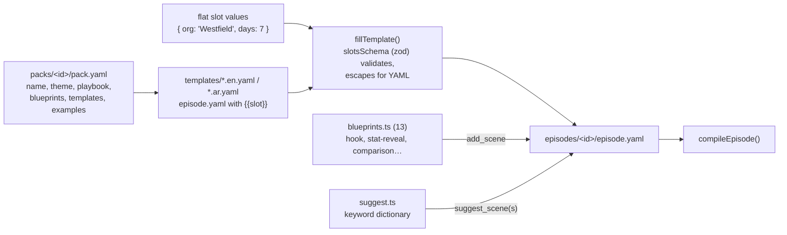

- **Packs (12):** `education`, `events-ngo`, `finance`, `food`, `government`, `healthcare`,
  `manufacturing`, `ports-logistics`, `real-estate`, `retail`, `tech`, `tourism`. Each has a theme (e.g.
  `clinical` for healthcare, `harbor` for ports, `default` for tech), **3 templates** in English and
  Arabic (36 in total), two generated examples (`examples/<name>-en` and `-ar`, rebuilt by
  `scripts/gen-pack-examples.mjs`) and a playbook in `skills/reelforge-industry-playbooks/references/`.
- **The pack schema** (`packSchema` in [packs.ts](../packages/core/src/packs.ts)): `id`, `name` and
  `description` (a string or `{ en, ar }`), `theme`, `playbook`, `blueprints`, `templates[]` (each with
  `id`, `title`, `description`, `slots`, `files: { en, ar? }`) and `examples`. Each slot has a `label`, a
  `type` (`text` / `number` / `color`), `max`/`min` and a `default` (possibly localized). Packs in your
  project (`<root>/packs/`) override installed packs with the same id.
- **Filling a template:** `slotsSchema` builds a zod validator from the slots (text is one line, no
  `{{`, a maximum length), then `fillTemplate` replaces each `{{slot}}` (and `{{id}}` with the episode
  id), escaping text for single-quoted YAML scalars. The model never writes YAML, so it cannot break the
  structure.
- **Blueprints (13):** `hook`, `problem-solution`, `stat-reveal`, `comparison`, `process-steps`,
  `timeline`, `before-after`, `bar-stats`, `quote`, `cta`, `map-route`, `appointment`, `chat`. Each takes
  `line` (the start line), optional `at` and `glow`, and short flat parameters, and returns a complete
  scene inside the safe area that enters on the line's word.
- **Tool tiers by model size:**

| Tier   | For           | Tools                                                                                           |
| ------ | ------------- | ----------------------------------------------------------------------------------------------- |
| Tier 1 | small models  | `list_templates` → `create_from_template` → `validate_episode` (flat slots only, no YAML)       |
| Tier 2 | medium models | `create_episode` → `suggest_scenes` → `list_blueprints` / `add_scene` (a scene from parameters) |
| Tier 3 | strong models | `edit_episode` / `write_episode_yaml` (free composition by YAML path)                           |

---

## 10. Package runtime: drawing with render(t) <a id="s10"></a>

### 10.1 The idea

The runtime is a **small HTML page** ([runtime.html](../packages/runtime/page/runtime.html)) plus
`runtime.js` bundled by esbuild (an IIFE for Chrome 120) plus local fonts. It exposes a single object
([main.ts](../packages/runtime/src/main.ts)):

```ts
window.reelforge = {
  ready: Promise<void>,      // resolves once fonts and the Timeline are loaded
  fonts: { ok, missing },    // checks that every font loaded (V-13)
  load(tl: Timeline),        // load a new Timeline (editor); waits for images to decode
  render(t: number),         // draw the frame at time t ← everything happens here
  measure(),                 // the V-9 / V-10 measuring pass
  boxes(t),                  // boxes of visible elements (editor clicks)
  duration, timeline, error,
};
```

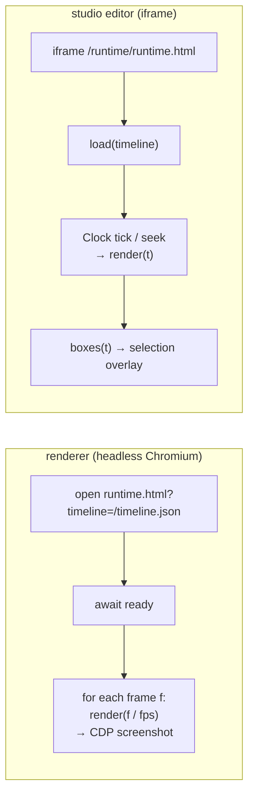

### 10.2 File map

| File                                                       | Role                                                                                             |
| ---------------------------------------------------------- | ------------------------------------------------------------------------------------------------ |
| [engine.ts](../packages/runtime/src/engine.ts)             | `Engine`: builds the scenes once; `render(t)`, `measure()` and `boxes(t)`                        |
| [scene.ts](../packages/runtime/src/scene.ts)               | `SceneView` and `ElementView`: transitions, camera, enter/exit, `fx`, `states`                   |
| [anim.ts](../packages/runtime/src/anim.ts)                 | Easing and motion functions (all pure in time)                                                   |
| [chrome.ts](../packages/runtime/src/chrome.ts)             | Background glow and grid, header and progress bar, waveform, grain, vignette and flashes         |
| [captions.ts](../packages/runtime/src/captions.ts)         | Caption drawing: karaoke and `<bdi>` isolation                                                   |
| [fonts.ts](../packages/runtime/src/fonts.ts)               | Loads the nine fonts explicitly before the first frame and checks them                           |
| [light.ts](../packages/runtime/src/light.ts)               | Light theme overrides (`#rf-root.rf-light`); dark theme frames are untouched                     |
| [icons.ts](../packages/runtime/src/icons.ts)               | 258 icons: ReelForge's own drawings plus a curated Lucide subset (ISC) in `data/lucide-icons.ts` |
| [qr.ts](../packages/runtime/src/qr.ts)                     | A QR encoder written for ReelForge (ISO/IEC 18004, versions 1–10, ECC L/M), dependency-free      |
| [geo.ts](../packages/runtime/src/geo.ts)                   | Map math: named views, a fitted equirectangular projection, great-circle routes                  |
| `data/world.ts`                                            | Country outlines from Natural Earth 1:110m (public domain), from `scripts/gen-world-map.mjs`     |
| [components/](../packages/runtime/src/components/index.ts) | The 62 component implementations, in files by category (next table)                              |
| `styles.ts`, `styles-general.ts`, `dom.ts`, `color.ts`     | Base CSS, cached DOM helpers, color mixing                                                       |

| Component file | Components                                                                                                                             |
| -------------- | -------------------------------------------------------------------------------------------------------------------------------------- |
| `text.ts`      | `title`, `label`, `quote`, `stamp`, `counter`, `cta`                                                                                   |
| `diagram.ts`   | `node`, `arrow`, `chip`, `icon`, `particles`                                                                                           |
| `code.ts`      | `code`                                                                                                                                 |
| `data.ts`      | `table`, `lanes`, `checklist`, `meter`, `timeline`, `grid`, `bucket`                                                                   |
| `screens.ts`   | `phone`, `trap`                                                                                                                        |
| `datavis.ts`   | `bar-chart`, `line-chart`, `donut-chart`, `stat-card`, `progress-ring`, `comparison`, `before-after`, `ranking`                        |
| `structure.ts` | `steps`, `flow`, `org-chart`, `tree`, `cycle`, `funnel`, `pyramid`, `matrix-2x2`                                                       |
| `place.ts`     | `map`, `route`, `floor-plan`, `building`, `container-stack`                                                                            |
| `time.ts`      | `calendar`, `clock`, `schedule-board`, `appointment`                                                                                   |
| `people.ts`    | `person-card`, `chat`, `notification`, `speech-bubble`, `lower-third`                                                                  |
| `media.ts`     | `image`, `logo`, `kinetic-text`, `bullet-list`, `callout`, `spotlight`, `split-screen`, `pricing-table`, `qr-code`, `rating`, `vitals` |

### 10.3 Frame layers

`Engine` builds all scenes and elements **once**; after that, `render(t)` only changes what is visible and
how. Layers from bottom to top:

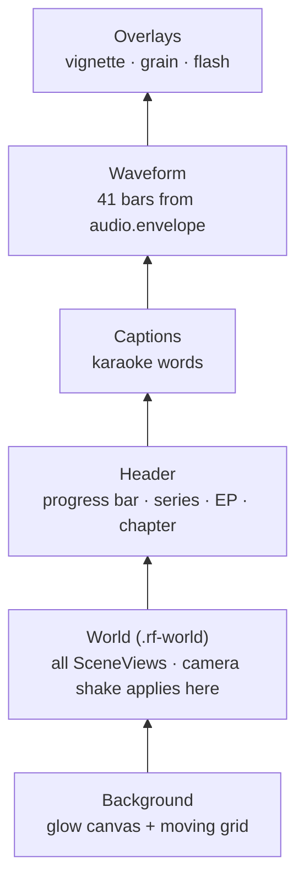

Camera shake applies to the World only, so the header and captions never shake.

### 10.4 What happens inside render(t)

```ts
t = clamp(t, 0, duration);
frame = Math.round(t * fps);
background.update(t); // glow color (0.8 s fade between scenes)
world.transform = cameraShake(t); // timeline.shakes
for (scene of scenes) scene.update(t, frame);
header.update(t);
captions.update(t);
waveform.update(t);
overlays.update(t, frame);
```

**Per scene** (`SceneView` in [scene.ts](../packages/runtime/src/scene.ts)):

- A scene is visible while `start ≤ t < end + exit transition length`.
- **Enter transition** by `transition`:

| Transition            | Effect                                                        |
| --------------------- | ------------------------------------------------------------- |
| `crossfade` (default) | fade in + scale 0.97→1 + blur 8→0                             |
| `cut`                 | instant                                                       |
| `slide-up`            | slides in from 140 px below                                   |
| `zoom`                | scale 1.12→1 + blur                                           |
| `push`                | pushes the old scene left while the new one enters (together) |
| `blur`                | strong blur 22→0                                              |

- **Camera** over the whole scene: `push-in` scales 1→1.06, `pull-out` the reverse, `drift` moves ±18 px.
- **Freezing:** while a scene exits, its elements freeze at the scene's last moment so they do not move
  during the fade.

**Per element** (`ElementView`):

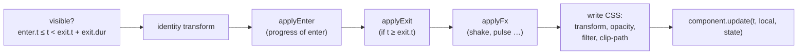

### 10.5 Animations

**Enter animations (18):**

| Animation         | What happens                                                 |
| ----------------- | ------------------------------------------------------------ |
| `pop` (default)   | scale from 0.8 with overshoot (1.9) + a small rise           |
| `rise`            | rises 40 px while fading in                                  |
| `slide-l/slide-r` | slides 140 px in from the side                               |
| `fade`            | fade only                                                    |
| `draw`            | revealed from the line start (arrows: the line is drawn)     |
| `type`            | typed letter by letter (title/code), word by word for Arabic |
| `count`           | fade (the value itself comes from keyframes)                 |
| `flip`            | flips 90° on the X axis                                      |
| `zoom`            | from 1.35 to normal size with blur                           |
| `stamp`           | drops from 2.2× and settles with a jolt                      |
| `blur`            | sharpens from blur 16                                        |
| `wipe`            | revealed from the start side (respects RTL)                  |
| `spring`          | damped spring from 0.55                                      |
| `drop`            | falls from 220 px with a bounce                              |
| `reveal`          | rises from behind a mask at its lower edge (for big titles)  |
| `glitch`          | jitter with red/blue channel split                           |
| `none`            | no motion                                                    |

**Easing (ease):** `smooth` (cubic, default), `snappy` (quint), `gentle` (sine), `linear`.

**Exit animations (10):** `fade`, `pop` (shrinks), `rise` (moves up), `sink` (moves down), `slide-l/r`,
`zoom` (grows), `blur`, `wipe`, `none`. All accelerate towards the exit (`easeInCubic`).

**`fx` effects:** `shake` (deterministic random jitter at 40 Hz), `glitch`, `pulse` (repeating), `bump`
(one pulse), `flash` (full-screen flash).

**`states`:** at each time, all earlier `set` values are merged over the props, and the time of the last
change of each key is kept (`$since`) so a component can animate the change (e.g. a node flashes when it
turns `err`). **Nothing accumulates**: the state is computed from scratch every frame.

### 10.6 How a component is written

```ts
interface RuntimeComponent {
  name: string;
  handles?: EnterAnim[]; // animations the component draws itself (title/code: type, arrow: draw, trap: glitch)
  mount(root, props, theme, ctx): Instance; // once: build the DOM
}
interface Instance {
  update(t, local, state): void; // every frame: a pure function of t
}
```

- `mount` builds the DOM once and may measure text (`fitText` shrinks the font by binary search until it
  fits).
- `update` runs every frame and must be **a function of t only**.
- Most components are HTML/CSS. **SVG** is used for arrows, the bucket, checklist marks, icons, charts,
  maps and the QR code. **Canvas** is used for particles, the glow, the grid and grain.
- DOM writes go through a cache (`css()`, `attr()`, `text()`) that only writes when a value changed,
  which makes drawing much faster.
- `measure()` skips components without measurable text (`arrow`, `particles`, `trap`, `icon`) and
  measures the rest in their settled state near the element's end.

### 10.7 Determinism in the browser

- No `Date.now`, `Math.random`, `setTimeout` or `requestAnimationFrame` in runtime code.
- The base CSS forces `animation: none !important; transition: none !important` on everything.
- Randomness comes from `rnd(seed)` and `mulberry32(seed)` in the audio package; the seed is hash(element
  id) XOR `timeline.seed`.
- Particles are computed in **closed form** from `t − start`, not simulated step by step, so frame 500
  can be drawn before frame 10.
- All images are decoded (`img.decode()`) before the first frame, so no frame depends on load timing.
- One test renders the whole gallery forwards and backwards and compares the DOM; another compares SHA-1
  hashes of the JPEG frames.

---

## 11. Package renderer: from frames to MP4 <a id="s11"></a>

### 11.1 File map

| File                                              | Role                                                                                               |
| ------------------------------------------------- | -------------------------------------------------------------------------------------------------- |
| [render.ts](../packages/renderer/src/render.ts)   | `renderEpisode()`: the whole pipeline with its phases                                              |
| [workers.ts](../packages/renderer/src/workers.ts) | Splits frames, runs parallel workers, retries                                                      |
| [host.ts](../packages/renderer/src/host.ts)       | Launches Chromium and serves the page **without an HTTP server**, blocking the network; `safeJoin` |
| [capture.ts](../packages/renderer/src/capture.ts) | Captures a frame through CDP `Page.captureScreenshot` (JPEG, or PNG with `--lossless`)             |
| [encode.ts](../packages/renderer/src/encode.ts)   | H.264 settings, master and share, compliance check, contact sheet                                  |
| [audio.ts](../packages/renderer/src/audio.ts)     | Writes the SFX track, cleans the voice (RNNoise) and mixes (loudnorm + ducking)                    |
| [ffmpeg.ts](../packages/renderer/src/ffmpeg.ts)   | Finds and runs ffmpeg/ffprobe, reads progress, encoders and filters                                |
| [measure.ts](../packages/renderer/src/measure.ts) | The V-9 and V-10 checks in a browser, cached                                                       |
| [snap.ts](../packages/renderer/src/snap.ts)       | PNG stills at given times (`reelforge snap`, `preview_frames`)                                     |
| [doctor.ts](../packages/renderer/src/doctor.ts)   | Environment checks                                                                                 |

### 11.2 Phases

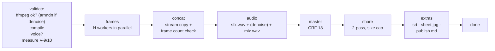

- All temporary files go to `out/.tmp/<timestamp>-<hex>/` and are deleted on success.
- **A partial render** (`--from 10 --to 15`) writes only `<id>.part.mp4`, with no share file and no
  extras.
- **Cancelling** (Ctrl+C once, or the Cancel button) kills every ffmpeg process and deletes partial
  files. A second Ctrl+C exits immediately (exit code 130).
- A failed compliance check **does not throw**: it returns `ok: false` with the list of problems (that is
  what the message `Output check failed: pixel format yuvj420p` used to show).
- **Noise cleanup** is enabled by `audio.denoise` or `--denoise` (`--no-denoise` overrides the file). It
  needs ffmpeg's `arnndn` filter; without it the render stops with a clear message.

### 11.3 Parallel workers

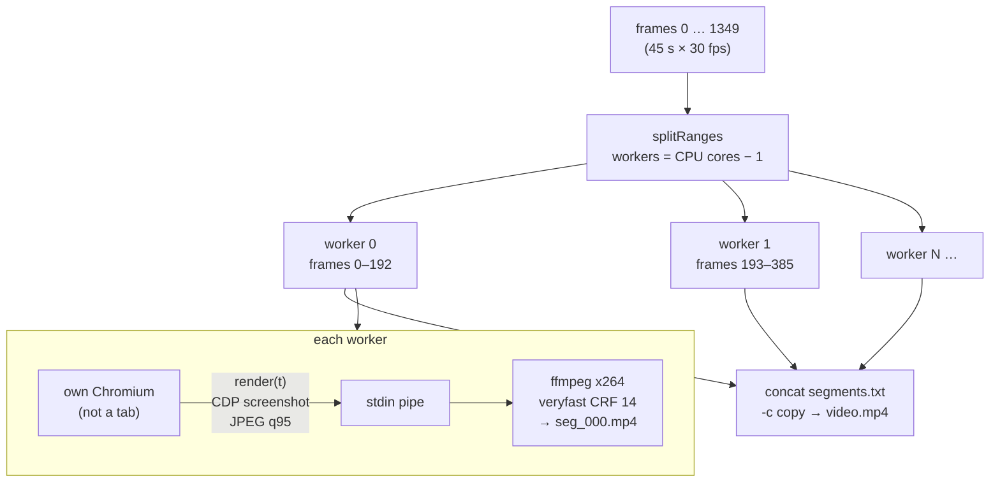

- Each worker has **its own browser** (not a tab), because tabs share a renderer process and their work
  would run one after another.
- The page is served through Playwright **request interception** on a fake origin,
  `http://reelforge.local`: `/timeline.json` from memory, `/runtime/*` from the runtime files,
  `/episode/assets/*` from the episode folder. **Any other URL** is blocked and recorded, and a worker
  that saw one fails (NFR-8: never any network).
- Chromium settings for determinism: no GPU, no LCD text or hinting, sRGB, scale 1, UTC, locale en-US.
- A worker crashed? Its range is retried **once**, and the progress counter is corrected so frames are
  not counted twice.
- After concatenation the frames are counted with ffprobe; any difference is an error.

### 11.4 Encoding

Shared H.264 settings: `libx264`, profile **High**, GOP 60 (two seconds), 2 B-frames, constant frame
rate, and the **`YUV420_TV` color conversion**:

```text
-vf scale=out_range=tv:out_color_matrix=bt709:flags=accurate_rnd+full_chroma_int,format=yuv420p
-pix_fmt yuv420p -color_range tv -colorspace bt709 -color_primaries bt709 -color_trc bt709
```

> **The story behind this line:** JPEG frames are captured in full range. Since FFmpeg 7,
> `-pix_fmt yuv420p` alone no longer converts the range, so the video came out full range, ffprobe saw
> `yuvj420p`, and the compliance check failed (some platforms reject it too). The fix: a `scale` filter
> that really converts to limited-range BT.709 (the HD and phone video standard), with tags that say so.
> It is applied to the intermediate segments and to the final encodes.

| Output     | Video                                                          | Audio            | Notes                                                     |
| ---------- | -------------------------------------------------------------- | ---------------- | --------------------------------------------------------- |
| **Master** | CRF 18, preset `slow` (`medium` with `--fast`)                 | AAC 192k, 48 kHz | archive quality                                           |
| **Share**  | **two passes** at a computed bitrate, maxrate 1.5×, bufsize 3× | AAC 128k         | never over the size cap, never above the master's bitrate |
| **Part**   | like master, but always `medium`                               | AAC 192k         | partial renders                                           |

**The share formula** (ADR-006):

```text
video_kbps = floor(MB × 8192 × 0.97 / duration) − 128      (0.97 = 3% margin for the MP4 container)
           then clamped to 250…8000 kb/s, and never above the master's bitrate
```

A real example: a 45 s episode with a 28 MB cap → `floor(28×8192×0.97/45) − 128 = 4944 − 128 = 4816 kb/s`.
That is exactly what the render printed: `share video 4816 kb/s`. If the file still comes out over the
cap, it is re-encoded once at 90% of the rate.

**The compliance check `checkCompliance`** (ffprobe): h264, High, `yuv420p`, `30/1`, AAC, 48 kHz, the
`moov` atom before `mdat` (faststart: playback starts before the download finishes), and the size within
the cap.

**The contact sheet `sheet.jpg`:** 12 evenly spaced frames in a 4×3 grid, 360×640 each.

### 11.5 Audio mix

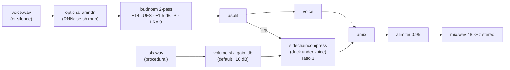

- **−14 LUFS** is the loudness platforms target. It is measured in a first pass (on the voice **after**
  cleanup when enabled) and applied linearly in the second.
- **Ducking:** the effects dip automatically while you speak (the voice is the compressor's key).
- Without a recording (`--silent`) the voice track is silence and only the effects remain.

### 11.6 Measuring and doctor

- `measureTimeline` uses one browser that calls `window.reelforge.measure()`. For each element it draws
  two moments near its end (the settled state, not an animation overshoot) and reports overflow only when
  the text overflows in both. A failed measuring pass does not stop the render.
- `doctor` checks Node ≥ 22, ffmpeg ≥ 6 with the encoders (libx264, aac, mjpeg) and filters (loudnorm,
  sidechaincompress, alimiter, arnndn), the RNNoise model, that the pinned Chromium really launches, and
  the font files. `--fix` installs Chromium. The dashboard adds the assist status (`assistStatus`) and
  the LLM provider (`providerStatus`) to its result.

---

## 12. Package audio: sound without sound files <a id="s12"></a>

A pure package with no dependencies that runs in Node and in the browser.

| File                                             | Role                                                                                                               |
| ------------------------------------------------ | ------------------------------------------------------------------------------------------------------------------ |
| [prng.ts](../packages/audio/src/prng.ts)         | `hashString` (FNV-1a), `rnd(seed)` (a stateless hash), `mulberry32` (a sequence generator)                         |
| [wav.ts](../packages/audio/src/wav.ts)           | Reads 8/16/24/32-bit, float and extensible WAV, and writes WAV                                                     |
| [envelope.ts](../packages/audio/src/envelope.ts) | `frameEnvelope` (loudness per frame), `peaks` (waveform drawing), `snapToOnset`                                    |
| [align.ts](../packages/audio/src/align.ts)       | `analyzeSpeech` (a 10 ms speech map), `pausesIn`, `alignLines` (DP), `alignWords`, `refineOnset` (see [§24](#s24)) |
| [synth.ts](../packages/audio/src/synth.ts)       | Generates 8 sounds from waveforms and noise                                                                        |
| [sfx.ts](../packages/audio/src/sfx.ts)           | Mixes the events into one track normalized to −0.9 dBFS                                                            |

**The eight sounds** (ADR-008: no sample libraries, no licenses, fully deterministic):

| Sound    | Length | How it is made                                      |
| -------- | ------ | --------------------------------------------------- |
| `whoosh` | 0.42 s | white noise through sweeping filters                |
| `hit`    | 0.7 s  | a sine falling from 55 to 38 Hz + a click           |
| `ding`   | 0.9 s  | two tones, 1320 and 1980 Hz                         |
| `err`    | 0.42 s | a 190 Hz square wave in two pulses                  |
| `glitch` | 0.38 s | chopped sample-and-hold noise                       |
| `tick`   | 15 ms  | a sharp noise click                                 |
| `tap`    | 90 ms  | a short 220 Hz tone + a click                       |
| `typing` | 0.36 s | 5 `tick`s with deterministic random gaps and levels |

**Where effect events come from** (with `audio.sfx: auto`):

1. A `whoosh` at every scene transition (except the first scene and `cut` transitions).
2. Component sounds (table in §9.8).
3. `fx` sounds (flash → hit, glitch → glitch).
4. Explicit `sfx` lists on elements, and `audio.extra`.

Then duplicates are removed: when the same sound repeats within 80 ms, only the loudest is kept.

**`snapToOnset`:** around the marked time (±120 ms) it computes RMS every 2.5 ms and looks for the
largest sudden rise (> 6 dB and above the noise floor). The browser uses it while marking cues to make up
for your reaction time.

**`analyzeSpeech`** also powers the V-14 long-silence check (`longSilences` in the compiler, cached per
recording by its sha1).

---

## 13. Package studio: dashboard and editor <a id="s13"></a>

### 13.1 Two servers, four pages

```mermaid
flowchart LR
    subgraph HUB["Hub — reelforge studio — :4310"]
        H1["list episodes, examples, packs"]
        H2["create (blank / template) ·<br/>upload voice · draft & auto cues"]
        H3["validate · render · thumbnails"]
        H4["gallery · Connect AI · doctor · docs"]
        H5["agent endpoints:<br/>/mcp · /api/v1 · /llms*.txt ·<br/>/.well-known/mcp.json"]
    end
    subgraph STU["Studio — reelforge edit ep10 — :4317"]
        S1["compile + file watcher"]
        S2["structured YAML edits + undo"]
        S3["PUT /cues · auto cues"]
        S4["suggestions (dictionary / LLM)"]
        S5["render job"]
    end
    HUB -->|"POST /api/studio<br/>starts one per episode<br/>(random port)"| STU
    RR[("RenderRunner<br/>one render at a time")]
    HUB --- RR
    STU --- RR
```

| Aspect        | Hub (dashboard)                                       | Studio (editor)                                                       |
| ------------- | ----------------------------------------------------- | --------------------------------------------------------------------- |
| File          | [hub.ts](../packages/studio/src/server/hub.ts)        | [index.ts](../packages/studio/src/server/index.ts)                    |
| Port          | 4310 (`--host` for another address)                   | 4317 (random when opened from the Hub or the tools), always 127.0.0.1 |
| Pages         | `hub.html` + `hub.ts`, `gallery.html`, `connect.html` | `index.html` + `main.ts` and about 15 modules                         |
| File watching | no (refreshes when the window regains focus)          | yes: `fs.watch` + recompile within 40 ms                              |
| Live updates  | WebSocket `/ws`: `job` and `project` messages         | WebSocket `/ws`: full `state` and `job` messages                      |

Vite builds four pages from `client/` (see [vite.config.ts](../packages/studio/vite.config.ts)): the
editor (`index.html`), the dashboard (`hub.html`), the **Connect AI** page (`connect.html`, setup recipes
per client from `connect-clients.ts`) and the **gallery** (`gallery.html`: components with golden-frame
previews, themes with color and font previews, and packs, with a "Copy YAML snippet" button). The editor
and the gallery share the component categories in `component-groups.ts`.

### 13.2 API routes

**Studio:**

| Method | Path                                                                   | Purpose                                                                        |
| ------ | ---------------------------------------------------------------------- | ------------------------------------------------------------------------------ |
| GET    | `/api/meta`                                                            | Component catalog with props schemas, animations, icons, themes                |
| GET    | `/api/state`                                                           | Current state (Timeline, issues, voice, outputs, history)                      |
| GET    | `/api/suggest?line=l3`                                                 | Dictionary suggestions for a line, and the LLM status                          |
| GET    | `/api/assist`                                                          | Whether Whisper and VAD are installed, manual cues exist, alignment is running |
| POST   | `/api/edit`                                                            | `{ops, label}` structured edits to `episode.yaml`                              |
| POST   | `/api/undo`, `/api/redo`                                               | Undo / redo                                                                    |
| POST   | `/api/assets`                                                          | List the SVG files in `assets/`                                                |
| PUT    | `/api/asset`                                                           | Store an SVG in `assets/` (anything with script is refused)                    |
| PUT    | `/cues`                                                                | Save `cues.json` (validated; the real voice sha1 is added)                     |
| POST   | `/api/cues/auto`                                                       | Automatic alignment (`engine`, `force`, `words`) through the undo history      |
| POST   | `/api/suggest/llm`                                                     | A scene suggestion from a language model (409 without one)                     |
| POST   | `/api/render`, `.../cancel`                                            | Start / cancel a render                                                        |
| GET    | `/episode/voice*`, `/episode/out/*`, `/episode/assets/*`, `/runtime/*` | Static files                                                                   |

**Hub (internal UI API; not covered by the ADR-014 stability promise):**

| Method | Path                                             | Purpose                                                         |
| ------ | ------------------------------------------------ | --------------------------------------------------------------- |
| GET    | `/api/project`                                   | Every episode with a summary (voice, cues, errors, outputs)     |
| GET    | `/api/packs`                                     | Packs with their templates and slots (both languages)           |
| GET    | `/api/connect`                                   | Data for the Connect AI page (the token only for this computer) |
| GET    | `/api/gallery/components`, `/api/gallery/themes` | Gallery data, plus `/gallery/frames/*` and `/gallery/fonts/*`   |
| GET    | `/api/doctor`                                    | Environment checks + assist status + LLM provider               |
| GET    | `/api/thumb`                                     | A thumbnail (generated and cached in `out/.cache/thumb.jpg`)    |
| GET    | `/files`                                         | Files from `out/` only (with a `sandbox` CSP)                   |
| GET    | `/docs/*`                                        | The offline documentation from `documentation/`                 |
| PUT    | `/api/voice`                                     | Upload a recording (up to 1 GB) → ffmpeg to mono 48 kHz WAV     |
| POST   | `/api/episodes`                                  | A new episode (blank, or `pack` + `template` + `slots`)         |
| POST   | `/api/studio`                                    | Open the editor for an episode (`edit` / `cue` / `dev`)         |
| POST   | `/api/validate`                                  | Full validation + V-9/V-10                                      |
| POST   | `/api/render`, `.../cancel`                      | Start / cancel a render                                         |
| POST   | `/api/cues/draft`, `/api/cues/auto`              | Draft cues / automatic alignment (409 while another one runs)   |
| POST   | `/api/reveal`                                    | Open the folder in the file manager                             |

The agent routes (`/mcp`, `/api/v1/*`, `/llms.txt`, `/llms-full.txt`, `/.well-known/mcp.json`) are
described in [§15](#s15); [agents.ts](../packages/studio/src/server/agents.ts) handles them before any
other route.

### 13.3 Structured edits that keep comments

**The editor never rewrites the file from scratch.** It sends small operations addressed by YAML path:

```json
{
  "label": "Move hook_title",
  "ops": [
    {
      "op": "set",
      "path": ["scenes", 0, "elements", 1, "place"],
      "value": { "x": 60, "y": 180, "w": 960, "h": 240 }
    }
  ]
}
```

Operations: `set`, `delete`, `insert`, `move`. [edit.ts](../packages/studio/src/server/edit.ts) applies
them to the **YAML document tree** (the `yaml` library), not to a JSON object, and the `edit_episode`
tool uses the same code:

- Changing a scalar edits the node in place, so quoting style and a `# keep me` comment survive.
- Small objects are written in flow style (`{ x: 1 }`), following the file's existing indentation.
- Deleting cleans up empty containers (an `enter: {}` disappears).
- Writes are **atomic** (temporary file, then rename).

**History:** up to 200 steps in server memory, covering `episode.yaml`, `cues.json` and the assets. When
the file is changed outside the editor, the history is cleared (so undo never overwrites your edits).

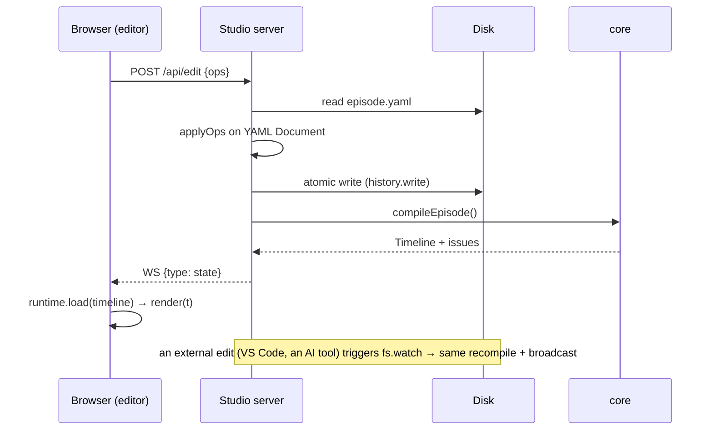

### 13.4 The editor in the browser

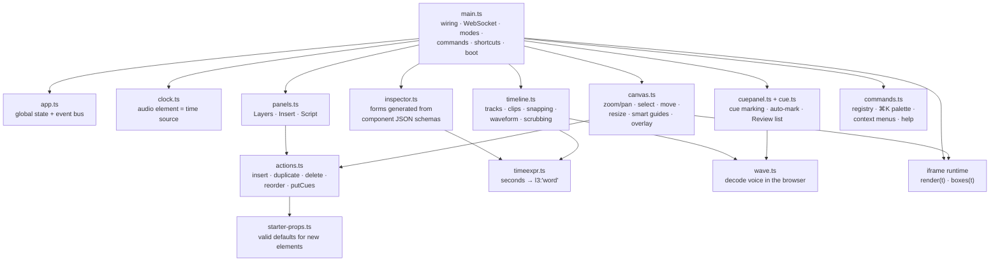

Key ideas:

- **The clock:** with a recording, the `<audio>` element is the time source (sound and picture stay in
  sync); without one, a wall clock is used. The runtime itself stays pure; the clock exists only in the
  editor.
- **Clicking the canvas:** `runtime.boxes(t)` returns the boxes of visible elements; Alt+click selects
  the element underneath.
- **Dragging:** while dragging, the DOM node inside the iframe is moved directly (fast); on release a
  `set place` operation is sent. Smart guides snap to the frame edges and to other elements' edges and
  centers.
- **The timeline:** dragging an element's clip snaps to **words**, and its time is stored as a word
  expression. That is what `exprFor(t)` in [timeexpr.ts](../packages/studio/client/src/timeexpr.ts) does:
  1.203 becomes `l1:'voice'`, not `1.203`.
- **The inspector** is generated **automatically** from each component's props JSON Schema: enum →
  select, boolean → toggle, number → drag-to-edit field, color → theme swatches, time → a field with a
  "now" button and a readable description of the expression.
- **Smart insert:** the Insert panel shows dictionary suggestions for the line at the playhead
  (`/api/suggest`), or a language model suggestion when one is configured (`/api/suggest/llm`); new
  elements start with valid props from `starter-props.ts`.
- **Commands:** one registry serves keyboard shortcuts, the ⌘K palette, context menus and the `?` help
  page. It works with an Arabic keyboard layout too (mapped through `e.code`).
- **Modes:** Edit (design), Cues (marking cues) and Review (the issue list; clicking an issue jumps to the
  element). The dashboard opens any of them directly.
- **Small screens:** below 900 px the side panels become sliding drawers; below 640 px the top bar wraps
  into two rows.

### 13.5 Marking cues

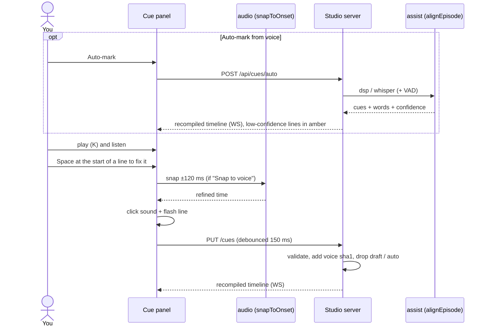

Keys: Space marks, Backspace undoes, ←/→ nudge ±50 ms (Shift: ±10 ms), W toggles word mode, S snaps to
the voice, A toggles auto-snap, G jumps to the cue, 1/2/3 set the speed.

### 13.6 Rendering from the UI

`RenderRunner` in [jobs.ts](../packages/studio/src/server/jobs.ts) allows **one render at a time** (a
second request gets 409). The Hub shares one runner with every editor it opens and with the agent tools.
Progress goes out over WebSocket every 200 ms, and when done the editor opens an outputs dialog with a
video player.

---

## 14. Package cli: the commands <a id="s14"></a>

[cli/src/index.ts](../packages/cli/src/index.ts) (commander). The `reelforge` and `reelforge.cmd`
launchers run `packages/cli/bin/reelforge.js`. Global options: `--root`, `--json`, `--verbose`.

| Command                                                | Calls                           | What it does                                                                                                             |
| ------------------------------------------------------ | ------------------------------- | ------------------------------------------------------------------------------------------------------------------------ |
| `studio [--port] [--host]`                             | `startHub`                      | The dashboard on 4310; a non-local `--host` requires the token                                                           |
| `new <id> [--lang en\|ar]`                             | `episodeTemplate`               | `episodes/<id>/episode.yaml` from the generic template                                                                   |
| `new <id> --pack <id> [--template] [--slot k=v]…`      | `findTemplate` + `fillTemplate` | An episode from an industry pack template; missing slots keep their defaults                                             |
| `packs [--lang]`                                       | `listPacks`                     | Packs with their templates and slots                                                                                     |
| `cue <id> [--draft]`                                   | `draftCues` / `startStudio`     | Draft cues, or the editor in Cues mode                                                                                   |
| `align [id] [--engine] [--model] [--setup] [--status]` | `alignEpisode` / `setupAssist`  | Cues from the recording (`--no-vad`, `--no-words`, `--force`, `--dry-run`), the one-time model install, or its status    |
| `edit <id>` / `dev <id>`                               | `startStudio`                   | The editor in Edit / Review mode                                                                                         |
| `validate <id> [--strict] [--no-measure]`              | `compileEpisode` + measure      | Every rule with line numbers                                                                                             |
| `render [id] [--all]`                                  | `renderEpisode`                 | Rendering (`--from/--to`, `--workers`, `--share-size`, `--fast`, `--silent`, `--lossless`, `--denoise`, `--keep-tmp`, …) |
| `snap <id> [times…] [--every] [--cover]`               | `snapFrames`                    | PNG frames at times or expressions, a contact sheet, or a cover                                                          |
| `doctor [--fix]`                                       | `runDoctor`                     | Environment checks                                                                                                       |
| `theme new <name> --accent <hex> [--mode] [--font]`    | `generateTheme`                 | A complete WCAG AA theme from one color                                                                                  |
| `schema`                                               | `episodeJsonSchema`             | `schema/episode.schema.json`                                                                                             |
| `mcp [--toolsets basic,design,render]`                 | `startMcp`                      | The MCP stdio transport over the tool registry                                                                           |

**Episode lookup** (`resolveEpisode`), in order: `episodes/<id>` → a path relative to the project → a path
relative to the current folder → `examples/<id>` → `examples/season1/<id>`. So `promo/intro` and
`season1-arabic/ep01` work directly.

**Exit codes:** 0 success, 1 failure, 2 usage error (including an unknown toolset), 130 render
cancelled. **`--json`:** every command prints one JSON object, except `render`, which prints one JSON line
per event (`progress`, `log`, then `result` or `error`).

---

## 15. The tool registry and its three transports (MCP and REST) <a id="s15"></a>

### 15.1 One registry (ADR-014)

Every agent tool is defined **once**, in
[packages/studio/src/tools/](../packages/studio/src/tools/registry.ts): one file per group
(`episodes.ts`, `preview.ts`, `components.ts`, `cues.ts`, `render.ts`, `guide.ts`, `authoring.ts`),
collected by `registry.ts`. Through `defineTool` each tool has a stable name, a `title`, a short
description, a zod input schema (and an output schema where it helps), its toolsets, MCP annotations
(`readOnlyHint`, `destructiveHint`, `idempotentHint`) and a `handler(args, ctx)`. JSON Schemas are
generated from zod (`zod-to-json-schema`), arguments are validated with the same schema, and invalid
arguments come back to the model as a readable tool error.

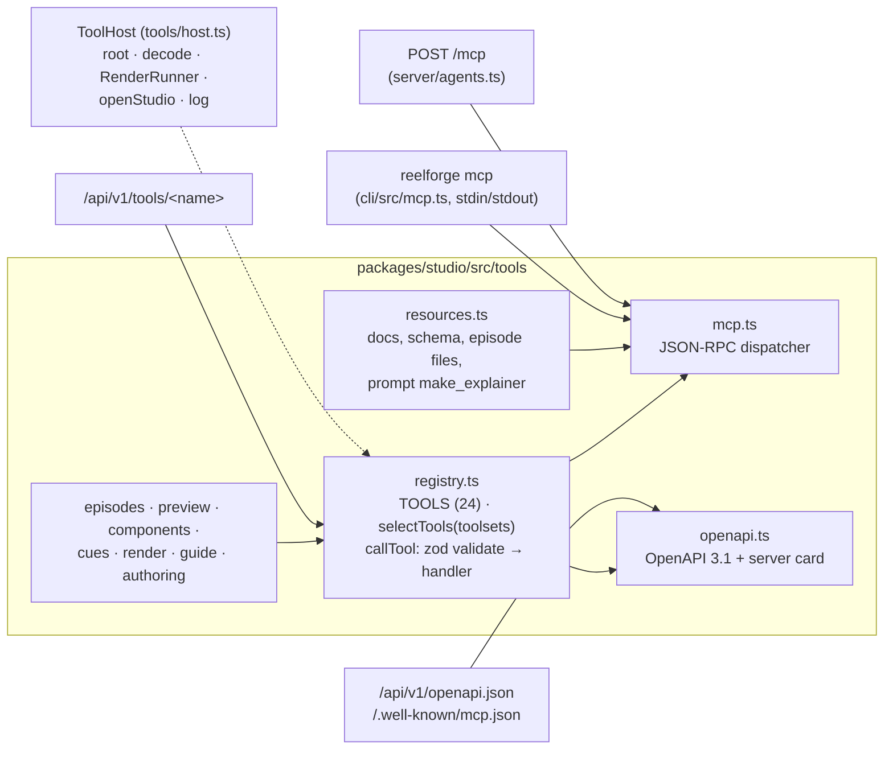

### 15.2 The 24 tools

| Tool                                       | Toolsets              | Purpose                                                                                               |
| ------------------------------------------ | --------------------- | ----------------------------------------------------------------------------------------------------- |
| `list_episodes`                            | basic                 | Every episode with its status                                                                         |
| `get_episode`                              | basic, design         | The YAML + a compiled outline: line and word times, element paths and boxes                           |
| `list_templates` / `create_from_template`  | basic                 | Industry pack templates; an episode from flat slots (Tier 1)                                          |
| `create_episode`                           | basic                 | An episode from a script, with draft cues                                                             |
| `suggest_scenes`                           | basic, design         | A scene plan for every line: a blueprint and the best single element                                  |
| `list_blueprints` / `add_scene`            | basic, design         | A whole scene from a blueprint with parameters (Tier 2)                                               |
| `edit_episode`                             | design                | The editor's own `set/delete/insert/move` operations (comments kept)                                  |
| `write_episode_yaml`                       | design                | Replace the whole file (`destructiveHint`; refused with V-1/V-13 errors unless `force`)               |
| `validate_episode`                         | basic                 | All rules V-1…V-14                                                                                    |
| `preview_frames`                           | basic                 | Up to 8 frames **returned as images** with a text layout description (boxes, V-8 overlaps, V-7 zones) |
| `list_components` / `get_component_schema` | design                | The 62 components and their exact props                                                               |
| `suggest_scene`                            | basic, design         | Element ideas for one line (the dictionary, or `llm: true` for the configured model)                  |
| `draft_cues` / `set_cues`                  | basic                 | Estimated or known timings                                                                            |
| `align_cues`                               | basic                 | Cues for every line and word from `voice.wav` (never replaces hand-marked cues without `force`)       |
| `render_episode` / `cancel_render`         | render                | Render in the background, cancel                                                                      |
| `get_render_status`                        | basic, render         | Poll the render                                                                                       |
| `open_editor`                              | render                | A URL to the visual editor for the person                                                             |
| `doctor`                                   | render                | Environment checks                                                                                    |
| `get_guide`                                | basic, design, render | Task guides from `skills/` (short, `detail: true`, or `"<topic>/<reference>"`)                        |

Every write tool (`create_from_template`, `add_scene`, `create_episode`, `edit_episode`,
`write_episode_yaml`, `set_cues`, `draft_cues`, `align_cues`) returns in its structured result the
validation summary, `fixes` (one hint per problem) and `next` (the recommended next step).

**Toolsets** are tags on tools: a client asks for one or more and gets their union; `all` is the default.
For example `reelforge mcp --toolsets basic` or `/mcp?toolsets=basic,design`. An unknown name is an
error.

### 15.3 The three transports

| Transport               | Where                                                  | Details                                                                                                                                                                                                                                           |
| ----------------------- | ------------------------------------------------------ | ------------------------------------------------------------------------------------------------------------------------------------------------------------------------------------------------------------------------------------------------- |
| **MCP stdio**           | `reelforge mcp` ([mcp.ts](../packages/cli/src/mcp.ts)) | JSON-RPC 2.0, one message per line; stdout carries protocol messages only and every `console.log` goes to stderr; progress notifications supported                                                                                                |
| **MCP Streamable HTTP** | `POST /mcp` on the dashboard                           | JSON responses (single or batch), `Mcp-Session-Id` issued on `initialize` and checked afterwards (up to 200 sessions), `DELETE` ends a session, `GET` = 405; bodies up to 8 MB                                                                    |
| **REST**                | `/api/v1` on the dashboard                             | `GET /api/v1/tools` (`?format=openai` for function definitions), `POST /api/v1/tools/<name>` with the arguments as JSON → `{ ok, result, text, images? }`, `GET /api/v1/health`, `GET /api/v1/openapi.json` (OpenAPI 3.1, one operation per tool) |

Supported protocol versions: `2025-06-18`, `2025-03-26` and `2024-11-05`. The dashboard also serves
`/llms.txt`, `/llms-full.txt` (built by `pnpm docs:llms`) and `/.well-known/mcp.json` (a server card
generated from the registry, including the stdio command for the project). The **Connect AI** page
(`/connect`) has copy-paste setup for each client.

```mermaid
sequenceDiagram
    participant A as AI agent
    participant M as reelforge (stdio or /mcp)
    A->>M: initialize
    M-->>A: capabilities + instructions (+ Mcp-Session-Id over HTTP)
    A->>M: tools/call list_templates
    A->>M: tools/call create_from_template {pack, template, slots}
    M-->>A: summary + fixes + next
    A->>M: tools/call add_scene / edit_episode {ops}
    M-->>A: issues + fixes
    A->>M: tools/call preview_frames {times}
    M-->>A: JPEG images (base64) + layout text
    Note over A: looks at the frames, fixes overlap…
    A->>M: tools/call render_episode
    A->>M: tools/call get_render_status (poll)
```

**Stability promise:** tool names, their arguments and the `/api/v1` paths follow semver from 1.0: within
a major version, tools and optional arguments are only added, never renamed or removed. The internal UI
routes (`/api/project`, …) are not part of the promise.

### 15.4 Resources, guides and client configuration

- **MCP resources:** `reelforge://docs/authoring`, `reelforge://docs/components`,
  `reelforge://docs/ai-agents` (AGENTS.md), `reelforge://schema/episode`, and the files of each episode.
  Plus a ready-made prompt, `make_explainer` (`topic`, `lang`, `seconds`).
- **Skills:** eight guides in the Agent Skills format: `reelforge-make-video`, `reelforge-script-writing`,
  `reelforge-scene-design`, `reelforge-timing`, `reelforge-brand-and-themes`,
  `reelforge-industry-playbooks` (one reference per pack), `reelforge-review-and-render`,
  `reelforge-contribute-component`. `get_guide` reads them, `scripts/check-skills.mjs` checks them
  (frontmatter, links, YAML examples), and `.claude-plugin/` packages them with the MCP server as a Claude
  Code plugin.
- **Client configuration** ships for each client: `.mcp.json` (Claude Code), `.cursor/mcp.json`,
  `.vscode/mcp.json`, `.gemini/settings.json`, and `.windsurf/rules/`.

---

## 16. The episode folder on disk <a id="s16"></a>

```text
episodes/ep10/
├── episode.yaml          ← the single source of truth (Git-friendly)
├── cues.json             ← line start times (+ words): draft / auto / hand-marked
├── voice.wav             ← the recording (uploads convert mp3/m4a/… to mono 48 kHz WAV)
├── assets/               ← images and SVGs used by elements (assets/logo.svg)
└── out/
    ├── ep10.master.mp4   ← archive quality
    ├── ep10.share.mp4    ← what you upload (≤ 28 MB)
    ├── ep10.srt          ← captions
    ├── ep10.sheet.jpg    ← 12 stills for a quick review
    ├── publish.md        ← title, description, hashtags, pinned comment, chapters
    ├── ep10.part.mp4     ← (partial render)
    ├── ep10.cover.png    ← (snap --cover, also used as the thumbnail)
    ├── snaps/            ← (snap stills)
    ├── .cache/           ← measure.json (V-9/V-10) and thumb.jpg
    └── .tmp/<run-id>/    ← temporary while rendering: seg_*.mp4, video.mp4, sfx.wav, mix.wav
```

Outside the project, in user folders: the token and `llm.json` in the config folder
(`%APPDATA%\reelforge`, `~/Library/Application Support/reelforge`, `~/.config/reelforge`), and the
optional model runtime in the cache folder (`%LOCALAPPDATA%\reelforge\assist`,
`~/Library/Caches/reelforge/assist`, `~/.cache/reelforge/assist`).

---

## 17. Build, tests, CI, documentation and releases <a id="s17"></a>

### 17.1 Build

```mermaid
flowchart LR
    B["pnpm build<br/>(pnpm -r, one package at a time,<br/>topological order)"] --> A1["audio: tsc -b"]
    A1 --> C1["core: tsc -b"]
    C1 --> AS["assist: tsc -b"]
    C1 --> R1["runtime: build.mjs (esbuild)<br/>→ dist/page/runtime.js<br/>+ runtime.html + fonts/"]
    R1 --> RE["renderer: tsc -b"]
    AS --> ST
    RE --> ST["studio: tsc -b (server + tools)<br/>+ vite build (4 pages)<br/>→ dist/client/"]
    ST --> CL["cli: tsc -b"]
```

- TypeScript 5.9 strict, Node 22, a pnpm 10 workspace.
- The runtime is bundled with **esbuild** (one IIFE for Chrome 120) and **the nine fonts are copied
  locally** (all OFL, from `@fontsource-variable`, with their license files) into a generated `fonts.css`.
  Rendering never touches the network.
- The four studio pages are built with **Vite** (plain TypeScript, no framework).
- `dist/` folders are ignored by git, but the release archive ships them prebuilt, so users never need to
  build.

### 17.2 Tests

| Suite     | Command             | What it covers                                                                                                                                                                                                                                     |
| --------- | ------------------- | -------------------------------------------------------------------------------------------------------------------------------------------------------------------------------------------------------------------------------------------------- |
| `unit`    | `pnpm test:unit`    | `packages/*/test`: WAV, alignment, the PRNG, sounds, time, captions and bidi, the compiler and every V rule, themes and contrast, packs, blueprints and suggestions, motion, YAML edits, the tools, providers, verified installs, renderer helpers |
| `browser` | `pnpm test:browser` | `tests/`: **golden frames** (fails above 0.2% difference), determinism, the full render pipeline, CLI, MCP, agents, editor, dashboard, gallery, motion                                                                                             |

- `fixtures/lint/v01…v14`: an episode with a deliberate mistake for each rule.
- `fixtures/golden/`: reference images for Arabic captions and every component (also used by the
  gallery). After an intended visual change: `UPDATE_GOLDEN=1 pnpm test:browser`.
- `fixtures/mini`: a 6 s episode with a real recording, fully rendered in the tests.
- `fixtures/align`: recordings with known word timings for alignment accuracy.
- `REELFORGE_TEST_MODELS=1 pnpm test:unit` adds the real Whisper and language model tests (after
  `reelforge align --setup`).

### 17.3 CI

[ci.yml](../.github/workflows/ci.yml) runs on **Linux, Windows and macOS** (Node 22, FFmpeg from the
system package manager, the pinned Playwright Chromium with a cache). Steps on all three:

1. `pnpm build`, then `check-docs-fresh.mjs` (generated references are up to date).
2. `pnpm typecheck` and `pnpm lint` (ESLint, Prettier, the mojibake check, the skills check).
3. Unit tests (with **≥ 85% line coverage** of core, runtime and audio on Linux).
4. Browser and integration tests, the license check and `doctor`.
5. Validating the season1 examples, `eval-agents.mjs --mock` (a scripted model, offline) and
   `eval-align.mjs`.
6. `pnpm docs` (offline docs) and `pnpm docs:site` (fails on dead links).
7. Linux only: **a render with networking really disabled** (`unshare --net`) to prove it works offline,
   and uploading the outputs and golden diffs.

A second job, `links`, checks every relative link in Markdown files offline with lychee.

### 17.4 The documentation site and generated references

- **The site:** VitePress in `docs/` (configured in `docs/.vitepress/config.mts`), in two languages
  (English at the root and Arabic, RTL, under `/ar/`), with local search. `pnpm docs:site` builds it into
  `docs/.site`, and [docs.yml](../.github/workflows/docs.yml) deploys it to GitHub Pages. The site serves
  this guide through `rewrites`: this English version at `/guide/architecture` and the Arabic one at
  `/ar/guide/architecture`. The `repoLinks` plugin turns relative links that leave `docs/` into GitHub
  links, so the same Markdown works on GitHub and on the site.
- **References generated from code** (`pnpm docs:gen` = [gen-docs.mjs](../scripts/gen-docs.mjs)): the
  episode format, the components with a rendered frame each, the CLI, the MCP and REST tools, client
  setup and the pack catalog, in English and in `docs/ar/reference/` with Arabic headings; plus
  `docs/components.md` and `llms-full.txt`. The output is deterministic, and `check-docs-fresh.mjs`
  compares it with the committed files.
- **Offline documentation:** `scripts/build-docs.mjs` collects the English pages into
  `documentation/index.html`, which the dashboard serves at `/docs`.

### 17.5 Releases

- [release.yml](../.github/workflows/release.yml), on a `v*` tag: checks the tag matches `package.json`,
  builds and runs every check, `pnpm -r pack`, extracts the release notes from `CHANGELOG.md` and drafts a
  GitHub Release. Publishing to npm is disabled until the `@reelforge` scope is ready.
- `scripts/release.mjs` builds a portable archive (`ReelForge-<v>.zip`, prebuilt, with the offline
  documentation), then unpacks it and verifies install → doctor → validate → render.
- Supporting scripts: `check-licenses.mjs` (MIT/Apache/BSD/ISC/OFL only), `gen-notices.mjs`
  (`THIRD-PARTY-NOTICES.md`), `pin-assist-models.mjs` (model pins), `vendor-icons.mjs` (Lucide icons),
  `gen-world-map.mjs` (map data), `gen-pack-examples.mjs`, `screenshots.mjs` and `marketing.mjs`
  (documentation images and the cover), and `eval-assist.mjs` (comparing alignment engines).

---

## 18. Security model <a id="s18"></a>

Local servers are a real risk when unprotected (any website you visit can send requests to `localhost`),
and the agent endpoints can write episodes and start renders. The rules live in
[security.ts](../packages/studio/src/server/security.ts) and ADR-015:

| Threat                            | Protection                                                                                                                                                                                                              |
| --------------------------------- | ----------------------------------------------------------------------------------------------------------------------------------------------------------------------------------------------------------------------- |
| Network access                    | Bind to **127.0.0.1** by default. Only the dashboard accepts `--host` (or `REELFORGE_HOST`); editor servers always stay on 127.0.0.1                                                                                    |
| DNS rebinding                     | A `Host` allow-list on every request and WebSocket: a loopback name (`127.0.0.0/8`, `localhost`, `[::1]`) on the server's port, the bind address itself, or a name in `REELFORGE_ALLOWED_HOSTS`; anything else gets 403 |
| CSRF from another site            | `Origin` checked against the same list, **writes accept JSON only** (HTML forms cannot send JSON), and **no CORS** ever, so other origins cannot read responses                                                         |
| A client on another computer      | A **bearer token** on `/mcp` and `/api/v1` when bound to a non-loopback address (or with `REELFORGE_REQUIRE_TOKEN=1`): 32 random bytes, base64url, in the config folder (0600 in 0700), compared in constant time       |
| The dashboard UI over the network | A remote client reaches only `/mcp`, `/api/v1`, `/llms*.txt` and `/.well-known/mcp.json`; the UI, its internal API and its WebSocket answer this computer only (checked on the real TCP peer)                           |
| Token leaks                       | `/api/connect` returns the token only to a request from this computer that the browser marks same-origin (`Sec-Fetch-Site`)                                                                                             |
| Path traversal (`../../etc`)      | `safeJoin` on every path, every episode inside the project, outputs from `out/` only                                                                                                                                    |
| A malicious SVG in assets         | `<script`, `on*=` and `javascript:` are refused, and files are served with a `sandbox` CSP                                                                                                                              |
| Huge or odd uploads               | A 1 GB cap, audio extensions only, conversion through ffmpeg; agent request bodies up to 8 MB                                                                                                                           |
| Data leaks while rendering        | Chromium cannot reach **any address** except the fake `reelforge.local`; any attempt fails the render                                                                                                                   |
| The model supply chain            | The runtime comes from a committed lockfile (`npm ci`), every model file is pinned to a commit and checked by SHA-256 before it is loaded, and remote models are disabled at run time ([§24.2](#s24))                   |

```mermaid
flowchart TD
    Q["request"] --> H{"Host + Origin<br/>allowed?"}
    H -->|no| F1["403"]
    H -->|yes| AG{"agent path?<br/>/mcp · /api/v1 ·<br/>/llms*.txt · /.well-known"}
    AG -->|yes| T{"token required?<br/>(non-loopback bind or<br/>REELFORGE_REQUIRE_TOKEN)"}
    T -->|"yes, wrong/missing"| F2["401"]
    T -->|"no / valid"| OK1["tool registry"]
    AG -->|no| L{"TCP peer is<br/>this computer?"}
    L -->|no| F3["403"]
    L -->|yes| W{"write?"}
    W -->|"not JSON"| F4["415"]
    W -->|"GET / JSON"| OK2["dashboard API"]
```

Plain HTTP carries the token in clear text; on an untrusted network, put the dashboard behind a TLS proxy
and list its host name in `REELFORGE_ALLOWED_HOSTS`.

---

## 19. Determinism <a id="s19"></a>

Why does "same inputs = same frames" matter? Because it lets frames be rendered **in any order** on
**any number of workers**, lets you re-render just a part, keeps scrubbing back and forth in the editor
correct, and makes visual tests trustworthy.

How it is guaranteed (ADR-003):

| Possible source of difference | How it was removed                                                                                        |
| ----------------------------- | --------------------------------------------------------------------------------------------------------- |
| Wall-clock time               | `render(t)` takes `t` as input; there is no clock in the runtime                                          |
| CSS animations                | Disabled with `!important` in the base CSS                                                                |
| Randomness                    | `rnd(seed)` and `mulberry32(seed)`; seeds come from the episode and element ids                           |
| Accumulated state             | `states` are computed from scratch for each `t`; particles are closed-form                                |
| Fonts and images              | Bundled locally and loaded before the first frame, checked by V-13; images decoded before the first frame |
| Browser rasterization         | No GPU, no LCD text/hinting, sRGB, scale 1, UTC, locale en-US                                             |
| Audio                         | Effects are generated from a seed, and the mix uses fixed settings                                        |
| Models                        | Never used while rendering; the renderer reads `cues.json` like any other file                            |

**The one exception:** the final x264 encode may differ byte for byte between FFmpeg versions, but the
captured frames themselves are identical.

---

## 20. Environment variables and defaults <a id="s20"></a>

| Variable                  | Default                  | Effect                                                           |
| ------------------------- | ------------------------ | ---------------------------------------------------------------- |
| `REELFORGE_ROOT`          | the current folder       | Project root (or `--root`)                                       |
| `REELFORGE_PRESET`        | `meta.preset`            | Force a preset                                                   |
| `REELFORGE_WORKERS`       | CPU cores − 1            | Number of workers                                                |
| `REELFORGE_JPEG_QUALITY`  | 95                       | Frame capture quality                                            |
| `REELFORGE_SHARE_SIZE`    | 28 (from the preset)     | Share file size cap in MB                                        |
| `REELFORGE_PORT`          | 4310 (Hub) / 4317        | Server port                                                      |
| `REELFORGE_HOST`          | `127.0.0.1`              | Dashboard bind address (non-local requires the token)            |
| `REELFORGE_ALLOWED_HOSTS` | —                        | Extra allowed Host names (comma separated, optional port)        |
| `REELFORGE_REQUIRE_TOKEN` | —                        | `1` = require the token even on 127.0.0.1                        |
| `REELFORGE_CONFIG_DIR`    | the user config folder   | Where the token and `llm.json` live                              |
| `REELFORGE_CACHE`         | the user cache folder    | Where the model runtime and models live (`assist/`)              |
| `HF_ENDPOINT`             | `https://huggingface.co` | A mirror for model downloads (SHA-256 checks still apply)        |
| `REELFORGE_LLM_PROVIDER`  | inferred from the URL    | `openai` / `anthropic` / `ollama`                                |
| `REELFORGE_LLM_BASE_URL`  | `http://127.0.0.1:11434` | The model server (`REELFORGE_OLLAMA` is a supported legacy name) |
| `REELFORGE_LLM_MODEL`     | `qwen2.5:1.5b` (Ollama)  | Model name                                                       |
| `REELFORGE_LLM_API_KEY`   | —                        | API key for a cloud service                                      |
| `REELFORGE_FFMPEG`        | `ffmpeg` on PATH         | ffmpeg path                                                      |
| `REELFORGE_FFPROBE`       | `ffprobe` on PATH        | ffprobe path                                                     |
| `REELFORGE_CHROMIUM`      | Playwright's Chromium    | An alternative browser                                           |
| `REELFORGE_NO_OPEN`       | —                        | Don't open the browser (also when `CI` is set)                   |
| `REELFORGE_DEBUG`         | —                        | Print stack traces                                               |
| `REELFORGE_TEST_MODELS`   | —                        | `1` = run the real model tests                                   |

Fixed audio values: −14 LUFS, −1.5 dBTP, LRA 9, effects normalized to −0.9 dBFS then `sfx_gain_db` (−16),
limiter 0.95, 48 kHz stereo.

---

## 21. Extending the project <a id="s21"></a>

### 21.1 Adding a component

```mermaid
flowchart LR
    A["1 core/components:<br/>zod schema + size +<br/>default enter + events (sfx)"] --> B["2 runtime/components:<br/>mount() + update(t)"]
    B --> C["3 register in both<br/>registries (same name)"]
    C --> D["4 add to gallery<br/>fixtures/golden/components/episode.yaml"]
    D --> E["5 pnpm docs:gen<br/>(docs/components.md + reference)"]
    E --> F["6 UPDATE_GOLDEN=1 pnpm test:browser"]
```

Mandatory rules: `update` must be a function of `t` only, with no timers and no `Math.random`; use
`ctx.seed` for randomness; put `data-fit` on text containers so V-9 checks them; make sure it reads well
in light themes (add rules to `light.ts` if needed). Props arrive resolved (times in seconds, CSS colors).
Add it to a category in `component-groups.ts` so it shows up in the editor and the gallery. The
`reelforge-contribute-component` guide walks agents through the steps.

### 21.2 A new theme

The fastest way: `reelforge theme new brand --accent "#ff5a1f" [--mode light] [--font Manrope]`. Or copy
a file in `themes/`, use `extends: default` and change only what you need. Fonts are limited to the nine
bundled ones, and the theme must pass the contrast test (§9.6).

### 21.3 A new preset

`presets/<name>.preset.yaml` holds `canvas`, `header_top`, `stage`, `captions_y`, `safe` (areas covered by
the platform UI), `share_mb` and `max_duration`. Remember ADR-016: a format other than 9:16 needs a
relative layout model first.

### 21.4 A new agent tool

Define it with `defineTool` in a group file under `packages/studio/src/tools/` (zod schema, toolsets,
annotations, handler) and list the group in `registry.ts`. It appears automatically in MCP stdio, HTTP,
REST, the OpenAPI document and the server card; then regenerate the reference with `pnpm docs:gen`. Write
tools return `checked(...)` (the summary, `fixes` and `next`).

### 21.5 A pack, template or blueprint

- **Pack:** a `packs/<id>/` folder with `pack.yaml` (validated by `packSchema`) and templates
  `templates/*.en.yaml` and `*.ar.yaml` with single-quoted `{{slot}}` placeholders, then
  `node scripts/gen-pack-examples.mjs <id>` and `pnpm docs:gen`. A project can add its own packs in
  `<root>/packs/`.
- **Blueprint:** `defineBlueprint` in [blueprints.ts](../packages/core/src/blueprints.ts) with flat zod
  parameters, returning a scene inside the safe area.
- **Skill:** a folder in `skills/` with a `SKILL.md` whose frontmatter has `name` (= the folder name) and
  a `description` of at most 300 characters, then `pnpm check:skills`.

### 21.6 Before any commit

```bash
pnpm typecheck && pnpm lint && pnpm test:unit
pnpm test            # when you touched drawing or the servers (needs FFmpeg and Chromium)
pnpm docs:gen        # when you changed the schema, a component, a command, a tool or a pack
```

---

## 22. Notes and things worth knowing <a id="s22"></a>

Studying the code turned up things that are not necessarily bugs, but knowing them saves time:

**Behaviors that may surprise you:**

- The schema's default language is `ar-EG`, and the direction becomes RTL when **any** line contains an
  Arabic letter or `meta.lang` starts with `ar`.
- `audio.sfx: manual` also ignores an explicit `fx.sound`, not only the automatic sounds.
- Draft cues count **letters** at 13 per second, while automatic alignment weighs lines by **syllables**.
- V-14 pacing is not checked with draft cues, because their speed is assumed, not measured.
- `--keep-tmp` keeps temporary files **on failure only**, as its help text says.
- Arrows and targets only connect elements **of the same scene**.
- Progress notifications are only sent over stdio; MCP over HTTP answers with plain JSON.
- MCP over HTTP and REST need the dashboard (`reelforge studio`) running; stdio does not.

**Possible weak spots in the code:**

- Cancelling a render kills **every** ffmpeg process in the same process (`killAll` on a global list),
  which would matter if two renders ran in one process (the RenderRunner currently prevents that).
- The 90% share re-encode sends no progress and does not respect the master bitrate cap.
- On cancel, `.srt` and `publish.md` are not removed.
- A network access attempt is only detected at the end of a worker's range, and the range is then
  retried although it will most likely fail the same way.
- [screens.ts](../packages/runtime/src/components/screens.ts) has a line multiplied by `* 0`, so phone
  notifications coming from `states` all appear at the same moment.
- `HEAD = 132` (the timeline's track label width) is duplicated in JS and CSS.
- `timeexpr.ts` in the client imports from `core` through a relative path instead of the package name.
- `pnpm typecheck` uses `tsc -b`, which also writes build output.
- CI does not run `validate` on the Arabic examples (`season1-arabic`) or the pack examples.
- The renderer's unit tests cover only its helpers (the formula, range splitting, MP4 atoms); the render
  pipeline, workers and encoding are covered by the browser tests.

---

## 23. Quick map: where do I find…? <a id="s23"></a>

| I want to…                              | Go to                                                                                                                                                                            |
| --------------------------------------- | -------------------------------------------------------------------------------------------------------------------------------------------------------------------------------- |
| Understand the Timeline                 | [core/src/types.ts](../packages/core/src/types.ts)                                                                                                                               |
| Add a field to episode.yaml             | [core/src/schema/episode.ts](../packages/core/src/schema/episode.ts), then `compile.ts`                                                                                          |
| Change the time expression syntax       | [core/src/time.ts](../packages/core/src/time.ts)                                                                                                                                 |
| Change how word times are estimated     | [core/src/words.ts](../packages/core/src/words.ts)                                                                                                                               |
| Fix an Arabic caption problem           | [core/src/captions.ts](../packages/core/src/captions.ts) and [runtime/src/captions.ts](../packages/runtime/src/captions.ts)                                                      |
| Add a validation rule                   | [core/src/lint.ts](../packages/core/src/lint.ts) (+ `fixtures/lint/`)                                                                                                            |
| Change an enter animation or transition | [runtime/src/scene.ts](../packages/runtime/src/scene.ts) and [anim.ts](../packages/runtime/src/anim.ts)                                                                          |
| Change the header, background or grain  | [runtime/src/chrome.ts](../packages/runtime/src/chrome.ts)                                                                                                                       |
| Change how a component looks            | `packages/runtime/src/components/*.ts` (table in §10.2)                                                                                                                          |
| Fix a component in a light theme        | [runtime/src/light.ts](../packages/runtime/src/light.ts)                                                                                                                         |
| Add an icon                             | [scripts/vendor-icons.mjs](../scripts/vendor-icons.mjs) or [runtime/src/icons.ts](../packages/runtime/src/icons.ts)                                                              |
| Change themes or contrast               | [themes/](../themes/), [core/src/theme.ts](../packages/core/src/theme.ts) and [themegen.ts](../packages/core/src/themegen.ts)                                                    |
| Change video quality or the share size  | [renderer/src/encode.ts](../packages/renderer/src/encode.ts)                                                                                                                     |
| Change loudness or ducking              | [renderer/src/audio.ts](../packages/renderer/src/audio.ts)                                                                                                                       |
| Add a sound effect                      | [audio/src/synth.ts](../packages/audio/src/synth.ts) (+ `SOUNDS`)                                                                                                                |
| Add a server API                        | [studio/src/server/index.ts](../packages/studio/src/server/index.ts) or [hub.ts](../packages/studio/src/server/hub.ts)                                                           |
| Change security or the token            | [studio/src/server/security.ts](../packages/studio/src/server/security.ts) and [ADR-015](adr/015-local-server-security.md)                                                       |
| Change the editor UI                    | `packages/studio/client/src/` and [style.css](../packages/studio/client/src/style.css)                                                                                           |
| Change the gallery or Connect AI page   | [gallery.ts](../packages/studio/client/src/gallery.ts) and [connect-clients.ts](../packages/studio/client/src/connect-clients.ts)                                                |
| Add a CLI command                       | [cli/src/index.ts](../packages/cli/src/index.ts)                                                                                                                                 |
| Add an agent tool                       | [studio/src/tools/registry.ts](../packages/studio/src/tools/registry.ts) (+ a group file)                                                                                        |
| Change MCP or REST                      | [tools/mcp.ts](../packages/studio/src/tools/mcp.ts), [server/agents.ts](../packages/studio/src/server/agents.ts) and [tools/openapi.ts](../packages/studio/src/tools/openapi.ts) |
| Add an industry pack or template        | [packs/](../packs/) and [core/src/packs.ts](../packages/core/src/packs.ts)                                                                                                       |
| Add a blueprint                         | [core/src/blueprints.ts](../packages/core/src/blueprints.ts)                                                                                                                     |
| Edit an agent guide                     | [skills/](../skills/)                                                                                                                                                            |
| Improve automatic cues                  | [audio/src/align.ts](../packages/audio/src/align.ts) and [assist/src/cues.ts](../packages/assist/src/cues.ts)                                                                    |
| Change the pinned models                | [scripts/pin-assist-models.mjs](../scripts/pin-assist-models.mjs) and [assist/runtime/README.md](../packages/assist/runtime/README.md)                                           |
| Add an LLM provider                     | [assist/src/providers.ts](../packages/assist/src/providers.ts)                                                                                                                   |
| Add a suggestion keyword                | [core/src/suggest.ts](../packages/core/src/suggest.ts)                                                                                                                           |
| Change the documentation site           | `docs/.vitepress/config.mts` and [scripts/gen-docs.mjs](../scripts/gen-docs.mjs)                                                                                                 |
| Understand **why** a decision was made  | [docs/adr/](adr/) and the [decision records](guide/adr.md)                                                                                                                       |
| Look up a component's props             | [component reference](reference/components.md) and [docs/components.md](components.md)                                                                                           |
| Write a good episode                    | [docs/authoring.md](authoring.md) and [AGENTS.md](../AGENTS.md)                                                                                                                  |

---

## 24. Smart features: automatic cues, noise cleanup and suggestions <a id="s24"></a>

Ordered by **value for the resources**. Level 0 runs on any machine without any model; levels 1 and 2 are
**optional**, installed only on request, and no model is ever used while rendering (so rendering stays
deterministic).

| Level | Feature                       | Needs                                                                                  | Time (per minute of audio) | Where                                                                                        |
| ----- | ----------------------------- | -------------------------------------------------------------------------------------- | -------------------------- | -------------------------------------------------------------------------------------------- |
| 0     | Automatic line and word cues  | nothing                                                                                | ~0.05 s                    | [align.ts](../packages/audio/src/align.ts), [autocue.ts](../packages/core/src/autocue.ts)    |
| 0     | Noise cleanup (RNNoise)       | the existing FFmpeg + a bundled model (`sh.rnnn`)                                      | ~1 s                       | [renderer/audio.ts](../packages/renderer/src/audio.ts)                                       |
| 0     | V-14 pacing                   | nothing                                                                                | instant                    | [compile.ts](../packages/core/src/compile.ts)                                                |
| 0     | Keyword smart insert          | nothing                                                                                | instant                    | [suggest.ts](../packages/core/src/suggest.ts)                                                |
| 1     | Whisper forced alignment      | `reelforge align --setup` (~180 MB once: runtime + base + VAD)                         | ~20 s on CPU               | [assist/](../packages/assist/src/)                                                           |
| 1     | Silero VAD                    | the same setup (2 MB)                                                                  | ~0.8 s                     | [vad.ts](../packages/assist/src/vad.ts)                                                      |
| 2     | Scene suggestions from an LLM | any OpenAI-compatible server, Anthropic, or Ollama (`qwen2.5:1.5b`, ~1 GB, by default) | 10–60 s per line locally   | [llm.ts](../packages/assist/src/llm.ts), [providers.ts](../packages/assist/src/providers.ts) |

### 24.1 Automatic cues (DSP, no model)

```mermaid
flowchart LR
    W["voice samples"] --> E["10 ms energy track<br/>(block sums, O(n))"]
    E --> T["adaptive threshold<br/>percentiles + hysteresis"]
    G["Silero VAD mask<br/>(optional gate)"] -.-> T
    T --> M["voiced mask<br/>drop clicks < 30 ms<br/>fill gaps < 50 ms"]
    M --> P["pauses = candidate<br/>line boundaries"]
    S["script lines →<br/>syllable weights"] --> DP
    P --> DP["DP: N lines over M pauses<br/>cost = (ln(voiced/expected))²<br/>− reward(pause length)"]
    DP --> R["refine to the sample:<br/>first 1 ms above threshold"]
    R --> L["line cues + confidence"]
    L --> WD["words: pauses inside the line ↔<br/>punctuation (DP), syllables,<br/>energy valleys"]
```

- **The expected weight of a line** is the sum of the syllables of its words (vowels for Latin script,
  consonants and long letters for Arabic).
- **The DP** picks one boundary per line among the silences so that each line's **voiced** time (not its
  total time; pauses do not count) is proportional to its weight, preferring long pauses. The search is
  bounded by a 1:5 ratio window, so 10 minutes and 120 lines take ~0.2 s.
- **Words:** pauses inside a line are matched to word gaps (a word ending in punctuation is more likely),
  the rest is spread by syllables and moved to a nearby energy valley when there is one close enough.
- **A smart threshold** tied both to the noise floor **and to the speech level**; otherwise digital
  silence (−120 dB) makes it catch the breath before a word.
- **Confidence:** each line gets a 0..1 value, and the editor shows weak lines in amber so you listen to
  them first.

### 24.2 Whisper + matching against the known script

```mermaid
sequenceDiagram
    participant A as alignEpisode
    participant R as resample (48k → 16k)
    participant V as Silero VAD
    participant W as Whisper (transformers.js)
    participant D as fuzzy DTW
    A->>R: voice mono
    R->>V: 16 kHz
    V-->>A: speech mask (gate for the DSP map)
    R->>W: 16 kHz
    W-->>A: heard words + start/end (text ignored)
    A->>D: script words × heard words
    D-->>A: match per word (1:1, 1:2, 2:1, skips)
    A->>A: measure this recording's lag (median vs real pause ends)
    A->>A: lines → snap to pause ends · words → fuse with DSP (±120 ms)
```

- **Whisper's text is not trusted:** "ReelForge" may be heard as "real forge", and spoken dialects are
  written many ways. Matching uses Levenshtein after letter folding (`ة/ه`, `ى/ي`, `أ/إ/آ`), with 1:2 and
  2:1 merges and skips for extra (um) or missing words. In tests, 96–100% of words were matched.
- **Lag correction:** Whisper timings lag by a roughly constant amount (~0.1–0.2 s). The lag is measured
  **per recording** (the median between Whisper's line starts and the real pause ends) and subtracted.
- **Fusion:** when the DSP estimate of a word agrees with Whisper within 120 ms, DSP wins (sharper edges);
  otherwise Whisper wins (it does not drift).
- **Engine choice:** `--engine auto` (default) uses Whisper when installed, else DSP. Sizes are `tiny`,
  `base` (default) and `small`. The model is loaded once and released after 3 idle minutes (~0.5–0.8 GB
  while loaded).

**The supply chain of `reelforge align --setup`** ([setup.ts](../packages/assist/src/setup.ts)):

```mermaid
flowchart TD
    S["reelforge align --setup"] --> L{"runtime installed<br/>from this lockfile?<br/>(.reelforge-lock = sha256)"}
    L -->|no| CI["copy package.json + package-lock.json<br/>npm ci --omit=dev (user cache)"]
    CI --> PR["prune other platforms<br/>+ onnxruntime-web<br/>(~460 MB → ~100 MB)"]
    PR --> MK["write .reelforge-lock"]
    L -->|yes| MD
    MK --> MD["for each pinned model<br/>(models.json: repo @ commit,<br/>file → sha256 + size)"]
    MD --> DL["download to *.part<br/>(HF_ENDPOINT mirror allowed)"]
    DL --> H{"sha256 matches?"}
    H -->|no| X["delete, stop with error<br/>(nothing installed)"]
    H -->|yes| MV["rename in place<br/>write .reelforge-verified = revision"]
    MV --> RUN["at run time: transformers.js<br/>allowRemoteModels = false"]
```

- The runtime (`@huggingface/transformers` 4.3.2 and `onnxruntime-node`) is **not part of the ReelForge
  install**. It is installed once into the user cache with `npm ci` from the committed
  [package-lock.json](../packages/assist/runtime/package-lock.json), so every version and integrity hash
  comes from the committed file. When the lockfile changes, it is reinstalled.
- Every model in [models.json](../packages/assist/runtime/models.json) is pinned to a Hugging Face
  **commit**, and every file to its **SHA-256** and size; the full table is in
  [assist/runtime/README.md](../packages/assist/runtime/README.md). Any mismatch stops setup and installs
  nothing.
- `scripts/pin-assist-models.mjs` regenerates the pins, only to move to newer commits, and the diff is
  reviewed before committing.
- `reelforge align --status` (and `/api/doctor`) shows what is installed and its size on disk.

**Measured accuracy** (`node scripts/eval-assist.mjs`, two voices, clean + 12 dB noise + 14 dB music):

| Engine        | Lines (mean / max) | Words p90  | Words ≤ 100 ms | Time (43 s) |
| ------------- | ------------------ | ---------- | -------------- | ----------- |
| DSP           | 50 / 1836 ms       | 250 ms     | 73%            | 38 ms       |
| DSP + VAD     | **15 / 45 ms**     | 169 ms     | 80%            | 0.6 s       |
| Whisper + VAD | **15 / 45 ms**     | **142 ms** | **81%**        | ~15 s       |

DSP alone made its big mistakes with background music: the music raises the threshold and creates fake
pauses inside sentences. The fix: the VAD decides **whether** there is speech, and energy only decides
**where the edge is**. `scripts/eval-align.mjs` measures accuracy in CI on every change.

### 24.3 Noise cleanup

```mermaid
flowchart LR
    V["voice.wav"] --> A["aresample 48k"] --> N["arnndn=m=sh.rnnn<br/>(RNNoise, speech in<br/>noisy recordings)"] --> L["loudnorm 2-pass<br/>(measured on the<br/>cleaned voice)"] --> M["mix"]
```

Enabled with `audio.denoise: true`, `--denoise` or a checkbox in the render dialog. The model
(`packages/renderer/assets/rnnoise/sh.rnnn`, "somnolent-hogwash" from rnnoise-nu, not subject to
copyright) ships with the install. FFmpeg runs with the model folder as its working directory (`cwd`), so
Windows paths never need escaping inside the filter string. Measured: noise between sentences −34.6 →
−49.8 dB (**−15 dB**), speech unchanged (−19.7 → −20.2 dB).

### 24.4 Suggestions (smart insert) and the LLM provider layer

- **Dictionary** (instant, no model, [suggest.ts](../packages/core/src/suggest.ts)): Arabic and English
  keywords → a component, with props taken from the line (numbers in words, "thirty thousand" → 30000;
  "X vs Y" → table columns; system parts like Client/DB → `node`), entering **on the word itself**
  (`l3:'bucket'`). Every suggestion is validated against the component schema. In tests, more than 150
  suggestions for all example lines (Arabic and English) compile without a single error. This is what
  `suggest_scene` and `suggest_scenes` use by default.
- **Language model** (optional, [llm.ts](../packages/assist/src/llm.ts)): a JSON Schema built from the zod
  schemas (a `oneOf` over the candidate components with their exact props, and an `enum` of the line's
  actual words for the entry word), so the model cannot invent a component or a prop. Times are always
  derived from the word, elements are validated again, wrong answers go back to the model once or twice
  with the problems, and arrows pointing at missing elements become points. The offered list is kept
  small on purpose (`title`, `chip`, `icon` + the dictionary's picks), because small models on laptops
  are slow.
- **The provider layer** ([providers.ts](../packages/assist/src/providers.ts)): one function, `chatJson`,
  returns a JSON object for a schema from any of three:

```mermaid
flowchart LR
    CFG["llmConfig()<br/>REELFORGE_LLM_* env →<br/>&lt;config dir&gt;/llm.json →<br/>default: local Ollama"] --> CJ["chatJson(schema)"]
    CJ --> OA["openai: any OpenAI-compatible<br/>/chat/completions<br/>(Ollama /v1, LM Studio, llama.cpp,<br/>vLLM, OpenRouter, OpenAI, Groq…)"]
    CJ --> AN["anthropic: Messages API<br/>(forced tool call carries the schema)"]
    CJ --> OL["ollama: native /api/chat<br/>(format grammar)"]
    OA --> V["structured output, best first:<br/>response_format JSON Schema →<br/>Ollama grammar →<br/>plain JSON + validate-and-repair (≤ 2 retries)"]
    AN --> V
    OL --> V
```

Nothing is configured by default except trying a local Ollama; when no server answers, the UI and the
tools fall back to the dictionary, and `llmUnavailableReason` explains what is missing. The timeout is
180 s because small models on busy laptops are slow. **Privacy note:** if you configure a cloud service
(`REELFORGE_LLM_API_KEY`), the line and its context are sent to it; a local server keeps everything on
your machine.

### 24.5 Safety and policies

- Cues a person marked are **never replaced** without confirmation (`force`, `--force`, or a dialog in the
  editor). An automatic `cues.json` carries `auto: true` (a V-3 info), cleared by the first manual save in
  Cues mode.
- In the editor the replacement goes through the undo history, so Ctrl+Z brings the old cues back.
- Only one alignment runs at a time per server (409 while one is running).
- Models are never used while rendering, and only files verified by setup are ever loaded.
- Scene suggestions contact no external service without your explicit configuration; the default is a
  local server on `127.0.0.1`.
