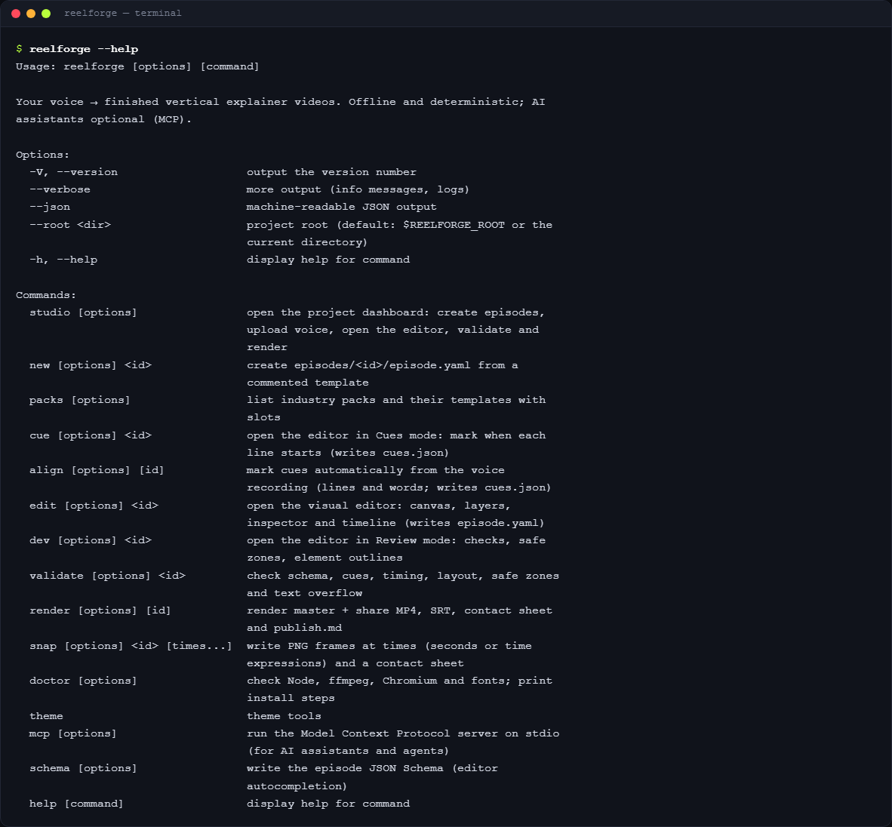
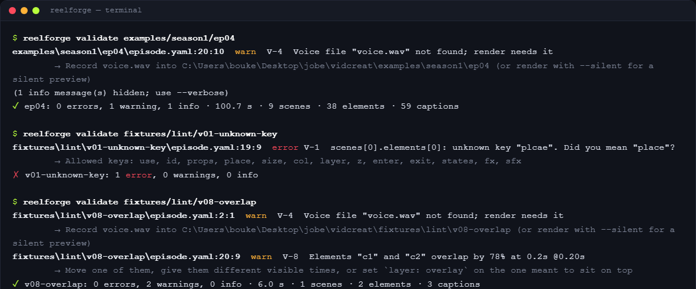

# Command line

On Windows use `reelforge.cmd`; on macOS/Linux `./reelforge` (or add the folder to your PATH). From a source
checkout, `pnpm reelforge` works everywhere. Every command and option is listed in the
[CLI reference](../reference/cli.md), generated from the command definition itself.

## Main commands

| Command                                                                        | Description                                                                                    |
| ------------------------------------------------------------------------------ | ---------------------------------------------------------------------------------------------- |
| `reelforge studio [--port <n>] [--host <address>] [--no-open]`                 | Open the project dashboard (default `http://127.0.0.1:4310`)                                   |
| `reelforge new <id> [--series <name>] [--episode <n>] [--lang en\|ar]`         | Create `episodes/<id>/episode.yaml` from the blank starter                                     |
| `reelforge new <id> --pack <pack> [--template <t>] [--lang ar] [--slot k=v …]` | Create it from an industry template, with draft cues (see [Templates](templates-and-packs.md)) |
| `reelforge packs [--lang en\|ar]`                                              | List the industry packs, their templates and slots (`--json` for the full slot definitions)    |
| `reelforge edit <id>`                                                          | Open the visual editor                                                                         |
| `reelforge cue <id> [--draft]`                                                 | Open the editor in Cues mode (`--draft` writes estimated cues instead)                         |
| `reelforge align <id> [--engine dsp\|whisper] [--force] [--dry-run]`           | Cues for every line and word from the recording (see [Timing](timing.md))                      |
| `reelforge align --setup [--model tiny\|base\|small]` / `--status`             | Install / show the optional speech models (one time, ~180 MB)                                  |
| `reelforge dev <id>`                                                           | Open the editor in Review mode                                                                 |
| `reelforge mcp [--toolsets basic,design,render]`                               | Run the MCP server for AI assistants (see [AI integration](ai.md))                             |
| `reelforge validate <id> [--strict] [--no-measure]`                            | Check everything; exit code 1 on errors (or warnings with `--strict`)                          |
| `reelforge render <id> [options]` / `--all`                                    | Render (see [Rendering and publishing](rendering.md))                                          |
| `reelforge snap <id> <times…> [--every 5] [--cover]`                           | PNG frames + contact sheet; times may be `12.5`, `l7`, `"l7:'word'"`                           |
| `reelforge doctor [--fix]`                                                     | Check the environment; `--fix` downloads Chromium                                              |
| `reelforge theme new <name> --accent <#hex> [--mode light\|dark] [--font <f>]` | Generate a full theme (contrast-checked) from an accent color                                  |
| `reelforge schema [--out <file>]`                                              | Write the JSON Schema for editor autocompletion                                                |

Global options: `--json` (machine-readable output, progress events while rendering), `--verbose`,
`--root <folder>` (project folder; default: the current folder).

`reelforge align` options: `--engine auto|dsp|whisper` (auto: Whisper when installed, else pause
detection), `--model tiny|base|small`, `--no-vad`, `--no-words` (line cues only), `--force` (replace cues
you marked by hand), `--dry-run` (print, don't write). `reelforge render --denoise` / `--no-denoise`
overrides `audio.denoise`.

## Environment variables

| Variable                                | Meaning                                                           |
| --------------------------------------- | ----------------------------------------------------------------- |
| `REELFORGE_ROOT`                        | Project folder                                                    |
| `REELFORGE_PRESET`                      | Default preset                                                    |
| `REELFORGE_WORKERS`                     | Render processes                                                  |
| `REELFORGE_SHARE_SIZE`                  | Share size in MB                                                  |
| `REELFORGE_JPEG_QUALITY`                | Frame capture quality (default 95)                                |
| `REELFORGE_PORT`                        | Dashboard / studio port                                           |
| `REELFORGE_HOST`                        | Dashboard bind address (default 127.0.0.1)                        |
| `REELFORGE_ALLOWED_HOSTS`               | Extra Host names the dashboard accepts (comma separated)          |
| `REELFORGE_REQUIRE_TOKEN`               | `1` requires the bearer token on `/mcp` and `/api/v1` everywhere  |
| `REELFORGE_NO_OPEN`                     | Do not open the browser automatically                             |
| `REELFORGE_FFMPEG`, `REELFORGE_FFPROBE` | Paths to ffmpeg / ffprobe                                         |
| `REELFORGE_CHROMIUM`                    | Path to a Chromium executable                                     |
| `REELFORGE_CACHE`                       | Folder for the optional speech models                             |
| `REELFORGE_CONFIG_DIR`                  | Config folder (`llm.json`, the server token)                      |
| `REELFORGE_LLM_*`                       | Language model for scene suggestions (see [models](ai.md#models)) |
| `NO_COLOR`                              | Disable colors                                                    |
