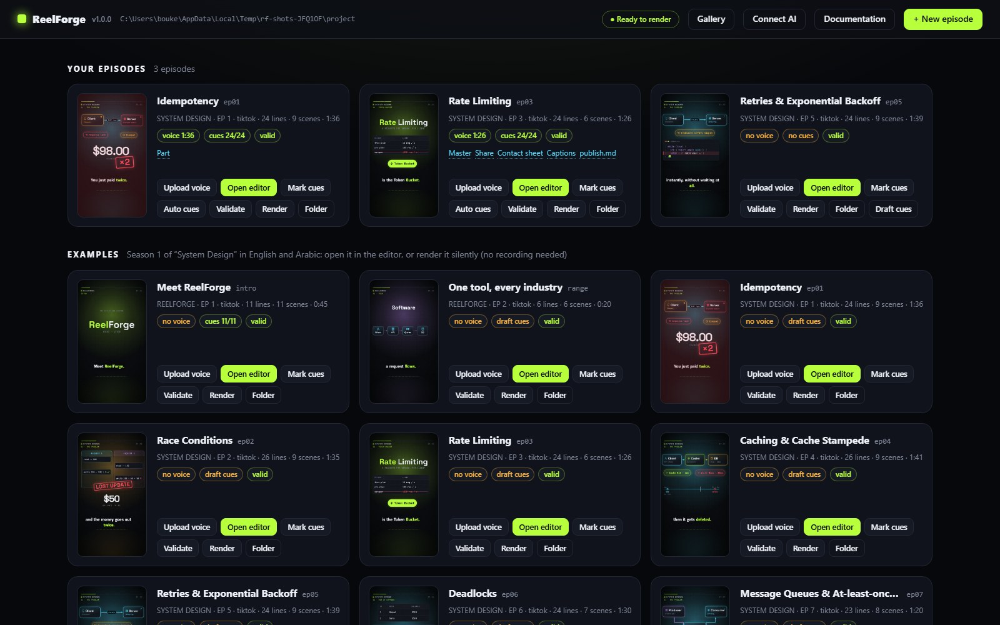
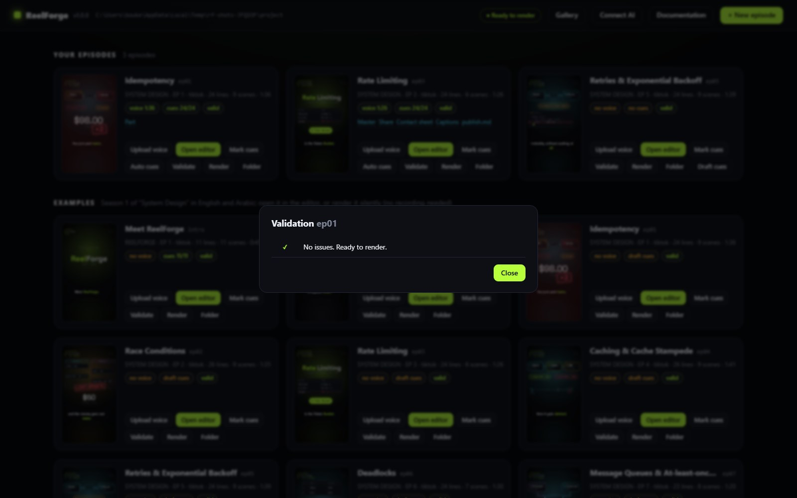
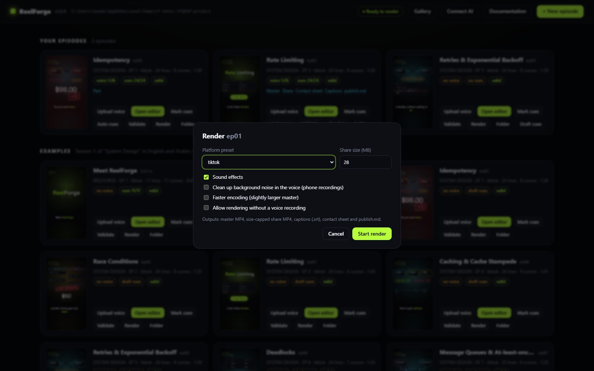
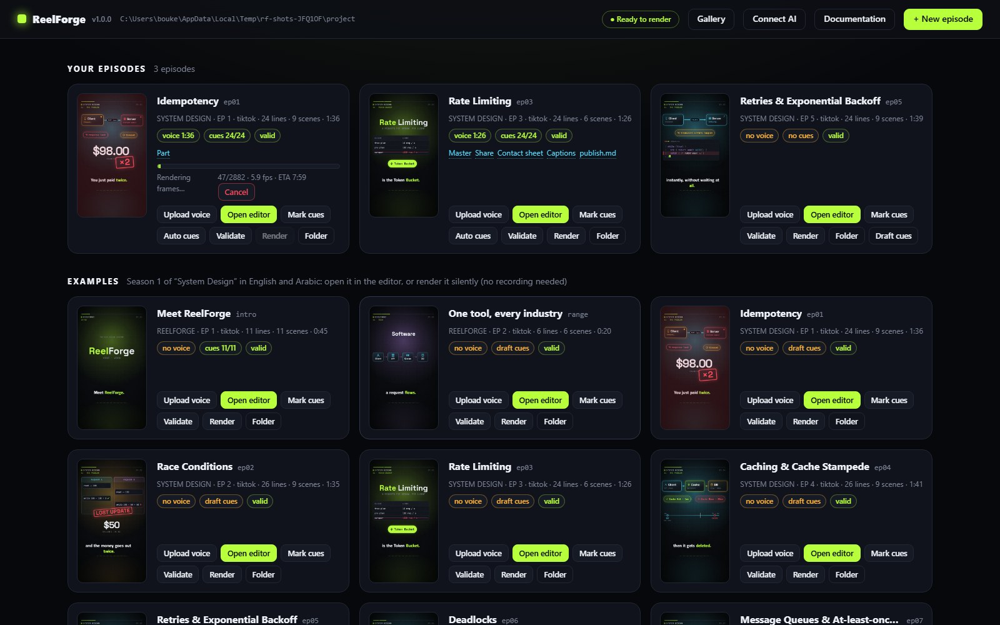
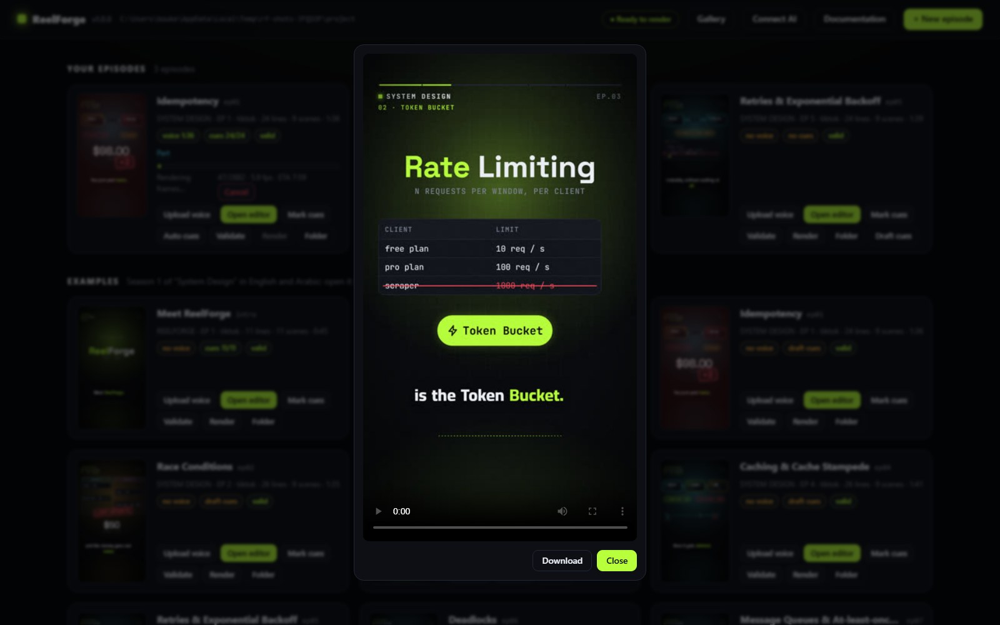

# The dashboard

`reelforge studio` (or `start.bat` / `start.sh`) opens the dashboard at `http://127.0.0.1:4310`. It lists
**your episodes** (the `episodes/` folder) and the **examples**.

Each card shows a live thumbnail, the series, preset, number of lines and scenes, the duration, and status
chips:

| Chip                                    | Meaning                                                 |
| --------------------------------------- | ------------------------------------------------------- |
| `voice 1:15` / `no voice`               | Whether a recording is present, and its length          |
| `cues 24/24` / `draft cues` / `no cues` | How many sentences are marked; draft cues are estimates |
| `valid` / `2 warnings` / `1 error`      | Result of the static checks (hover an error to read it) |

| Button           | What it does                                                                                                       |
| ---------------- | ------------------------------------------------------------------------------------------------------------------ |
| **Upload voice** | Choose a recording; it is converted to `voice.wav` (48 kHz)                                                        |
| **Open editor**  | Opens the visual editor for this episode in a new tab (see [The editor](editor.md))                                |
| **Mark cues**    | Opens the editor in Cues mode, ready to mark when each sentence starts                                             |
| **Auto cues**    | Aligns every line and word to the recording (see [Timing, cues and alignment](timing.md))                          |
| **Validate**     | Runs every check, including the headless text-overflow and caption checks                                          |
| **Render**       | Choose the platform preset, share size, SFX and speed; progress, FPS and ETA appear live; **Cancel** stops cleanly |
| **Folder**       | Opens the episode folder in your file manager                                                                      |
| **Draft cues**   | (only without cues) estimates timing from the text                                                                 |

To start from an industry template, click **+ New episode** and choose **Start from template**: pick a pack
and a template, fill in the fields and the language, and the episode opens in the editor (see
[Templates and packs](templates-and-packs.md)).

Finished outputs appear as links on the card: videos open in a player with a **Download** button.

The **Gallery** page (`/gallery`) shows what you can build with. **Components** lists all 62 components by
category with a search box and a preview frame from the component gallery; click one for its props and a YAML
snippet to copy. **Themes** previews every built-in and project theme from its colors and fonts, with its light
or dark mode and a WCAG contrast check. **Packs** lists the industry packs in English or Arabic; **Use this
template** opens the new-episode dialog with that template selected.

The **Connect AI** page (`/connect`) has copy-paste setup for AI clients; see [AI integration](ai.md).

The **Documentation** button opens this documentation at `/docs/`, served from your ReelForge folder, so it
works offline. It has the same pages as the online site, in English and Arabic (switch with the language
menu), with search.

Only one render runs at a time. The dashboard listens on `127.0.0.1` by default, so other computers cannot
reach it. `--host` binds it elsewhere and then requires a bearer token for the AI endpoints (see
[security](ai.md#security)).
