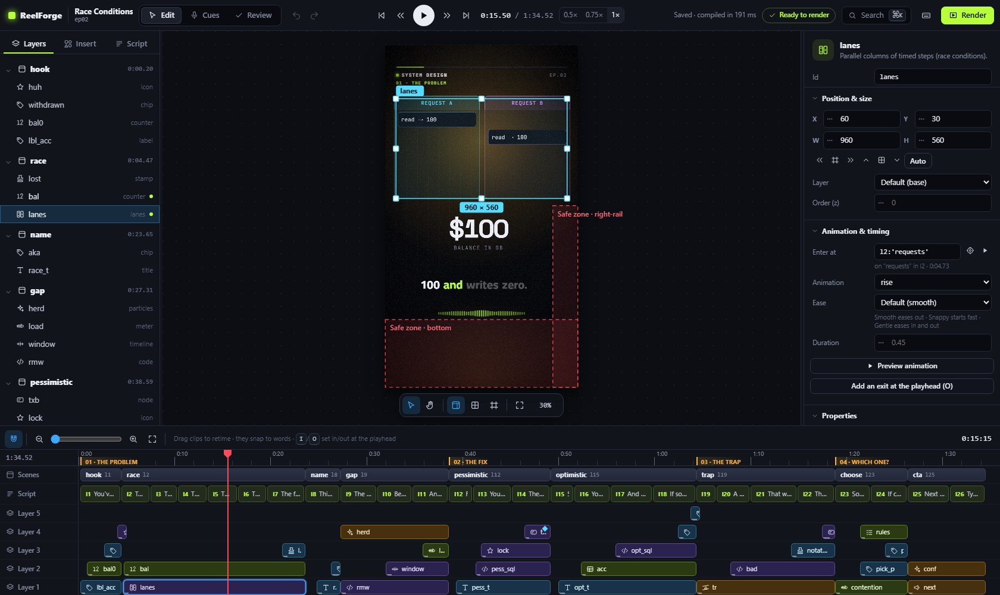
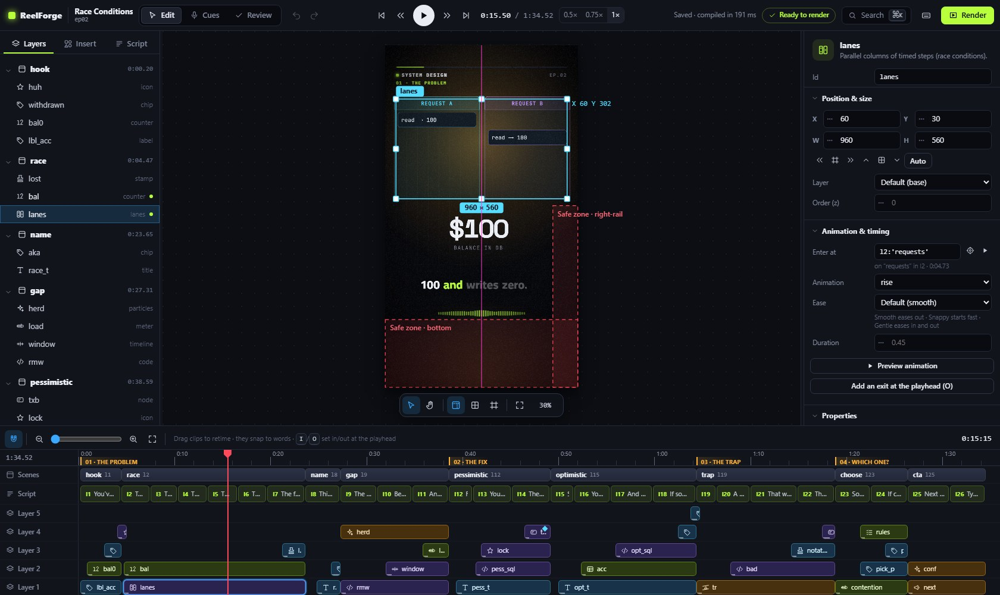
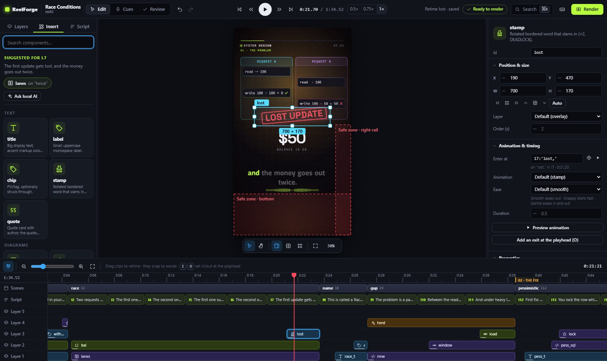
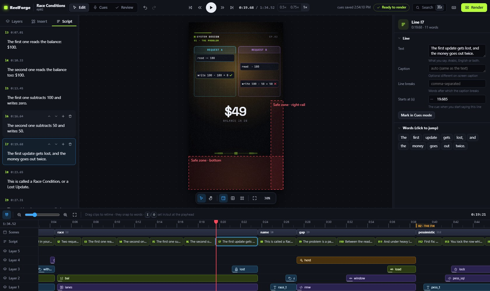
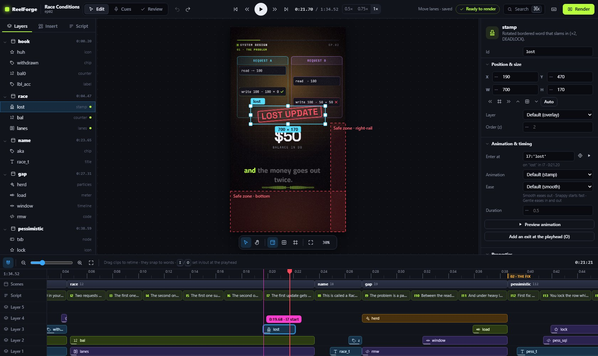
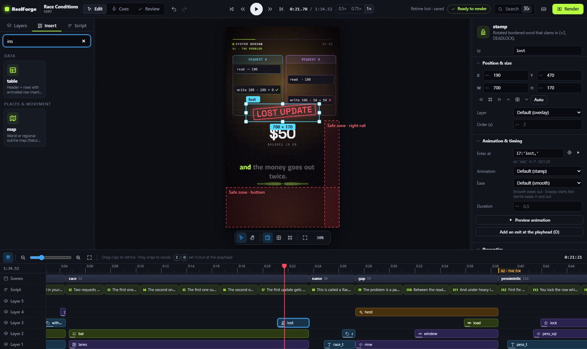
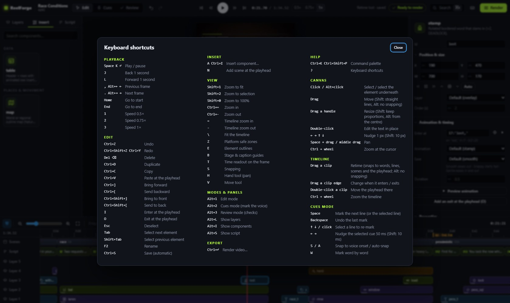
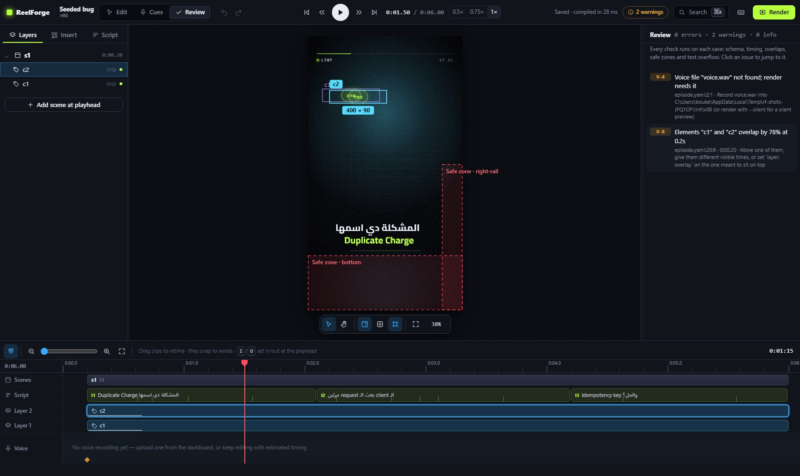
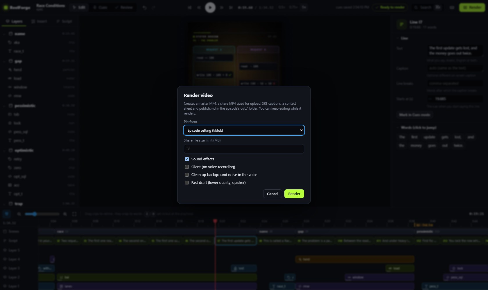

# The editor

The editor is where you design an episode. It works like a design tool on top of a video
timeline, but it is made for one job. You place animated components on the real
1080×1920 frame and time them to the words you speak.

Open it from the dashboard with **Open editor**, or run `reelforge edit <id>`. `reelforge cue <id>` opens
it in Cues mode and `reelforge dev <id>` in Review mode.

| Area            | What it holds                                                                                    |
| --------------- | ------------------------------------------------------------------------------------------------ |
| **Top bar**     | Modes (Edit · Cues · Review), undo/redo, transport and speed, status, checks, search, **Render** |
| **Left panel**  | **Layers** (scenes → elements), **Insert** (every component) and **Script** (your lines)         |
| **Canvas**      | The real frame, rendered by the same engine as the final video, synced to your voice             |
| **Right panel** | The **Inspector** for whatever is selected (or the episode settings when nothing is)             |
| **Timeline**    | Chapters, scenes, script lines, one track per layer, and your voice waveform with sound effects  |

Every change is written to `episode.yaml` immediately, and your comments and formatting are kept.
Every change can also be undone (**⌘Z** / **Ctrl+Z**), including cue changes. You can keep
`episode.yaml` open in a text editor at the same time. Edits made there appear in the editor as
soon as you save.

## Canvas

- **Click** an element to select it. **Alt+click** selects the one underneath. Hover shows an
  outline.
- **Drag** to move. Smart guides snap to the frame center, the scene area and other elements. Hold
  **Shift** to move in a straight line, or **Alt** to turn snapping off.
- **Drag a handle** to resize. Hold **Shift** to keep the proportions, or **Alt** to resize from the
  center.
- Use the **arrow keys** to nudge 1 px (**Shift**: 10 px).
- **Double-click** a title, label, chip, stamp, quote, node or ending card to **edit its text in
  place**. Press **Enter** to save or **Esc** to cancel.
- **Drag a component** from **Insert** onto the canvas to add it there.
- **Zoom** with **⌘/Ctrl + wheel**, **Shift+1** (fit), **Shift+2** (selection) or **Shift+0**
  (100%). **Pan** with the wheel, by holding **Space**, or with the **H** tool.
- The floating toolbar toggles the **safe zones** (**Z**, where TikTok/Reels/Shorts draw their
  buttons), **stage and caption guides** (**B**) and **element outlines** (**E**).

## Layers, Insert and Script

**Layers** lists every scene and its elements. The top of each list is drawn on top. Click to select
(the playhead jumps to a moment when the element is visible), **drag** to reorder, and
**double-click** to rename. Renaming also updates any arrows that point at the element. A green dot
marks what is on screen at the playhead.

**Insert** shows all 62 components in groups: Text, Diagrams, Data, Charts, Process & structure, Places &
movement, Time, People & messaging, Media & text, Health & data, Code & devices, Effects & endings.
**Click** one to add it to the current scene at the playhead, or drag it onto the canvas. New
elements start with sensible content that you can change at once.

**Script** is your text, one spoken sentence per line. Edit a line in place. Use the line's buttons
to add, delete or reorder lines. Arabic, English and mixed lines are all supported, and the
direction is detected automatically.

## Inspector

The inspector edits **every property** of the selection:

- **Position & size** (X, Y, W, H), alignment buttons, layer and stacking order.
- **Animation & timing**: when it enters, the animation, its ease and duration, and an optional
  exit. **Preview animation** plays just that moment once; choosing a new animation or ease
  previews it automatically. The
  **target** button sets a time from the playhead. It writes a word-anchored time such as
  `l3:'bucket'` whenever the playhead is on a word, so the element stays on that word even after
  you re-record.
- **Properties**: every option of the component, generated from its schema. That covers text
  fields, numbers (drag the dotted handle to scrub), on/off switches, menus, colors
  (theme swatches or any color), times, and lists you can add to, reorder and remove from.
- **Effects** (shake, flash, glitch, pulse, bump) and **States** (prop changes at a time, e.g. a
  node turning red).
- **Sound**: automatic sound effects on or off.
- **YAML (advanced)**: the exact YAML of the element. Anything the format supports can be edited
  here.

With a **scene** selected, the inspector edits its start and end, transition, camera move (with **Preview transition**), area (stage or full
frame), background glow and auto-layout. With a **script line** selected, it edits the text,
caption, line breaks and cue, and lists every word (click one to jump to it). With **nothing**
selected, it edits the episode: title, series, platform, theme, language, publishing texts, audio
and chapters.

## Timeline

- **Click or drag the ruler** to move the playhead. Chapters are shown on the ruler.
- **Scenes**: drag a scene's start to move it.
- **Script**: each line is a clip. Drag it to change its cue. Its word marks move with it.
- **Layer tracks**: each element is a clip from when it enters to when it leaves.
  - Drag the **body** to retime it.
  - Drag the **left edge** to change when it enters.
  - Drag the **right edge** to set when it leaves. Dragging it to the end of the scene removes the
    exit.
  - Diamonds mark effects (orange) and state changes (blue).
- Clips snap to **words**, line starts, scenes and the playhead. The badge shows the time
  expression that will be saved. Hold **Alt** to drag freely, or press **S** to turn snapping off.
- **I** and **O** set the selected element's in and out points at the playhead.
- **Zoom** with **= / −**, the slider or **⌘/Ctrl + wheel**. **\\** fits the whole episode.

## Search everything: ⌘K / Ctrl+K

The command palette finds every command, component, scene, element and script line. Type a few
letters and press **Enter**. Try `insert counter`, `go to scene trap` or `safe zones`.

Right-click the canvas, a layer or a clip for the most common actions. Press **?** to see every
shortcut.

## Review mode

**Review** (**Alt+3**, or click the checks pill in the top bar) lists every issue found by the
checks: schema, timing, overlaps, safe zones, text overflow measured in the real browser, and
caption length. Each issue has a fix hint. Click an issue to jump to its time and select the
element.

If `episode.yaml` has a syntax error (for example after editing it by hand), a banner shows the line
and the message. The editor keeps showing the last version that worked.

## Rendering from the editor

Click **Render** (**⌘/Ctrl+Enter**) and choose the platform, the share-file size, sound effects,
silent mode (when there is no recording yet) and a fast draft. You can keep editing while it
renders, and the progress shows in the top bar. When it finishes, the videos open in a player with
download links.

## Shortcuts at a glance

| Keys                                     | Action                                 |
| ---------------------------------------- | -------------------------------------- |
| **Space** / **K**                        | Play / pause                           |
| **J** / **L**, **,** / **.**             | −1 s / +1 s, previous / next frame     |
| **Home** / **End**                       | Start / end                            |
| **1 2 3**                                | Speed 0.5× 0.75× 1×                    |
| **⌘/Ctrl+Z**, **⌘/Ctrl+Shift+Z**         | Undo, redo                             |
| **⌘/Ctrl+D**, **⌘/Ctrl+C**, **⌘/Ctrl+V** | Duplicate, copy, paste at the playhead |
| **Delete**                               | Delete the selection                   |
| **⌘/Ctrl+]**, **⌘/Ctrl+[**               | Bring forward, send backward           |
| **I** / **O**                            | Enter / exit at the playhead           |
| **A**                                    | Insert a component                     |
| **N**                                    | Add a scene at the playhead            |
| **Tab** / **Shift+Tab**                  | Next / previous element                |
| **Z**, **B**, **E**                      | Safe zones, stage guides, outlines     |
| **S**                                    | Snapping                               |
| **Alt+1 / 2 / 3**                        | Edit / Cues / Review                   |
| **⌘/Ctrl+K**                             | Command palette                        |
| **?**                                    | All shortcuts                          |
