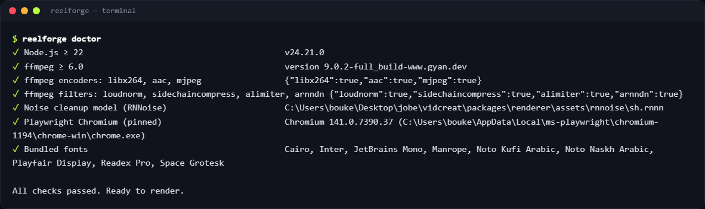

# Installation

Clone the repository (`git clone https://github.com/TerminalDZ/vidcreat.git`) or unpack a release
archive anywhere you like (for example `Documents/ReelForge`). Avoid folders synced by OneDrive
or iCloud for faster renders.

## Windows 10 / 11

1. Install **Node.js 22 LTS** from <https://nodejs.org> (keep the default options). If it is missing, the
   installer can install it for you with `winget`.
2. Double-click **`install.bat`**. It will:
   - check Node.js,
   - offer to install **ffmpeg** with `winget` (answer **Y**),
   - install ReelForge's dependencies,
   - download the pinned Chromium browser used for rendering,
   - run a full environment check.
3. Double-click **`start.bat`** to open the dashboard.

> If Windows SmartScreen warns about the script, choose **More info → Run anyway**. If ffmpeg was just
> installed, close and reopen `start.bat` so Windows picks up the new PATH.

## macOS

1. Install **Node.js 22 LTS** from <https://nodejs.org> and **Homebrew** from <https://brew.sh>.
2. Open **Terminal** in the ReelForge folder (Finder → right-click the folder → _New Terminal at Folder_) and run:

   ```bash
   ./install.sh
   ```

   Answer **Y** when it offers `brew install ffmpeg`.

3. Double-click **`ReelForge.command`** (or run `./start.sh`) to open the dashboard.

## Linux

```bash
./install.sh          # add --yes to accept every prompt
./start.sh            # opens the dashboard
```

The installer uses your package manager (`apt`, `dnf`, `pacman` or `zypper`) for ffmpeg and can install
Chromium's system libraries (it asks for `sudo`).

## From source (developers)

```bash
git clone https://github.com/TerminalDZ/vidcreat.git && cd vidcreat
corepack enable && pnpm install && pnpm build && pnpm reelforge doctor --fix
```

The [contributing guide](contributing.md) covers the full development setup on each system.

## Check your setup at any time

```bash
reelforge doctor          # Windows: reelforge.cmd doctor
```

It checks Node.js, ffmpeg (version, encoders and filters), Chromium and the bundled fonts, and prints the
exact fix for anything missing. The dashboard shows the same check as the status pill in the top bar.



## Optional speech models

Automatic cue alignment works without any download (pause detection over the known script). For word-level
accuracy with music in the background, install the optional speech models once (about 180 MB):

```bash
reelforge align --setup     # downloads Whisper and Silero VAD into your user cache
reelforge align --status    # shows what is installed
```

## Troubleshooting

| Symptom                                        | Fix                                                                                                                                        |
| ---------------------------------------------- | ------------------------------------------------------------------------------------------------------------------------------------------ |
| The dashboard says “setup issues”              | Click the pill: each failed check shows its fix. Most often ffmpeg is missing.                                                             |
| `ffmpeg not found`                             | Windows: `winget install Gyan.FFmpeg`; macOS: `brew install ffmpeg`; Linux: your package manager. Then open a new terminal or `start.bat`. |
| “Cannot launch Chromium”                       | Run `reelforge doctor --fix`. On Linux, run the installer again and accept the system libraries prompt.                                    |
| ffmpeg installed but still not found (Windows) | Close every terminal and `start.bat`, then reopen: Windows only picks up the new PATH in new windows.                                      |
| `pnpm` is not recognized                       | Run `corepack enable` once (Node.js 22 ships Corepack), then open a new terminal.                                                          |
| Renders are slow or fail with disk errors      | Move the folder out of OneDrive or iCloud and keep about 2 GB free for temporary files.                                                    |

More answers are in [FAQ and troubleshooting](faq.md).

## Updating

If you cloned the repository, run `git pull`, then run the installer again (or `pnpm install && pnpm build`).

If you downloaded a release archive, download the new version from the
[releases page](https://github.com/TerminalDZ/vidcreat/releases), unpack it next to the old one, copy your
`episodes/` folder (and any custom `themes/` or `presets/`) into the new folder, then run the installer
again. Your episodes are plain files: nothing else needs migrating.

## Uninstalling

Delete the ReelForge folder. The Chromium download lives in your user cache folder
(`%LOCALAPPDATA%\ms-playwright` on Windows, `~/Library/Caches/ms-playwright` on macOS,
`~/.cache/ms-playwright` on Linux) and can be deleted too. The optional speech models from
`reelforge align --setup` live in `reelforge` inside the same cache folder (`%LOCALAPPDATA%\reelforge`,
`~/Library/Caches/reelforge`, `~/.cache/reelforge`).
