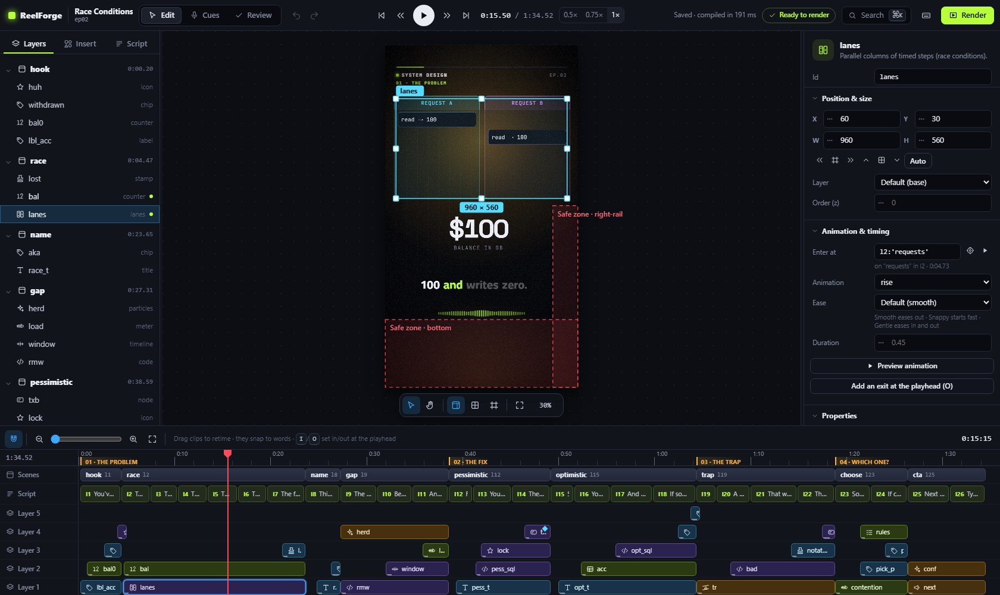

# Introduction and concepts

**ReelForge** turns a voice recording and one YAML file into a finished vertical explainer video:
1080×1920 at 30 fps, ready for **TikTok**, **Instagram Reels** and **YouTube Shorts**.

You write what you say, sentence by sentence, and describe what appears on screen and **on which word**.
ReelForge animates diagrams, code, tables, charts and titles exactly when you say them, adds word-by-word
captions, sound effects and series branding, masters the audio and encodes platform-ready files.

## Highlights

- **A real editor, made simple.** Place components on the frame like in a design tool, retime them on a
  timeline like in a video editor, edit every property in the inspector, with undo, smart guides,
  a command palette and keyboard shortcuts for everything.
- **Timed to your words.** Elements appear on the word that names them. Re-record a sentence and everything
  after it stays in sync, because animations follow your words, not seconds.
- **English and Arabic.** Word-by-word captions in English, and in Arabic with correct right-to-left layout
  when English terms are mixed in: `الـ client` stays together and `؟` lands on the correct side.
- **Templates for many sectors.** Industry packs (healthcare, real estate, logistics, education, finance and
  more) give you ready templates: fill in a few fields and the episode is designed for you.
- **Works with AI assistants (optional).** A built-in MCP server and a REST API let Claude, Cursor, Copilot,
  Codex, Gemini and other clients write scripts, build scenes and check frames for you.
- **Animated components** for explainers: nodes and arrows with moving packets, code that types itself,
  charts, steps and flows, tables, timelines, meters, counters, a phone mock, stamps…
- **Professional sound**: procedural sound effects on every hit and transition, voice mastered to −14 LUFS
  (the platforms' loudness target), effects ducked under the voice.
- **Platform-ready output**: an archival master MP4, a share MP4 that fits the upload limit you choose,
  SRT captions, a contact sheet and a `publish.md` with your caption, hashtags and pinned comment.
- **No AI in the render engine.** Frames are drawn by a deterministic engine and encoded by FFmpeg. It
  never generates voices or visuals: your voice, your words, your design, consistent every time.
- **Optional local helpers.** Speech alignment marks every line and word from your recording, and scene
  suggestions propose a component for a line. Both run on your computer, and you can always mark cues by
  ear and design scenes yourself instead.
- **Offline and private.** Everything runs on your computer. No account, no subscription, no upload.
  `reelforge align --setup` downloads the optional speech models once; after that, everything runs offline.
- **Deterministic.** The same inputs always produce the same frames.

## Concepts

| Term                | Meaning                                                                                                                                          |
| ------------------- | ------------------------------------------------------------------------------------------------------------------------------------------------ |
| **Episode**         | One video: a folder `episodes/<id>/` with `episode.yaml`, your `voice.wav`, `cues.json` and the outputs in `out/`.                               |
| **Script line**     | One spoken sentence. Lines get ids `l1`, `l2`, … in order. Captions are built from them.                                                         |
| **Cue**             | The moment a line starts in your recording. Cues come from automatic alignment, from marking by ear, or from an estimate before you record.      |
| **Scene**           | A group of elements on screen. A scene starts on a line (`at: l3`) and ends where the next scene starts.                                         |
| **Element**         | One component placed in a scene, with props, a box (`place`), and times to enter and exit.                                                       |
| **Component**       | A building block such as `title`, `node`, `arrow`, `code`, `bar-chart` or `steps`. Props are strict and listed in the components reference.      |
| **Time expression** | A time written relative to your words: `l3`, `l3.end`, `l3:'bucket'`, `@scene.end`, plus offsets such as `+0.4`. Words survive re-recording.     |
| **Theme**           | Colors, fonts, sizes and motion tokens in `themes/<name>.theme.yaml`.                                                                            |
| **Preset**          | The platform layout (`tiktok`, `reels`, `shorts`): header, stage and caption positions and the platform's safe zones.                            |
| **Pack, template**  | An industry pack bundles a theme and templates. A template is an episode with named fields (slots) that you fill in.                             |
| **Timeline**        | The compiled episode with every time resolved. It is the only contract between the compiler and the renderer, which keeps the output repeatable. |

## How a video is made

1. **Start** from a template (`reelforge new <id> --pack <pack> --template <template>`), from a blank
   episode (`reelforge new <id>`) or from the dashboard.
2. **Write the script**: one short spoken sentence per line, about 2.3 words per second.
3. **Design scenes** in the editor or in YAML, with each element entering on the word that names it.
4. **Record** your voice. `reelforge align` marks every line and word; you check by ear in Cues mode.
5. **Review**: every check (overlap, safe zones, text overflow, pacing) has a fix hint.
6. **Render** and upload the share file with the texts from `publish.md`.

The [quick start](quick-start.md) walks through these steps in about ten minutes.

## What is in the repository

| Folder / file                                 | Contents                                                     |
| --------------------------------------------- | ------------------------------------------------------------ |
| `install.bat` (`install.ps1`), `install.sh`   | One-command installers for Windows, macOS and Linux          |
| `start.bat`, `start.sh`, `ReelForge.command`  | Open the dashboard                                           |
| `reelforge.cmd`, `reelforge`                  | The command-line interface                                   |
| `examples/season1/`                           | Nine complete example episodes in English (“System Design”)  |
| `examples/season1-arabic/`                    | The same series in Arabic with English technical terms       |
| `examples/promo/intro/`                       | A 45-second ReelForge intro video, a showcase of animations  |
| `packs/`                                      | Industry packs: manifests, templates and example episodes    |
| `skills/`                                     | Task guides for AI assistants (Agent Skills format)          |
| `AGENTS.md`, `CLAUDE.md`, `GEMINI.md`, …      | Instructions for AI assistants (see [AI integration](ai.md)) |
| `themes/`, `presets/`                         | Editable visual themes and platform layouts                  |
| `docs/`, `documentation/`                     | This documentation (site source, and an offline copy)        |
| `packages/`                                   | Full TypeScript source code                                  |
| `LICENSE`, `NOTICE`, `THIRD-PARTY-NOTICES.md` | Apache-2.0 license, notices and third-party credits          |

## Requirements

|                  | Minimum                                                  | Recommended                                             |
| ---------------- | -------------------------------------------------------- | ------------------------------------------------------- |
| Operating system | Windows 10, macOS 13, Ubuntu 22.04 (or any recent Linux) | Windows 11, macOS 14+, Ubuntu 24.04                     |
| CPU / RAM        | 4 cores, 8 GB                                            | 8 threads or more, 16 GB (renders scale with cores)     |
| Disk             | 2 GB free (plus ~2 GB temporary space per render)        | SSD                                                     |
| Software         | **Node.js 22 LTS**, **ffmpeg 6+**                        | installed automatically by the installer where possible |

A 2-minute episode renders in roughly 5–10 minutes on an 8-thread laptop.
