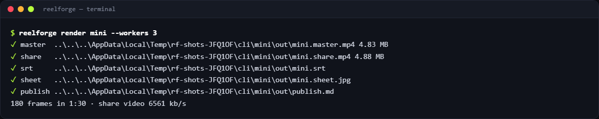

# Rendering and publishing

Render from the dashboard (**Render** on a card), the editor (**⌘/Ctrl+Enter**) or the command line. Every
option is listed in the [CLI reference](../reference/cli.md#reelforge-render).

```bash
reelforge render ep10
reelforge render ep10 --preset reels --share-size 50
reelforge render ep10 --from 12 --to 20      # quick partial check → out/ep10.part.mp4
reelforge render --all                       # every episode in episodes/
```



## Outputs (`episodes/<id>/out/`)

| File              | Use                                                                             |
| ----------------- | ------------------------------------------------------------------------------- |
| `<id>.master.mp4` | Archival quality: H.264 High, CRF 18, AAC 192 kb/s                              |
| `<id>.share.mp4`  | **Upload this one.** Two-pass encoded to fit the share size (default 28 MB)     |
| `<id>.srt`        | Captions for YouTube or accessibility                                           |
| `<id>.sheet.jpg`  | 12-frame contact sheet for a quick review                                       |
| `publish.md`      | Your cover text, caption, hashtags, pinned comment and chapters, ready to paste |
| `<id>.cover.png`  | Cover image (`reelforge snap <id> <time> --cover`)                              |

Every video is verified after encoding: H.264 High profile, yuv420p, 30 fps constant frame rate, AAC
48 kHz, “fast start” (plays while downloading) and the size limit.

## Options

| Option                           | Meaning                                                   |
| -------------------------------- | --------------------------------------------------------- |
| `--preset tiktok\|reels\|shorts` | Platform layout and safe zones                            |
| `--share-size <MB>`              | Size cap of the share file                                |
| `--workers <n>`                  | Parallel render processes (default: CPU cores − 1)        |
| `--fast`                         | Faster final encoding (slightly larger master)            |
| `--no-sfx`                       | Without sound effects                                     |
| `--silent`                       | Allow rendering without a recording (for previews)        |
| `--no-share`                     | Master only                                               |
| `--lossless`                     | PNG frame capture instead of JPEG (slower, for archiving) |

## Performance

Rendering uses all your cores. Approximate times for a 2-minute episode: 4 cores ≈ 10 min, 8 threads ≈
5–6 min. Press **Ctrl+C** (or **Cancel** in the dashboard) at any time: partial files are removed.

## Before you render

- `reelforge validate <id>` shows **0 errors**, and warnings are fixed or understood (`--strict` fails on
  warnings too, useful in CI).
- Preview a few frames shortly after things enter: `reelforge snap <id> "l3:'bucket'+0.8"`.
- `meta.publish` (cover, caption, hashtags, pinned comment) is filled in; it becomes `publish.md`.
- Phone recording? Set `audio: { denoise: true }` or pass `--denoise`.

## Publishing

`publish.md` collects everything you paste when uploading: the cover text, caption, hashtags, pinned
comment and chapter timestamps. Make a cover image with `reelforge snap <id> <time> --cover`.

- **TikTok**: upload `share.mp4`; paste the caption and hashtags from `publish.md`.
- **Instagram Reels**: render with `--preset reels` for its safe zones.
- **YouTube Shorts**: render with `--preset shorts` (max 3 minutes); upload `<id>.srt` as subtitles.

## Rendering on a server or in CI

Everything works headless on Linux. `--json` prints machine-readable progress events, exit codes are
stable (`0` success, `1` failure, `2` usage error), and rendering needs no network once Chromium and
FFmpeg are installed. Render a whole folder with `reelforge render --all`.
