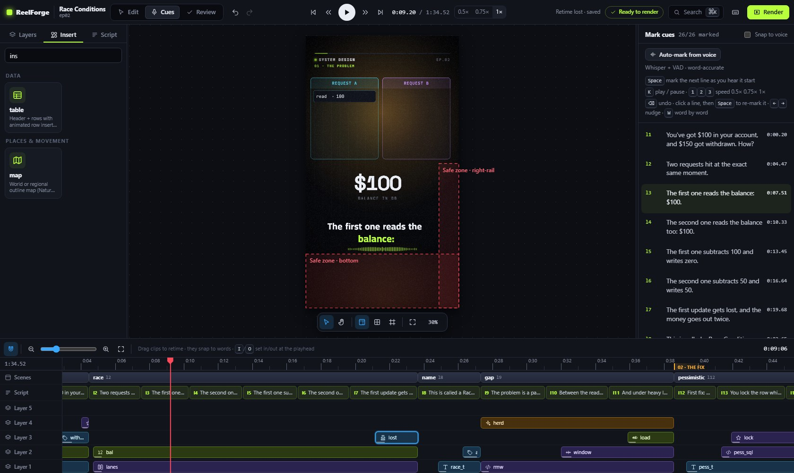
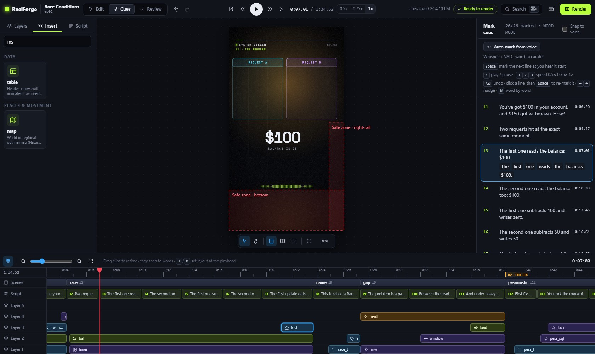

# Timing, cues and auto alignment

Everything in an episode is timed relative to your words. A **cue** is the moment a script line starts in
your recording; word times follow from it. Scenes start on lines and elements enter on words:

```yaml
scenes:
  - at: l3 # the scene starts with line 3
    elements:
      - use: bucket
        enter: { at: "l3:'bucket'" } # the element enters on the word "bucket"
```

Re-record a sentence, move its cue, and every animation follows.

## Time expressions

| Form                              | Meaning                                                                     |
| --------------------------------- | --------------------------------------------------------------------------- |
| `12.5s` (or a YAML number `12.5`) | absolute seconds                                                            |
| `l7`                              | cue start of line `l7`                                                      |
| `l7.end`                          | start of the next line − 0.15 s                                             |
| `l7:'timeout'`                    | first word matching "timeout" (punctuation, tatweel and diacritics ignored) |
| `l7:'request'#2`                  | second match                                                                |
| `l7.3`                            | the 4th word (0-based)                                                      |
| `@hook`, `@hook.end`              | a scene's start / end                                                       |
| any of the above `+0.4` / `-0.2`  | offset in seconds                                                           |

Quote YAML strings that contain `:` or `'`, for example `at: "l3:'bucket'"`. Prefer word expressions to
absolute seconds: words survive re-recording. The full list is in [Writing episodes](../authoring.md).

## Before you record: draft cues

A new episode gets **draft cues**, estimated from the length of each line (about 13 characters per second
plus a short gap). The preview plays with realistic timing, and validation already checks pacing. Write them
with `reelforge cue <id> --draft`, the **Draft cues** button, or the `draft_cues` tool.

## Recording tips

- Record in a quiet room, 20–30 cm from the microphone. Any sample rate works; ReelForge masters the
  loudness for you (−14 LUFS).
- Read one script line per breath and leave a short pause (0.3–0.5 s) between lines. Pauses make marking
  faster and give animations room.
- Re-recording later? Upload the new take: ReelForge warns that the voice changed so you can re-check the
  cues.
- Recorded on a phone or in a noisy room? Turn on **Clean up noise** (episode settings, or
  `audio: { denoise: true }`, or `reelforge render --denoise`). RNNoise removes hiss, hum and room noise
  from the voice before mastering; in tests it lowers the noise between sentences by about 15 dB without
  changing the voice level.

## Automatic cues

Click **Auto-mark from voice** in Cues mode, **Auto cues** on the dashboard, or run
`reelforge align <id>`. ReelForge already knows the script, so it only has to find where each line and
each word starts in the recording. Then listen through once and fix any line by ear (amber lines are the
ones it was least sure about). The result is one undo step (**⌘/Ctrl+Z**).

Two engines:

| Engine                 | Needs                                    | Speed (1 min of voice) | How it works                                                                                                                                                           |
| ---------------------- | ---------------------------------------- | ---------------------- | ---------------------------------------------------------------------------------------------------------------------------------------------------------------------- |
| **Pauses** (default)   | nothing                                  | ~0.05 s                | Finds the pauses, then splits the recording into the script's lines so each line's length matches its text (dynamic programming). Words follow the syllables.          |
| **Whisper** (optional) | `reelforge align --setup` once (~180 MB) | ~20 s on a laptop CPU  | A speech model hears the words; only its **timings** are used, matched to your script, so dialects and English terms in Arabic don't matter. Best for words and music. |

With the optional models installed, a 2 MB voice-activity model (Silero VAD) also tells speech from
music, breaths and room noise. Measured on recorded speech with known timings, every line lands within
100 ms (average 15 ms), with or without background music. Words land within 100 ms about 80% of the time,
so give precise hits (a stamp on one exact word) a listen in word mode.

`reelforge align --status` shows what is installed. Models live in your user cache
(`%LOCALAPPDATA%\reelforge`, `~/Library/Caches/reelforge` or `~/.cache/reelforge`; `$REELFORGE_CACHE`
moves it) and are never used while rendering. Cues you marked by hand are never replaced unless you
confirm (`--force` on the command line).

| Option           | Meaning                                                          |
| ---------------- | ---------------------------------------------------------------- |
| `--engine <e>`   | `auto` (Whisper when installed, else pauses), `dsp` or `whisper` |
| `--model <size>` | Whisper model: `tiny`, `base` (default) or `small`               |
| `--no-vad`       | Detect speech by energy only                                     |
| `--no-words`     | Line cues only                                                   |
| `--force`        | Replace cues you marked by hand                                  |
| `--dry-run`      | Print the result without writing `cues.json`                     |

## Cues mode

Open the editor and switch to **Cues** (**Alt+2**), or click **Mark cues** on the dashboard. The script
is listed on the right, the playhead and waveform are on the timeline.



| Key                           | Action                                                              |
| ----------------------------- | ------------------------------------------------------------------- |
| **Enter** / **K**             | Play / pause                                                        |
| **1 / 2 / 3**                 | Speed 0.5× / 0.75× / 1× (slower = more accurate)                    |
| **Space**                     | Mark the next unmarked line at the playhead                         |
| **Click a line** or **↑ / ↓** | Select a line to re-mark it (then press Space)                      |
| **← / →**                     | Nudge the selected cue by 50 ms (**Shift**: 10 ms)                  |
| **Backspace**                 | Undo the last change                                                |
| **S** / **A**                 | Snap the selected cue to the nearest voice onset / toggle auto-snap |
| **G**                         | Jump to the selected cue                                            |
| **W**                         | Word mode: mark each word of the selected line with Space           |
| **J / L**, **, / .**          | Back / forward 1 s, previous / next frame                           |

Every change is saved instantly to `cues.json` and can be undone with **⌘/Ctrl+Z**. Lines out of order
are shown in red. You can also drag a line's clip on the **Script** track of the timeline, in Edit or
Cues mode.

## Word mode

By default ReelForge estimates when each word starts from its length. For precise hits (a stamp landing
exactly on “twice”), select the line, press **W**, play, and press **Space** on each word.



## Pacing checks

Validation rule **V-14** warns when a line is spoken faster than about 3.5 words per second (too fast to
read in captions) and when the hook starts after 3 s; it also reports silences of 1.5 s or more. Split long
lines, or slow down when you record.
